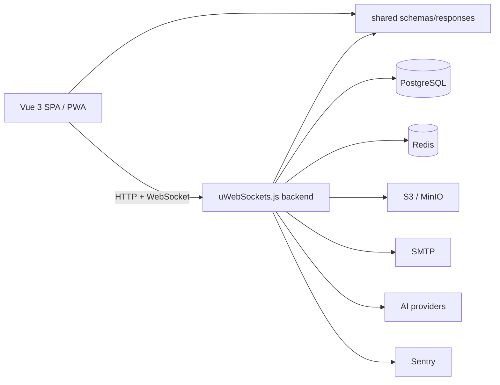

# vibe-template

[](https://github.com/Blazheiko/vibe-template/actions/workflows/docs.yml)

📖 **Documentation:** <https://blazheiko.github.io/vibe-template/> (Ukrainian, English at <https://blazheiko.github.io/vibe-template/en/>; backend-focused;
source in [`documentation/`](documentation/), run locally with `pnpm docs:dev`).

A full-stack TypeScript monorepo template: a Vue 3 frontend, a high-performance
uWebSockets.js backend, and a shared package for contracts (schemas, enums,
guards, responses) reused on both sides of the wire.

The repository is organized as a [pnpm](https://pnpm.io/) workspace with
type-safe end-to-end contracts shared between the frontend and backend.

## What it's good for

This template is built for **quickly bootstrapping production-ready SPA
applications**. Instead of wiring up the same foundation on every new project,
you start from a working full-stack app that already ships the features most
products need on day one:

- **Authentication out of the box** — sign in via email, phone number (SMS), and
  social providers, with sessions, CSRF protection, and throttling already in
  place.
- **Real-time by default** — a configured WebSocket layer (uWebSockets.js) for
  live updates, presence, and bidirectional messaging.
- **Push notifications** — server-side delivery of web push notifications to
  connected clients.
- **Installable PWA** — the Vue 3 frontend is preconfigured as a Progressive Web
  App, so users can install it and use it offline.
- **And more** — file storage (S3/MinIO), transactional/auth email, i18n,
  AI provider integrations, error monitoring, and an end-to-end type-safe
  contract layer shared between frontend and backend.

Because the plumbing is already done, you can focus on your product's actual
features from the first commit.

### Best suited for

- SaaS dashboards and account-based products
- Admin panels with real-time user activity
- PWA products with auth, push notifications, and offline support
- Apps that need shared frontend/backend contracts from day one
- Products with AI-assisted support or knowledge-base workflows
- **Backend-only / API services** — you can drop the `frontend` package entirely,
  turn off static serving (`SERVE_STATIC=false`) and session/CSRF handling, and
  run just the backend with `api-playground` for convenient manual API testing

### Probably overkill for

- Static landing pages
- Serverless-first edge applications
- Projects that do not need auth, a database, or real-time features

## Ready-made product flows

Beyond the technology list, the template ships working user-facing flows you can
build on (or strip out):

- Email registration, email verification, login, logout, logout-all, change /
  reset password (including a one-time-token reset flow)
- Optional phone-based auth (register / confirm / complete profile) plus phone
  and email linking to an existing account
- OAuth redirect/callback foundation (`auth/oauth/:provider/redirect` and
  `/callback`)
- User account page with profile and avatar upload/management
- Push notification subscription management plus a "send test push" endpoint
- Admin area for users, online users, online history, and the knowledge base
- AI-backed support chat with chat history and knowledge-base articles
- API playground for manual HTTP/WebSocket testing

## What this template includes

| Area              | Included                                         |
| ----------------- | ------------------------------------------------ |
| **API**           | uWebSockets.js, route validation, WebSocket      |
| **DB**            | PostgreSQL, Drizzle migrations (+ seed hook)     |
| **Auth/security** | cookies, CSRF, CORS, throttling, CSP             |
| **Frontend**      | Vue 3, Pinia, i18n, PWA, Playwright              |
| **Observability** | Sentry, Pino                                     |
| **Integrations**  | S3/MinIO, mail, push notifications, AI providers |

## Requirements

- **Node.js** `^24.22.2` (Node 24 LTS; see `.nvmrc`; the Docker image uses Node 24)
- **pnpm** `>=9` (pinned to `9.15.0` via `packageManager`)

### Local services

| Service                                   | Required?                  | Used for                                   |
| ----------------------------------------- | -------------------------- | ------------------------------------------ |
| **PostgreSQL** + **pgvector**             | Required                   | Primary database (Drizzle ORM)             |
| **Redis**                                 | Required for auth/realtime | Sessions, WebSocket coordination, presence |
| **S3 / MinIO**                            | Required for storage flows | File upload / object storage               |
| **SMTP**                                  | Optional                   | Transactional / auth email                 |
| **Sentry**                                | Optional                   | Error & performance monitoring             |
| **AI providers** (OpenAI / Mistral / xAI) | Optional                   | AI features                                |

To boot the database layer you need **PostgreSQL**; **Redis** is required as soon
as you exercise full auth/realtime behavior (sessions, WebSocket, presence). The
remaining services are optional and unlock the corresponding feature areas as you
enable them.

> **pgvector is required**, even if you never enable AI. The support knowledge
> base stores OpenAI embeddings in a `vector(1536)` column and finds relevant
> articles by cosine distance (`<=>`) in SQL, so the schema itself depends on the
> extension: `db:create` runs `CREATE EXTENSION IF NOT EXISTS vector`, and the
> initial migration fails with `type "vector" does not exist` without it. The
> stock `postgres` Docker image does not include it; use `pgvector/pgvector:pg16`
> (or install pgvector for your PostgreSQL). Details:
> [Database → pgvector](https://blazheiko.github.io/vibe-template/backend/database#pgvector).

All of these except Sentry and the AI providers run locally from
[`docker-compose.yml`](docker-compose.yml): PostgreSQL with pgvector, Redis,
SeaweedFS (S3) and Mailpit (SMTP). With `packages/backend/.env` in place:

```bash
make services-up     # start and wait until every service is healthy
make services-down   # stop, keep the data
```

PostgreSQL with pgvector already installed locally? Keep it and start the rest:
`make services-up ARGS="redis s3 mailpit"`. `make doctor` warns when a port the
stack needs is taken and names the process.

Credentials and ports are read from `packages/backend/.env`, so the containers and
the backend always agree.

The application itself can run in the same compose stack, from the production
image built locally (the backend serves the built SPA on `http://localhost:3000`):

```bash
make app-build   # scripts/docker-build.sh → vibe-template:local
make app-up      # services + one-shot migrate + app, waits until healthy
make app-seed    # optional: reference data and demo accounts (SEED_* in .env)
make app-down    # stop only the app, services keep running (back to make dev)
```

Details:
[Getting started](https://blazheiko.github.io/vibe-template/guide/getting-started).

### Feature prerequisites

Which optional service / env each feature needs:

| Feature                             | Requires                                      |
| ----------------------------------- | --------------------------------------------- |
| Email verification / password reset | `SMTP_*` settings (`SMTP_ENABLED=true`)       |
| Phone auth                          | `AUTH_PHONE_ENABLED=true` and an SMS provider |
| Push notifications                  | `VAPID_*` keys                                |
| Avatar uploads / KB screenshots     | S3 or MinIO (`S3_*`)                          |
| Support AI                          | OpenAI / xAI (and other configured providers) |
| Presence / sessions / throttling    | Redis                                         |
| Error monitoring                    | `SENTRY_DSN`                                  |

## Repository structure

```
.
├── packages/
│   ├── frontend/        # Vue 3 + Vite app (PWA, i18n, Pinia, Playwright e2e)
│   ├── backend/         # uWebSockets.js HTTP/WebSocket server (Drizzle, Redis, S3, mail, AI)
│   ├── shared/          # Shared schemas, enums, guards, responses, utils (workspace:*)
│   ├── api-playground/  # Vue dev tool for exercising the backend API/WebSocket
│   └── landing/         # Static landing page with Log in / Sign up buttons (prerendered Vue, nginx image)
├── documentation/       # VitePress docs site, published to GitHub Pages
├── Dockerfile           # Multi-stage build: shared → frontend → backend → production image
├── init.sh              # One-shot install + typecheck + lint + test + build
├── feature_list.json    # Source of truth for feature ownership/status (see AGENTS.md)
└── pnpm-workspace.yaml
```

The backend follows a layered architecture: `repository → transformer →
service → controller → route`, with shared schemas defining the request/response
contracts. See `AGENTS.md` for the full conventions.

## Architecture at a glance

The frontend and backend speak over HTTP + WebSocket and share a single
contract package, so request/response shapes are type-checked on both sides:



## Getting started

```bash
# 1. Check Node/pnpm/Docker, install dependencies, create packages/backend/.env
#    from .env.example (if missing) and build shared
make setup
# then edit packages/backend/.env (PGSQL_*, APP_KEY, S3_*, etc.)

# 2. Services, database, then backend + frontend dev servers in parallel
make services-up db-create db-migrate
make dev
```

`make` with no target lists every command. The Makefile is the single entry point,
but it is optional: each target only calls a pnpm script, so the app can be set up
and run with pnpm alone:

```bash
pnpm install
cp packages/backend/.env.example packages/backend/.env   # then edit it
pnpm build:shared
pnpm services:up
pnpm --filter backend db:create
pnpm --filter backend db:migrate
pnpm dev
```

The pnpm script behind each target is in [Common commands](#common-commands);
`make -n <target>` prints the command without running it.

**Windows:** the Makefile and several pnpm scripts need a Unix shell (`sh`, `awk`,
`rm -rf`, `./scripts/*.sh`), so they do not run in cmd or PowerShell. Use WSL2
(recommended; CI covers Linux only) or Git Bash with `make` installed
(`winget install GnuWin32.Make`). Details:
[Make commands → Windows](https://blazheiko.github.io/vibe-template/reference/make#windows).

### Minimal `.env` for local development

`packages/backend/.env.example` lists every available setting. To get the app
running locally you really only need a few of them:

```dotenv
APP_KEY=at-least-32-characters-local-secret
FRONTEND_URL=http://localhost:5173

# PostgreSQL
DB_CONNECTION=pg
PGSQL_HOST=127.0.0.1
PGSQL_PORT=5432
PGSQL_USER=postgres
PGSQL_PASSWORD=password
PGSQL_DB_NAME=vibe_template

# Redis
REDIS_HOST=127.0.0.1
REDIS_PORT=6379
REDIS_PASSWORD=
REDIS_PREFIX=uwebsocket:
```

Everything else (S3/MinIO, SMTP, Sentry, AI, CSRF/CORS hardening) is
opt-in — enable it when you start using the corresponding feature.

### Development workflow

A typical human-friendly loop:

```bash
make install
make build-shared   # shared contracts must be built before backend/frontend
make dev            # run backend, frontend and landing together

make check          # format, typecheck, lint, tests: the same as the CI quality job
make test PKG=backend
```

Code style is defined by the root `.prettierrc.json` (4 spaces, single quotes, no
semicolons, width 100); `make format-check` must pass. The one-off mass formatting
commit is listed in `.git-blame-ignore-revs`, so `git blame` skips it after:

```bash
git config blame.ignoreRevsFile .git-blame-ignore-revs
```

Before opening a PR, run the full verification chain with `./init.sh`
(a wrapper over `make init`: `install → build shared → check → build`) to confirm a
clean checkout:

```bash
./init.sh
```

### Local ports

| Service        | Default URL                   |
| -------------- | ----------------------------- |
| Backend        | http://localhost:3000         |
| Frontend       | http://localhost:5173         |
| API playground | http://localhost:5174         |
| Landing        | http://localhost:5175         |
| Drizzle Studio | launched via `make db-studio` |

## Common commands

Run from the repository root. [`Makefile`](Makefile) is the single entry point;
`make` (or `make help`) prints every target with a description. Each target only
calls the pnpm script in the last column, which you can also run directly.

| Command                                   | Description                                                                        | pnpm script                        |
| ----------------------------------------- | ---------------------------------------------------------------------------------- | ---------------------------------- |
| `make setup`                              | Check tools (`make doctor`), install deps, create `.env` if missing, build shared  | —                                  |
| `make doctor`                             | Check Node, pnpm, Docker, `packages/backend/.env` and busy ports                   | `scripts/doctor.sh`                |
| `make dev`                                | Build `shared` + `backend`, then run backend, frontend and landing dev servers     | `dev`                              |
| `make dev-backend` / `make dev-frontend`  | Run a single package in dev mode                                                   | `dev:backend` / `dev:frontend`     |
| `make check`                              | Build shared, verify the Makefile, format check, typecheck, lint, tests (CI)       | —                                  |
| `make typecheck`                          | TypeScript checks across all packages                                              | `typecheck`                        |
| `make lint` / `make lint-fix`             | Lint (and auto-fix) the whole repo with ESLint                                     | `lint` / `lint:fix`                |
| `make format` / `make format-check`       | Write / check Prettier formatting                                                  | `format` / `format:check`          |
| `make test [PKG=backend]`                 | Run all package test suites, or one package                                        | `test`                             |
| `make test-e2e`                           | Frontend Playwright e2e                                                            | `frontend test:e2e`                |
| `make test-e2e-landing`                   | Build the landing and run its Playwright smoke tests                               | `landing test:e2e`                 |
| `make services-up` / `services-down`      | Start / stop the Docker Compose services (`ARGS="redis s3 mailpit"`: a subset)     | `services:up` / `services:down`    |
| `make app-up` / `make app-down`           | Run the production image with the services / stop only the app                     | `app:up` / `app:down`              |
| `make db-create` / `make db-migrate`      | Create the database / apply migrations                                             | `backend db:create` / `db:migrate` |
| `make db-seed [ARGS=--demo]`              | Seed reference data (and demo accounts)                                            | `backend db:seed`                  |
| `make build` / `make build-shared`        | Build every package / only `shared`                                                | `build` / `build:shared`           |
| `make start`                              | Start the built backend (`node dist/index.js`)                                     | `start`                            |
| `make clean`                              | Clean build artifacts and `node_modules`                                           | `clean`                            |
| `make docs-dev` / `make docs-preview`     | Run the VitePress documentation site in dev mode / preview the built site          | `docs:dev` / `docs:preview`        |
| `make docs-build` / `make docs-verify`    | Build the documentation site / check the build (links, anchors, key pages)         | `docs:build` / `docs:verify`       |
| `make prod-local`                         | Production-like local run: the backend serves the built SPA, plus the landing      | `prod:local`                       |
| `make dev-landing` / `make build-landing` | Landing dev server (http://localhost:5175) / build it into `packages/landing/dist` | `dev:landing` / `build:landing`    |

The full list, including `test-pg`, `test-redis`, `coverage`, `db-generate`,
`db-studio` and the `app-*` targets, is in `make help` and in
[Make commands](https://blazheiko.github.io/vibe-template/reference/make).

Frontend e2e tests use Playwright:

```bash
pnpm --filter frontend test:e2e
```

### Landing page

`packages/landing` is the template's public page: a description of the project and
Log in / Sign up buttons that open the app's `/login` and `/register`. It is
prerendered at build time into static HTML for three languages (`/`, `/uk/`,
`/pl/`) with no JavaScript, and ships as its own nginx image. It runs with
`make dev` on http://localhost:5175, and with `make app-up` on
http://localhost:8080. The landing and the app need different origins. See
[Landing page](https://blazheiko.github.io/vibe-template/en/landing/).

### Manual API testing

The `api-playground` package is a Vue dev tool for exercising the backend's
HTTP and WebSocket endpoints by hand. Run it alongside the backend with:

```bash
pnpm dev:manual_test   # builds shared, then runs backend + API playground in parallel
```

The playground is then available at http://localhost:5174.

## Database (backend)

The backend uses [Drizzle ORM](https://orm.drizzle.team/) against PostgreSQL.
Useful package-level scripts (run from `packages/backend`):

```bash
pnpm db:create     # create the database
pnpm db:generate   # generate migrations from schema
pnpm db:migrate    # apply migrations
pnpm db:seed       # seed default LLM prompts (add --demo for demo accounts)
pnpm db:seed:prod  # same, from the built dist/
pnpm db:studio     # open Drizzle Studio
```

> `pnpm db:seed` is safe to re-run: it inserts the three support LLM prompts
> (the same texts the services fall back to) and never overwrites prompts edited
> in the admin panel. With `--demo` it also creates an admin and, optionally, a
> regular user from `SEED_ADMIN_*` / `SEED_USER_*`; existing users are never
> modified. Run it before starting the backend, which caches prompts at startup.
> Logic and tests live in `packages/backend/src/db/seed/`; see the
> [database docs](https://blazheiko.github.io/vibe-template/backend/database#seed).

## Configuration

All backend configuration is environment-driven. Use
`packages/backend/.env.example` as the reference — it documents settings for the
app, CSP, CORS/CSRF, proxy trust, phone/email auth, database, S3 storage, mail,
Sentry, Redis, and AI providers. The frontend reads `VITE_*` variables
(see `packages/frontend/.env.example`).

> **Do not commit secrets.** Treat auth, storage, mail, AI, and database
> settings as environment-specific.

### Content Security Policy (CSP)

A Content-Security-Policy is **on by default** (`CSP_ENABLED=true`). The policy is
built at startup by `packages/backend/src/config/csp.ts` from the environment, so
you tune it with variables instead of hand-writing a header string:

- `CSP_ENABLED` / `CSP_REPORT_ONLY` — master switch and a report-only mode for
  safe rollout (observe violations before enforcing); `CSP_REPORT_URI` receives
  the reports.
- `CSP_API_ORIGIN`, `CSP_WS_ORIGIN`, `CSP_SENTRY_ORIGIN` — the origins allowed in
  `connect-src`; by default they are derived from `APP_URL`, the WebSocket
  address and `CDN_URL` (media in `img-src`). `CSP_EXTRA_CONNECT_SRC` and
  `CSP_EXTRA_IMG_SRC` add more.
- HTML gets the full policy, SVG and API responses a strict one, and
  `/service-worker.js` none.

With `SERVE_STATIC=true` the backend sends the policy on the HTML it serves; with
`SERVE_STATIC=false` the reverse proxy or CDN that serves the frontend must set
it. Details:
[Security → CSP](https://blazheiko.github.io/vibe-template/backend/security#security-headers-and-csp).

## Starting a new product from this template

When you fork this template into a real product, work through:

- [ ] Rename package/app branding (names, titles, manifest, metadata)
- [ ] Replace the default legal/policy pages (privacy, terms, cookies, AI policy)
- [ ] Configure the `.env` files (backend and frontend)
- [ ] Create and migrate the database (`pnpm --filter backend db:create && pnpm --filter backend db:migrate`)
- [ ] Decide which optional integrations to enable (SMTP, S3, push, AI, Sentry)
- [ ] Replace the demo/support knowledge-base content
- [ ] Configure production CORS, CSRF, CSP, proxy trust, cookies, and Sentry
- [ ] Run `./init.sh` to confirm a clean install → typecheck → lint → test → build

## Building for production

The multi-stage `Dockerfile` builds `shared`, then `frontend`, then `backend`,
and copies the compiled frontend into the backend's `public/` directory. The
container runs as the unprivileged user `app`, has a `HEALTHCHECK` on
`/api/ready` (PostgreSQL and Redis respond), and starts only the server (`node dist/index.js`). Migrations are a
separate one-shot run of the same image before each rollout:

```bash
docker build -t vibe-template .
docker run --rm --env-file production.env vibe-template pnpm db:create:prod
docker run --rm --env-file production.env vibe-template pnpm db:migrate
docker run -d -p 3000:3000 --env-file production.env vibe-template
```

`db:create:prod` runs the compiled `dist/db/create-database.js`, because the image has only production dependencies (no `tsx`). `.dockerignore` keeps local `.env` files out of the build. Details: [Deployment](https://blazheiko.github.io/vibe-template/backend/deployment).

### Production / security checklist

Before deploying, make sure you have:

- [ ] Set a strong, unique `APP_KEY`
- [ ] Set `APP_IS_PRODUCTION=true`
- [ ] Enabled `TRUST_PROXY` **only** behind a trusted reverse proxy / load balancer
      (and set `TRUSTED_PROXY_CIDRS` accordingly)
- [ ] Disabled the fake SMS provider (`AUTH_SMS_PROVIDER_ALLOW_FAKE=false`)
- [ ] Configured `CORS_ALLOWED_ORIGINS` for your real frontend origin(s)
- [ ] Kept `CSRF_ENFORCE` and `CSRF_STRICT_ORIGIN` at their default `true` (no CSRF
      warning in the startup log); `false` only as a deliberate, temporary rollout step
- [ ] Kept `CSP_ENABLED=true`, set `CSP_API_ORIGIN` / `CSP_WS_ORIGIN` /
      `CSP_SENTRY_ORIGIN` if they differ from the defaults — the first deploy
      can use `CSP_REPORT_ONLY=true` with `CSP_REPORT_URI`

## Workflow & conventions

This template is set up for coordinated multi-developer (and AI agent) work.
`feature_list.json` on `main` is the single source of truth for who owns which
feature; per-feature state (`feature-state/<feat-id>/progress.md` and
`session-handoff.md`) lives on feature branches. Read **`AGENTS.md`** for the full startup workflow, Definition of
Done, coding style, and testing guidelines before contributing.

## Troubleshooting

| Symptom                    | Things to check                                                                                               |
| -------------------------- | ------------------------------------------------------------------------------------------------------------- |
| `pnpm install` fails       | Node `^24.22.2` and pnpm `9.15.0` (`node -v`, `pnpm -v`; `corepack enable`)                                   |
| Backend won't start        | `APP_KEY` and `PGSQL_*` are set in `packages/backend/.env`, and PostgreSQL is reachable                       |
| E2E tests fail             | Make sure frontend and backend are running (`pnpm dev`) before `pnpm --filter frontend test:e2e`              |
| Drizzle / migration errors | Verify the database settings in `packages/backend/.env` (`PGSQL_*`) and that the DB exists (`pnpm db:create`) |

## Further reading

Each package keeps its own README with package-specific details:

- [`packages/backend/README.md`](packages/backend/README.md)
- [`packages/frontend/README.md`](packages/frontend/README.md)
- [`packages/api-playground/README.md`](packages/api-playground/README.md)
- [`AGENTS.md`](AGENTS.md) — contributor workflow & conventions

## License

Open source and free to use — released under the [MIT License](LICENSE). You are
free to use, copy, modify, and distribute this template for any purpose,
including commercially.
