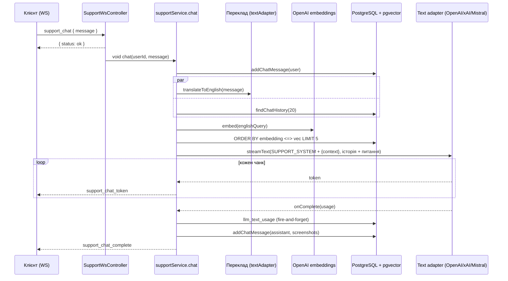

# AI-інтеграції

У бекенді AI використовується в одному продуктовому сценарії: **Support AI**. Це чат техпідтримки, який відповідає на основі бази знань із пошуком через pgvector. Довкола нього є адмінка промптів, облік токенів і керування базою знань. Ця сторінка описує, як усе влаштовано в коді. Змінні оточення для AI перелічені в [Конфігурації](/backend/configuration), тут вони не повторюються.

## Абстракція провайдерів

Контракт текстового адаптера описано в [`types.ts`](https://github.com/Blazheiko/vibe-template/blob/main/packages/backend/src/app/services/ai/types.ts): інтерфейс `ITextAdapter` має `isConfigured()`, геттер `model` і **єдину операцію** `streamText(opts, onComplete?)`. Це async-генератор текстових чанків, тобто генерація завжди потокова. `TextStreamOptions` містить `systemPrompt`, `userPrompt`, `temperature`, `maxOutputTokens`, `modelOverride` і необов'язковий `toolCallHandler` для tool calling. Після завершення потоку `onComplete` отримує `TokenUsage` (`promptTokens`/`completionTokens`/`totalTokens`), назву моделі та `finalPrompt`, який збирає `buildFinalTextPrompt()`.

| Адаптер                                                                                                                                                     | Провайдер / SDK                                                                                             | Tool calling                      | Usage                                            |
| ----------------------------------------------------------------------------------------------------------------------------------------------------------- | ----------------------------------------------------------------------------------------------------------- | --------------------------------- | ------------------------------------------------ |
| [`openai-text-adapter.ts`](https://github.com/Blazheiko/vibe-template/blob/main/packages/backend/src/app/services/ai/adapters/openai-text-adapter.ts)       | OpenAI Chat Completions через голий `fetch` на `OPENAI_CHAT_API_URL`, SSE (`stream: true`, `include_usage`) | Так, один раунд tool calls        | Сума usage обох запитів                          |
| [`xai-text-adapter.ts`](https://github.com/Blazheiko/vibe-template/blob/main/packages/backend/src/app/services/ai/adapters/xai-text-adapter.ts)             | xAI через `ai` (`streamText`) + `@ai-sdk/xai`, Responses API (`xaiProvider.responses()`)                    | Так, `stepCountIs(3)`             | `result.usage`                                   |
| [`mistralai-text-adapter.ts`](https://github.com/Blazheiko/vibe-template/blob/main/packages/backend/src/app/services/ai/adapters/mistralai-text-adapter.ts) | `@mistralai/mistralai` (`client.chat.stream`)                                                               | Ні, `toolCallHandler` ігнорується | З останнього чанка, якщо провайдер його надіслав |

Окремо є [`openai-embedding-adapter.ts`](https://github.com/Blazheiko/vibe-template/blob/main/packages/backend/src/app/services/ai/adapters/openai-embedding-adapter.ts) на офіційному SDK `openai`. Він має методи `embed(text)` і `embedBatch(texts)` та використовує `OPENAI_EMBEDDING_MODEL` і `OPENAI_EMBEDDING_DIMENSIONS`. Embeddings є **тільки в OpenAI**, альтернативного драйвера немає. Генерації зображень у коді немає.

Вибір адаптера робить [`ai-provider.ts`](https://github.com/Blazheiko/vibe-template/blob/main/packages/backend/src/app/services/ai/ai-provider.ts):

- `textAdapter` є адаптером за замовчуванням. Його обирає `AI_TEXT_DRIVER`: `openai` (дефолт), `xai` або `mistral`. Інше значення зупиняє старт помилкою `Invalid AI configuration: AI_TEXT_DRIVER must be one of openai, xai, mistral` (`validateRuntimeConfig`).
- `getTextAdapterForModel(model)` обирає адаптер за назвою моделі з рядка промпту в БД: `grok` веде до xAI, `mistral` до Mistral, `gpt`/`openai` до OpenAI. Порожнє або невідоме значення повертає `textAdapter`. Модель із промпту потім передається адаптеру як `modelOverride`.

## Промпти

Промпти зберігаються в таблиці `llm_system_prompts` ([`schema.ts`](https://github.com/Blazheiko/vibe-template/blob/main/packages/backend/src/database/schema.ts)): унікальний `type`, `content`, і необов'язкові `model`, `temperature`, `max_tokens`. Доступ до таблиці дає [`prompt-repository.ts`](https://github.com/Blazheiko/vibe-template/blob/main/packages/backend/src/app/repositories/ai/prompt-repository.ts) (`findAll`/`findByType`/`update`). Контролер працює з трьома типами: `SUPPORT_SYSTEM`, `SUPPORT_FIRST_CHAT`, `SUPPORT_QUERY_TRANSLATION`.

[`prompt-service.ts`](https://github.com/Blazheiko/vibe-template/blob/main/packages/backend/src/app/services/ai/prompt-service.ts) завантажує всі рядки в `Map` на старті (`promptService.load()` у [`index.ts`](https://github.com/Blazheiko/vibe-template/blob/main/packages/backend/src/index.ts)) і далі віддає їх синхронно. Кеш має TTL `PROMPT_CACHE_TTL_MS` (за замовчуванням 60 с): після нього читання ще віддає поточне значення й запускає фонове перечитування, тож зміна промпту на іншому інстансі видна із затримкою не більше TTL; `update()` на своєму інстансі оновлює кеш одразу. Інвалідації між інстансами (pub/sub) немає. Деталі — [Кешування та ETag](/backend/caching-etag). Якщо в БД промпту немає, сервіси беруть дефолти: [`config/support.ts`](https://github.com/Blazheiko/vibe-template/blob/main/packages/backend/src/config/support.ts) для системного та першого повідомлення, константу в [`support-query-translation-service.ts`](https://github.com/Blazheiko/vibe-template/blob/main/packages/backend/src/app/services/support/support-query-translation-service.ts) для перекладу.

Адмінські маршрути групи `prompts` ([`http-routes.ts`](https://github.com/Blazheiko/vibe-template/blob/main/packages/backend/src/app/routes/http-routes.ts)) проходять через middlewares `session_web`, `csrf_guard`, `auth_guard`, `admin_guard`. Обробляє їх [`prompt-controller.ts`](https://github.com/Blazheiko/vibe-template/blob/main/packages/backend/src/app/controllers/http/ai/prompt-controller.ts):

- `GET /prompts`, `GET /prompts/:type` читають промпти з кешу;
- `PUT /prompts/:type` оновлює БД, після чого `promptService.update()` перечитує рядок у кеш;
- `POST /prompts/:type/test` проганяє промпт із довільним повідомленням через [`prompt-test-service.ts`](https://github.com/Blazheiko/vibe-template/blob/main/packages/backend/src/app/services/ai/prompt-test-service.ts) і `textAdapter` — без власного `fetch` і без запасного виклику OpenAI. Провайдер не налаштований → `503 service_unavailable`; провайдер відповів помилкою → `502 upstream_error`; не вклався в `AI_REQUEST_TIMEOUT_MS` → `504 upstream_timeout`. Текст помилки провайдера йде лише в лог. Якщо клієнт закрив запит, виклик провайдера скасовується (`HttpContext.signal`).

## Облік використання

[`llm-usage-service.ts`](https://github.com/Blazheiko/vibe-template/blob/main/packages/backend/src/app/services/ai/usage/llm-usage-service.ts) пише в таблицю `llm_text_usage` через `recordText()`; для викликів адаптерів є `textUsageRecorder(feature, userId, promptId)`, що повертає готовий `onComplete`. Запис іде у fire-and-forget режимі: помилка вставки потрапляє лише в `logger.warn`. У кожному рядку зберігаються `user_id`, `llm_system_prompt_id`, `model`, `feature`, **`final_prompt` повністю** та три лічильники токенів.

Що записується:

| `feature`                   | Звідки                                                                                                                                                   | `user_id`                                    |
| --------------------------- | -------------------------------------------------------------------------------------------------------------------------------------------------------- | -------------------------------------------- |
| `SUPPORT_CHAT`              | відповідь і привітання Support AI (`support-service.ts`)                                                                                                 | користувач чату                              |
| `SUPPORT_QUERY_TRANSLATION` | переклад запиту перед пошуком (`support-query-translation-service.ts`)                                                                                   | користувач чату                              |
| `SUPPORT_EMBEDDING`         | embeddings (`support-embedding-service.ts`): пошук у чаті, індексація статті, `reindexAll`; `final_prompt` — вхідний текст, `completion_tokens` — `NULL` | користувач для пошуку, `NULL` для індексації |
| `PROMPT_TEST`               | тест промпту з адмінки (`prompt-test-service.ts`)                                                                                                        | адмін                                        |

Лічильники токенів nullable: **`NULL` означає, що провайдер не повідомив usage**, `0` — справжній нуль. Адаптер, який не отримав usage (буває в Mistral і в стрімі OpenAI без `include_usage`), усе одно викликає `onComplete` з `NULL` і пише `warn` — виклик не зникає з обліку. Рядки, записані до feat-028, мають старі дефолтні `0` замість невідомого значення.

Адмінські `GET /admin/usage/text` (пагінація з фільтрами `userId`, `dateFrom`, `dateTo`, `feature`) та `GET /admin/usage/stats` обслуговує [`llm-usage-controller.ts`](https://github.com/Blazheiko/vibe-template/blob/main/packages/backend/src/app/controllers/http/ai/usage/llm-usage-controller.ts); типи рядків — `TextUsageRow` і `TextUsageStatRow` у `shared` (`userId` і токени — `… | null`). Статистика групується за `model` × `feature`: `totalCalls`, `totalTokens` (сума лише за викликами з відомим usage) і `callsWithoutUsage`. Запити до БД виконує [`llm-usage-repository.ts`](https://github.com/Blazheiko/vibe-template/blob/main/packages/backend/src/app/repositories/ai/usage/llm-usage-repository.ts).

::: warning Прогалини обліку
**Вартість не рахується.** Колонки ціни немає, є лише токени.
:::

## Support AI і база знань

Статті лежать у `support_knowledge_base`: `title`, `content`, `category`, `is_active`, скріншот і колонка `embedding vector(1536)`, яку описує `customType` у [`schema.ts`](https://github.com/Blazheiko/vibe-template/blob/main/packages/backend/src/database/schema.ts). Навіщо потрібне розширення pgvector і як його встановити, див. [База даних → pgvector](/backend/database#pgvector). Розмірність колонки — `EMBEDDING_COLUMN_DIMENSIONS = 1536` ([`embedding-dimensions.ts`](https://github.com/Blazheiko/vibe-template/blob/main/packages/backend/src/database/embedding-dimensions.ts)); `OPENAI_EMBEDDING_DIMENSIONS` з іншим значенням зупиняє старт: інша розмірність потребує міграції колонки й переіндексації.

**Індексація** відбувається в [`support-embedding-service.ts`](https://github.com/Blazheiko/vibe-template/blob/main/packages/backend/src/app/services/support/support-embedding-service.ts). Текст `${title}\n\n${content}` відправляється в OpenAI embeddings, а результат записує `setEmbedding()` сирим SQL `::vector`. Індексацію запускають:

- [`knowledge-base-service.ts`](https://github.com/Blazheiko/vibe-template/blob/main/packages/backend/src/app/services/support/knowledge-base-service.ts) після створення статті та після зміни `title`/`content`, у фоні (`void ... .catch(log)`);
- адмінські `POST /admin/knowledge-base/:id/reindex` і `POST /admin/knowledge-base/reindex-all`. Другий маршрут надсилає активні статті пачками по `SUPPORT_EMBEDDING_BATCH_SIZE` (за замовчуванням 50);
- `POST /admin/knowledge-base/init` імпортує статті з файлів ([`knowledge-base-init-service.ts`](https://github.com/Blazheiko/vibe-template/blob/main/packages/backend/src/app/services/support/knowledge-base-init-service.ts)).

Якщо ключ OpenAI не задано, індексація пропускається з попередженням, а пошук повертає порожній список. `clearEmbedding()` скидає вектор і оновлює `updatedAt` одним `UPDATE`.

**Пошук** виконує `searchByEmbedding()` у [`support-knowledge-repository.ts`](https://github.com/Blazheiko/vibe-template/blob/main/packages/backend/src/app/repositories/support/support-knowledge-repository.ts): косинусна відстань `embedding <=> $vec::vector` серед активних статей із непорожнім embedding, `ORDER BY distance`, `LIMIT 5`, і лише статті з відстанню не більше `SUPPORT_SEARCH_MAX_DISTANCE` (за замовчуванням `0.8`; косинусна відстань від 0 — однаковий зміст — до 2). Якщо релевантних статей немає, контекст порожній, і промпт велить чесно сказати, що відповіді немає. Значення `0.8` **не відкалібровано** на реальних даних: щоб підібрати своє, залогуйте `distance` для кількох запитів із відомою відповіддю й візьміть межу трохи вище відстаней правильних статей.

**Чат** працює через WebSocket ([`ws-routes.ts`](https://github.com/Blazheiko/vibe-template/blob/main/packages/backend/src/app/routes/ws-routes.ts), група `support`, `rateLimit` 60 запитів за хвилину). Деталі транспорту описано на сторінці [WebSocket](/backend/websocket). [`support-controller.ts`](https://github.com/Blazheiko/vibe-template/blob/main/packages/backend/src/app/controllers/ws/support-controller.ts) відповідає на запит **вердиктом допуску**: спершу `supportService.admitChat()` / `admitOpenChat()` (ліміт на користувача і замок, див. [Допуск повідомлення](#допуск-повідомлення)), і лише тоді `{ status: 'ok' }` та запуск `runChat()` / `runOpenChat()` у фоні. Відмова — це сама відповідь на запит (`status: '429'`), а не `ok` з подальшою тишею. Токени приходять клієнту подіями `support_chat_token`, наприкінці надходить `support_chat_complete` (з `screenshots`, витягнутими з маркерів `[screenshot:id]`; клієнт показує їх через `GET /support/screenshot/:articleId`, який редиректить на `CDN_URL`, бо медіа чату дозволено лише з нашого CDN) або `support_chat_error`. Історію читають і видаляють HTTP-маршрути `GET`/`DELETE /support/chat/history`.

## Потік запиту

Системний промпт збирає [`support-llm-service.ts`](https://github.com/Blazheiko/vibe-template/blob/main/packages/backend/src/app/services/support/support-llm-service.ts). Він підставляє контекст замість `{context}`, а якщо плейсхолдера немає, дописує контекст у кінець і логує попередження. Окремо додається інструкція відповідати рідною мовою користувача. Невдалий переклад не зупиняє чат: сервіс повертає оригінальний запит.

## Історія чату

Історію читають двома різними способами, і жоден не віддає всю розмову (раніше UI отримував її всю, а промпт — молча обрізану):

- **Для UI — сторінками.** `GET /support/chat/history` ([support-controller.ts](https://github.com/Blazheiko/vibe-template/blob/main/packages/backend/src/app/controllers/http/support/support-controller.ts)) віддає **останню сторінку** (за замовчуванням 50 повідомлень, `limit` від 1 до 100) за зростанням, а також `hasMore: true`, якщо є старіші. Старіші: `?before=<id найстарішого повідомлення, яке в клієнта вже є>&limit=…`. Курсор — `id` рядка (цифри без ведучого нуля, ≤ 18 цифр), порядок — за `id`, а не за `created_at` (рядки, вставлені в одну мілісекунду, мають однаковий час). Некоректні `limit`/`before` — `422`. Чужі повідомлення недоступні навіть з чужим курсором. На фронтенді кнопка «Show earlier messages» підвантажує попередню сторінку й ставить її перед показаним, не стрибаючи вгору; повідомлення, додані локально й ще не збережені, курсором не стають.
- **Для промпту — фіксований зріз.** `supportRepository.findRecentForContext(userId, 20)` ([support-repository.ts](https://github.com/Blazheiko/vibe-template/blob/main/packages/backend/src/app/repositories/support/support-repository.ts)): останні 20 повідомлень, незалежно від довжини розмови, тож довга розмова не роздуває промпт і вартість. Це окрема константа (`SUPPORT_CONTEXT_MESSAGES`), а не побічний ефект ліміту сторінки.

**Зміна поведінки.** Запит без параметрів більше не повертає всю історію: лише останні 50 повідомлень і `hasMore`. Клієнти, що не знають про `hasMore`, бачать лише хвіст розмови.

## Допуск повідомлення

Кожне повідомлення чату коштує кілька платних викликів провайдера (переклад, embedding, відповідь, а потім ще раз як історія), тому його **допускають до того, як відповісти `ok`**. Допуск ([`support-service.ts`](https://github.com/Blazheiko/vibe-template/blob/main/packages/backend/src/app/services/support/support-service.ts), `admitChat` / `admitOpenChat`) перевіряє по черзі:

1. **Довжина.** `message` не довше `SUPPORT_MESSAGE_MAX_LENGTH` = 4000 символів (`shared/limits`; той самий ліміт у `maxlength` поля вводу на фронтенді). Довше — звичайна помилка валідації WS (`validation_failed`, кадр помилки) і жодного виклику.
2. **Частота на користувача.** Атомарний лічильник у Redis (`consumeAuthThrottle`): `supportChatUser` — 20 повідомлень за 60 с, `supportOpenChatUser` — 5 за 60 с (`SUPPORT_CHAT_USER_RATE_LIMIT_*`, `SUPPORT_OPEN_CHAT_USER_RATE_LIMIT_*`, див. [Конфігурацію](/backend/configuration)). Понад ліміт — відповідь `status: "429"`, `code: "rate_limited"`, `reason: "support_rate_limited"`.
3. **Одна відповідь за раз.** Замок `support:inflight:<userId>` ([support-inflight-lock.ts](https://github.com/Blazheiko/vibe-template/blob/main/packages/backend/src/app/services/support/support-inflight-lock.ts)): `SET … NX PX` зі **знаком власника**. Поки попередня відповідь пишеться, наступне повідомлення (і привітання теж) — `status: "429"`, `reason: "support_busy"`. Замок знімається скриптом Lua **лише якщо в ньому ще токен цього запиту**: запит, що втратив замок, не видалить замок наступного.

    Замок — це **оренда (lease)**, а не припущення про тривалість відповіді: очікування БД у pipeline не обмежені `AI_REQUEST_TIMEOUT_MS`, тож жоден фіксований TTL не гарантує, що повільна відповідь не переживе замок. Ключ живе 30 с, а відповідь, поки працює, продовжує його кожні 5 с (Lua: `PEXPIRE` лише якщо токен ще наш). Мертвий процес перестає продовжувати, і користувач вільний за 30 с. Якщо продовження не вдається (Redis мовчить, ключ зник чи належить іншому запиту) або відповідь триває довше за `3 × AI_REQUEST_TIMEOUT_MS + 60 с`, власник дізнається про втрату **раніше, ніж ключ міг би спливти**: його `AbortSignal` спрацьовує, виклики провайдера скасовуються, і перед кожним платним кроком (переклад, embedding, відповідь, збереження) є перевірка — друга відповідь поруч не стартує.

4. **Добовий бюджет токенів.** Кожен користувач має бюджет `AI_SUPPORT_DAILY_TOKEN_BUDGET` токенів на добу (UTC; за замовчуванням 200000; `0` вимикає облік — лише поза production, при старті production-like середовища з `0` — помилка). Лічильник — ключ `llm:budget:<userId>:<YYYY-MM-DD>` у Redis (TTL 48 год; журнал `llm_text_usage` лишається аудитом і для рішень не читається). Рішення та альтернативи — [ADR 0003](https://github.com/Blazheiko/vibe-template/blob/main/docs/adr/0003-llm-budget-reservation.md).
    - **Резервування (допуск).** Після ліміту й замка один Lua-скрипт ([llm-budget-service.ts](https://github.com/Blazheiko/vibe-template/blob/main/packages/backend/src/app/services/ai/usage/llm-budget-service.ts)) атомарно перевіряє `витрачено + резерв ≤ ліміт` і додає резерв; N паралельних запитів не бачать один і той самий залишок. Відмова — `status: "429"`, `reason: "support_budget_exceeded"`, `retryAfterSeconds` до півночі UTC; **замок, узятий цим допуском, звільняється**. Резерв не перевищує ліміт.
    - **Оцінка** ([support-budget.ts](https://github.com/Blazheiko/vibe-template/blob/main/packages/backend/src/app/services/support/support-budget.ts)): переклад = `токени(повідомлення) + maxTokens(переклад)`; embedding = `токени(повідомлення)`; відповідь = `AI_SUPPORT_PROMPT_ALLOWANCE_TOKENS` (8000: системний промпт, контекст бази знань, історія — їхній розмір на допуску невідомий) `+ токени(повідомлення) + maxTokens(відповідь)`. `токени(текст) = ⌈символи / 2⌉` — **евристика, а не верхня межа**: для CJK, emoji, коду співвідношення гірше. Привітання — лише «відповідь».
    - **Звірка (кінець запуску, `release()` — перед зняттям замка).** Виклик, що **не стартував** (запуск зупинено: втрачений замок, закрите з'єднання, дублікат повідомлення), повертає свою частку; виклик, що стартував і повідомив usage, списується за **фактом** (вниз чи вгору); виклик, що стартував **без usage** (обрив посеред стрімінгу, timeout, помилка провайдера), лишає **резерв** списаним — скасування після початку генерації не безкоштовне. Помилка звірки не відкликає відповідь: логується, резерв лишається.
    - **Гарантія приблизна:** бюджет обмежує вартість на добу на порядок величини, а не з точністю до токена; остання відповідь доби може вийти за ліміт на різницю «факт − резерв», але не більше ніж на одну відповідь (замок). Консервативний резерв означає, що користувач упирається в ліміт трохи раніше за реальні витрати.

Якщо Redis недоступний, допуск дає `503` (`service_unavailable`), а не `ok`. Це стосується і лічильників ліміту та бюджету (окреме з'єднання `redis-rate-limit`, що кидає звичайні помилки ioredis): `tryInternal` розпізнає недоступність обох клієнтів (`isRedisUnavailable`), тож це не `500`.

Замок знімається **до** фінальної події (`support_chat_complete` / `support_chat_error`), тож клієнт, який одразу після відповіді шле наступне повідомлення, не отримає хибне «зайнято».

**Збій після допуску** (помилка провайдера, таймаут, збій БД) надходить клієнту подією `support_chat_error` з `message` і `code`: `chat_failed`, `open_chat_failed`, `message_already_received` (повтор уже збереженого повідомлення), а коли відповідь зупинено через втрачений замок — `chat_interrupted`. Закрите з'єднання подію не надсилає.

**Ідемпотентний повтор (`clientMessageId`).** Відповідь на запит може загубитися (таймаут, розрив з'єднання), коли сервер уже зберіг повідомлення. Клієнт дає кожному повідомленню `clientMessageId` (`[A-Za-z0-9_-]{1,64}`, на фронтенді UUID) і при втраті відповіді шле **той самий** запит ще раз. Повідомлення зберігається один раз на пару `(user_id, client_message_id)` — унікальний індекс `support_chat_history_client_message_uidx`, вставка `ON CONFLICT DO NOTHING` (паралельний повтор чекає транзакцію оригіналу, потім конфліктує). Повтор проходить допуск як будь-яке повідомлення; якщо повідомлення вже є, відповідь не генерується вдруге, а клієнт отримує `support_chat_error` з `code: "message_already_received"`. Поки оригінал ще відповідає, повтор отримує `429 support_busy`. Без `clientMessageId` (старі клієнти) кожен запит зберігається окремо.

Порівнювати тексти в історії для з'ясування доставки не можна: оригінальний `INSERT` може ще виконуватися, коли `SELECT` уже повернув стару історію. Тому відсутність повідомлення в історії ніколи не означає «не доставлено».

**Події відповіді несуть `clientMessageId`** (`support_chat_token`, `support_chat_complete`, `support_chat_error`; у привітання його немає). Фронтенд ігнорує події з чужим id, тож запізнілий `complete`/`error` старої відповіді не завершить нову. На сервері запуск, що втратив замок, не надсилає **нічого**: ні токенів (перевірка перед кожним токеном), ні `complete`, ні сповіщення (перевірка після збереження відповіді) — лише `chat_interrupted`, і лише якщо ще міг. `INSERT`, що вже почався, скасувати не можна: відповідь старого запуску може опинитися в історії поруч із відповіддю нового власника замка.

**Клієнт при відмові.** Явна відповідь сервера про відмову (`429`, `503`, помилка валідації) або збій до відправки: фронтенд прибирає оптимістично додане повідомлення **за його id** (привітання могло завершитися після нього й перед відмовою) і повертає текст у поле вводу. Таймаут чи розрив з'єднання — **невідомий статус доставки**: клієнт один раз шле той самий запит із тим самим id. Прийнято — усе як зазвичай. Не прийнято (навіть явна відмова повтору: оригінал може бути збережений чи ще виконуватися) — повідомлення лишається в розмові, текст у поле не повертається, показується підказка звірити розмову перед новою спробою. Події `message_already_received` і `chat_interrupted` змушують клієнт перечитати історію.

## Надійність, вартість і безпека

- **Таймаут і скасування.** Кожен виклик провайдера (OpenAI `fetch`, xAI `abortSignal`, Mistral `fetchOptions.signal`, embeddings `{ signal }`) отримує сигнал з [`aiRequestSignal`](https://github.com/Blazheiko/vibe-template/blob/main/packages/backend/src/app/services/ai/ai-request-signal.ts): `AI_REQUEST_TIMEOUT_MS` (за замовчуванням 60 000 мс) плюс сигнал викликача. Для HTTP це `HttpContext.signal` (клієнт відключився), для Support AI — сигнал WS-з'єднання (`WsContext.signal`, абортиться в `onClose`): закрита вкладка зупиняє генерацію, і це не логується як збій. AI SDK (xAI) повідомляє про abort не винятком, а частиною стріму `abort`; адаптер перетворює її на `TimeoutError`/`AbortError`, тож таймаут xAI дає `504`, а не порожню успішну відповідь.
- **Помилки.** Будь-яка помилка в `runChat()`/`runOpenChat()` ловиться, логується і перетворюється на подію `support_chat_error` із загальним текстом і полем `code` (`chat_failed`, `open_chat_failed`, `chat_interrupted`). Ретраїв немає. Скасування через закрите з'єднання подію не надсилає (відповідати нікому). Тест промпту повертає `502`/`503`/`504`, див. вище.
- **Ліміти на користувача.** Додатково до ліміту на IP нижче діють ліміти на користувача, довжина повідомлення і «одна відповідь за раз» (див. [Допуск повідомлення](#допуск-повідомлення)).
- **Rate limit.** Для WS-групи `support` діє ліміт 60 запитів за хвилину на IP для кожної події окремо (ключ IP + URL маршруту), а не на з'єднання: усі вкладки й пристрої за одним IP ділять цей бюджет. Кожне повідомлення коштує мінімум 3 платні виклики: переклад, embedding і відповідь. HTTP-групи `prompts` і `admin/knowledge-base` закриті `admin_guard`, але власного `rateLimit` у визначенні групи не мають.
- **PII.** Провайдеру йдуть дослівне повідомлення користувача та до 20 останніх повідомлень історії. У `llm_text_usage.final_prompt` той самий текст зберігається повністю й безстроково, а адмін бачить його через `/admin/usage/text`. Фільтрації чи маскування персональних даних немає.
- **Секрети.** Ключі задаються тільки через env (`OPENAI_API_KEY=<your-openai-key>` тощо). `OPENAI_API_KEY` спільний для чату й embeddings.

**Мова відповіді.** Фронтенд передає в `support/support_open_chat` і `support/support_chat` поточну локаль інтерфейсу (`language`, наприклад `uk` чи `pt-BR`). [`support-service.ts`](https://github.com/Blazheiko/vibe-template/blob/main/packages/backend/src/app/services/support/support-service.ts) зводить її до коду з `APP_LOCALE_CODES` (`resolveSupportLanguage`), а якщо поле відсутнє чи невідоме — бере `SUPPORT_DEFAULT_LANGUAGE` (за замовчуванням `en`). Окремої мови в профілі користувача немає.
