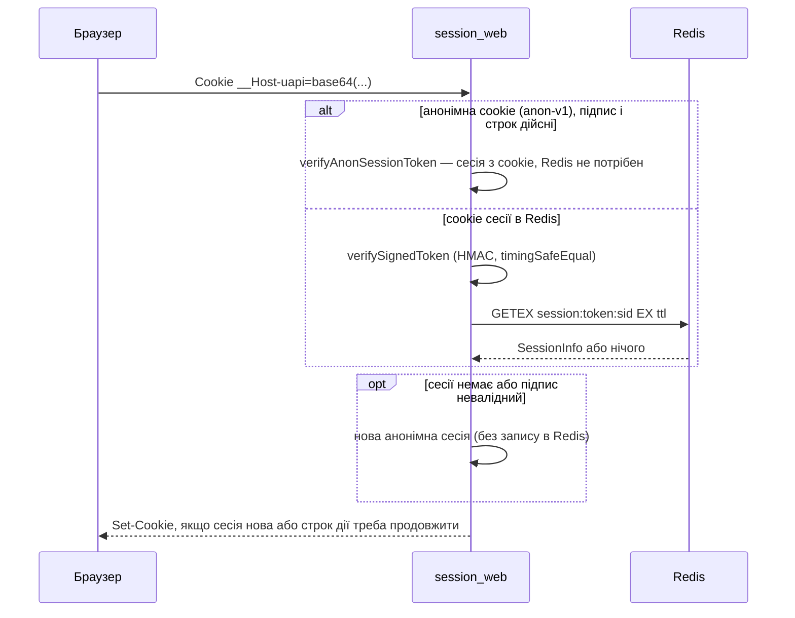

# Автентифікація

Ця сторінка описує, як бекенд впізнає користувача: сесії в Redis з HMAC-підписаною cookie, способи входу, як залогінити й розлогінити користувача з коду, авторизацію WebSocket і ролі. Захист трафіку (rate limiting, CSRF, CORS, CSP, проксі) описано на сторінці [Безпека](/backend/security), вхід через Google, GitHub та інші — на сторінці [Вхід через соцмережі](/backend/oauth).

## Коротко на прикладі: що відбувається після входу

Цей ланцюжок можна пройти в браузері (DevTools → Network) або через curl, див. [Перший сценарій](/guide/getting-started#_6-першии-сценаріи-від-входу-до-виходу).

1. **`GET /api/main/init`** без cookie. Сервер створює гостьову сесію в Redis, ставить cookie `uapi` і повертає `401` з `csrfToken`.
2. **`POST /api/auth/login`** з email, паролем і заголовком `x-csrf-token`. Сервер перевіряє пароль, прив'язує сесію до користувача і оновлює cookie:

    ```text
    Set-Cookie: uapi=<…>; Path=/; Expires=…; HttpOnly; Max-Age=86400; SameSite=Lax
    ```

    Неправильний пароль дає `401 {"message":"Invalid email or password","code":"unauthorized"}`, а після 10 невдалих спроб поспіль з однієї адреси сервер відповідає `429` із заголовком `Retry-After: 60` (перевірено з налаштуваннями за замовчуванням; ліміти описано нижче).

3. **Кожен наступний запит** несе cookie автоматично. Middleware `session_web` знаходить сесію в Redis, звіряє її `userToken` з `users.session_token` у БД (див. [Відкликання сесій](#відкликання-сесіи)) і знає, хто ви. `GET /api/main/init` тепер повертає `200` з даними користувача, `wsToken` і новим `csrfToken`.
4. **Захищені маршрути.** `auth_guard` пропускає лише сесію з користувачем (інакше `401`), `admin_guard` — лише роль `admin` (інакше `403 Admin access required`).
5. **`POST /api/auth/logout`** видаляє сесію з Redis. Стара cookie більше нічого не відкриває, `init` знову дає `401`. `logout-all` ротує `users.session_token`, чим відкликає всі сесії користувача (вихід на всіх пристроях), і видаляє їхні записи з Redis.

Що лежить у Redis після такого сценарію (ключі з префіксом `REDIS_PREFIX`):

```text
uwebsocket:session:<userId>:<sessionId>          сесія залогіненого користувача
uwebsocket:session:anon_session:<sessionId>      гостьова сесія, лише якщо вона зберігає дані (OAuth state)
uwebsocket:auth:throttle:login_ip:127.0.0.1      лічильник спроб входу з IP
uwebsocket:auth:ws:<token>                       одноразовий WebSocket-токен (60 с)
```

Звичайна гостьова сесія (до входу) в Redis не пишеться: вона живе в підписаній cookie (див. [Анонімна сесія](#анонімна-сесія)).

Нижче описано формат cookie, підпис, ротацію і решту механізмів.

## Вхід і вихід у коді

Розробнику не треба працювати з cookie, Redis чи підписами напряму. У кожному HTTP-контексті є два об'єкти: `context.auth` (хто користувач, вхід і вихід) і `context.session` (дані поточної сесії). Їх заповнює middleware `session_web`, тож маршрут має стояти в групі з ним. Типи — `Auth` і `Session` у [`vendor/types/types.d.ts`](https://github.com/Blazheiko/vibe-template/blob/main/packages/backend/src/vendor/types/types.d.ts), реалізація — [`session-handler.ts`](https://github.com/Blazheiko/vibe-template/blob/main/packages/backend/src/vendor/utils/session/session-handler.ts).

### `context.auth`

| Метод                      | Повертає                         | Що робить                                                                                                                                                                                                                                                                                                                                                                                                                                                                                                                                           |
| -------------------------- | -------------------------------- | --------------------------------------------------------------------------------------------------------------------------------------------------------------------------------------------------------------------------------------------------------------------------------------------------------------------------------------------------------------------------------------------------------------------------------------------------------------------------------------------------------------------------------------------------- |
| `check()`                  | `boolean`                        | `true`, якщо в сесії є `userId`, тобто користувач залогінений. Те саме перевіряє `auth_guard`.                                                                                                                                                                                                                                                                                                                                                                                                                                                      |
| `getUserId()`              | `string \| null`                 | id користувача з сесії рядком або `null` для гостя. Для запиту до БД перетворіть на `BigInt(userId)`.                                                                                                                                                                                                                                                                                                                                                                                                                                               |
| `getPresentedUserToken()`  | `string \| undefined`            | `userToken` сесії, з якою **прийшов** запит, якщо `session_web` перевірив її як актуальну (ADR 0002); `undefined` для гостя чи відкликаної сесії. Значення фіксується при відновленні сесії і не змінюється до кінця запиту: `login`, `logout` чи оновлення сесії його не замінюють. Сервіси порівнюють його з `users.session_token` під час зміни облікових даних (див. [Зміни облікових даних із сесії](#зміни-облікових-даних-із-сесіі)).                                                                                                        |
| `login(userId, userToken)` | `Promise<boolean>`               | **Логінить** користувача: видаляє поточну сесію (гостьову чи іншого користувача), створює нову з новим `sessionId` і CSRF-токеном, ставить cookie у відповідь. `userId` — `String(user.id)`, `userToken` — `user.sessionToken` з таблиці `users`. Якщо будь-який аргумент `undefined`, нічого не робить і повертає `false`. Помилку Redis кидає далі.                                                                                                                                                                                               |
| `logout()`                 | `Promise<boolean>`               | **Розлогінює** на цьому пристрої: видаляє поточну сесію і видає нову гостьову з новим CSRF-токеном.                                                                                                                                                                                                                                                                                                                                                                                                                                                 |
| `logoutAll()`              | `Promise<{ deleted, complete }>` | Виходить на **всіх** пристроях: видаляє записи всіх сесій користувача і видає нову гостьову сесію — **завжди**, навіть якщо очищення зупинилося чи впало. Сама по собі лише чистить Redis; відкликання забезпечує ротація `users.session_token`, яку маршрут `logout-all` робить у `authService.logoutAll` **перед** цим викликом. `deleted` — видалення, підтверджені Redis; `complete: false` — Redis недоступний або вичерпано дедлайн (див. [Redis як джерело істини](#redis-як-джерело-істини)). Для гостя — `{ deleted: 0, complete: true }`. |

Після `login`, `logout` і `logoutAll` об'єкти `context.auth` і `context.session` у тому ж запиті вже дивляться на **нову** сесію: `getUserId()` одразу повертає нового користувача, а `context.session.sessionInfo.data.csrfToken` — новий токен, який треба віддати клієнту.

### `context.session`

| Член                      | Що робить                                                                                                                                                          |
| ------------------------- | ------------------------------------------------------------------------------------------------------------------------------------------------------------------ |
| `sessionInfo`             | Поточна сесія `{ id, data, createdAt, updatedAt? }` або `null`. У `data` лежать `userId`, `userToken`, `csrfToken`, `wsToken` і ваші власні поля.                  |
| `updateSessionData(data)` | **Зливає** `data` з наявними даними сесії і зберігає в Redis. Так OAuth зберігає `oauthState` між редиректом і callback. Щоб прибрати поле, передайте `undefined`. |
| `changeSessionData(data)` | **Замінює** дані сесії повністю. Обережно: без `userId`/`userToken`/`csrfToken` у новому об'єкті користувач фактично розлогіниться, а CSRF перестане працювати.    |
| `destroySession()`        | Видаляє поточну сесію з Redis без видачі нової. Для виходу користуйтеся `auth.logout()`, який ще й видає гостьову сесію та cookie.                                 |

### Приклад: свій спосіб входу

Типова схема — сервіс знаходить користувача, перевіряє облікові дані й викликає `auth.login`. Так влаштовано [`auth-service.ts`](https://github.com/Blazheiko/vibe-template/blob/main/packages/backend/src/app/services/auth/auth-service.ts) (функція `buildAuthSuccess`, яка ще й видає `wsToken`); нижче спрощений варіант:

```ts
import type { Auth, Session } from '#vendor/types/types.js'

async function signIn(auth: Auth, session: Session, email: string, password: string) {
    const user = await userRepository.findByEmail(email)
    if (user === undefined || !(await validatePassword(password, user.password))) {
        return Result.err(unauthorized('Invalid email or password'))
    }

    // нова сесія, нова cookie, новий CSRF-токен
    await auth.login(String(user.id), user.sessionToken)

    return Result.ok({
        user: userTransformer.serialize(user),
        csrfToken: session.sessionInfo?.data.csrfToken,
    })
}
```

Контролер передає в сервіс `context.auth` і `context.session` і повертає результат. Новий `csrfToken` обов'язково віддайте клієнту: старий після входу більше не приймається (`403 token_mismatch`).

### Приклад: вихід

```ts
async logout(context: HttpContext<EmptyFormInput>): Promise<LogoutResponse> {
    await context.auth.logout()
    return { status: 'success', csrfToken: context.session.sessionInfo?.data.csrfToken }
}
```

Реальний [`auth-controller.ts`](https://github.com/Blazheiko/vibe-template/blob/main/packages/backend/src/app/controllers/http/auth/auth-controller.ts) робить те саме через `authService.logout(context.auth, context.session)` і обробляє помилки через `Result`. Вихід на всіх пристроях — `authService.logoutAll`, який ще й надсилає push-сповіщення безпеки.

### Перевірити, хто робить запит

```ts
async getProfile(context: HttpContext): Promise<ProfileResponse> {
    const userId = context.auth.getUserId()
    if (userId === null) {
        // сюди не дійде, якщо маршрут закрито auth_guard
        context.responseData.status = 401
        return { status: 'error', message: 'Unauthorized' }
    }
    const user = await userRepository.findById(BigInt(userId))
    // ...
}
```

Зазвичай перевірку робить не контролер, а `auth_guard` на маршруті (див. [Middleware](/backend/middlewares)). Тоді в контролері `getUserId()` гарантовано не `null`.

::: warning WebSocket
У WS-контексті `context.auth` і `context.session` дорівнюють `null`: користувач визначається під час підключення, а в обробнику доступний `context.userData`. Див. [Авторизація WebSocket](#авторизація-websocket).
:::

## Сесії

### Формат cookie

Cookie сесії читає [`session-handler.ts`](https://github.com/Blazheiko/vibe-template/blob/main/packages/backend/src/vendor/utils/session/session-handler.ts), а сесію запиту веде клас `RequestSession` ([`request-session.ts`](https://github.com/Blazheiko/vibe-template/blob/main/packages/backend/src/vendor/utils/session/request-session.ts)). Його стан — поточна `SessionInfo`, прапорець «сесія лише в cookie» (анонімна, ще без запису в Redis), простір імен у Redis і одна відкладена перевірка перед відправкою відповіді. Переходи між станами — методи класу:

- `restore` відновлює сесію з cookie або починає нову анонімну;
- перший запис даних в анонімну сесію переносить її в Redis;
- `login` замінює будь-яку сесію новою сесією користувача;
- `logout` і `logoutAll` замінюють сесію новою анонімною.

Метод `attach` віддає їх обробникам як `context.session` і `context.auth`. Підпис робить [`token-handler.ts`](https://github.com/Blazheiko/vibe-template/blob/main/packages/backend/src/vendor/utils/session/token-handler.ts).

- Значення до підпису: `<userToken>.<sessionId>`. Для анонімної сесії, збереженої в Redis, замість `userToken` стоїть рядок `anon_session`. Анонімна сесія без Redis має власний формат — див. [Анонімна сесія](#анонімна-сесія).
- `sessionId` генерується через `crypto.randomUUID()`.
- Підпис: HMAC-SHA256 з ключем `APP_KEY`, hex-рядок обрізаний до 32 символів. Підпис дописується через крапку, а результат кодується в base64: `base64("<userToken>.<sessionId>.<signature>")`.
- Під час перевірки підписи порівнюються через `crypto.timingSafeEqual`. Токен має складатися рівно з 3 частин, а `userToken` має відповідати шаблону `^[a-zA-Z0-9_-]{10,}$`.
- Якщо `APP_KEY` не задано, він коротший за 32 символи або дорівнює `your-secret-key` чи `change-me`, модуль кидає помилку під час завантаження, і сервер не стартує.

Ім'я та атрибути cookie задає [`config/session.ts`](https://github.com/Blazheiko/vibe-template/blob/main/packages/backend/src/config/session.ts):

| Параметр                     | Значення                                                                                                                                   |
| ---------------------------- | ------------------------------------------------------------------------------------------------------------------------------------------ |
| Ім'я                         | `__Host-uapi`, якщо `SESSION_COOKIE_HOST_PREFIX` увімкнено (за замовчуванням вмикається, коли `appConfig.isProductionLike`), інакше `uapi` |
| `path` / `httpOnly`          | `/` / `true`                                                                                                                               |
| `secure`                     | `true` для будь-якого `APP_ENV`, крім `local`                                                                                              |
| `sameSite`                   | `Lax`                                                                                                                                      |
| TTL (`age`, `maxAge`, Redis) | 24 години (`duration('24h')`) для сесії користувача                                                                                        |
| TTL анонімної сесії          | `SESSION_ANON_TTL` (`anonAge`), за замовчуванням `2h`: і для cookie, і для анонімної сесії в Redis                                         |

`session_web` читає cookie лише під активним ім'ям; cookie під іншим ім'ям (наприклад, `uapi`, коли ввімкнено `__Host-` префікс) ігнорується, і запит отримує нову анонімну сесію. Під час старту [`validate-runtime-config.ts`](https://github.com/Blazheiko/vibe-template/blob/main/packages/backend/src/app/start/validate-runtime-config.ts) перевіряє, що при `__Host-` префіксі cookie має `Secure=true`, а `APP_URL` починається з `https://`.

### Анонімна сесія

Запит без cookie (або з невалідною чи простроченою) отримує анонімну сесію з CSRF-токеном — без запису в Redis (feat-057). Інакше кожен запит бота до `main/init` залишав би в Redis сесію на добу.

- Cookie: `base64("anon-v1.<sessionId>.<csrfToken>.<issuedAt>.<signature>")`, підпис — той самий HMAC з `APP_KEY`. Префікс `anon-v1` розділяє підписи: cookie сесії користувача не перевіряється як анонімна і навпаки.
- Дійсна, поки з `issuedAt` минуло менше `SESSION_ANON_TTL`. Коли їй більше 15 хвилин, сервер видає її знову з новим `issuedAt` і тим самим `sessionId` та токеном (ковзний строк дії, лише `Set-Cookie`).
- Повторно видана анонімна cookie проходить ту саму перевірку перед відправкою (`beforeSend`), що й cookie сесії в Redis: якщо тим часом інший запит цієї сесії виконав вхід (вхід лишає маркер `session_superseded:<sessionId>` на 15 хвилин для будь-якої попередньої анонімної сесії) або переніс її в Redis (`session:anon_session:<sessionId>`), повільна відповідь свою cookie не надсилає.
- Запит, що сам переніс сесію в Redis, перед відправкою перевіряє лише маркер входу: власний запис у Redis не заважає його cookie, а вхід, зроблений тим часом, — заважає. Вхід також видаляє запис `anon_session`, якщо паралельний запит устиг його створити.
- Запит, що сам виконав вхід або вихід, свою cookie зберігає. Якщо перевірка не вдалася (Redis недоступний), cookie з відповіді прибирається.
- CSRF працює як раніше: `sessionInfo.data.csrfToken` береться з cookie, `session_web` віддає його в 401/403, `csrf_guard` порівнює його з заголовком.
- Відкликати таку cookie до кінця строку дії не можна. Прав вона не дає: після входу стара анонімна cookie відкриває лише анонімну сесію, а її токен не підходить до сесії користувача.
- Щойно код записує в анонімну сесію дані (`updateSessionData` / `changeSessionData`, напр. OAuth `state`), вона переходить у Redis як `session:anon_session:<sessionId>` з TTL `SESSION_ANON_TTL`, а cookie — у формат `anon_session.<sessionId>`.

### Redis як джерело істини

### Відкликання сесій

Запис сесії в Redis доводить лише, що сесію колись видали. Тому відкликання не спирається на видалення ключів (воно може не дійти до Redis), а на `users.session_token` у PostgreSQL ([ADR 0002](https://github.com/Blazheiko/vibe-template/blob/main/docs/adr/0002-session-revocation-via-user-token.md)):

- **Перевірка на кожному автентифікованому запиті.** `sessionHandler` (`session_web`), `wsSessionHandler` (кожне WS-повідомлення) і `verifyUpgradeToken` (підключення WS) порівнюють `userToken` сесії з актуальним `users.session_token`, прочитаним із БД без кешу (одне читання за первинним ключем), за сталий час ([`safeEqual`](https://github.com/Blazheiko/vibe-template/blob/main/packages/backend/src/vendor/utils/helpers/safe-equal.ts)). Так само порівнюють пред'явлений токен зміни облікових даних із сесії (див. нижче). Збіг — сесія діє; розбіжність або видалений користувач — сесія вважається відкликаною: запит стає анонімним (`401` на `auth_guard`), запис у Redis прибирається за можливості. Анонімні сесії без користувача цієї перевірки не мають.
- **Fail-closed, дедлайн і скасування.** Читання обмежене `SESSION_TOKEN_CHECK_TIMEOUT_MS` (за замовчуванням 2000 мс, див. [Конфігурацію](/backend/configuration)): БД, яка прийняла запит і не відповідає, дає `503`, а не запит, що чекає без кінця. Дедлайну в коді застосунку немає: читання йде через окремий пул з 5 зʼєднань ([`session-check-db.ts`](https://github.com/Blazheiko/vibe-template/blob/main/packages/backend/src/database/session-check-db.ts)), у якого `statement_timeout` дорівнює дедлайну, тож сервер сам скасовує запит (`57014`) і слот не лишається зайнятим. Якщо сервер не відповідає взагалі (розрив мережі), через `timeout + 500 мс` спрацьовує `query_timeout` драйвера: зʼєднання знищується, слот звільняється. Окремий пул потрібен, бо `statement_timeout` — властивість зʼєднання: на основному пулі він спільний для всіх запитів застосунку і тому значно ширший (`DB_QUERY_TIMEOUT_MS`, 10 с); побічно він ізолює автентифікацію від довгих бізнес-запитів. Після помилки `pg-pool` відкриває нове зʼєднання, тож під час тривалого збою кожна перевірка, що вичерпала час, платить за рукостискання (кількість обмежена розміром пулу). Якщо БД не відповіла, запит **не** обслуговується за одним записом Redis: HTTP відповідає `503 service_unavailable` з `Retry-After: 1` (без тексту драйвера), WS-підключення і повідомлення — також `503`/відмовою. Запис Redis при цьому не видаляється: щойно БД відповідає, та сама cookie знову працює.
- **Три операції відкликають, ротуючи токен у БД першим кроком:** `change-password` (один умовний `UPDATE … WHERE password = <поточний хеш>`, тож із двох паралельних змін з однаковим старим паролем успішна рівно одна, друга отримує `409`), `reset-password` / `reset-phone/complete` і `logout-all`. Поточний клієнт після `change-password` отримує нову сесію вже під новим токеном. `change-password` і `logout-all` в тій самій транзакції, що й ротація, закривають pending-посилання скидання пароля (`password_reset_tokens.used_at`) і, як скидання через email, pending SMS-челенджі телефону акаунта (`reset-phone`, `link-phone`; `sms_auth_challenges.invalidated_at`, feat-121): посилання чи код, які хтось запросив до зміни пароля чи виходу на всіх пристроях, після них уже нічого не скидають. Збій закриття відкочує ротацію (feat-109).
- **Зміни облікових даних перевіряють пред'явлений токен** (див. [нижче](#зміни-облікових-даних-із-сесіі)): запит, допущений до відкликання, не змінює облікові дані після нього.
- **`destroyAllSessions` — лише очищення пам'яті.** Його збій (Redis недоступний, вичерпано дедлайн) логується й не змінює результат жодної з трьох операцій, `logout-all` включно: записи, що лишилися, уже відхиляються перевіркою, а решту прибирає TTL. Після збою Redis перший же запит зі старою cookie дає `401` — повторного очищення не потрібно.
- **Ціна.** +1 читання за первинним ключем на автентифікований запит і WS-повідомлення. Кеш цього значення можливий, але свідомо не вводився: він додав би вікно, у якому відкликана сесія ще діє (збій інвалідації, гонка читання й інвалідації).

### Зміни облікових даних із сесії

Перевірка сесії на початку запиту не зупиняє операцію, яка вже виконується. Якщо запит пройшов `session_web`, а відкликання (зміна пароля на іншому пристрої, `logout-all`) закомітилося, поки він працював, запит не повинен змінити облікові дані після цього. Тому кожна зміна рядка `users`, яку ініціює залогінений користувач, порівнює `context.auth.getPresentedUserToken()` з `users.session_token` **в одному операторі** з самою зміною (`UPDATE … WHERE id = ? AND session_token = <пред'явлений>`, [`updateIfSessionToken`](https://github.com/Blazheiko/vibe-template/blob/main/packages/backend/src/app/repositories/user/user-repository.ts)). Брати очікуваний токен зі свіжого читання марно: воно вже бачить новий токен.

| Маршрут                                         | Де перевіряється                                                                                                                                                                                               |
| ----------------------------------------------- | -------------------------------------------------------------------------------------------------------------------------------------------------------------------------------------------------------------- |
| `POST /api/auth/change-password`                | `changePasswordIfCurrent`: `WHERE password = <поточний хеш> AND session_token = <пред'явлений>`                                                                                                                |
| `POST /api/auth/link-phone/start`               | повторна автентифікація паролем (`requireCurrentPasswordReauth`); перевірка пароля спершу витрачає бюджет `change_password_user` на користувача (спільний із `change-password` і `link-email/start`, feat-109) |
| `POST /api/auth/link-phone/confirm`             | `updateIfSessionToken` при записі телефону                                                                                                                                                                     |
| `POST /api/auth/link-email/start`               | видача токена під блокуванням користувача (`issueTokenLocked`)                                                                                                                                                 |
| `POST /api/auth/logout-all`                     | `updateIfSessionToken` при ротації токена                                                                                                                                                                      |
| `POST /api/avatar/upload`, `DELETE /api/avatar` | `replaceAvatarIfSessionToken` (рядок під замком, повертає попередній ключ); новий файл у сховищі видаляється, старий лишається                                                                                 |
| `POST /api/push-subscriptions`, `PUT …/:id`     | `withCurrentSession`: запис у транзакції під блокуванням рядка користувача                                                                                                                                     |

**Одиночний logout в іншій вкладці** (`POST /api/auth/logout`) видаляє лише запис сесії в Redis і `users.session_token` не змінює, тож перевірки вище його не бачать. Операції, що самі в сесію не пишуть, тому питають безпосередньо перед своїм незворотним кроком, чи запис ще є (`context.session.isStored()`, feat-123): `link-email/start` і `oauth/email/resend` перед листом, `link-phone/start` перед SMS, `link-phone/confirm` перед підтвердженням челенджу, `change-password` перед записом пароля (feat-134: інакше `renewSession` знову логінив вкладку, з якої щойно вийшли), `resend-verification-email` перед тим, як поставити лист у чергу, і `POST /api/push-subscriptions/test-push` перед відправкою push (feat-129). Якщо запису немає, відповідь `401 session_revoked`, нічого не надіслано й не прив'язано. Перевірка — обов'язковий параметр сервісу (feat-129): виклик без неї не компілюється, а тести контролерів перевіряють, що передано саме `session.isStored` запиту. Операції, що пишуть у сесію (OAuth start і callback), бачать її зникнення в самому записі. Вужче вікно лишається: logout між цією перевіркою і листом лист не скасовує.

**Бюджет повторної перевірки пароля.** `change-password`, `link-email/start` і `link-phone/start` витрачають **один спільний** бюджет `change_password_user` на користувача (10 спроб за 15 хв, feat-109), а не окрему політику `reauthUser`, яку пропонував план: окремий лічильник дав би вдвічі більше спроб вгадати пароль через вкрадену сесію. Вичерпаний бюджет відповідає `429 rate_limited` (feat-123). Так само (feat-134) відповідають усі інші бюджети auth-throttle: реєстрація, перевірка коду чи посилання, привʼязка, скидання пароля і повторна відправка листа OAuth; раніше вони відповідали `400`.

Записи в інші таблиці, які claim має прибрати (push-підписки), одним оператором не перевіриш. Їх робить [`withCurrentSession`](https://github.com/Blazheiko/vibe-template/blob/main/packages/backend/src/app/services/auth/session-guard.ts): транзакція бере те саме блокування `FOR UPDATE`, що й claim, і порівнює пред'явлений токен під ним. Тож запит або комітиться раніше за claim (і claim видаляє записане), або бачить ротований токен.

Відповідь, коли токен уже не актуальний, — `401` з `reason: "session_revoked"`, і жодних змін. Для `change-password` програш умовного `UPDATE` через **іншу зміну пароля** (дві паралельні зміни з однаковим старим паролем) лишається `409`.

### Що таке `userToken`

`userToken` — це колонка `users.session_token` (`nanoid()`, 21 символ, унікальна, задається при створенні користувача). Це не сесія і не секрет для входу, а **постійний простір імен сесій користувача** в Redis:

- усі сесії одного користувача на всіх пристроях лежать під `session:<userToken>:*`, тож `logoutAll` знаходить їх одним `SCAN MATCH` без окремого індексу «користувач → сесії»;
- зміна пароля, скидання пароля (за email і за SMS) і `logout-all` **замінюють** `session_token` на новий `nanoid()`: сесії зі старим значенням відкликані, навіть якщо їхні ключі ще лежать у Redis (див. [Відкликання сесій](#відкликання-сесіи));
- значення входить у підписану cookie (`<userToken>.<sessionId>.<signature>`), тож сервер одразу знає, де шукати сесію в Redis, а актуальність значення звіряє з БД.

Зберігається воно в PostgreSQL, бо мусить пережити всі сесії: нова сесія після логіну бере `userToken` з рядка користувача, а Redis зберігає лише живі сесії з TTL. Без постійного значення в БД кожен вхід створював би новий простір імен, і `logoutAll` не бачив би сесій з інших пристроїв.

Клієнту `userToken` не потрібен: відповіді з користувачем (`user-transformer.ts`) його не містять. Сам по собі він сесію не відкриває — потрібні ще `sessionId` і підпис `APP_KEY`, — але й світити його в JSON, доступному з JavaScript, немає причин.

Сесії зберігає [`redis-session-storage.ts`](https://github.com/Blazheiko/vibe-template/blob/main/packages/backend/src/vendor/utils/session/redis-session-storage.ts):

- Ключ має вигляд `session:<userToken|anon_session>:<sessionId>`. Перед кожною операцією `sanitizeRedisKey` перевіряє його: дозволено лише `[a-zA-Z0-9:_*-]`, довжина не більше 86 символів.
- Запис робиться через `SETEX`, читання — через `GETEX ... EX`, з TTL `age` для сесії користувача і `anonAge` для `anon_session`. Тобто кожне читання продовжує життя сесії (ковзний TTL).
- Якщо підпис валідний, але ключа в Redis немає, видається нова анонімна сесія (у cookie, без запису).
- `destroyAllSessions` (виклик `logoutAll`) знаходить ключі через `SCAN MATCH session:<userToken>:*` порціями по 100, а не через `KEYS`.
- **Межа `logoutAll`.** Обхід завжди починається з курсора `0`. Увесь цикл `SCAN`/`DEL` обмежений дедлайном `REDIS_LOGOUT_ALL_DEADLINE_MS` (2000 мс), що рахується від його початку. Перед кожним `await` обчислюється залишок бюджету, і команда очікується не довше `min(залишок, REDIS_COMMAND_TIMEOUT_MS)`. `destroyAllSessions` повертає `{ deleted, complete }` і при недоступному Redis чи вичерпаному дедлайні не кидає помилку, а повертає `complete: false` і пише попередження в лог; кидає лише неочікувану помилку (баг). `deleted` — кількість видалень, **підтверджених** відповідями Redis: команда, на яку перестали чекати після дедлайну, може ще виконатися, тож фактично видалених записів буває більше.
- **`POST /api/auth/logout-all` після успішної ротації завжди відповідає `200`** з новим `csrfToken` і новою гостьовою cookie та надсилає сповіщення `logout_all`: сесії вже відкликані, записи, що лишилися, — пам'ять. `deletedCount` у відповіді — це `deleted` (при неповному очищенні менше за кількість сесій; при неочікуваній помилці очищення — `0`, а помилка йде в лог рівня `error` і через нього в Sentry). Якщо ротація **не вдалася** (сесію вже відкликано — `401 session_revoked`, користувача немає — `404`, помилка БД), очищення не запускається і сповіщення немає. Якщо Redis недоступний ще до запиту, відповідь — `503` на етапі відновлення сесії, і токен у БД не змінюється. Повторювати `logout-all` після збою немає потреби (і неможливо: сесія вже анонімна); записи дочищає наступне повне відкликання або TTL.

Middleware `session_web` ([`session-web.ts`](https://github.com/Blazheiko/vibe-template/blob/main/packages/backend/src/vendor/utils/middlewares/ws/session-web.ts)) читає cookie сесії. Cookie нової сесії видається одразу, а cookie незміненої сесії в Redis — повторно не частіше ніж раз на годину, щоб продовжити строк дії. Момент оновлення визначає окремий ключ `session_cookie_refresh:<sessionId>` (`SET NX EX 3600`): запис сесії при цьому не переписується, тож оновлення не може відновити сесію, яку інший запит щойно видалив.

Запис сесії змінюють `updateSessionData` (злиття) і `changeSessionData` (заміна) з [redis-session-storage.ts](https://github.com/Blazheiko/vibe-template/blob/main/packages/backend/src/vendor/utils/session/redis-session-storage.ts) (feat-111). Обидва читають запис і пишуть новий одним Lua-скриптом лише поверх того самого значення, яке прочитали (compare-and-set, з тим самим TTL):

- ключа вже немає (logout в іншій вкладці) — нічого не створюється, результат `null`;
- значення змінив інший запит — запис перечитується, зміна застосовується до нового значення (до трьох спроб, далі `SessionUpdateConflictError`), тож паралельні оновлення різних полів обидва зберігаються.

`RequestSession.restore`, чий запис зник під час відновлення CSRF-токена, продовжує запит як нову анонімну сесію (нова cookie, `auth_guard` → `401`). OAuth redirect, чия сесія зникла, відповідає `401 session_revoked` і не веде браузер до провайдера зі state, якого немає.

Збережена сесія живе не довше `SESSION_MAX_AGE_DAYS` (30 днів) від `createdAt`, хоч 24-годинний TTL і продовжується з кожним запитом: старіша, з `createdAt`, що не розбирається, або з майбутнім понад 5 хвилин розбіжності годинника, видаляється, щойно її прочитають, і запит іде як анонімний. Перевірка одна для всіх читачів ([`session-age.ts`](https://github.com/Blazheiko/vibe-template/blob/main/packages/backend/src/vendor/utils/session/session-age.ts), feat-119): її робить `getSession` сховища (HTTP-запит і кожне WebSocket-повідомлення) та WebSocket upgrade. Тож відкрите WS-з'єднання не тримає сесію живою після строку: наступне повідомлення отримує відмову, як і HTTP-запит. Нова сесія користувача ставить цей ключ одразу; якщо запис ключа не вдається, сесія все одно створюється (помилка лише логується), і cookie просто буде оновлено раніше. Перед відправкою відповіді (`context.session.beforeSend` після хендлера) сервер перевіряє, що сесія, чию cookie повторно видає запит, ще існує: повільна відповідь не повертає браузеру cookie сесії, яку тим часом замінив інший запит (зміна пароля, logout-all). Запити, що самі змінили сесію (login, logout), свою cookie зберігають. Якщо ця перевірка не вдається (Redis недоступний), cookie з відповіді прибирається, а відповідь хендлера лишається без змін. Залишковий ризик: браузер може отримати відповіді в іншому порядку, ніж сервер їх відправив, і зберегти cookie вже видаленої сесії. Тоді наступний запит отримує нову анонімну сесію (користувач входить знову); прав видаленої сесії він не отримує.

### Ротація

- `auth.login(userId, userToken)` видаляє попередню сесію з Redis (автентифіковану або збережену анонімну) і створює нову з новим `sessionId` та новим CSRF-токеном. Стара cookie сесії з Redis після цього відкриває нову анонімну сесію з іншим токеном, тож мутація зі старим токеном отримує `403 token_mismatch`. Анонімна cookie без Redis лишається дійсною до кінця свого строку, але відкриває лише анонімну сесію; токен з неї не підходить до сесії користувача. Це захищає від session fixation.
- `auth.logout()` видаляє поточну сесію і видає нову анонімну (у cookie).
- `auth.logoutAll()` видаляє записи всіх сесій користувача і видає нову анонімну (у cookie). Відкликання — це ротація `users.session_token` у `authService.logoutAll`, яка йде першою.
- Після `login`/`logout`/`logoutAll` хелпери `context.session.*` у тому ж запиті працюють уже з новою сесією.
- Ротація лише CSRF-токена без зміни `sessionId` не використовується: зміна автентифікації завжди означає новий `sessionId`.

Коли змінюється сесія (аудит переходів автентифікації):

| Потік                                        | Що відбувається з сесією                                                                                                                                                                                                                                                                                                                                                                                                                                                                                                                                                                                                                                                                                                             |
| -------------------------------------------- | ------------------------------------------------------------------------------------------------------------------------------------------------------------------------------------------------------------------------------------------------------------------------------------------------------------------------------------------------------------------------------------------------------------------------------------------------------------------------------------------------------------------------------------------------------------------------------------------------------------------------------------------------------------------------------------------------------------------------------------ |
| Вхід (email/пароль, телефон), OAuth-callback | `auth.login`: новий `sessionId` і токен, попередня сесія видалена                                                                                                                                                                                                                                                                                                                                                                                                                                                                                                                                                                                                                                                                    |
| `register/phone/complete-profile`            | `auth.login` після створення користувача                                                                                                                                                                                                                                                                                                                                                                                                                                                                                                                                                                                                                                                                                             |
| `register/email`                             | анонімна сесія видаляється; вхід — після підтвердження email                                                                                                                                                                                                                                                                                                                                                                                                                                                                                                                                                                                                                                                                         |
| `register/phone/confirm`, `verify-email`     | сесія не змінюється: лише підтвердження коду або адреси, права не змінюються; токен пошти споживається атомарно в одній транзакції з її підтвердженням. `verify-email` для посилання реєстрації вимагає пароль акаунта (`password` у тілі) або сесію цього акаунта: без нього `403 password_required`, неправильний — `400 invalid_password` (ліміт `AUTH_VERIFY_EMAIL_PASSWORD_MAX_ATTEMPTS_PER_HOUR`), токен при цьому не споживається. Посилання прив'язки email працює лише з чинної сесії акаунта, що його запитав (`403 email_link_wrong_session`)                                                                                                                                                                             |
| `change-password`                            | `authService.renewSession`: новий `sessionId`, CSRF- і WS-токен для того самого користувача; відповідь `sessionRenewed: true` з `csrfToken`, `wsUrl`, `wsToken`, і клієнт перепідключає WebSocket. Пароль і новий `users.session_token` пишуться одним умовним `UPDATE`: усі інші сесії відкликані, а нова видається вже зі свіжим токеном. Якщо видача нової сесії падає, відповідь лишається успіхом з `sessionRenewed: false` (попередня сесія вже відкликана — клієнт входить знову)                                                                                                                                                                                                                                             |
| `reset-password`, `reset-phone/complete`     | анонімний запит; токен скидання (email) споживається в одній транзакції зі зміною пароля й ротацією `users.session_token` (це і є відкликання): із двох паралельних запитів з одним посиланням успішний один, а збій після запису відкочує все, і посилання лишається придатним; `destroyAllSessions` виконується після коміту, лише чистить записи в Redis, і його збій не зупиняє скидання. Скидання за email на акаунті з непідтвердженою адресою — це claim (див. [OAuth](/backend/oauth#прив-язка-за-email)): адреса з листа (`password_reset_tokens.target_email`) має збігатися з поточною (`409 email_changed` інакше), а пароль, телефон, OAuth-прив'язки, push-підписки й pending-токени попереднього власника видаляються |
| `link-phone/confirm`, `link-email/*`         | сесія не змінюється: додається ідентифікатор, права не змінюються                                                                                                                                                                                                                                                                                                                                                                                                                                                                                                                                                                                                                                                                    |
| Зміна ролі                                   | ендпоінта немає (роль міняють у БД); `admin_guard` читає роль із бази на кожному запиті, а відкрите WS-з'єднання втрачає admin-доступ за `WS_ADMIN_RECHECK_INTERVAL_MS` ([WebSocket](/backend/websocket#відкликання-admin-доступу))                                                                                                                                                                                                                                                                                                                                                                                                                                                                                                  |



## Способи входу

Маршрути групи `auth` оголошено в [`http-routes.ts`](https://github.com/Blazheiko/vibe-template/blob/main/packages/backend/src/app/routes/http-routes.ts). Група має middleware `session_web` і `csrf_guard` та rate limit 10 запитів на хвилину з IP на кожен маршрут групи (окремі маршрути мають суворіші власні ліміти). Контролери: [`auth-controller.ts`](https://github.com/Blazheiko/vibe-template/blob/main/packages/backend/src/app/controllers/http/auth/auth-controller.ts) і [`oauth-controller.ts`](https://github.com/Blazheiko/vibe-template/blob/main/packages/backend/src/app/controllers/http/auth/oauth-controller.ts).

- **Email і пароль**: `POST /auth/register/email` для реєстрації та `POST /auth/login` для входу. Схема входу [`login.ts`](https://github.com/Blazheiko/vibe-template/blob/main/packages/shared/src/schemas/auth/login.ts) приймає `identifier` (email або телефон) разом із `password` (8–32 символи). Паролі хешує `hashPassword` з `metautil` ([`auth-service.ts`](https://github.com/Blazheiko/vibe-template/blob/main/packages/backend/src/app/services/auth/auth-service.ts)). Є також `forgot-password`, `reset-password`, `verify-email`, `resend-verification-email`, `change-password`, `link-email/start`.
    - **Невідомий email чи телефон і акаунт без пароля** (створений через OAuth) відповідають тим самим `401 Invalid email or password`, що й неправильний пароль, і **за той самий час**: пароль перевіряється через `validatePassword` проти фіктивного scrypt-хешу ([`dummy-password-hash.ts`](https://github.com/Blazheiko/vibe-template/blob/main/packages/backend/src/app/services/auth/dummy-password-hash.ts)). Хеш створює той самий `hashPassword` з випадкового пароля під час старту сервера ([`index.ts`](https://github.com/Blazheiko/vibe-template/blob/main/packages/backend/src/index.ts)), тож уже перший промах коштує один scrypt, як і решта; якщо на старті це не вдалося (лише попередження в лозі), хеш створить перший промах. Параметри scrypt збігаються зі справжніми хешами; збіг з ним ніколи не означає входу. Без цього відповідь без scrypt приходила б помітно швидше й видавала, що адреса не зареєстрована. Реєстрація з тієї ж причини хешує пароль до пошуку адреси.
    - **Вхід у непідтверджений акаунт** (за `AUTH_STRICT_REGISTRATION=true`) з **правильним** паролем відповідає тим самим `401 Invalid email or password`, що й неправильний пароль: окрема відповідь («Email verification required», `400`) видавала б кожному, хто підбирає пароль, що акаунт існує і пароль вгадано. Спроба рахується як невдала (лічильник входу акаунта не скидається). Власнику, який знає пароль, у фоні надсилається лист підтвердження ще раз — не частіше за `AUTH_LOGIN_UNVERIFIED_RESEND_INTERVAL_MS` (5 хв) на акаунт; на відповідь вхід це не впливає, збій листа лише логується. Фронтенд показує для цього загальне повідомлення про невдалий вхід.
    - **Реєстрація** хешує пароль **до** пошуку email, тож заняту адресу й нову обробляють однаково довго (хешування займає десятки мілісекунд, і за часом відповіді можна було б визначити, чи адреса зареєстрована). Відповідь для обох однакова.
    - **Паралельні запити з одним email, телефоном** (реєстрація, `register/phone/complete-profile`, `link-phone/confirm`) обидва можуть пройти перевірку до того, як хтось із них запише користувача. Тоді другий запис відхиляє унікальний індекс (`users_email_unique_non_null_idx` на `LOWER(email)` або `users.phone`), і запит, що програв, отримує ту саму відповідь, що й для вже зайнятого значення, а не `500`: реєстрація за email — загальне повідомлення (у режимі `AUTH_STRICT_REGISTRATION=false` переможець входить, а той, хто програв, лише отримує загальне повідомлення, без входу і без видалення сесії), `complete-profile` — `409 Phone already exist`, `link-phone/confirm` — `409 Phone is already linked to another account` (челендж цього запиту вже використано, привʼязку треба почати знову). Лист підтвердження, закриття челенджа реєстрації за телефоном і вхід виконуються лише після успішного запису; челендж `link-phone/confirm` підтверджується ще до запису, тож у запиту, що програв, він лишається використаним.
- **Телефон і SMS**: `register/phone/start`, `register/phone/confirm`, `register/phone/complete-profile`, `reset-phone/start`, `reset-phone/complete`, `link-phone/start`, `link-phone/confirm`. Вмикається через `AUTH_PHONE_ENABLED` ([`config/auth.ts`](https://github.com/Blazheiko/vibe-template/blob/main/packages/backend/src/config/auth.ts)). OTP-коди зберігаються як HMAC-SHA256 з ключем `AUTH_OTP_HMAC_KEY` (або `APP_KEY`, якщо перший не задано) ([`otp-verification-hash.ts`](https://github.com/Blazheiko/vibe-template/blob/main/packages/backend/src/app/services/auth/otp-verification-hash.ts)). Якщо телефонний вхід увімкнено, а ключ коротший за 32 символи, сервер не стартує. Три SMS-флоу (реєстрація, привʼязка, скидання пароля) ділять одну механіку челенджа в [`sms-challenge.ts`](https://github.com/Blazheiko/vibe-template/blob/main/packages/backend/src/app/services/auth/sms-challenge.ts): `findPendingChallenge` (429 до часу повторної відправки), `issueSmsChallenge` (у транзакції під advisory lock на телефон і флоу ще раз перевірити час повторної відправки, закрити старі, записати — feat-134: з двох паралельних start, що обидва пройшли `findPendingChallenge`, другий чекає першого й отримує той самий 429, а не другий живий челендж; надіслати код і зберегти лише його хеш; збій провайдера чи запису, як і челендж, закритий за цей час, закриває новий челендж), `verifySmsCode` і `confirmChallenge`. Перед кожним порівнянням коду `verifySmsCode` атомарно витрачає спробу (`consumeAttempt`: один `UPDATE … WHERE attempt_count < AUTH_SMS_MAX_INVALID_ATTEMPTS`, який заодно перевіряє, що челендж не підтверджений, не закритий і не прострочений). Тому паралельні запити порівнюють не більше кодів, ніж дозволяє ліміт. Спробу витрачає й правильний код, тож `AUTH_SMS_MAX_INVALID_ATTEMPTS` обмежує кількість перевірок. Челендж, на який спробу вже не витратити, відповідає «… no longer valid» без порівняння. Хибний код, що вичерпав ліміт, закриває челендж, лише якщо той ще не підтверджено (`markInvalidatedIfPending`). Методи SMS-репозиторію приймають транзакцію (`executor`). `reset-phone/complete` (feat-106) після перевірки коду блокує рядок користувача, на заблокованому рядку перевіряє, що в акаунта досі немає email і телефон той самий, і в одній транзакції підтверджує челендж, закриває інші телефонні челенджі та посилання скидання за email і ротує пароль разом із `users.session_token`. Відмова чи збій на будь-якому з цих кроків відкочує все, зокрема підтвердження, тож код можна ввести знову в межах ліміту; витрачена спроба лишається витраченою. Бізнес-відмову, повернуту як `Result.err`, відкочує [`withTransactionResult`](https://github.com/Blazheiko/vibe-template/blob/main/packages/backend/src/app/services/shared/transaction-result.ts), бо `withTransaction` відкочує лише на виняток.
- **Соцмережі (OAuth)**: Google, Facebook, GitHub і GitLab через бібліотеку `arctic`. Що потрібно налаштувати і як додати провайдера — на сторінці [Вхід через соцмережі](/backend/oauth).

### Прив'язка розкриває, що адреса зайнята (рішення Д4)

Прив'язка email чи телефону до свого акаунта, коли адреса вже належить іншому акаунту, відповідає `409 Email is already linked to another account` або `409 Phone is already linked to another account` ([auth-service.ts](https://github.com/Blazheiko/vibe-template/blob/main/packages/backend/src/app/services/auth/auth-service.ts)). Те саме відповідає повторний лист підтвердження адреси OAuth-акаунта ([oauth-service.ts](https://github.com/Blazheiko/vibe-template/blob/main/packages/backend/src/app/services/auth/oauth-service.ts)). Тобто користувач, що прив'язує адресу, дізнається, що вона зареєстрована. На відміну від входу й реєстрації (див. вище), тут це **свідоме рішення** (Д4 у [плані виправлень](https://github.com/Blazheiko/vibe-template/blob/main/docs/plan/code-review-2026-11-03-plan.md)), а не недогляд: зрозуміла помилка важливіша, ніж «код надіслано», після якого код не приходить.

Розкриття прийнятне, бо обмежене:

- **Лише автентифікований користувач.** Маршрути `POST /api/auth/link-email/start`, `/api/auth/link-phone/start`, `/api/auth/link-phone/confirm` і `/api/auth/oauth/email/resend` мають `auth_guard`. Прив'язка email чи телефону ще й вимагає **поточний пароль**, а невдалі спроби витрачають бюджет `changePasswordUser`.
- **Ліміти на ціль і на користувача** списуються **до** перевірки зайнятості, тож заблокована спроба нічого не розкриває (див. [Безпека → ліміти](/backend/security)):
    - email: `linkEmailTarget` (3 на адресу за годину), `linkEmailUser` (3 на акаунт за годину) і пауза `linkEmailUserCooldown`;
    - телефон: `linkPhoneIp` (10 з IP), `linkPhoneUser` (3 на акаунт за годину, `AUTH_PHONE_LINK_MAX_ATTEMPTS_PER_USER_PER_HOUR`, feat-117) і `smsSendPhone` (3 на номер за годину).
- **Перевірка на підтвердженні** (`link-phone/confirm`) приходить лише після правильного SMS-коду на цей номер.

Отже, один акаунт за годину перевіряє не більше 3 адрес email і 3 номерів, хоч би з яких IP він працював. Якщо для вашого застосунку і цього забагато, рішення можна змінити: відповідати однаково («код надіслано»), а для зайнятої адреси нічого не надсилати.

Провайдер SMS обирається через `AUTH_SMS_PROVIDER`. Валідатор runtime-конфігурації забороняє `AUTH_SMS_PROVIDER=fake` в середовищах production-like і вимагає явно задати `AUTH_SMS_PROVIDER_ALLOW_FAKE=true` та `AUTH_FAKE_SMS_CODE`.

## Авторизація WebSocket

1. Автентифікований клієнт викликає `GET /main/update-ws-token` (`auth_guard`). [`generate-ws-token-service.ts`](https://github.com/Blazheiko/vibe-template/blob/main/packages/backend/src/app/services/auth/generate-ws-token-service.ts) кладе в Redis ключ `auth:ws:<token>` з TTL 60 с і даними `{ sessionId, userId, userToken }`.
2. Клієнт відкриває `/<pathPrefix>/websocket` і передає токен першим елементом `Sec-WebSocket-Protocol`. `handleUpgrade` у [`ws-handlers.ts`](https://github.com/Blazheiko/vibe-template/blob/main/packages/backend/src/vendor/utils/network/ws-handlers.ts) перевіряє формат токена: довжина `accessTokenLength`, лише символи `[a-zA-Z0-9]`. Якщо формат невірний, сервер відповідає `401`.
3. [`ws-session-auth.ts`](https://github.com/Blazheiko/vibe-template/blob/main/packages/backend/src/app/websocket/ws-session-auth.ts) (`verifyUpgradeToken`) читає токен, знаходить сесію `session:<userToken>:<sessionId>` і перевіряє, що `userId` у сесії збігається з `userId` у токені, і звіряє `userToken` з `users.session_token` (відкликана сесія → відмова; БД не відповіла → `503`, а не доступ за одним записом Redis). `refreshToken` продовжує TTL токена до 120 с, а `revokeToken` видаляє токен під час закриття з'єднання.
4. Кожне повідомлення проходить через `wsSessionHandler`, який так само звіряє `userToken` з БД (недоступна БД → повідомлення не обробляється, клієнт отримує `503`-повідомлення). Якщо сесії немає, вона відкликана або в ній немає `userId`, клієнт отримує unauthorized-повідомлення, а з'єднання закривається з кодом `4001`.

## Ролі: `auth_guard` та `admin_guard`

- [`auth-guard.ts`](https://github.com/Blazheiko/vibe-template/blob/main/packages/backend/src/vendor/utils/middlewares/core/auth-guard.ts) повертає `401 unauthorized`, якщо `auth.check()` хибне.
- [`admin-guard.ts`](https://github.com/Blazheiko/vibe-template/blob/main/packages/backend/src/app/middlewares/admin-guard.ts) завантажує користувача з БД і повертає `403` з канонічною помилкою `code: 'forbidden'`, якщо `role !== 'admin'`. Адмінські групи підключають `["session_web", "csrf_guard", "auth_guard", "admin_guard"]`.
