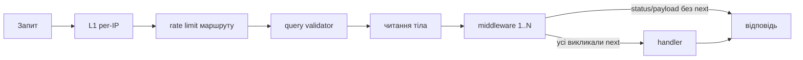

# Middleware

Middleware — це функції, які виконуються **перед** обробником маршруту і можуть його не пустити: перевірити сесію, CSRF-токен, дозвіл ролі. Які middleware спрацюють для запиту, визначає поле `middlewares` у маршруті та його групах — див. [Маршрутизація](/backend/routing#маршрут-—-єдине-джерело-істини).

## Коротко на прикладі: закрити маршрут для незалогінених

Middleware задаються списком назв на групі маршрутів (або на окремому маршруті) і виконуються по черзі до обробника.

```ts
{
    group: [ /* defineRoute({ contract: ..., handler: ... }) */ ],
    prefix: 'notes',
    middlewares: ['session_web', 'csrf_guard', 'auth_guard'],
}
```

| Набір middleware                                            | Хто пройде                         | Інші отримають                              |
| ----------------------------------------------------------- | ---------------------------------- | ------------------------------------------- |
| немає                                                       | усі (як `GET /api/ping`)           | —                                           |
| `session_web`, `csrf_guard`, `auth_guard`                   | лише залогінені                    | `401 unauthorized`                          |
| `session_web`, `csrf_guard`, `auth_guard`, `can:users.read` | лише роль із дозволом `users.read` | `401` без входу, `403` для ролі без дозволу |

Відповіді `GET /api/admin/users` (`can:users.read`):

```text
без cookie            → 401 {"status":"error","code":"unauthorized","message":"Session expired or not found",...}
роль без users.read   → 403 {"status":"error","code":"forbidden","message":"Access denied",...}
```

`session_web` має стояти першим: решта читає сесію, яку він піднімає. Повний список middleware і як додати свій — нижче.

::: tip Веб-маршрут чи публічний API
`session_web` і `csrf_guard` потрібні маршрутам, які викликає наш фронтенд у браузері. Маршрути для зовнішніх клієнтів (інший сервер, мобільний застосунок) кладіть в окрему групу без них. Чому і як: [Веб-маршрути і публічний API](/backend/web-and-api-routes).
:::

## Kernel middleware

Усі middleware реєструються за іменем у [`src/app/middlewares/kernel.ts`](https://github.com/Blazheiko/vibe-template/blob/main/packages/backend/src/app/middlewares/kernel.ts). Там дві мапи, по одній на транспорт: `httpMiddlewares` (тип `Middleware`, контекст `HttpContext`) і `wsMiddlewares` (`Middleware<WsContext>`). Так кожен middleware отримує той контекст, для якого написаний. Якщо WS-маршрут назве HTTP-middleware або навпаки, це помилка `No middleware <name>`, як і для невідомого імені.

| Ім'я              | Файл                                                                                                                                                                   | Що робить                                                                                                                                                                                                                                                                                                                |
| ----------------- | ---------------------------------------------------------------------------------------------------------------------------------------------------------------------- | ------------------------------------------------------------------------------------------------------------------------------------------------------------------------------------------------------------------------------------------------------------------------------------------------------------------------ |
| `session_web`     | [`vendor/utils/middlewares/ws/session-web.ts`](https://github.com/Blazheiko/vibe-template/blob/main/packages/backend/src/vendor/utils/middlewares/ws/session-web.ts)   | сесія на cookie (використовується в HTTP-групах)                                                                                                                                                                                                                                                                         |
| `csrf_guard`      | [`app/middlewares/csrf-guard.ts`](https://github.com/Blazheiko/vibe-template/blob/main/packages/backend/src/app/middlewares/csrf-guard.ts)                             | для `post/put/patch/delete` перевіряє Origin/Referer та CSRF-токен із заголовка `csrfConfig.headerName` (порівняння `timingSafeEqual`); при `enforce = false` лише логує порушення                                                                                                                                       |
| `auth_guard`      | [`vendor/utils/middlewares/core/auth-guard.ts`](https://github.com/Blazheiko/vibe-template/blob/main/packages/backend/src/vendor/utils/middlewares/core/auth-guard.ts) | `401` з `code: "unauthorized"`, якщо `auth.check()` хибне                                                                                                                                                                                                                                                                |
| `can:<дозвіл>`    | [`app/middlewares/permission-guard.ts`](https://github.com/Blazheiko/vibe-template/blob/main/packages/backend/src/app/middlewares/permission-guard.ts)                 | читає роль з БД на кожному запиті; `403` з `forbidden` і `Access denied`, якщо роль не має дозволу. Ставиться після `auth_guard`                                                                                                                                                                                         |
| `ws_can:<дозвіл>` | [`app/middlewares/ws-permission-guard.ts`](https://github.com/Blazheiko/vibe-template/blob/main/packages/backend/src/app/middlewares/ws-permission-guard.ts)           | для WS-маршрутів: роль з'єднання (`userData.role`); без дозволу або поки адмін-канал з'єднання призупинено ([синхронізація ролі](/backend/websocket#синхронізація-ролі)) — `status "403"` з `forbidden` без виклику handler. HTTP-`auth_guard`/`can:` на WS не працюють: WS-контекст не має `auth` і HTTP-`responseData` |

`can:<дозвіл>` і `ws_can:<дозвіл>` `kernel.ts` генерує для кожного дозволу каталогу [`shared/src/access`](https://github.com/Blazheiko/vibe-template/blob/main/packages/shared/src/access/index.ts) (`can:kb.read`, `can:users.read`, …); який дозвіл потрібен якому маршруту — [Ролі та можливості](/reference/roles-capabilities).

Деталі сесій і CSRF — на сторінці [Автентифікація](/backend/auth) і [Безпека](/backend/security#csrf).

## Як виконується ланцюжок

[`execute-httpMiddlewares.ts`](https://github.com/Blazheiko/vibe-template/blob/main/packages/backend/src/vendor/utils/middlewares/core/execute-httpMiddlewares.ts) реалізує класичний `next()`-ланцюжок: `executeMiddlewares` для HTTP і `executeWsMiddlewares` для WS-диспетчера беруть middleware з мапи свого транспорту за іменем (невідоме ім'я — помилка `No middleware <name>`) і повертає `true`, лише якщо **кожен** middleware викликав `next()`. Handler запускається тоді, коли ланцюжок пройдено і `responseData.status` лишився у діапазоні 2xx.



## Власний middleware

Шаблон — як у `permission-guard.ts`: функція типу `Middleware`, що або встановлює `status`/`payload` і повертається, або викликає `await next()`.

```ts
import type { HttpContext, Middleware } from '#vendor/types/types.js'
import { forbidden } from '#app/services/shared/errors.js'
import { appErrorToPayload } from '#app/services/shared/app-error-payload.js'
import { applyAppErrorStatus } from '#app/services/shared/apply-service-status.js'

const myGuard: Middleware = async (
    context: HttpContext,
    next: () => Promise<void>,
): Promise<void> => {
    if (context.auth.getUserId() === null) {
        const error = forbidden('Forbidden')
        applyAppErrorStatus(context.responseData, error) // 403
        context.responseData.payload = appErrorToPayload(error) // { status: 'error', code: 'forbidden', ... }
        return
    }
    await next()
}

export default myGuard
```

Далі: імпортуйте його в `kernel.ts`, додайте ключ у `httpMiddlewares` (наприклад `my_guard: myGuard`; WS-middleware — у `wsMiddlewares`, з типом `Middleware<WsContext>`, як `ws-permission-guard.ts`) і вкажіть ім'я в `middlewares` маршруту чи групи. Порядок має значення: `auth_guard`/`can:<дозвіл>` повинні стояти після `session_web`. Повний приклад фічі — у [Додаванні фічі](/backend/adding-a-feature).
