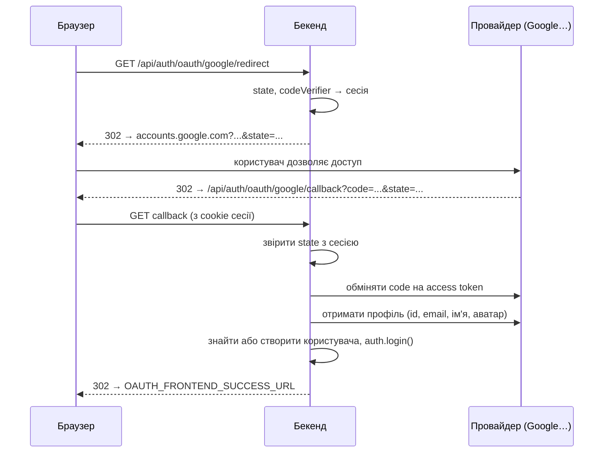

# Вхід через соцмережі

Користувач може увійти через акаунт у соцмережі замість пароля. Бекенд підтримує чотири провайдери: **Google**, **Facebook**, **GitHub** і **GitLab**. Протокол OAuth 2.0 реалізує бібліотека [`arctic`](https://arcticjs.dev/). Код: [`config/oauth.ts`](https://github.com/Blazheiko/vibe-template/blob/main/packages/backend/src/config/oauth.ts), [`oauth-service.ts`](https://github.com/Blazheiko/vibe-template/blob/main/packages/backend/src/app/services/auth/oauth-service.ts), [`oauth-controller.ts`](https://github.com/Blazheiko/vibe-template/blob/main/packages/backend/src/app/controllers/http/auth/oauth-controller.ts).

::: info Кнопки у фронтенді
Фронтенд показує кнопки **лише налаштованих** провайдерів: компонент [`SocialAuthButtons.vue`](https://github.com/Blazheiko/vibe-template/blob/main/packages/frontend/src/components/SocialAuthButtons.vue) один раз завантажує список з `GET /api/auth/oauth/providers`. Якщо жоден провайдер не налаштовано, блоку «або увійдіть через» немає зовсім.
:::

## Як це працює

Маршрути лежать у групі `auth/oauth` з middleware `session_web` і `csrf_guard` (на `GET` CSRF не перевіряється, тож редиректи від провайдера проходять).

| Маршрут                                  | Що робить                                                                                          |
| ---------------------------------------- | -------------------------------------------------------------------------------------------------- |
| `GET /api/auth/oauth/providers`          | список налаштованих провайдерів: `{ status: 'ok', providers: ['google', …] }`; без входу           |
| `GET /api/auth/oauth/:provider/redirect` | генерує `state` (і PKCE-`codeVerifier` для Google), кладе їх у сесію, `302` на сторінку провайдера |
| `GET /api/auth/oauth/:provider/callback` | сюди провайдер повертає користувача з `code` і `state`; бекенд логінить і робить `302` на фронтенд |



Що відбувається в callback ([`oauthService.handleCallback`](https://github.com/Blazheiko/vibe-template/blob/main/packages/backend/src/app/services/auth/oauth-service.ts)):

1. **Перевірка `state`.** Значення з query порівнюється з тим, що збережено в сесії на кроці redirect, за сталий час ([`safeEqual`](https://github.com/Blazheiko/vibe-template/blob/main/packages/backend/src/vendor/utils/helpers/safe-equal.ts)). Розбіжність — `OAuth state mismatch`: так відсікається підроблений callback (CSRF на вході). Після callback `oauthState` і `oauthCodeVerifier` видаляються з сесії.
2. **Обмін `code` на токени** через `arctic` і запит профілю до API провайдера. Токен доступу використовується **один раз**, для цього запиту, і далі не зберігається (див. [нижче](#що-зберігається)). Facebook отримує токен у заголовку `Authorization: Bearer`, а не в query-рядку: у URL він потрапляє в логи проксі й CDN та в `Referer`. Відповідь API профілю з кодом поза `2xx` (прострочений токен, rate limit, збій) — це помилка, а не профіль: `fetchJson` кидає виняток, і вхід завершується `Failed to exchange authorization code` (feat-108). Список адрес GitHub, що не є масивом, читається як «немає підтвердженої адреси».
3. **Ідентифікатор обов'язковий.** Порожній або нерядковий/нечисловий `id` профілю відхиляється до будь-якого пошуку (`Could not retrieve account id from provider`, feat-108): акаунт шукається за `(provider, provider_user_id)`, і порожній `id` став би одним спільним акаунтом для всіх, чий профіль провайдер не віддав.
4. **Email обов'язковий.** Якщо провайдер не віддав email, вхід не відбувається (`Could not retrieve email from provider`). Email приводиться до нижнього регістру. Разом з email бекенд визначає, чи провайдер є **власником поштової скриньки** (`emailTrust`, див. [нижче](#довіра-до-адреси)).
5. **Пошук користувача** (див. таблицю в [Прив'язка за email](#прив-язка-за-email)):
    - є запис у `oauth_accounts` з цим провайдером і id користувача в провайдера → вхід. Прив'язка й `session_token` читаються **повторно під блокуванням рядка користувача** (`FOR UPDATE`): якщо claim щойно видалив прив'язку, вхід відхиляється з причиною `oauth_link_revoked`;
    - інакше є користувач з таким email → прив'язка (Google-власник скриньки) або лист із посиланням підтвердження (усі інші);
    - інакше створюється новий користувач без пароля (`password: null`) з ім'ям і аватаром із профілю. Користувач і його перша прив'язка створюються **однією транзакцією**: якщо паралельний callback тієї ж ідентичності закомітився першим, унікальна пара `provider` + `provider_user_id` відкочує цю транзакцію разом із користувачем, і рішення ухвалюється ще раз — уже за прив'язкою переможця (вхід у той самий акаунт). Зайвого користувача не лишається.
6. **Вхід.** Викликається `auth.login(...)` — та сама функція, що й при вході за паролем (див. [Автентифікація](/backend/auth#вхід-і-вихід-у-коді)): нова сесія, нова cookie. Користувач отримує push «новий вхід».
7. **Редирект на фронтенд**, завжди зі статусом `302`: успіх — `OAUTH_FRONTEND_SUCCESS_URL` (`/?oauth=success`); прив'язка чекає підтвердження листом — `OAUTH_FRONTEND_LINK_PENDING_URL` (`/?oauth=link_pending`, вхід **не** відбувся); помилка — `OAUTH_FRONTEND_ERROR_URL` (`/?error=oauth_failed`). До URL помилки додається `reason=` для `oauth_link_revoked`, `email_changed`, `oauth_already_linked` і `too_many_attempts`, решта помилок — загальне повідомлення.

## Що зберігається

Таблиця `oauth_accounts` тримає `provider`, `provider_user_id`, `provider_email`, `provider_name`, `provider_avatar` і час створення/зміни. Пара `provider` + `provider_user_id` унікальна. **Токени провайдера (`access_token`, `refresh_token`) не зберігаються**: жоден код їх не читав, а токен у відкритому вигляді в БД — це ризик без користі (витік бекапу чи дампу віддає доступ до акаунтів у провайдерів). Колонки видалено міграцією `drop_oauth_tokens`; вони були nullable, тож відкат — `ADD COLUMN access_token text, ADD COLUMN refresh_token text` (дані, що там були, не відновлюються).

Якщо вам потрібен доступ до API провайдера від імені користувача (офлайн), токени треба зберігати **зашифрованими** ключем, окремим від `APP_KEY`, і лише тоді, коли для цього є код, що їх читає.

### Що потрапляє в логи

Email і ім'я з профілю — персональні дані. Журнал OAuth-входу містить провайдера і **замаскований** email (`u***r@e*****e.com`, `maskEmailForLogs`), без імені, без id у провайдера і без токенів.

## Прив'язка за email

Захист від pre-hijacking акаунта ([план](https://github.com/Blazheiko/vibe-template/blob/main/docs/plan/oauth-pre-hijack-plan.md)): атакуючий заздалегідь створює акаунт з адресою жертви (паролем, через Facebook, з прив'язаним телефоном) і чекає, поки жертва увійде через OAuth. Тому прив'язка за email і саме значення `users.email` спираються лише на **доказ володіння скринькою**.

### Довіра до адреси

| Провайдер | `emailTrust`                                                                                                                                                                                                                                                                                  |
| --------- | --------------------------------------------------------------------------------------------------------------------------------------------------------------------------------------------------------------------------------------------------------------------------------------------- |
| Google    | `authoritative` лише для `@gmail.com` / `@googlemail.com` з `verified_email: true` або для Google Workspace (`hd` дорівнює домену адреси) з `verified_email: true` ([документація Google](https://developers.google.com/identity/gsi/web/guides/verify-google-id-token)); інакше `unverified` |
| GitHub    | `unverified`; адреса береться з `/user/emails` (основна й підтверджена) лише як адреса для листа                                                                                                                                                                                              |
| GitLab    | `unverified`; адреса з OpenID Connect `/oauth/userinfo` (якщо там `email_verified`), інакше з `/api/v4/user`                                                                                                                                                                                  |
| Facebook  | `unverified`: Graph API не має ознаки «email підтверджено»                                                                                                                                                                                                                                    |

### Що відбувається

| Ситуація                                         | Google `authoritative`                           | Решта (`unverified`)                                                                                                                                                                          |
| ------------------------------------------------ | ------------------------------------------------ | --------------------------------------------------------------------------------------------------------------------------------------------------------------------------------------------- |
| Є користувач з цим email, адреса підтверджена    | прив'язка й вхід                                 | **без входу**: лист «прив'язати провайдера» на адресу акаунта, редирект на `link_pending`                                                                                                     |
| Є користувач з цим email, адреса не підтверджена | **claim** (див. нижче), прив'язка й вхід         | так само лист; підтвердження виконує claim                                                                                                                                                    |
| Користувача немає                                | новий користувач з `email` і `email_verified_at` | новий користувач з **`email = null`**; адреса лишається в `oauth_accounts.provider_email`, на неї йде лист підтвердження першої адреси (`email_link_verifications`); вхід відбувається одразу |

- **Лист «прив'язати провайдера»** (`oauth_link_verifications`, TTL 30 хв) працює лише в браузерній сесії, з якої почався вхід: у токені зберігається хеш id сесії, і підтвердження порівнює його з хешем поточної сесії за сталий час ([`safeEqual`](https://github.com/Blazheiko/vibe-template/blob/main/packages/backend/src/vendor/utils/helpers/safe-equal.ts)). Посилання веде на фронтенд `/oauth/link/confirm?token=…`, а той викликає `POST /api/auth/oauth/link/confirm` з `{ token }`. Відкрите в іншому браузері — `403 oauth_link_wrong_session`, токен лишається придатним. Якщо адреса акаунта змінилася після відправки — `409 email_changed`; якщо ця ідентичність уже прив'язана — `409 oauth_already_linked`. Pending-прив'язка одного провайдера не скасовує pending-прив'язку іншого.
- **Ліміти листів.** Кожен шлях, що надсилає лист підтвердження адреси, — лист «прив'язати провайдера», перший лист нового OAuth-користувача і його `resend` — до видачі токена й відправки списує ті самі бюджети, що й [прив'язка email зі сторінки акаунта](/backend/security): `linkEmailTarget` (адреса), `linkEmailUser` і `linkEmailUserCooldown` (акаунт). Вичерпаний бюджет: callback — редирект з `reason=too_many_attempts`, без токена й без скасування pending-посилання власника; `resend` — `400 too_many_attempts`; перший лист просто не надсилається (вхід лишається). Загальний ліміт OAuth-маршрутів за IP цього не замінює: атакуючий з багатьох IP не завалить скриньку жертви й не скасовуватиме її посилання знову й знову.
- **Перша адреса** нового користувача підтверджується посиланням `/verify-email` лише з сесії цього акаунта (`403 email_link_wrong_session` інакше), тож клік жертви в листі, який ініціював атакуючий, нічого не робить. Повторно надіслати лист: `POST /api/auth/oauth/email/resend` (залогінений користувач без email; адреса береться з `provider_email`, вводити її не треба).
- **Claim** — перший доказ володіння скринькою на акаунті з непідтвердженим email (авторитетний Google, підтверджене посилання прив'язки, [скидання пароля листом](/backend/auth)). В одній транзакції під блокуванням рядка: адреса перевіряється ще раз, `email_verified_at` виставляється, пароль і телефон обнуляються, видаляються всі OAuth-прив'язки й push-підписки, усі pending-токени й SMS-челенджі інвалідуються, `session_token` ротується (старі сесії відкликані, ADR 0002). Дані акаунта лишаються.

::: warning Уже розгорнуті копії шаблону
Записи, створені до цієї зміни, нові правила не перевіряють: користувачі GitHub/GitLab мають `email_verified_at` за відповіддю провайдера, користувачі Facebook — непідтверджений `email`, а вже прив'язані ідентичності просто входять. Скидання `email_verified_at` саме по собі **не** прибирає наявну прив'язку атакуючого: її видаляє claim, коли власник входить через авторитетний Google або скидає пароль. Запити нижче лише **позначають кандидатів** для ручної перевірки, а не доводять атаку:

```sql
-- прив'язки не-Google провайдерів, створені раніше за підтвердження адреси
SELECT u.id, u.email, o.provider, o.created_at, u.email_verified_at
FROM oauth_accounts o JOIN users u ON u.id = o.user_id
WHERE o.provider <> 'google' AND (u.email_verified_at IS NULL OR o.created_at < u.email_verified_at);
```

Для підтвердженого кандидата: видалити підозрілу прив'язку, скинути `email_verified_at`, ротувати `session_token`, повідомити власника й порадити скинути пароль.
:::

## Що потрібно, щоб це запрацювало

### 1. Зареєструвати застосунок у провайдера

У консолі розробника кожного провайдера створіть OAuth-застосунок і отримайте **Client ID** і **Client Secret**.

| Провайдер | Де створити                                                                                                    | Які дозволи запитує бекенд            |
| --------- | -------------------------------------------------------------------------------------------------------------- | ------------------------------------- |
| Google    | [Google Cloud Console → Credentials](https://console.cloud.google.com/apis/credentials), тип «Web application» | `openid`, `profile`, `email` (+ PKCE) |
| Facebook  | [Meta for Developers](https://developers.facebook.com/apps/), продукт «Facebook Login»                         | `email`, `public_profile`             |
| GitHub    | [GitHub → Settings → Developer settings → OAuth Apps](https://github.com/settings/developers)                  | `user:email`                          |
| GitLab    | [GitLab → Preferences → Applications](https://gitlab.com/-/user_settings/applications)                         | `openid`, `email`, `read_user`        |

GitLab підключено до `https://gitlab.com`. Для власного інстансу GitLab змініть адресу в `createGitLabClient()` і `fetchGitLabUserInfo()`.

::: warning GitLab: увімкніть scopes `openid` і `email`
Бекенд запитує в GitLab `openid`, `email` і `read_user`: ознаку підтвердження email (`email_verified`) GitLab віддає лише через OpenID Connect. У налаштуваннях OAuth-застосунку GitLab (**Preferences → Applications** → ваш застосунок) мають бути позначені всі три scopes.

Якщо застосунок створено раніше лише з `read_user`, **оновіть його до деплою цієї версії**: інакше GitLab відхилить авторизацію з помилкою `invalid_scope`, і вхід через GitLab перестане працювати. Деталі — [GitLab як OpenID Connect provider](https://docs.gitlab.com/integration/openid_connect_provider/).
:::

### 2. Вказати Redirect URI

У налаштуваннях застосунку провайдера додайте **Authorized redirect URI**. Він має вести на callback бекенду і **точно** збігатися з тим, що в `.env`:

```text
https://app.example.com/api/auth/oauth/<provider>/callback
```

Провайдер поверне браузер саме на цю адресу, і браузер має надіслати туди cookie сесії, створеної на кроці redirect. Тому домен у Redirect URI — той, на якому користувач відкрив застосунок.

::: tip Локальна розробка
У dev фронтенд працює на `http://localhost:5173`, а Vite проксіює `/api` на бекенд. Вказуйте Redirect URI через порт фронтенду: `http://localhost:5173/api/auth/oauth/google/callback`. Якщо вказати `:3000`, cookie сесії з `:5173` туди не дійде і вхід завершиться `Missing OAuth parameters`. Google і GitHub дозволяють `http://localhost`; Facebook вимагає HTTPS для всього, крім `localhost`.
:::

### 3. Заповнити `.env`

```bash
GOOGLE_CLIENT_ID=<client-id>
GOOGLE_CLIENT_SECRET=<client-secret>
GOOGLE_REDIRECT_URI=http://localhost:5173/api/auth/oauth/google/callback

# куди повернути користувача після входу (необов'язково)
OAUTH_FRONTEND_SUCCESS_URL=/?oauth=success
OAUTH_FRONTEND_ERROR_URL=/?error=oauth_failed
```

Так само для `FACEBOOK_*`, `GITHUB_*` і `GITLAB_*`. Повний список змінних — [Конфігурація → OAuth](/backend/configuration#oauth). Client Secret — секрет: не комітьте його.

Перезапустіть бекенд і відкрийте `http://localhost:5173/api/auth/oauth/google/redirect` — вас має перекинути на сторінку входу Google.

::: info Ненастроєний провайдер
Провайдер вважається налаштованим, коли задано всі три змінні: `*_CLIENT_ID`, `*_CLIENT_SECRET` і `*_REDIRECT_URI`. Ненастроєного провайдера немає в `GET /api/auth/oauth/providers`, тож і кнопки для нього немає, а прямий перехід на `/api/auth/oauth/<provider>/redirect` повертає `404 Provider not configured`.
:::

### Типові помилки

Усі помилки callback ведуть на `OAUTH_FRONTEND_ERROR_URL` (статус `302`); причину видно в логах бекенду (`oauth callback failed`).

| Повідомлення в логах                  | Причина                                                                                                                                                                                                            |
| ------------------------------------- | ------------------------------------------------------------------------------------------------------------------------------------------------------------------------------------------------------------------ |
| `Missing OAuth parameters`            | у callback немає `code`/`state` або в сесії немає `oauthState` (інший домен, інший браузер, сесія протермінувалась, користувач скасував вхід)                                                                      |
| `OAuth state mismatch`                | `state` не збігся: старе посилання або callback з чужої сесії                                                                                                                                                      |
| `OAuth code exchange failed`          | невірний Client Secret, Redirect URI не збігається з зареєстрованим, `code` уже використаний                                                                                                                       |
| `oauth provider returned empty email` | користувач не дав доступу до email або в нього немає підтвердженої адреси                                                                                                                                          |
| `oauth link mailed`                   | користувач з таким email уже є, а провайдер не є власником скриньки: на адресу акаунта пішов лист підтвердження прив'язки, фронтенд отримує `?oauth=link_pending` (див. [Прив'язка за email](#прив-язка-за-email)) |
| `Provider not configured: <name>`     | для провайдера не задано всі три змінні `*_CLIENT_ID`, `*_CLIENT_SECRET`, `*_REDIRECT_URI`                                                                                                                         |
| `Unsupported provider: <name>`        | у URL провайдер, якого немає в `SUPPORTED_PROVIDERS`                                                                                                                                                               |

## Як додати нового провайдера

Нижче приклад для **Discord**. `arctic` підтримує понад 50 провайдерів ([список](https://arcticjs.dev/)), і для кожного кроки однакові. Усі зміни бекенду — у двох файлах: `config/oauth.ts` і `oauth-service.ts`. Маршрути змінювати не треба: `:provider` у URL уже приймає будь-яке ім'я.

### 1. Конфіг і змінні оточення

[`config/oauth.ts`](https://github.com/Blazheiko/vibe-template/blob/main/packages/backend/src/config/oauth.ts):

```ts
discord: {
    clientId: env['DISCORD_CLIENT_ID'] ?? '',
    clientSecret: env['DISCORD_CLIENT_SECRET'] ?? '',
    redirectUri: env['DISCORD_REDIRECT_URI'] ?? '',
},
```

Додайте ці три змінні в `packages/backend/.env.example` і в таблицю на сторінці [Конфігурація](/backend/configuration#oauth).

### 2. Сервіс

У [`oauth-service.ts`](https://github.com/Blazheiko/vibe-template/blob/main/packages/backend/src/app/services/auth/oauth-service.ts):

```ts
import { Discord /* , Google, ... */ } from 'arctic'

// 1. дозволити провайдера
const SUPPORTED_PROVIDERS = ['google', 'facebook', 'github', 'gitlab', 'discord'] as const

// 2. фабрика клієнта
function createDiscordClient(): Discord {
    return new Discord(
        oauthConfig.discord.clientId,
        oauthConfig.discord.clientSecret,
        oauthConfig.discord.redirectUri,
    )
}

// 3. профіль користувача → OAuthUserInfo
async function fetchDiscordUserInfo(accessToken: string): Promise<OAuthUserInfo> {
    const data = await fetchJson('https://discord.com/api/users/@me', {
        Authorization: `Bearer ${accessToken}`,
    })
    const id = typeof data['id'] === 'string' ? data['id'] : ''
    const avatarHash = typeof data['avatar'] === 'string' ? data['avatar'] : null
    return {
        id,
        email: typeof data['email'] === 'string' ? data['email'] : '',
        name:
            typeof data['global_name'] === 'string'
                ? data['global_name']
                : typeof data['username'] === 'string'
                  ? data['username']
                  : '',
        avatar:
            avatarHash !== null
                ? `https://cdn.discordapp.com/avatars/${id}/${avatarHash}.png`
                : null,
        // Discord повертає `verified`: чи підтверджено email. Без цього поля ставте false.
        emailVerified: data['verified'] === true,
    }
}
```

Поле `emailVerified` обов'язкове: воно вирішує, чи можна прив'язати вхід до наявного користувача з тим самим email (див. [Прив'язка за email](#прив-язка-за-email)). Якщо провайдер не дає надійної ознаки, ставте `false`, як для Facebook.

У `getAuthorizationUrl` додайте гілку перед GitLab (вона йде останньою як «інакше»):

```ts
if (provider === 'discord') {
    const url = createDiscordClient().createAuthorizationURL(state, null, ['identify', 'email'])
    return Result.ok({ url: url.toString(), state, codeVerifier: null })
}
```

У `handleCallback` — гілку обміну коду:

```ts
} else if (provider === 'discord') {
    const tokens = await createDiscordClient().validateAuthorizationCode(code, null)
    userInfo = await fetchDiscordUserInfo(tokens.accessToken())
}
```

Сигнатури `createAuthorizationURL` і `validateAuthorizationCode` у різних провайдерів відрізняються: одні вимагають PKCE (`codeVerifier`, як Google), інші ні (GitHub), у треті його можна передати або `null` (Discord). Дивіться сторінку провайдера в документації `arctic`. Якщо провайдер вимагає PKCE, згенеруйте `codeVerifier` через `generateCodeVerifier()` і поверніть його з `getAuthorizationUrl` — контролер збереже його в сесії, як для Google.

Решту робить спільний код: пошук або створення користувача, запис у `oauth_accounts` з `provider = 'discord'`, `auth.login` і редирект. Колонка `provider` має довжину 50 символів, тож міграція БД не потрібна.

### 3. Тип провайдера і фронтенд

Список провайдерів також є в спільному типі: додайте `'discord'` в `OAuthProviderSchema` у [`shared/src/responses/oauth-controller.ts`](https://github.com/Blazheiko/vibe-template/blob/main/packages/shared/src/responses/oauth-controller.ts). Тоді `GET /api/auth/oauth/providers` зможе його повернути.

У [`SocialAuthButtons.vue`](https://github.com/Blazheiko/vibe-template/blob/main/packages/frontend/src/components/SocialAuthButtons.vue) додайте назву в `LABELS` (TypeScript підкаже, бо `LABELS` має тип `Record<OAuthProvider, string>`) і за бажанням іконку:

```ts
const LABELS: Record<OAuthProvider, string> = {
    google: 'Google',
    // ...
    discord: 'Discord',
}
```

Окремо прописувати кнопку не треба: вона з'явиться сама, щойно на бекенді будуть задані змінні `DISCORD_*`. Посилання формує компонент (`/api/auth/oauth/discord/redirect`); це звичайне посилання, а не `fetch`, бо браузер має сам перейти на сторінку провайдера.

### 4. Перевірка

1. Зареєструйте застосунок у [Discord Developer Portal](https://discord.com/developers/applications), Redirect URI — `http://localhost:5173/api/auth/oauth/discord/callback`.
2. Заповніть `DISCORD_*` у `.env`, перезапустіть бекенд.
3. Переконайтесь, що `GET /api/auth/oauth/providers` повертає `discord`, натисніть кнопку, дозвольте доступ — вас поверне на `/?oauth=success` уже залогіненим. У таблиці `oauth_accounts` з'явиться рядок з `provider = 'discord'`.
4. Запустіть `pnpm --filter backend typecheck` і `pnpm --filter backend test`.
