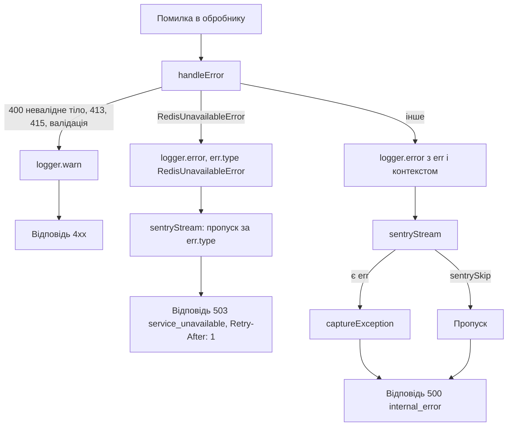

# Observability

Сторінка описує, як бекенд пише логи, що потрапляє в Sentry, як влаштовані liveness і readiness і чого в шаблоні поки немає (метрики). Змінні оточення Sentry перелічені в [Конфігурації](/backend/configuration), обробка помилок HTTP — у [Життєвому циклі запиту](/backend/request-lifecycle), Sentry-аргументи збірки фронтенду — у [Деплої](/backend/deployment).

## Логування

Логер — [pino](https://getpino.io) 10, єдиний екземпляр експортується з [logger.ts](https://github.com/Blazheiko/vibe-template/blob/main/packages/backend/src/vendor/utils/logger.ts) (імпорт `#vendor/utils/logger.js`).

- **Рівень.** `LOG_LEVEL` ([`config/logging.ts`](https://github.com/Blazheiko/vibe-template/blob/main/packages/backend/src/config/logging.ts)): `fatal`, `error`, `warn`, `info` (за замовчуванням), `debug`, `trace` або `silent`, без огляду на регістр. Невідоме значення зупиняє старт (`Invalid logging configuration`).
- **Формат.** Якщо `APP_ENV` дорівнює `prod` або `production`, логи йдуть у stdout як JSON-рядки (`destination({ sync: false })`). В інших оточеннях використовується `pino-pretty` з кольорами; пакет імпортується динамічно лише поза production.
- **Потоки.** `multistream` має два потоки: основний (stdout) і `sentryStream` рівня `error`, який пересилає помилки в Sentry (див. нижче).
- **Серіалізатори.** `bigint` → рядок; `err` і `error` — стандартний серіалізатор pino поверх безпечної копії помилки (див. [Помилки БД у логах](#помилки-бд-у-логах)).
- **Redaction.** Опції pino `redact` немає. Маскування робиться вручну: хелпери `maskEmailForLogs`, `maskPhoneForLogs` і `maskTokenForLogs` у [mask-sensitive.ts](https://github.com/Blazheiko/vibe-template/blob/main/packages/backend/src/vendor/utils/helpers/mask-sensitive.ts). Правило для нового запису логу — не класти в нього те, що написав чи надав користувач, і те, що діє як секрет: текст звернення до підтримки логується лише довжиною (`originalLength`), адреси отримувачів листа — замасковані, токен сесії — лише перші 4 символи (`maskTokenForLogs` у `session-handler.ts` і `ws-session-auth.ts`), збій push — зі `statusCode` та ім'ям помилки без об'єкта `WebPushError` (він містить endpoint підписки, заголовки й тіло відповіді push-сервісу), OAuth-редирект — лише з провайдером, без URL зі `state`.

### Помилки БД у логах

Помилка запиту може нести дані користувача. Повідомлення помилки `pg` може цитувати значення (`invalid input syntax for type bigint: "…"`), а `detail` — рядок або ключ; pino вбудовує повідомлення `cause` у запис. Клієнт drizzle з `paramsInErrors: true` ще й кладе параметри запиту (хеш пароля, `session_token`, email) у `message` і `stack` `DrizzleQueryError` та зберігає `query` / `params` як поля; `db` застосунку цю опцію не вмикає, захист діє на випадок, якщо її ввімкнуть. Тому логер і Sentry отримують не саму помилку, а її копію з [scrub-error.ts](https://github.com/Blazheiko/vibe-template/blob/main/packages/backend/src/vendor/utils/errors/scrub-error.ts) (`toSafeError`):

- **Помилка БД** (`DrizzleQueryError` або `pg` `DatabaseError`) зберігає лише `code`, `constraint`, `table`, `column`, `schema`, `routine`, `severity`. Повідомлення фіксоване: `Failed query (params redacted)` або `Database error (code=23505 constraint=users_email_unique)`. `stack` перебудовується з цього повідомлення і кадрів (`at …`). Кадри беруться лише **після** справжнього заголовка помилки, тож рядок повідомлення, що має вигляд кадру (`    at …`, процитований БД), до стеку не потрапляє (feat-126).
- **Будь-яка помилка** втрачає поля `query`, `params`, `detail`, `where`, `internalQuery`, `hint`.
- `cause`, `AggregateError.errors` і помилки в полях обробляються так само, рекурсивно (цикли зберігаються, глибина обмежена), зокрема помилки всередині звичайних об'єктів і масивів у полях (`details: { failures: [err] }`, feat-126). `cause`, що не є помилкою, відкидається.
- Копія має той самий прототип, тому `err.type` (ім'я класу, напр. `RedisUnavailableError`) не змінюється.
- Оригінальна помилка не змінюється: її далі читає [db-errors.ts](https://github.com/Blazheiko/vibe-template/blob/main/packages/backend/src/app/repositories/db-errors.ts).

Ключі `err` і `error` (і помилка першим аргументом, `logger.error(err)`) очищають серіалізатори. Коли виклик не дає повідомлення, pino бере `msg` із самої помилки ще до серіалізаторів, тому хук `logMethod` заздалегідь замінює її безпечною копією (feat-127). Помилки серед format-аргументів (`logger.error({ … }, 'failed: %s', err)`) хук теж замінює безпечними копіями, бо pino підставляє їх у `msg` як є; так само очищаються bindings дочірнього логера (`logger.child({ lastError })`), які pino пише в кожен запис повз `formatters.log` (feat-137). Помилку деінде в записі (`logger.error({ context: { failure: err } }, …)`, масив збоїв, поле екземпляра класу — feat-137) очищає і серіалізує `formatters.log` ([`toSafeValue`](https://github.com/Blazheiko/vibe-template/blob/main/packages/backend/src/vendor/utils/errors/scrub-error.ts), feat-126), не змінюючи об'єктів того, хто логує:

- помилкою вважається лише `Error` або об'єкт із рядковими `name`, `message` і `stack`; звичайний об'єкт із полем `message` (`{ code, message }` відповіді, `payload: { message }`) логується як є (feat-127);
- копіюється лише шлях до заміненої помилки, тож запис без помилок не копіюється; спільне посилання обробляється один раз;
- цикл стає `[Circular]`, а піддерево глибше 32 рівнів — `[Truncated]`, щоб помилка під ними не потрапила в лог сирою;
- екземпляр класу обходиться як об'єкт власних полів (feat-137); значення з `toJSON` — як результат `toJSON()`, бо саме його пише pino: помилка, яку `toJSON` повертає або містить, замінюється безпечною копією, `toJSON`, що кидає, стає `[toJSON failed]` (feat-139); `Buffer`, дати, `Map`, `Set` не обходяться.

Текст помилки, вставлений у `msg` вручну, пишеться як є.

Те саме діє поза логером:

- `console.error` у `index.ts` (збій старту, зупинки) друкує безпечну копію.
- Sentry очищає `extra`, `contexts` і дані breadcrumb **на копії**: об'єкти, які передав той, хто викликав, не змінюються, а помилки в них замінюються безпечними копіями. Екземпляр класу очищається як об'єкт власних полів, бо саме його Sentry і надсилає після нормалізації; дати, `Map`, `Set`, буфери лишаються як є (feat-127). Значення з `toJSON` (`URL`, `Decimal`) очищається як результат `toJSON()`, бо так його серіалізує Sentry; раніше воно, не маючи власних полів, ішло як `{}`. `URL` надсилається рядком без секретів: значення query-параметрів, fragment і userinfo замінюються на `[Filtered]`, ключі лишаються (feat-139). Значення глибше 8 рівнів стає `[Truncated]`, а не надсилається як є (feat-139). У безпечній копії помилки з `extra` чутливі власні поля видаляються, а решта очищається, як будь-яке значення (feat-137).
- Статус `knowledge-base/init-status` показує для помилки БД лише безпечне повідомлення.

### Логер запиту

Для кожного HTTP-запиту і WS-повідомлення створюється дочірній логер `logger.child({ requestId })`, де `requestId` — `randomUUID()`. HTTP-`requestId` генерується на першому кроці обробки (`server.ts`), ще до читання тіла, тож його мають і помилки 413/415/422. Коли `session_web` відновив сесію з користувачем, логер запиту замінюється на `child({ userId })`; WS-логер отримує `userId` з даних з'єднання. Він доступний у контролерах як `ctx.logger` ([http-context.ts](https://github.com/Blazheiko/vibe-template/blob/main/packages/backend/src/vendor/utils/context/http-context.ts), [ws-context.ts](https://github.com/Blazheiko/vibe-template/blob/main/packages/backend/src/vendor/utils/context/ws-context.ts)).

### Що логується при помилці

`handleError` у [server.ts](https://github.com/Blazheiko/vibe-template/blob/main/packages/backend/src/vendor/start/server.ts) пише через `logger.child({ requestId, userId, route, method })` — кожен запис нижче має ці поля (`userId` — коли відомий):

| Помилка                                       | Рівень  | Поля                                                        |
| --------------------------------------------- | ------- | ----------------------------------------------------------- |
| `PayloadTooLargeError`                        | `warn`  | `limit`, `contentType`                                      |
| `MalformedBodyError`                          | `warn`  | `bodyKind` (без тіла запиту й тексту помилки парсера)       |
| `UnsupportedMediaTypeError`                   | `warn`  | `receivedContentType`, `allowedKinds`                       |
| `ValidationError`, `ParameterValidationError` | `warn`  | `err`                                                       |
| `RedisUnavailableError` (відповідь 503)       | `error` | `err` + контекст; у Sentry не йде (див. нижче)              |
| інше (відповідь 500)                          | `error` | `err` + `requestId`, `userId`, `route`, `method` (контекст) |

Для маршрутів API контекст містить `requestId`, `userId`, `route.url`, `route.method`; для службового обробника документації маршрутів — лише `route` і `method`. `userId` береться в момент помилки: для 413/415/422 його немає, бо тіло читається й валідується до middleware сесії. Коди відповідей — у [Життєвому циклі запиту](/backend/request-lifecycle).

### Помилки сервісів (`AppError`)

Сервіси повертають помилки як `Result` і не кидають їх, тож `handleError` їх не бачить. Їх логує контролерний шар: `mapControllerError` і `mapWsControllerError` викликають [`reportAppError`](https://github.com/Blazheiko/vibe-template/blob/main/packages/backend/src/app/services/shared/report-app-error.ts) через логер запиту. Деталі — у [Контролерах](/backend/controllers#мапінг-помилок).

| `AppError`                                          | Рівень      | Поля                                      | Sentry                              |
| --------------------------------------------------- | ----------- | ----------------------------------------- | ----------------------------------- |
| 4xx (`BadRequest`, `NotFound`, `Conflict` тощо)     | не пишеться | —                                         | ні                                  |
| `Internal`, `UpstreamError`, `UpstreamTimeout`      | `error`     | `err` (першопричина), `appError` (`_tag`) | так                                 |
| `ServiceUnavailable`, причина — недоступність Redis | `error`     | `err`, `appError`, `sentrySkip: true`     | ні, подію дає модуль здоров'я Redis |
| `ServiceUnavailable`, інша причина                  | `error`     | `err`, `appError`                         | так                                 |

Також у [index.ts](https://github.com/Blazheiko/vibe-template/blob/main/packages/backend/src/index.ts): `uncaughtException` логується як `error` з `sentrySkip: true` і окремо відправляється через `sentryService.captureException`; при graceful shutdown викликається `sentryService.flush(2000)`.

## Sentry (бекенд)

### Ініціалізація

[sentry-bootstrap.ts](https://github.com/Blazheiko/vibe-template/blob/main/packages/backend/src/sentry-bootstrap.ts) — це перший імпорт у [index.ts](https://github.com/Blazheiko/vibe-template/blob/main/packages/backend/src/index.ts): він завантажує `dotenv/config` і викликає `sentryService.init()`. Конфіг — [config/sentry.ts](https://github.com/Blazheiko/vibe-template/blob/main/packages/backend/src/config/sentry.ts):

- Sentry активний, лише якщо `SENTRY_DSN` непорожній і `SENTRY_ENABLED` не `false`. Інакше всі методи сервісу — no-op.
- В `Sentry.init` передаються `dsn`, `environment` (`SENTRY_ENVIRONMENT` або `APP_ENV`), `release`, `tracesSampleRate` (дефолт `0`). Додаткові `integrations` не задаються — діють стандартні з `@sentry/node` 11.
- Помилка `Sentry.init` не зупиняє застосунок: пишеться `console.warn`, Sentry лишається вимкненим.

```dotenv
SENTRY_DSN=https://<public-key>@<org>.ingest.sentry.io/<project-id>
SENTRY_ENVIRONMENT=production
SENTRY_RELEASE=<git-sha>
SENTRY_TRACES_SAMPLE_RATE=0
```

### PII і санітизація

У Sentry 11 `sendDefaultPii` прибрано, тому [sentry-service.ts](https://github.com/Blazheiko/vibe-template/blob/main/packages/backend/src/app/services/observability/sentry-service.ts) явно вимикає збір через `dataCollection`: `userInfo`, `cookies`, `httpBodies: []`, `genAI` inputs/outputs, `databaseQueryData`, `queues`, `stackFrameVariables` — усе `false`.

Додатково event processor `sanitizeEvent`:

- видаляє з `tags` ключі, що збігаються з `/token|secret|password|cookie|auth|api[_-]?key|bearer/i`; з `extra`, `contexts` і `breadcrumbs[].data` — на будь-якій глибині, разом з парою `query` + `params`;
- замінює повідомлення помилок БД у `exception.values[].value` (Sentry будує їх з оригінальної помилки, коли сам ловить uncaught exception), а також текст `Failed query: …` у `message`, `breadcrumbs[].message` і рядках `extra` / `contexts`;
- видаляє заголовки `authorization`, `cookie` і ті, що збігаються з тим самим regex;
- видаляє `request.data`, якщо `status_code >= 400`, інакше обрізає його до 10 КБ.

`sentryService.captureException` передає в Sentry безпечну копію помилки (`toSafeError`), а `sentryStream` — запис, уже серіалізований логером з такої копії.

З користувача в Sentry передається лише `id` (`scope.setUser({ id })`).

### Що потрапляє в Sentry

Логи пересилає `sentryStream` у [logger.ts](https://github.com/Blazheiko/vibe-template/blob/main/packages/backend/src/vendor/utils/logger.ts). Правила:

1. Рівень нижче `error` (50) ігнорується — `warn` (4xx у `handleError`) у Sentry не йде.
2. `sentrySkip: true` — пропустити (використовується, коли помилку відправлено вручну). Так само пропускаються записи з `err.type === "RedisUnavailableError"`: інцидент уже зафіксовано модулем здоров'я Redis, див. [Відмова Redis](#відмова-redis).
3. Є поле `err` або `error` → `captureException`.
4. Інакше лише при `sentryCapture: true` → `captureMessage(msg, "error")`.

До події додаються теги `requestId`, `route`, `method` і `user.id`, якщо вони є в записі логу. `AppError` (об'єкти з `_tag`) нормалізуються в `Error` з ім'ям `AppError.<tag>`.

```ts
// повідомлення без exception — лише з явним прапорцем
ctx.logger.error({ sentryCapture: true, orderId }, 'Payment webhook mismatch')

// вже відправлено вручну — не дублювати
logger.error({ err, sentrySkip: true }, 'event uncaughtException')
```



### Відмова Redis

Стан основного Redis-клієнта тримає [redis-health.ts](https://github.com/Blazheiko/vibe-template/blob/main/packages/backend/src/database/redis-health.ts): `healthy` або `unavailable`.

- **Одна подія на інцидент.** Перехід `healthy → unavailable` (перша подія `error`/`close` клієнта або перша `RedisUnavailableError` з `withRedis`) пише один `logger.error({ sentryCapture: true }, "Redis unavailable")` — це єдина подія Sentry за інцидент.
- **Поки інцидент триває**, модуль пише `warn` `"Redis still unavailable"` не частіше разу на хвилину і раз на 2 с шле фоновий `PING`.
- **Відновлення** — за першим із сигналів: успішна команда через `withRedis`, успішний фоновий `PING` або подія `ready` після reconnect. Тоді пишеться `info` `"Redis recovered"` з `downMs`, стан стає `healthy`, і наступний збій знову дасть одну подію.
- **На процес, а не на кластер.** Кожен процес має власний стан, тож N інстансів дадуть N подій; групує їх сам Sentry.
- **Інші записи не дублюють подію.** `sentryStream` пропускає записи, де `err.type === "RedisUnavailableError"` (поле, яке пише серіалізатор pino). Цю обгортку кидає лише основний клієнт. Rate-limit клієнт кидає сирі помилки ioredis (`err.type === "Error"`), тому `reportAppError` сама позначає такі записи `sentrySkip: true`, коли `isRedisUnavailable(cause)`. `isRedisUnavailable` дивиться лише на ознаки, які дає тільки ioredis (`MaxRetriesPerRequestError`, `Command timed out`, `Connection is closed`, `Stream isn't writeable`). Голий код сокета (`ECONNREFUSED` тощо) не рахується: його так само дають S3, PostgreSQL чи SMTP, і такий збій має бути 500 з подією в Sentry. Коди сокета враховує лише `withRedis` основного клієнта (`isRedisCommandUnavailable`), де джерело відоме. Окремого модуля здоров'я в rate-limit клієнта немає: його збій видно лише в stdout (`warn` `"Rate-limit Redis connection error"`).
- **Свідоме рішення щодо stdout.** `logger.error` із `handleError` і з контролерного шару (`reportAppError` для `AppError` з 5xx-статусом); збої інфраструктури доходять до `handleError` винятком під час збою лишаються в stdout на кожен запит: це діагностика конкретних запитів, і їхній обсяг обмежений самими запитами. Обмеження «раз на хвилину» діє лише для модуля здоров'я. Якщо обсяг логів стане проблемою, наступний крок — понизити ці записи до `warn`, а не прибирати.

### Сервіси observability

У [app/services/observability](https://github.com/Blazheiko/vibe-template/blob/main/packages/backend/src/app/services/observability/sentry-service.ts) є лише `sentryService`: `init`, `isEnabled`, `captureException`, `captureMessage`, `withScope`, `flush`. Тести — [sentry-service.spec.ts](https://github.com/Blazheiko/vibe-template/blob/main/packages/backend/src/app/services/observability/sentry-service.spec.ts).

## Sentry (фронтенд)

Фронтенд використовує `@sentry/vue` ([sentry-service.ts](https://github.com/Blazheiko/vibe-template/blob/main/packages/frontend/src/utils/sentry-service.ts), [sentry-config.ts](https://github.com/Blazheiko/vibe-template/blob/main/packages/frontend/src/utils/sentry-config.ts)). Налаштування задаються на етапі збірки через `VITE_SENTRY_DSN`, `VITE_SENTRY_ENABLED`, `VITE_SENTRY_ENVIRONMENT` (дефолт — Vite `MODE`), `VITE_SENTRY_RELEASE`, `VITE_SENTRY_TRACES_SAMPLE_RATE`, `VITE_SENTRY_REPLAYS_SESSION_SAMPLE_RATE`, `VITE_SENTRY_REPLAYS_ON_ERROR_SAMPLE_RATE`. Так само, як на бекенді, `dataCollection` вимикає збір PII. Як передати ці значення в Docker-збірку — у [Деплої](/backend/deployment).

Перед відправкою сервіс очищає дані на всіх трьох виходах. `beforeSend` (помилки) лишає від `user` лише `id`, маскує заголовки `Authorization`/`Cookie`, видаляє чутливі ключі з `request.data`, а в `request.url`, `extra` і breadcrumbs замінює на `[Filtered]` значення чутливих query-параметрів (`token`, `code`, `state`, `access_token`, `id_token`, `secret` і будь-який, що збігається з `/password|token|secret|cookie|auth|api[_-]?key|bearer/i`) — у тому числі в URL усередині довільного рядка. `beforeBreadcrumb` робить те саме для breadcrumbs. `beforeSendSpan` очищає tracing: інтеграція Vue Router копіює кожен query-параметр в атрибут span `query.<name>`, а URL — у `url.full`/`url.query`, і `beforeSend` spans не бачить; без цього хука відкриття `/reset-password?token=…` з `VITE_SENTRY_TRACES_SAMPLE_RATE` > 0 відправило б чинний токен. Обробник `router.onError` у [main.ts](https://github.com/Blazheiko/vibe-template/blob/main/packages/frontend/src/main.ts) передає в `extra` лише `to.path` і назву маршруту, без query.

**Session Replay і одноразові токени** (feat-205). Для replay жоден із трьох хуків вище не викликається, а адресу сторінки replay записує в подіях DOM-рекордера, які SDK не дає застосунку переписати (`beforeAddRecordingEvent` бачить лише власні події інтеграції). Тому маскування тут недостатньо: токен листа (`/reset-password`, `/verify-email`, `/oauth/link/confirm`) **прибирається з адресного рядка до старту Sentry**. Шлях порівнюється так, як його порівнює Vue Router: без урахування регістру, кінцевих `/` і percent-кодування, тож `/Reset-Password` і `/reset-password/` обробляються так само, як точне написання (feat-211). [`strip-url-token.ts`](https://github.com/Blazheiko/vibe-template/blob/main/packages/frontend/src/utils/strip-url-token.ts) — перший імпорт у `main.ts`: він переносить `?token=` у `sessionStorage` і чистить адресу через `history.replaceState`, ще до створення роутера; для навігації всередині застосунку те саме робить вартовий роутера (`redirectWithoutUrlToken`). Сторінка бере токен через `readUrlToken` і стирає його після успішного використання ([`one-time-url-token.ts`](https://github.com/Blazheiko/vibe-template/blob/main/packages/frontend/src/utils/one-time-url-token.ts)); перезавантаження сторінки токен не втрачає. Другий рубіж — `beforeAddRecordingEvent` (маскує URL у власних подіях replay) і event processor для `replay_event` (маскує `urls` і `request.url` у заголовку сегмента). Перевірка на справжньому SDK у справжньому браузері — [`e2e/sentry/replay-url-token.spec.ts`](https://github.com/Blazheiko/vibe-template/blob/main/packages/frontend/e2e/sentry/replay-url-token.spec.ts): у жодному envelope немає токена-канарки, а контрольний тест показує, що токен, залишений в адресі іншої сторінки, у replay потрапляє. Отже, параметр із секретом в адресі будь-якої **іншої** сторінки replay відправить: не кладіть секрети в query.

## Health check

`GET /api/ping` ([http-routes.ts](https://github.com/Blazheiko/vibe-template/blob/main/packages/backend/src/app/routes/http-routes.ts) → `MainController.ping` у [main-controller.ts](https://github.com/Blazheiko/vibe-template/blob/main/packages/backend/src/app/controllers/http/core/main-controller.ts) → `mainService.ping` у [main-service.ts](https://github.com/Blazheiko/vibe-template/blob/main/packages/backend/src/app/services/core/main-service.ts)) повертає статичне:

```json
{ "status": "ok" }
```

`/api/ping` — **liveness**: підтверджує лише, що процес слухає порт, і нічого не перевіряє.

`GET /api/ready` — **readiness** ([`readiness-service.ts`](https://github.com/Blazheiko/vibe-template/blob/main/packages/backend/src/app/services/core/readiness-service.ts)): паралельно `SELECT 1` у PostgreSQL (через `healthRepository`) і `PING` основного Redis, кожна перевірка з таймаутом `READINESS_CHECK_TIMEOUT_MS` (за замовчуванням 1000 мс). PostgreSQL перевіряється через окреме зʼєднання ([`readiness-probe.ts`](https://github.com/Blazheiko/vibe-template/blob/main/packages/backend/src/database/readiness-probe.ts)), а не через основний пул чи пул перевірки сесій: зайнятий основний пул — це навантаження, а не недоступність, тож `/ready` тоді відповідає `200` і в межах дедлайну, а перевірка не конкурує з автентифікацією. Таймаут ділиться навпіл між отриманням зʼєднання і запитом (`statement_timeout`, `query_timeout`), тож перевірка в найгіршому разі триває таймаут, а не вдвічі довше, і наступна після збою не чекає зайвого (feat-138); зʼєднання, що вичерпало час, знищується, і наступна перевірка відкриває нове. Одночасно йде лише одна перевірка БД: запит, що надійшов, поки попередня не завершилась, отримує її результат, а не запускає нову, тож часті healthcheck проти БД, яка прийняла зʼєднання і мовчить, тримають одне зʼєднання, а не накопичують їх. Раніше такий запит одразу отримував «не готовий» — і здоровий інстанс відповідав `503`, коли два перевіряльники (оркестратор і балансувальник) питали одночасно (feat-159). Обидві відповіли — `200 { "status": "ok" }`; інакше `503 { "status": "unavailable" }` без деталей, а що саме впало — у `warn` «Readiness check failed» (`failed: ["redis"]` тощо). Маршрут без сесії й CSRF; глобальний ліміт за IP діє, але частота healthcheck на порядки нижча за поріг. S3 і SMTP не перевіряються. На `/ready` налаштований `HEALTHCHECK` Docker-образу (див. [Деплой](/backend/deployment)).

Перевірено наживо: зупинка Redis → `503` за ~0,05 с; зупинка PostgreSQL → `503`, `/ping` далі `ok`; після повернення БД `/ready` знову `200`.

::: tip Обрив з'єднання з PostgreSQL
`pg.Pool` при обриві простою з'єднання (рестарт, failover) емітить `error`. Без обробника Node перетворював це на `uncaughtException`, і сервер зупинявся — знайдено під час feat-030. Тепер [`db.ts`](https://github.com/Blazheiko/vibe-template/blob/main/packages/backend/src/database/db.ts) логує подію (`PostgreSQL pool: idle client error`), пул сам замінює клієнт, а `/ready` відповідає `503`, доки БД недоступна.
:::

## Метрики і трасування

- Prometheus/OpenTelemetry-метрик у бекенді немає: серед залежностей [package.json](https://github.com/Blazheiko/vibe-template/blob/main/packages/backend/package.json) є лише `@sentry/node`, `pino`, `pino-pretty`. `@opentelemetry/api` у lockfile — транзитивна залежність, у коді не використовується.
- Трасування можливе лише через Sentry performance: `SENTRY_TRACES_SAMPLE_RATE` > 0 (дефолт `0` — трасування вимкнене).

## Практика

**Читати логи локально.** `pnpm dev:backend` виводить pretty-логи. Щоб знайти всі записи одного запиту, шукайте його `requestId`. У production (`APP_ENV=production`) логи — JSON, їх зручно фільтрувати через `jq`:

```bash
docker logs <container> | jq 'select(.level >= 50)'
docker logs <container> | jq 'select(.requestId == "<uuid>")'
```

**Перевірити Sentry.** Задайте `SENTRY_DSN` і перезапустіть бекенд, потім викличте в коді (наприклад, тимчасово в обробнику локального маршруту) `logger.error({ err: new Error('sentry test') }, 'sentry test')` — запис рівня `error` іде в Sentry. Окремого тестового маршруту немає: мертвий `MainController.testSentryError` видалено (п. 27 у [code-issues-found-during-docs.md](https://github.com/Blazheiko/vibe-template/blob/main/docs/plan/code-issues-found-during-docs.md)).
