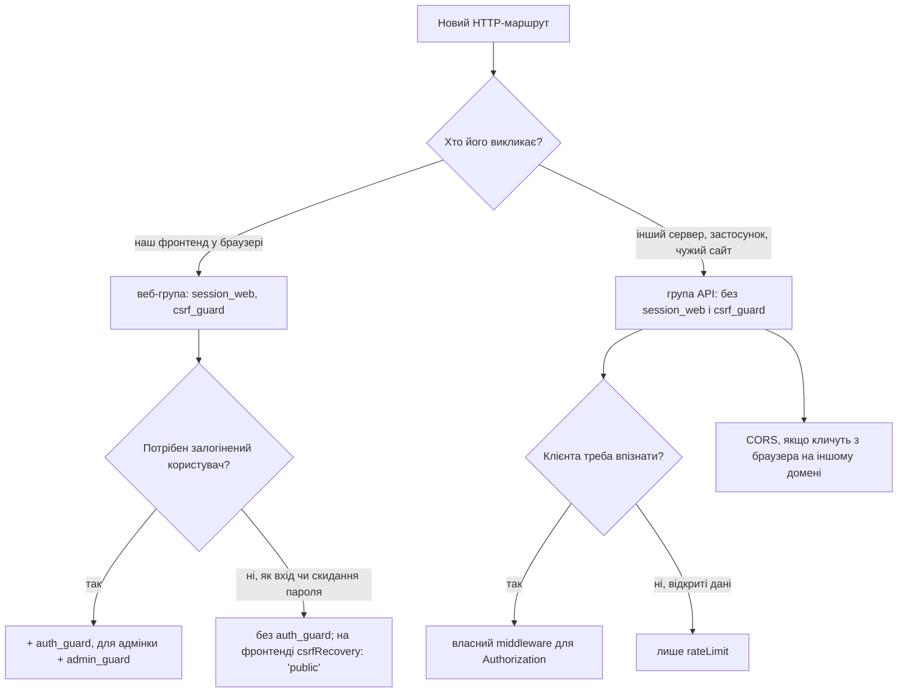

# Веб-маршрути і публічний API

Бекенд обслуговує HTTP-маршрути двох видів, і кожному потрібен свій набір middleware:

| Вид маршруту               | Хто викликає                                               | Як клієнт себе підтверджує               | Middleware групи                                 |
| -------------------------- | ---------------------------------------------------------- | ---------------------------------------- | ------------------------------------------------ |
| **Веб-маршрут**            | SPA з `packages/frontend` у браузері користувача           | cookie сесії, яку браузер надсилає сам   | `session_web`, `csrf_guard`                      |
| **Маршрут публічного API** | інший сервер, мобільний застосунок, скрипт, чужий фронтенд | заголовок запиту, який клієнт додає явно | немає (`session_web` і `csrf_guard` не потрібні) |

Обидва види оголошуються однаково, через `defineRoute({ contract, ... })` у [`http-routes.ts`](https://github.com/Blazheiko/vibe-template/blob/main/packages/backend/src/app/routes/http-routes.ts) з контрактом у `shared/contracts` і схемами в реєстрі `app/routes/contract-schemas/` ([Маршрутизація](/backend/routing#http-маршрути-defineroute)), і мають однакову валідацію, ліміти та заголовки безпеки. Відрізняються лише групою, у якій лежить маршрут. Ця сторінка пояснює, чому так, як обрати правильну групу і що ламається, якщо помилитися.

::: tip Правило в одному реченні
Маршрут, який викликає наш фронтенд, кладіть у групу з `middlewares: ['session_web', 'csrf_guard', ...]`. Маршрут для зовнішніх клієнтів кладіть в окрему групу без цих двох middleware і не читайте в ньому cookie.
:::

## Чому видів два

CSRF-атака можлива лише тоді, коли браузер **сам** додає до запиту облікові дані. Cookie саме такі: якщо користувач увійшов у застосунок, браузер надішле cookie сесії з кожним запитом на цей сайт, навіть коли запит ініціювала чужа сторінка. Сервер не може відрізнити такий запит від справжнього лише за cookie. Тому веб-маршрутам потрібен `csrf_guard`: він перевіряє ознаки, яких чужа сторінка підробити не може (`Sec-Fetch-Site`, `Origin`, CSRF-токен із заголовка). Докладно — у [CSRF простими словами](/guide/csrf).

Публічний API цього механізму не має і мати не повинен:

- Зовнішній клієнт не живе в браузері поруч із нашою сесією. У нього немає cookie `uapi`, немає CSRF-токена з `GET /api/main/init`, а сервер-клієнт часто не надсилає `Origin` взагалі.
- Облікові дані API (ключ, токен) передаються в заголовку, наприклад `Authorization`. Браузер ніколи не додає такий заголовок сам, тож чужа сторінка не може «позичити» його в користувача. Нема чого підробляти, отже нема від чого захищатися токеном.

Звідси обидва правила. Веб-маршрут без `csrf_guard` — це вразливість. Маршрут API з `session_web` і `csrf_guard` — це API, який зовнішній клієнт не зможе викликати.

## Що роблять `session_web` і `csrf_guard`

Обидва middleware зареєстровано в [`kernel.ts`](https://github.com/Blazheiko/vibe-template/blob/main/packages/backend/src/app/middlewares/kernel.ts), повний опис — у [Middleware](/backend/middlewares).

**`session_web`** ([session-web.ts](https://github.com/Blazheiko/vibe-template/blob/main/packages/backend/src/vendor/utils/middlewares/ws/session-web.ts)) читає cookie сесії і заповнює `context.session` та `context.auth`:

- cookie немає або вона прострочена → створюється **анонімна сесія** з власним CSRF-токеном, і відповідь отримує `Set-Cookie` з нею. У Redis така сесія не пишеться, доки не зберігає дані ([Анонімна сесія](/backend/auth#анонімна-сесія));
- cookie залогіненої сесії → сесія читається з Redis, а `userToken` звіряється з `users.session_token` у базі, щоб відкликана сесія не пройшла ([ADR 0002](/backend/auth#відкликання-сесіи));
- після ланцюжка middleware додає `csrfToken` у відповіді, які сформували самі middleware (`401` від `auth_guard`, `403` від `csrf_guard`), щоб анонімний клієнт міг отримати токен.

**`csrf_guard`** ([csrf-guard.ts](https://github.com/Blazheiko/vibe-template/blob/main/packages/backend/src/app/middlewares/csrf-guard.ts)) перевіряє лише `post`, `put`, `patch` і `delete`. `GET` проходить без перевірок. Для небезпечних методів він по черзі перевіряє `Sec-Fetch-Site`, `Origin`/`Referer` (список `CSRF_ALLOWED_ORIGINS`) і заголовок `x-csrf-token`, який має збігтися з токеном **сесії**. Тому `csrf_guard` не працює без `session_web` перед ним: без сесії немає токена, з яким можна порівняти. Деталі — у [Безпека → CSRF](/backend/security#csrf).

Що ці middleware коштують на кожен запит:

| Middleware    | Ціна                                                                                                                                      |
| ------------- | ----------------------------------------------------------------------------------------------------------------------------------------- |
| `session_web` | для залогіненого користувача: читання Redis і запит до PostgreSQL; для клієнта без cookie: нова анонімна сесія і `Set-Cookie` у відповіді |
| `csrf_guard`  | лише перевірки в пам'яті; для небезпечних методів вимагає `Origin`/`Referer` і токен сесії                                                |

## Веб-маршрути

### Як оголосити

Маршрут кладеться в групу, де `session_web` стоїть першим, а `csrf_guard` — другим. Перевірки ролі (`auth_guard`, `admin_guard`) додаються після них, на групі або на окремому маршруті:

```ts
{
    group: [
        defineRoute({
            contract: noteContracts.list, // GET /notes
            handler: NotesController.list.bind(NotesController),
            description: 'List notes of the current user',
        }),
        defineRoute({
            contract: noteContracts.create, // POST /notes
            handler: NotesController.create.bind(NotesController),
            description: 'Create a note',
        }),
    ],
    prefix: 'notes',
    description: 'Notes of the signed-in user (web)',
    middlewares: ['session_web', 'csrf_guard', 'auth_guard'],
},
```

`noteContracts` тут — приклад (так їх оголошує [туторіал](/backend/adding-a-feature#крок-8-контракт-і-реєстрація-маршрутів)): контракти лежать у `shared/contracts`, а схеми тіла й відповіді — у записі реєстру, тому в маршруті їх немає. Так влаштовані всі групи в `http-routes.ts`: `auth`, `auth/oauth`, `main`, `push-subscriptions`, `avatar`, `support`, `prompts` і `admin`. Порядок важливий: `csrf_guard` і `auth_guard` читають сесію, яку піднімає `session_web`.

### Що потрібно від клієнта

Веб-маршрути розраховані на SPA з цього репозиторію, і фронтенд виконує всі умови сам ([`base-api.ts`](https://github.com/Blazheiko/vibe-template/blob/main/packages/frontend/src/utils/base-api.ts)):

1. **Cookie сесії.** Браузер надсилає її автоматично. Фронтенд і API мають бути на одному сайті (той самий домен або піддомени одного домену), бо cookie має `SameSite=Lax`.
2. **CSRF-токен.** Береться з `GET /api/main/init` (і з відповідей входу та виходу) і надсилається в заголовку `x-csrf-token` з кожним `POST`/`PUT`/`PATCH`/`DELETE`.
3. **`Origin` зі списку `CSRF_ALLOWED_ORIGINS`.** Браузер додає його сам.

Як викликати веб-маршрут з curl, якщо потрібно для перевірки: [CSRF → Тестування через curl](/guide/csrf#тестування-через-curl-або-api-playground).

## Маршрути публічного API

### Як оголосити

Маршрути API кладуться в **окрему групу без `session_web` і `csrf_guard`**, з власним префіксом, щоб їх було легко відрізнити від веб-маршрутів і окремо обмежити:

```ts
{
    group: [
        defineRoute({
            contract: publicOrderContracts.show, // GET /v1/orders/:id
            handler: PublicOrdersController.show.bind(PublicOrdersController),
            description: 'Public API: order status',
        }),
        defineRoute({
            contract: publicOrderContracts.create, // POST /v1/orders
            handler: PublicOrdersController.create.bind(PublicOrdersController),
            description: 'Public API: create an order',
            rateLimit: { windowMs: 60_000, maxRequests: 10 },
        }),
    ],
    prefix: 'v1',
    description: 'Public API for external clients (no cookie session, no CSRF)',
    rateLimit: { windowMs: 60_000, maxRequests: 60 },
},
```

`publicOrderContracts` — теж приклад: таку групу контрактів треба оголосити в `shared/contracts` зі шляхами від `/v1`, бо шлях контракту має починатися з префікса групи, і записати її схеми в реєстр. Маршрути отримають адреси `/api/v1/orders/:id` і `/api/v1/orders` (глобальний префікс `API_PATH_PREFIX` додається до всіх маршрутів, див. [Маршрутизація → Групи та префікси](/backend/routing#групи-та-префікси)). У репозиторії вже є два маршрути без middleware: `GET /api/ping` і `GET /api/ready`.

### Що отримує handler

Без `session_web` handler працює з контекстом за замовчуванням ([http-context.ts](https://github.com/Blazheiko/vibe-template/blob/main/packages/backend/src/vendor/utils/context/http-context.ts)):

| Що                            | Значення                                                                |
| ----------------------------- | ----------------------------------------------------------------------- |
| `context.session.sessionInfo` | `null`                                                                  |
| `context.auth.check()`        | `false`                                                                 |
| `context.auth.getUserId()`    | `null`                                                                  |
| cookie у відповіді            | жодної: бекенд не ставить cookie сесії і не читає Redis/БД заради сесії |

Отже, у handler маршруту API не можна покладатися на `context.auth` чи `requireUserId`: користувача сесії там немає ніколи. Хто викликає API, визначається з заголовка запиту.

### Автентифікація клієнта API

`auth_guard` і `admin_guard` перевіряють **cookie-сесію**. У групі без `session_web` `auth_guard` завжди відповідає `401 unauthorized`, навіть якщо клієнт надіслав правильний ключ у `Authorization`. Для API потрібен окремий middleware, який перевіряє облікові дані із заголовка.

::: warning План
Автентифікації за ключем API в шаблоні поки немає: немає таблиці ключів, middleware чи змінних оточення для них. Нижче — каркас, з якого можна почати. Він не є частиною репозиторію.
:::

```ts
// src/app/middlewares/api-key-guard.ts (приклад)
import type { HttpContext, Middleware } from '#vendor/types/types.js'

const apiKeyGuard: Middleware = async (
    context: HttpContext,
    next: () => Promise<void>,
): Promise<void> => {
    const header = context.httpData.headers.get('authorization') ?? ''
    const key = header.startsWith('Bearer ') ? header.slice('Bearer '.length) : ''

    // isKnownApiKey — ваша перевірка: хеш ключа в базі, порівняння через safeEqual
    // (#vendor/utils/helpers/safe-equal.js), не звичайне ===.
    if (key === '' || !(await isKnownApiKey(key))) {
        context.responseData.status = 401
        context.responseData.payload = {
            status: 'error',
            code: 'unauthorized',
            message: 'Invalid API key',
        }
        return
    }

    await next()
}

export default apiKeyGuard
```

Далі зареєструйте його в `httpMiddlewares` у `kernel.ts` (наприклад `api_key_guard: apiKeyGuard`) і вкажіть у групі API: `middlewares: ['api_key_guard']`. Як писати власний middleware — у [Middleware → Власний middleware](/backend/middlewares#власнии-middleware).

Облікові дані API беріть **лише із заголовка**. Якщо API почне читати їх з cookie, браузер знову надсилатиме їх автоматично, і повернеться та сама CSRF-проблема, від якої захищає `csrf_guard`.

### CORS для браузерних клієнтів

Сервер-клієнтам і мобільним застосункам CORS не потрібен. Він потрібен лише тоді, коли публічний API викликає JavaScript зі сторінки на **іншому** домені. CORS налаштовується глобально для всіх маршрутів ([Безпека → CORS](/backend/security#cors)):

- `ENABLED_CORS=true` і точні origin клієнтів у `CORS_ALLOWED_ORIGINS`;
- заголовок `Authorization` вже дозволено в `Access-Control-Allow-Headers` ([cors.ts](https://github.com/Blazheiko/vibe-template/blob/main/packages/backend/src/config/cors.ts)). Власний заголовок на кшталт `X-API-Key` довелося б додати туди окремо, тому зручніше `Authorization: Bearer …`;
- `CREDENTIONALS_CORS` для такого API залиште `false`: API без cookie не потребує `Access-Control-Allow-Credentials`, а ця змінна діє на всі маршрути, зокрема веб-маршрути.

### Ліміти запитів

Веб-маршрути захищені ще й тим, що їх викликає лише наш фронтенд. Публічний API відкритий для будь-якого клієнта, тому задавайте `rateLimit` на групі API і суворіший — на маршрутах, що змінюють дані чи дорогі. Ліміт рахується на IP і маршрут, а поверх нього діє глобальний per-IP ліміт `HTTP_GLOBAL_RATE_LIMIT_*` ([Безпека → Обмеження частоти запитів](/backend/security#обмеження-частоти-запитів)).

## Чому маршрут API не можна покласти у веб-групу

Middleware групи додаються **перед** middleware маршруту (`middlewares.concat(route.middlewares)` у [router.ts](https://github.com/Blazheiko/vibe-template/blob/main/packages/backend/src/vendor/start/router.ts)), і маршрут не може їх вимкнути: поля на кшталт «пропустити `csrf_guard`» немає. Маршрут у групі `main` завжди виконає `session_web` і `csrf_guard`.

Що побачить зовнішній клієнт, якщо його маршрут опинився у веб-групі:

| Запит клієнта                                     | Відповідь                                                                                                               |
| ------------------------------------------------- | ----------------------------------------------------------------------------------------------------------------------- |
| `POST` з сервера, без `Origin` і `Referer`        | `403 csrf_invalid`, `reason: origin_mismatch` (бо `CSRF_STRICT_ORIGIN=true`)                                            |
| `POST` з `Origin` зі списку, але без cookie сесії | `403 csrf_invalid`, `reason: token_mismatch`: токен анонімної сесії, яку `session_web` щойно створив, клієнту невідомий |
| `GET`                                             | проходить, але кожна відповідь несе `Set-Cookie` з новою анонімною сесією                                               |
| будь-який запит до групи з `auth_guard`           | `401 unauthorized`: заголовок `Authorization` `auth_guard` не читає                                                     |

Тому для API потрібна **своя група**, а не виняток усередині веб-групи.

## Що ламається у зворотному випадку

Веб-маршрут, покладений поза веб-групою, ламається тихіше:

| Помилка                                                                       | Наслідок                                                                                                                                                          |
| ----------------------------------------------------------------------------- | ----------------------------------------------------------------------------------------------------------------------------------------------------------------- |
| маршрут, що змінює дані, без `session_web` і `csrf_guard`, але з `auth_guard` | `401` для всіх: без `session_web` немає користувача                                                                                                               |
| `csrf_guard` без `session_web`                                                | `403 token_mismatch` на кожен `POST`/`PUT`/`PATCH`/`DELETE`: немає сесії, з токеном якої можна порівняти                                                          |
| `session_web` без `csrf_guard` на маршруті, що змінює дані                    | **CSRF-вразливість**: чужа сторінка може надіслати запит від імені залогіненого користувача, і cookie підтвердить його особу. Тести і typecheck цього не помітять |
| `csrf_guard` перед `session_web`                                              | те саме, що `csrf_guard` без `session_web`: guard виконується до того, як з'явилася сесія                                                                         |

Останні два випадки ловить тест [`web-and-api-routes.spec.ts`](https://github.com/Blazheiko/vibe-template/blob/main/packages/backend/src/app/routes/web-and-api-routes.spec.ts): він вимагає, щоб у кожного маршруту з `session_web` одразу за ним стояв `csrf_guard`, і щоб кожен `POST`/`PUT`/`PATCH`/`DELETE` у `http-routes.ts` мав `csrf_guard`. Коли в шаблоні з'явиться перший маршрут публічного API, що змінює дані, другу перевірку треба буде звузити до веб-груп, наприклад виключивши префікс API.

## Як обрати групу для нового маршруту



Чекліст:

- [ ] Маршрут лежить у групі, що відповідає його клієнту, а не в першій-ліпшій.
- [ ] У веб-групі `session_web` стоїть першим, `csrf_guard` — другим.
- [ ] Маршрут API не читає cookie і не використовує `context.auth`; облікові дані беруться із заголовка.
- [ ] Група API має `rateLimit`.
- [ ] Для браузерних клієнтів API налаштовано CORS без `CREDENTIONALS_CORS`.
- [ ] Сторінки `documentation/backend/` оновлено, як вимагає [робочий процес](/guide/workflow).

## Лише API, без фронтенду

Якщо проєкт використовує бекенд без `packages/frontend` (див. README, «Backend-only / API services»), веб-груп може не бути зовсім, і тоді `session_web` та `csrf_guard` не знадобляться жодному маршруту. Зверніть увагу:

- групи `auth`, `main`, `support`, `admin` та інші з шаблону — це веб-маршрути для SPA. Їх видаляють або залишають разом з їхніми middleware, а не переносять в API без `session_web`;
- конфігурація CSRF перевіряється на старті незалежно від маршрутів: у production-like середовищі сервер не стартує без `CSRF_ALLOWED_ORIGINS` ([validate-runtime-config.ts](https://github.com/Blazheiko/vibe-template/blob/main/packages/backend/src/app/start/validate-runtime-config.ts)). Задайте в ній адресу, з якої працюватиме адмін-інструмент, або origin самого API;
- Redis однаково потрібен: його перевіряє readiness-маршрут `GET /api/ready`, на ньому працюють WebSocket і спільні ліміти ([Безпека → Спільні ліміти](/backend/security#спільні-ліміти-redis)).
