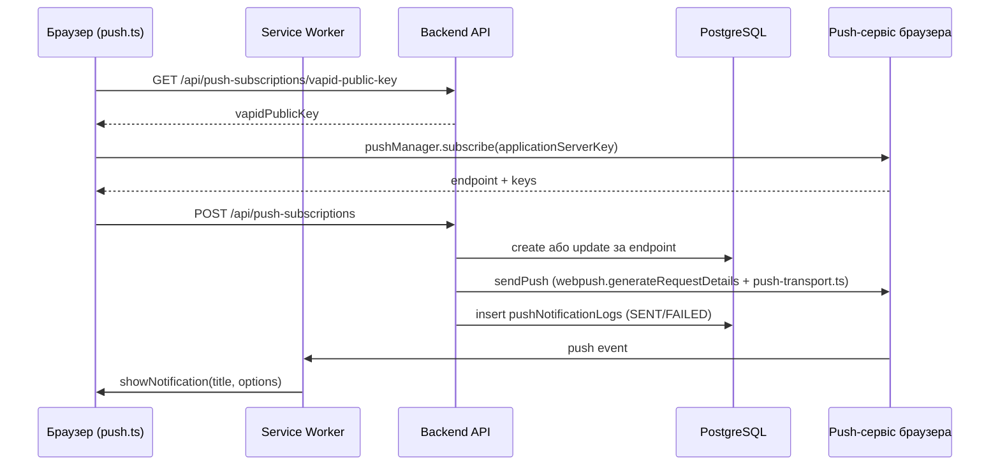

# Web Push сповіщення

Web Push дозволяє серверу показати користувачу системне сповіщення, **навіть коли вкладку із застосунком закрито**: повідомлення доставляє push-сервіс браузера (Google FCM для Chrome, Mozilla autopush для Firefox, Apple для Safari), а показує його Service Worker. У шаблоні вже є все потрібне: підписка у фронтенді, збереження підписок у PostgreSQL, відправка через бібліотеку [`web-push`](https://github.com/web-push-libs/web-push), журнал відправок і статистика. Щоб це запрацювало, потрібні лише VAPID-ключі.

## Як це працює

1. Користувач вмикає сповіщення в акаунті ([`UserAccount.vue`](https://github.com/Blazheiko/vibe-template/blob/main/packages/frontend/src/views/UserAccount.vue)). Браузер питає дозвіл (`Notification.requestPermission()`).
2. Фронтенд бере **публічний** VAPID-ключ з бекенду і просить браузер створити підписку: `pushManager.subscribe({ userVisibleOnly: true, applicationServerKey })`.
3. Браузер реєструється в своєму push-сервісі й повертає підписку: унікальний `endpoint` (URL у push-сервісі) і ключі шифрування `p256dh` та `auth`.
4. Фронтенд відправляє підписку на бекенд, бекенд зберігає її в таблиці `push_subscriptions`.
5. Коли трапляється подія (новий вхід, зміна пароля, відповідь підтримки), бекенд шифрує payload ключами підписки, підписує запит **приватним** VAPID-ключем і робить `POST` на `endpoint`.
6. Push-сервіс перевіряє підпис, будить Service Worker браузера, а той показує сповіщення. Клік відкриває `data.url`.

## Що таке VAPID-ключі

**VAPID** (Voluntary Application Server Identification, [RFC 8292](https://www.rfc-editor.org/rfc/rfc8292)) — це спосіб, яким ваш сервер доводить push-сервісу браузера, що він має право надсилати повідомлення на конкретну підписку.

- Це **пара ключів ECDSA на кривій P-256**: публічний і приватний, у форматі base64url.
- **Публічний ключ** не секретний. Фронтенд передає його браузеру як `applicationServerKey` під час підписки, і push-сервіс «прив'язує» підписку до нього.
- **Приватний ключ** — секрет, він лише на сервері. Ним бекенд підписує короткий JWT у заголовку `Authorization` кожного push-запиту. Push-сервіс перевіряє підпис публічним ключем з підписки. Тож навіть якщо хтось дізнається `endpoint`, без приватного ключа він не надішле повідомлення.
- **`VAPID_SUBJECT`** — контакт власника сервера (`mailto:` або `https:` URL). Його отримує push-сервіс, щоб зв'язатися з вами, якщо з вашими запитами щось не так.

::: tip VAPID не шифрує повідомлення
VAPID лише ідентифікує сервер. Вміст повідомлення шифрується окремо ключами самої підписки (`p256dh`, `auth`, [RFC 8291](https://www.rfc-editor.org/rfc/rfc8291)), тож push-сервіс не бачить, що ви надсилаєте. Бібліотека `web-push` робить і те, і інше.
:::

::: warning Ключі не можна просто змінити
Кожна підписка прив'язана до публічного ключа, з яким її створили. Якщо замінити ключі, усі наявні підписки перестануть працювати: push-сервіс відхилятиме запити, і користувачам доведеться підписатися знову. Генеруйте ключі один раз на оточення і зберігайте приватний ключ як секрет (менеджер секретів, змінні CI), а не в репозиторії.
:::

### Генерація ключів

У бекенді є скрипт [`generate-vapid-keys.ts`](https://github.com/Blazheiko/vibe-template/blob/main/packages/backend/src/scripts/generate-vapid-keys.ts):

```bash
# надрукувати нову пару ключів
pnpm --filter backend push:vapid

# записати ключі прямо в packages/backend/.env
pnpm --filter backend push:vapid --write
```

- З кореня репозиторію те саме запускає `pnpm push:vapid` (і `pnpm push:vapid --write`).
- Без прапорців скрипт лише друкує рядки `VAPID_PUBLIC_KEY=...` і `VAPID_PRIVATE_KEY=...`, які треба додати в `.env`.
- `--write` оновлює `VAPID_PUBLIC_KEY` і `VAPID_PRIVATE_KEY` у `packages/backend/.env`, решту файлу не чіпає. Якщо файлу немає, створює його.
- Якщо приватний ключ у `.env` уже задано, `--write` відмовляється (код виходу `1`), щоб випадково не зламати наявні підписки. Щоб таки замінити ключі, додайте `--force`.

Після генерації задайте `VAPID_SUBJECT` (наприклад `mailto:admin@your-domain.com`) і перезапустіть бекенд.

### Конфігурація

[`config/push.ts`](https://github.com/Blazheiko/vibe-template/blob/main/packages/backend/src/config/push.ts) читає такі змінні:

| Змінна                            | За замовчуванням                                                                              | Призначення                                                                                          |
| --------------------------------- | --------------------------------------------------------------------------------------------- | ---------------------------------------------------------------------------------------------------- |
| `VAPID_PUBLIC_KEY`                | `''`                                                                                          | публічний ключ, віддається фронтенду                                                                 |
| `VAPID_PRIVATE_KEY`               | `''`                                                                                          | приватний ключ, секрет                                                                               |
| `VAPID_SUBJECT`                   | `mailto:admin@vibe-template.example`                                                          | контакт для push-сервісу                                                                             |
| `PUSH_ALLOWED_ENDPOINT_HOSTS`     | `fcm.googleapis.com,updates.push.services.mozilla.com,.notify.windows.com,web.push.apple.com` | хости push-сервісів, яким дозволено бути `endpoint` (див. [Обмеження endpoint](#обмеження-endpoint)) |
| `PUSH_MAX_SUBSCRIPTIONS_PER_USER` | `20`                                                                                          | максимум підписок на акаунт                                                                          |

Під час першої відправки [`push-notification-sender-service.ts`](https://github.com/Blazheiko/vibe-template/blob/main/packages/backend/src/app/services/notifications/push-notification-sender-service.ts) викликає `webpush.setVapidDetails(...)`. Якщо ключі порожні, пише `VAPID keys not configured — push notifications disabled` і нічого не надсилає (`{ sent: 0, failed: 0 }`). `GET /push-subscriptions/vapid-public-key` і `POST /push-subscriptions/test-push` у цьому випадку відповідають `500 VAPID keys not configured`, тож підписатися неможливо. Решта застосунку працює.

## Типи сповіщень

Кожне сповіщення має тип `notificationType`, а підписка — необов'язковий список `notificationTypes` (`'mention' | 'system'`), які вона хоче отримувати. Порожній список означає «усі типи».

| Тип       | Що це                                                      |
| --------- | ---------------------------------------------------------- |
| `system`  | сповіщення безпеки акаунта                                 |
| `mention` | повідомлення, адресовані користувачу (відповідь підтримки) |

## HTTP-маршрути

Група `push-subscriptions` у [`http-routes.ts`](https://github.com/Blazheiko/vibe-template/blob/main/packages/backend/src/app/routes/http-routes.ts) з middleware `session_web` і `csrf_guard`; на кожному маршруті, крім `vapid-public-key`, стоїть `auth_guard` (анонімний запит → `401` до контролера); контролер — [`push-subscription-controller.ts`](https://github.com/Blazheiko/vibe-template/blob/main/packages/backend/src/app/controllers/http/notifications/push-subscription-controller.ts). Фронтенд звертається до них з префіксом `/api` ([`utils/api.ts`](https://github.com/Blazheiko/vibe-template/blob/main/packages/frontend/src/utils/api.ts)).

| Метод    | Шлях                                             | Призначення                                                                                                                                                                                                                                                               |
| -------- | ------------------------------------------------ | ------------------------------------------------------------------------------------------------------------------------------------------------------------------------------------------------------------------------------------------------------------------------- |
| `GET`    | `/push-subscriptions/vapid-public-key`           | Публічний VAPID-ключ                                                                                                                                                                                                                                                      |
| `POST`   | `/push-subscriptions/test-push`                  | Тестовий push поточному користувачу; тіло `{ title?, body? }` (`PushSubscriptionTestInputSchema`: до 200 / 1000 символів), відповідь містить `sent`/`failed`; якщо запис сесії видалено logout-ом в іншій вкладці, `401 session_revoked` і нічого не надіслано (feat-129) |
| `GET`    | `/push-subscriptions`                            | Підписки користувача                                                                                                                                                                                                                                                      |
| `POST`   | `/push-subscriptions`                            | Створити підписку (`CreateSubscriptionInputSchema`)                                                                                                                                                                                                                       |
| `GET`    | `/push-subscriptions/:subscriptionId`            | Одна підписка                                                                                                                                                                                                                                                             |
| `PUT`    | `/push-subscriptions/:subscriptionId`            | Оновити (`UpdateSubscriptionInputSchema`)                                                                                                                                                                                                                                 |
| `DELETE` | `/push-subscriptions/:subscriptionId`            | Видалити                                                                                                                                                                                                                                                                  |
| `GET`    | `/push-subscriptions/:subscriptionId/logs`       | Журнал відправок                                                                                                                                                                                                                                                          |
| `GET`    | `/push-subscriptions/:subscriptionId/statistics` | Статистика                                                                                                                                                                                                                                                                |
| `PUT`    | `/push-subscriptions/:subscriptionId/deactivate` | Деактивувати                                                                                                                                                                                                                                                              |

Журнал відправок у відповідях (`GET /push-subscriptions`, `GET /:subscriptionId` → `notificationLogs`, `GET /:subscriptionId/logs`) містить `status`, `statusCode` і `reason` (`gone` для 404/410, `rejected` для іншого коду, `network_error` без відповіді, `null` для `SENT`); текст помилки транспорту (`errorMessage`) і `responseData` клієнту не віддаються (feat-104).

Маршрути з `:subscriptionId` працюють лише зі своїми підписками. `GET /:subscriptionId`, `PUT`, `DELETE`, `…/statistics` і `…/deactivate` для чужого й неіснуючого id дають однакову відповідь `404 Subscription not found`: чужий запис не змінюється і не потрапляє у відповідь. Для `PUT` і `deactivate` це забезпечує сам `UPDATE … WHERE id AND user_id … RETURNING` у [репозиторії](https://github.com/Blazheiko/vibe-template/blob/main/packages/backend/src/app/repositories/notifications/push-subscription-repository.ts), без повторного читання за одним id. `GET /:subscriptionId/logs` підписку не шукає: журнал фільтрується за власником, тож для чужого й неіснуючого id це `200` з порожнім списком `data` (чужі записи не повертаються). Перенесення підписки на іншого користувача можливе лише через `POST /push-subscriptions` з тими самими ключами (див. нижче).

## Обмеження endpoint

Бекенд робить `POST` на `endpoint`, який передав браузер, тому зберігаються лише адреси push-сервісів ([`push-endpoint-policy.ts`](https://github.com/Blazheiko/vibe-template/blob/main/packages/backend/src/app/services/notifications/push-endpoint-policy.ts), feat-104):

- лише `https:`, порт за замовчуванням, без `user:password@`, без IP-адреси замість хоста;
- хост дорівнює запису з `PUSH_ALLOWED_ENDPOINT_HOSTS` або, для запису з крапкою на початку (`.notify.windows.com`), є його піддоменом на межі DNS-мітки: `wns2-par02p.notify.windows.com` підходить, `evilnotify.windows.com` і `notify.windows.com.evil.io` — ні. Хост порівнюється в нижньому регістрі, без кінцевої крапки, у punycode.

Endpoint зберігається й шукається в **канонічній формі** (`canonicalPushEndpoint`, feat-125): хост у нижньому регістрі й без кінцевої крапки, без порту за замовчуванням, а в шляху й query нормалізовано percent-encoding за RFC 3986 §6.2.2 (`%41` — це `A`, `%3d` — `%3D`; feat-130). Інша query (дописаний `?x=1`) лишається іншим endpoint: WNS передає токен у query, тож відкинути її не можна, а такий endpoint лише витрачає квоту push-сервісу, бо браузер відкидає payload, який не може розшифрувати. `https://FCM.GOOGLEAPIS.COM./fcm/send/…` і `https://fcm.googleapis.com/fcm/send/…` ведуть до одного push-сервісу й вважаються одним endpoint, тож перевірка «підписка належить іншому користувачу» бачить їх як один.

Інший `endpoint` у `POST /push-subscriptions` дає `400` з `reason: "push_endpoint_not_allowed"`. Перед кожною відправкою endpoint перевіряється ще раз: підписка, збережена до обмеження або під ширшим списком, запиту не отримує (у лог — `warn`). Невалідне значення `PUSH_ALLOWED_ENDPOINT_HOSTS` зупиняє старт (`Invalid push configuration`).

`web-push` відправляє через `https.request`, який не переходить за редиректами; відповідь поза `2xx`, зокрема `3xx`, — це `FAILED`. Застосунок не передає `web-push` опцій `proxy` чи `agent`. Обидва факти закріплено тестами (`push-transport-redirect.spec.ts` на справжньому TLS-сервері, `push-notification-sender-service.spec.ts`).

Нова підписка (зокрема перенесена з іншого акаунта) понад `PUSH_MAX_SUBSCRIPTIONS_PER_USER` дає `409` з `reason: "push_subscription_limit"`; підрахунок іде під блокуванням рядка користувача, тож два паралельні запити за останній слот не проходять обидва. `POST /push-subscriptions/test-push` (розсилає на всі пристрої) має власний ліміт 5 запитів на хвилину.

## Збереження підписки

**Поля запиту й межі.** Тіло `POST /push-subscriptions` перевіряє [`CreateSubscriptionInputSchema`](https://github.com/Blazheiko/vibe-template/blob/main/packages/shared/src/schemas/push-subscription/create-subscription.ts); зайві поля відхиляються (`422`). Межі довжини відповідають колонкам `push_subscriptions`, тож задовге значення — це `422`, а не помилка бази:

| Поле                                                    | Межа                                               |
| ------------------------------------------------------- | -------------------------------------------------- |
| `endpoint`                                              | 1–500 символів (і лише дозволений хост, див. вище) |
| `p256dhKey`, `authKey`                                  | 1–255                                              |
| `userAgent`                                             | до 1024                                            |
| `deviceType`, `browserVersion`, `osVersion`, `timezone` | до 50                                              |
| `browserName`, `osName`                                 | до 100                                             |
| `notificationTypes`                                     | до 10 елементів `mention` / `system`               |

`PUT /push-subscriptions/:subscriptionId` ([`UpdateSubscriptionInputSchema`](https://github.com/Blazheiko/vibe-template/blob/main/packages/shared/src/schemas/push-subscription/update-subscription.ts)) має ті самі межі для своїх полів. Адреса пристрою (`ipAddress` у відповіді) — не поле запиту: сервер записує адресу, з якої прийшов запит (`context.httpData.ip`, з урахуванням [довірених проксі](/backend/security)); `ipAddress` у тілі — `422`.

[`push-subscription-service.ts`](https://github.com/Blazheiko/vibe-template/blob/main/packages/backend/src/app/services/notifications/push-subscription-service.ts) у `createSubscription` шукає підписку за `endpoint` (він унікальний серед усіх користувачів). Якщо підписка належить іншому користувачу, її переносять на поточного лише тоді, коли `p256dhKey` і `authKey` збігаються з збереженими (той самий браузер, зміна акаунта); інакше — `409 conflict`, підписка лишається за старим власником. Перенесена підписка зберігає свій id, а журнал відправок попереднього власника лишається за ним: список підписок, `…/logs` і `…/statistics` показують новому власнику лише його власні відправки. Якщо вона є — оновлює ключі `p256dhKey`/`authKey`, метадані пристрою, `notificationTypes`, `timezone` і знову робить `isActive: true`; інакше створює новий запис. `POST` і `PUT` пишуть у транзакції під блокуванням рядка користувача й лише поки пред'явлений токен сесії актуальний ([`withCurrentSession`](https://github.com/Blazheiko/vibe-template/blob/main/packages/backend/src/app/services/auth/session-guard.ts)): запит із сесії, яку відкликав claim акаунта, отримує `401 session_revoked` і не повертає пристрій атакуючого (див. [Автентифікація](/backend/auth#зміни-облікових-даних-із-сесіі)). Робота з таблицею — через репозиторій, див. [Репозиторії](/backend/repositories).

## Відправка та формат payload

`pushNotificationSenderService.sendToUser(userId, payload, { skipIfOnline?, notificationType? })`:

1. Якщо `skipIfOnline` і користувач має активне WebSocket-з'єднання (`wsConnectionRegistry.isUserOnline`) — push пропускається (див. [WebSocket](/backend/websocket)).
2. Береться список активних підписок; якщо в підписки непорожній `notificationTypes` і він не містить `notificationType` — її пропускають.
3. Для кожної підписки запит іде з дедлайном 10 с на весь обмін, від з'єднання до останнього байта відповіді (`PUSH_SEND_TIMEOUT_MS`; feat-138, feat-139: push-сервіс, що завис або віддає відповідь по байту, не тримає відправку, і запис стає `network_error`). Запит будує web-push (`generateRequestDetails`: заголовки VAPID, зашифроване тіло), а надсилає [`push-transport.ts`](https://github.com/Blazheiko/vibe-template/blob/main/packages/backend/src/app/services/notifications/push-transport.ts): власний таймаут web-push — лише таймаут простою сокета. Редиректи, як і раніше, не виконуються. Тіло запиту — JSON:

```json
{
    "notification": {
        "title": "...",
        "body": "...",
        "icon": "/icons/icon_192x192.png",
        "badge": "/icons/badge-72.png",
        "vibrate": [200, 100, 200],
        "data": { "url": "/", "...": "payload.data" },
        "tag": "...",
        "actions": [
            { "action": "open", "title": "Open" },
            { "action": "close", "title": "Close" }
        ]
    }
}
```

Активні підписки (з урахуванням `notificationType`) обробляються паралельно, не більше `PUSH_SEND_CONCURRENCY = 5` запитів до push-сервісу одночасно. Результат кожної спроби — рядок `pushNotificationLogs` зі статусом `SENT` (і `statusCode` відповіді) або `FAILED` (з `errorMessage`, який лишається в базі; у лог сервера йдуть лише `statusCode` та ім'я помилки, без endpoint і відповіді push-сервісу); після всіх відправок рядки пишуться одним `insertMany` через [`push-notification-log-repository.ts`](https://github.com/Blazheiko/vibe-template/blob/main/packages/backend/src/app/repositories/notifications/push-notification-log-repository.ts), а `lastUsedAt` успішних підписок оновлюється одним `touchLastUsed`. Якщо запис не вдався, помилка логується, а результат `{ sent, failed }` відповідає фактичним відповідям push-сервісу.

**Прострочені підписки:** відповідь push-сервісу `410` або `404` деактивує підписку (`pushSubscriptionRepository.deactivate`). Окремої фонової очистки чи видалення неактивних записів немає.

**Бізнес-події** ([`user-notification-service.ts`](https://github.com/Blazheiko/vibe-template/blob/main/packages/backend/src/app/services/notifications/user-notification-service.ts)). Push надсилається без очікування: збій або повільний push-сервіс не змінює й не затримує відповідь, помилка — лише `warn`.

| Подія                                 | Де                                                      | `notificationType` | `skipIfOnline` |
| ------------------------------------- | ------------------------------------------------------- | ------------------ | -------------- |
| Новий вхід (`new_sign_in`)            | успішний `login` (email/телефон) і OAuth-callback       | `system`           | ні             |
| Зміна пароля (`password_changed`)     | `POST /auth/change-password`                            | `system`           | ні             |
| Скидання пароля (`password_reset`)    | скидання за email-токеном і за SMS                      | `system`           | ні             |
| Вихід з усіх пристроїв (`logout_all`) | `POST /auth/logout-all`                                 | `system`           | ні             |
| Відповідь підтримки                   | збережена відповідь Support AI (`support/support_chat`) | `mention`          | так            |

Сповіщення безпеки йдуть на всі активні підписки, зокрема й на пристрій, з якого виконано дію: підписки не прив'язані до сесії. Відповідь підтримки доходить лише тоді, коли в користувача немає відкритого WS-з'єднання; оскільки закриття з'єднання зупиняє генерацію, на практиці це випадок, коли вкладка закрилася вже після збереження відповіді. Підписка, у якої `notificationTypes` не містить відповідного типу, push не отримує. Окремо є ендпоінт `test-push`.

::: warning Межі `skipIfOnline`
«Онлайн» означає лише одне: у **цьому процесі** є хоча б одне відкрите WS-з'єднання користувача ([`ws-connection-registry.ts`](https://github.com/Blazheiko/vibe-template/blob/main/packages/backend/src/app/websocket/ws-connection-registry.ts), `Map` у пам'яті, `isUserOnline` = `userStorage.has(userId)`). Звідси:

- **Кілька інстансів.** З'єднання на іншому інстансі не видно: користувач, онлайн там, вважається офлайн, і push прийде. Спільного реєстру (Redis тощо) немає.
- **Фонова вкладка — теж онлайн.** Відкрите з'єднання у згорнутій вкладці чи заблокованому телефоні пригнічує push, хоча користувач повідомлення не бачить.
- **Момент перевірки.** Стан читається один раз перед надсиланням; з'єднання, яке закрилося одразу після перевірки, push уже не поверне.
- **Обрив без close.** Поки сервер не помітив розрив (heartbeat), з'єднання рахується відкритим.
  :::

## Статистика

[`push-subscription-statistics-service.ts`](https://github.com/Blazheiko/vibe-template/blob/main/packages/backend/src/app/services/statistics/push-subscription-statistics-service.ts) рахує `totalNotifications`, `sentNotifications`, `failedNotifications`, `pendingNotifications`, `successRate` (%), `last7DaysCount`, `lastUsed`, `isActive`. Лічильники дає один SQL-запит `countsBySubscription` (`count(case …)`), межу 7 днів обчислює застосунок і передає параметром.

## Фронтенд

- Підписка — у [`stores/push.ts`](https://github.com/Blazheiko/vibe-template/blob/main/packages/frontend/src/stores/push.ts) (опис пристрою для сервера — у [`utils/push-device.ts`](https://github.com/Blazheiko/vibe-template/blob/main/packages/frontend/src/utils/push-device.ts)): перевіряє `registration.pushManager.getSubscription()`, отримує VAPID-ключ з `/api/push-subscriptions/vapid-public-key`, викликає `pushManager.subscribe({ applicationServerKey })` і відправляє дані на `POST /api/push-subscriptions`.
- Підписка браузера переживає вихід і зміну акаунта, а сервер надсилає тому, кому належить запис, тому стор тримає їх узгодженими:
    - «увімкнено» означає, що підписка **цього браузера** є активним записом поточного акаунта; підписки на інших пристроях на перемикач не впливають;
    - увімкнення завжди надсилає підписку на сервер (також коли браузер її вже має), і стан «увімкнено» настає лише після відповіді сервера; якщо сервер відмовив, повторна спроба надсилає ту саму підписку ще раз;
    - вихід (`useSessionLifecycle.logout`) до запиту виходу видаляє запис на сервері й знімає підписку в браузері — best-effort і не довше 3 секунд, помилка вихід не блокує;
    - після входу (`initializeApp` в `App.vue` і сторінка акаунта) підписка браузера, якої немає серед підписок поточного акаунта, знімається: її лишив інший акаунт, і його сповіщення більше не приходять у цей браузер. Новий користувач вмикає push сам, його запис не переноситься мовчки.
- [`service-worker.ts`](https://github.com/Blazheiko/vibe-template/blob/main/packages/frontend/src/service-worker.ts) у обробнику `push` парсить JSON, зливає `payload.notification` з дефолтами і викликає `showNotification`; `notificationclick` закриває нотифікацію і відкриває `data.url`. Адреса приходить із payload, тому [`notification-target.ts`](https://github.com/Blazheiko/vibe-template/blob/main/packages/frontend/src/utils/notification-target.ts) приймає лише адресу того ж origin (інакше — `/`): чужий хост, порт чи схема, `//host`, `/\host`, `javascript:` відкидаються. Уже відкрите вікно знаходиться за збігом origin і `pathname`, а не за підрядком в URL, тож `/support/archive` не береться за `/support`.



## Локальне тестування

1. Згенеруйте ключі: `pnpm --filter backend push:vapid --write`, і перезапустіть бекенд.
2. Service Worker реєструється лише в production-збірці (див. [Фронтенд → PWA](/frontend/#pwa)), а push потребує `localhost` або HTTPS. Зберіть фронтенд і віддайте його бекендом або через `vite preview`.
3. Увійдіть, увімкніть сповіщення в акаунті й дозвольте їх у браузері.
4. Викличте `POST /api/push-subscriptions/test-push` (тіло `{}` або `{ "title": "…", "body": "…" }`, з CSRF-токеном) з активною сесією. Результат видно у відповіді (`sent`/`failed`), у логах бекенду та через `/:subscriptionId/logs`.

Юніт-тести: `pnpm --filter backend test`, зокрема [`push-subscription-service.spec.ts`](https://github.com/Blazheiko/vibe-template/blob/main/packages/backend/src/app/services/notifications/push-subscription-service.spec.ts).
