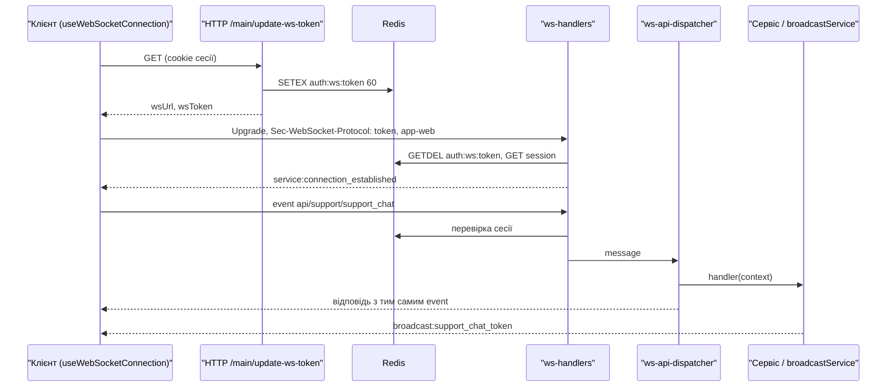

# WebSocket

Бекенд тримає один WebSocket-ендпоінт `/<pathPrefix>/websocket` (за замовчуванням `/api/websocket`) на тому ж сервері uWebSockets.js, що й HTTP. Через нього клієнт викликає WS-маршрути у стилі «запит — відповідь», а сервер надсилає push-події (`broadcast:*`). Загальний шлях upgrade і повідомлення описано на сторінці [Життєвий цикл запиту](/backend/request-lifecycle), схему токенів — у розділі [Авторизація WebSocket](/backend/auth#авторизація-websocket), а синтаксис `defineWsRoute` — на сторінці [Маршрутизація](/backend/routing) і [Middleware](/backend/middlewares). Тут зібрано все, що стосується саме WS: структура на сервері, протокол, push-події, heartbeat, клієнт і обмеження.

## Коротко на прикладі: надіслати подію з сервера

**Задача:** коли користувач створює нотатку, усі його відкриті вкладки мають дізнатися про це без оновлення сторінки.

1. Опишіть payload події в реєстрі [broadcast-events.ts](https://github.com/Blazheiko/vibe-template/blob/main/packages/shared/src/schemas/ws/broadcast-events.ts) — без нього `tsc` не прийме назву події:

    ```ts
    export const BroadcastEventSchemas = {
        // ...
        note_created: type({ note: NoteSchema }),
    } as const
    ```

1. У сервісі після успішного створення викличте `broadcastService`:

    ```ts
    import { broadcastService } from '#app/services/communication/broadcast-service.js'

    const note = noteTransformer.serialize(createdResult.value)
    broadcastService.broadcastMessageToUser(String(userId), 'note_created', { note })
    ```

1. Кожне WebSocket-з'єднання цього користувача отримає повідомлення (знято з реального з'єднання):

    ```json
    {
        "event": "broadcast:note_created",
        "status": 200,
        "payload": {
            "note": {
                "id": "4",
                "title": "Нова",
                "body": null,
                "created_at": "2026-10-25T17:26:14.928+02:00"
            }
        }
    }
    ```

1. На фронтенді додайте guard payload у [ws-payload-guards.ts](https://github.com/Blazheiko/vibe-template/blob/main/packages/frontend/src/utils/ws-payload-guards.ts) і запишіть його в `broadcastGuards` під іменем події. Реєстр має тип `satisfies BroadcastGuards`, тож подія з `BroadcastEventSchemas` без guard'а не компілюється ([ADR 0006](https://github.com/Blazheiko/vibe-template/blob/main/docs/adr/0006-websocket-contracts.md)). [useBroadcastHandler.ts](https://github.com/Blazheiko/vibe-template/blob/main/packages/frontend/src/composables/useBroadcastHandler.ts) сам передасть подію в event bus під тим самим іменем з payload контракту (`BroadcastContracts` з `shared/contracts`); підпишіться на неї `useEventBus().on('note_created', …)`. Тест паритету `ws-payload-guards.spec.ts` звіряє guard зі схемою реєстру.

::: warning Тести сервісу
`broadcast-service.ts` імпортує сервер, а той на старті вимагає `APP_KEY`. Без мока unit-тест сервісу впаде з `APP_KEY must be set...`. Додайте в тест:

```ts
vi.mock('#app/services/communication/broadcast-service.js', () => ({
    broadcastService: { broadcastMessageToUser: vi.fn() },
}))
```

:::

Окрім адресних подій є канали (`broadcastMessageToChannel`), як-от адмін-канал зі списком онлайн-користувачів. Запити від клієнта до сервера йдуть через WS-маршрути. Усе це описано нижче.

## Підключення

### Отримання токена по HTTP

Браузерний `WebSocket` не вміє передавати cookie-сесію як заголовок авторизації, тому клієнт спочатку отримує короткоживучий WS-токен:

1. `GET /<pathPrefix>/main/update-ws-token` (група `main` з `session_web` + `csrf_guard`, на маршруті `auth_guard`) — [http-routes.ts](https://github.com/Blazheiko/vibe-template/blob/main/packages/backend/src/app/routes/http-routes.ts).
2. `MainController.updateWsToken` → `mainService.updateWsToken` ([main-controller.ts](https://github.com/Blazheiko/vibe-template/blob/main/packages/backend/src/app/controllers/http/core/main-controller.ts), [main-service.ts](https://github.com/Blazheiko/vibe-template/blob/main/packages/backend/src/app/services/core/main-service.ts)) повертає `{ wsUrl, wsToken }`.
3. [generate-ws-token-service.ts](https://github.com/Blazheiko/vibe-template/blob/main/packages/backend/src/app/services/auth/generate-ws-token-service.ts) генерує 16-символьний ключ і пише в Redis `auth:ws:<token>` з TTL 60 с і даними `{ sessionId, userId, userToken }`.
4. `wsUrl` будує [get-ws-url-service.ts](https://github.com/Blazheiko/vibe-template/blob/main/packages/backend/src/app/services/communication/get-ws-url-service.ts): `wss://` для `production`/`prod`, інакше `ws://`, далі `<domain>/<pathPrefix>/websocket`.

### Upgrade

`handleUpgrade` у [ws-handlers.ts](https://github.com/Blazheiko/vibe-template/blob/main/packages/backend/src/vendor/utils/network/ws-handlers.ts) спершу перевіряє ліміт upgrade за IP ([upgrade-rate-limit.ts](https://github.com/Blazheiko/vibe-template/blob/main/packages/backend/src/vendor/utils/rate-limit/upgrade-rate-limit.ts), за замовчуванням 120 на хвилину в пам'яті процесу і 60 у спільному Redis-лічильнику, див. [нижче](#обмеження-та-безпека)): перевищення дає `429` з `Retry-After`, збій лічильника — `503`. Потім він розбирає `Sec-WebSocket-Protocol` через кому: перший елемент — токен, другий — тип застосунку (`app-web` → `web`, `app-pwa` → `pwa`, інше → `web` з попередженням). Токен перевіряється за форматом (`accessTokenLength` = 16, лише `[a-zA-Z0-9]`), інакше `401 Invalid token format`. Далі викликається хук `onUpgrade`, тобто `wsSessionAuth.verifyUpgradeToken` з [ws-session-auth.ts](https://github.com/Blazheiko/vibe-template/blob/main/packages/backend/src/app/websocket/ws-session-auth.ts), і сервер повертає клієнту як обраний subprotocol сам токен. Якщо основний Redis-клієнт недоступний, upgrade відхиляється **до** `res.upgrade` відповіддю `503 Service Unavailable` з `Retry-After: 1` (без `4001`); після першої недоступної команди друга (`get` сесії) не виконується.

```ts
const token = protocols[0] ?? ''
const appType = normalizeAppTypeProtocol(protocols[1] ?? '')
```

Якщо `verifyUpgradeToken` не знайшов живої сесії для токена правильного формату, upgrade відхиляється **до** `res.upgrade` відповіддю `401 Session expired`: з'єднання не відкривається. Браузер бачить це як невдалий handshake (close `1006`), і клієнт оновлює токен через HTTP (див. нижче). Якщо дані є, клієнт отримує `service:connection_established` з `socket_id` (UUID з'єднання) і `activity_timeout: 30`.

Токен **одноразовий**: `verifyUpgradeToken` читає `auth:ws:<token>` командою `GETDEL`, тож запис зникає з Redis тим самим кроком, яким його прочитано (feat-196). Другий upgrade з тим самим токеном отримує `401`, а з двох одночасних upgrade з одним токеном відкривається рівно один. Токен споживається за будь-якої відповіді (зокрема `503`, коли БД не відповіла): клієнт після невдалого handshake бере новий через `update-ws-token`. `sessionId` і `userToken` далі живуть лише в `userData` з'єднання, тому повідомлення й heartbeat не коштують команди Redis для токена, а під час закриття відкликати нічого. `closeAllWs` (graceful shutdown) закриває кожне з'єднання кодом `4201`. Після `closeAllWs` сервер більше не апгрейдить: upgrade, що ще чекав перевірки токена, отримує `503 Server is shutting down` (feat-138).

## Структура на сервері

| Модуль                                                                                                                                                           | Роль                                                                                                                              |
| ---------------------------------------------------------------------------------------------------------------------------------------------------------------- | --------------------------------------------------------------------------------------------------------------------------------- |
| [vendor/start/server.ts](https://github.com/Blazheiko/vibe-template/blob/main/packages/backend/src/vendor/start/server.ts)                                       | `configureWebsockets`: реєстрація `server.ws(...)`, опції uWS, `broadcastToChannel` (`server.publish`)                            |
| [vendor/utils/network/ws-handlers.ts](https://github.com/Blazheiko/vibe-template/blob/main/packages/backend/src/vendor/utils/network/ws-handlers.ts)             | транспорт: `handleUpgrade`, `onOpen`, `onMessage`, `onClose`, `closeAllWs`; хуки застосунку `WsAppHooks` і валідатор повідомлення |
| [app/start/index.ts](https://github.com/Blazheiko/vibe-template/blob/main/packages/backend/src/app/start/index.ts)                                               | склеює vendor і app: `registerWsMessageValidator` і `registerWsAppHooks`                                                          |
| [app/websocket/ws-session-auth.ts](https://github.com/Blazheiko/vibe-template/blob/main/packages/backend/src/app/websocket/ws-session-auth.ts)                   | перевірка, продовження, відкликання WS-токена в Redis                                                                             |
| [app/websocket/ws-coordinator.ts](https://github.com/Blazheiko/vibe-template/blob/main/packages/backend/src/app/websocket/ws-coordinator.ts)                     | `handleConnected` / `handleDisconnected`: роль користувача, реєстр, `userOnlineService`, presence                                 |
| [app/websocket/ws-connection-registry.ts](https://github.com/Blazheiko/vibe-template/blob/main/packages/backend/src/app/websocket/ws-connection-registry.ts)     | in-memory реєстр з'єднань                                                                                                         |
| [vendor/utils/routing/ws-api-dispatcher.ts](https://github.com/Blazheiko/vibe-template/blob/main/packages/backend/src/vendor/utils/routing/ws-api-dispatcher.ts) | маршрутизація повідомлень на handler                                                                                              |

Підключення хуків у [app/start/index.ts](https://github.com/Blazheiko/vibe-template/blob/main/packages/backend/src/app/start/index.ts):

```ts
registerWsAppHooks({
    onUpgrade: (token) => wsSessionAuth.verifyUpgradeToken(token),
    onConnected: (ws, userData) => websocketCoordinator.handleConnected(ws, userData),
    onDisconnected: (ws, userData, code) =>
        websocketCoordinator.handleDisconnected(ws, userData, code),
})
```

### Що відстежується

- **Транспорт** (`ws-handlers.ts`): `Set<MyWebSocket>` усіх відкритих сокетів — лише для `closeAllWs` при зупинці.
- **Реєстр** (`ws-connection-registry.ts`): `Map<userId, { ip, userAgent, appType, connections: Map<uuid, { ws, ip, userAgent, appType }> }>`. Кожне з'єднання зберігає власні `ip`, `userAgent` і `appType`, тож зведення (`appType`, `getOnlineUserMeta`) ніколи не читають `ws.getUserData()` збереженого сокета: на закритому сокеті uWS кидає `Invalid access of closed uWS.WebSocket` (feat-107). Один користувач може мати кілька з'єднань (вкладки, PWA); `appType` стає `pwa`, якщо хоча б одне з'єднання PWA. `registerConnection` повертає `true` для першого з'єднання, `unregisterConnection` — `true` для останнього. Є також `isUserOnline`, `findOnlineUsers`, `forEachConnection`, `getConnection`, `getOnlineUsers`, `getOnlineUserMeta`.
- **Канали**: використовується pub/sub uWS (`ws.subscribe` / `server.publish`). У коді є один канал — `admin` ([admin-ws-channel-service.ts](https://github.com/Blazheiko/vibe-template/blob/main/packages/backend/src/app/services/admin/admin-ws-channel-service.ts)); підписатись може лише з'єднання з `role === 'admin'`, лічильник підписників зберігається в пам'яті. Роль з'єднання читається з БД один раз, при відкритті, тому відкликання адмін-доступу на відкритому з'єднанні описано в [Відкликання admin-доступу](#відкликання-admin-доступу).
- **Історія онлайну в БД**: `userOnlineService.trackConnected/trackDisconnected` викликаються з координатора без `await` (помилки лише логуються). Відключення чекає, поки рядок підключення буде записано (feat-124): інакше `UPDATE` з'єднання, що закрилося до коміту `INSERT`, не знаходив рядка, і той лишався відкритим назавжди. З'єднання, чий рядок не записався (збій БД або сокет закрився, поки читалася роль), рядка відключення не пише.

У `handleDisconnected` з'єднання видаляється з реєстру **синхронно до будь-якого `await`**, щоб broadcast-цикли не звертались до вже закритого uWS-сокета.

Сокет мертвий з моменту, коли uWS викликає `close`-хендлер: після цього будь-яке звернення до нього кидає помилку. Окремого heartbeat для виявлення немає: напівмертве з'єднання закриває `idleTimeout`, і тоді теж спрацьовує `close`. Тому `onClose` (feat-107) до першого `await`:

1. читає `userData` і ставить `userData.closed = true`;
2. прибирає сокет з `wsStorage`;
3. запускає `onDisconnected`, синхронна частина якого знімає з'єднання з реєстру;
4. лише потім чекає завершення `onDisconnected`.

`handleConnected` після `await findRole(...)` перевіряє `userData.closed`. Сокет, закритий поки читалася роль, у реєстр не потрапляє: його `close` уже відпрацював і більше не викличеться. Якщо `onConnected` падає (наприклад, помилка БД під час читання ролі), з'єднання закривається кодом `1011` (feat-133): клієнт уже отримав `connection_established`, але поза реєстром до нього не доходять broadcast, а push ішов би так, ніби користувач офлайн. Клієнт перепідключається на будь-якому коді поза 4000–4099 і реєструється заново. Так само відповідь обробника повідомлення (`sendJson`) перевіряє `userData.closed`: якщо клієнт пішов, поки обробник працював (відповідь AI, повільний запит), нічого не надсилається й не логується як помилка (feat-124). Те саме для закриття `4001`, коли сесію не знайдено після `await` пошуку сесії (feat-128). Подія `admin_user_online_upsert` надсилається лише тоді, коли користувач досі в реєстрі: знімок для неї читається з БД, і відключення за цей час уже надіслало `remove`, тож запізнілий upsert лишив би «привида» в списку адміна. Рядок `user_online` закривається (`UPDATE` за uuid сокета) лише після того, як `INSERT` підключення завершився, і за будь-якого його результату: невдалий `INSERT` міг закомітитися (timeout чи обрив з'єднання після `COMMIT`), тож без `UPDATE` рядок лишився б відкритим. Якщо рядка справді немає, `UPDATE` нічого не знаходить і пише `warn` (feat-128).

Усі ці структури живуть у пам'яті одного процесу: при кількох інстансах реєстр, канали і presence не спільні.

## Протокол повідомлень

Клієнт надсилає текстовий JSON (бінарний фрейм закриває з'єднання кодом `1003` з одним рядком `warn`, feat-197). Форму перевіряє [ws-message-validator.ts](https://github.com/Blazheiko/vibe-template/blob/main/packages/backend/src/app/validate/ws-message-validator.ts) (ArkType через адаптер `defaultValidator`):

```ts
const WsMessageSchema = type({
    payload: 'Record<string, unknown> | null',
    event: 'string',
    'id?': '0 < string <= 64',
    timestamp: 'number',
})
```

Приклад запиту від клієнта:

```json
{
    "event": "api/support/support_chat",
    "id": "3f2c9a4e-…",
    "timestamp": 1760000000000,
    "payload": { "message": "..." }
}
```

`id` — ідентифікатор запиту від клієнта (непорожній рядок до 64 символів; клієнти беруть `crypto.randomUUID()`). Сервер його не тлумачить, лише повторює в **кожній** відповіді на цей запит: успіх, помилка валідації, `not_found`, ліміт, `service_unavailable`, виняток ([ADR 0006](https://github.com/Blazheiko/vibe-template/blob/main/docs/adr/0006-websocket-contracts.md), feat-180). Клієнт чекає відповідь саме за `id`, тож кілька запитів однієї події можуть бути в дорозі одночасно. Повідомлення без `id` теж приймається (ручні запити в playground), тоді його немає й у відповіді.

Відповідь (`WsResponseData`) повторює `event`, `id` і `timestamp` запиту:

```json
{
    "event": "api/support/support_chat",
    "id": "3f2c9a4e-…",
    "timestamp": 1760000000000,
    "status": "200",
    "error": null,
    "data": { "status": "ok" }
}
```

Помилки бувають двох видів:

- **Помилка транспорту** — диспетчер не дійшов до відповіді обробника або відхилив її (маршрут не знайдено, невалідний payload, ліміт, виняток, перевірка відповіді, Redis): `status: "error"`, `data: null`, а `error` — конверт `{ code, message, reason?, details? }`. Конверт будує [ws-error-envelope.ts](https://github.com/Blazheiko/vibe-template/blob/main/packages/backend/src/vendor/utils/network/ws-error-envelope.ts); `setWsError` ставить усі три поля разом, тож дані, які обробник встиг записати до винятку, клієнт не отримає.
- **Бізнес-помилка** — обробник або middleware повернули помилку як результат (`appErrorToPayload`, наприклад `ws_admin_guard`): вона лежить у `data` як `{ status: "error", code, message, reason? }`, а `error: null`. Таку відповідь описує `ResponseSchema` маршруту (union з `CanonicalErrorResponseSchema`), як і в HTTP.

Відповідь починається з `data: null`: якщо middleware зупинив запит і нічого не записав, клієнт отримає `null`.

### Тип конверта

Конверт описано один раз у [`shared/ws-client/envelope.ts`](https://github.com/Blazheiko/vibe-template/blob/main/packages/shared/src/ws-client/envelope.ts) (feat-184), і його використовують сервер, застосунок і playground:

| Тип                            | Напрям          | Поля                                                                                                                                                      |
| ------------------------------ | --------------- | --------------------------------------------------------------------------------------------------------------------------------------------------------- |
| `WsRequestEnvelope<Payload>`   | клієнт → сервер | `event`, `id?`, `timestamp`, `payload`; на сервері — `WsMessage`                                                                                          |
| `WsReplyEnvelope<Data>`        | сервер → клієнт | `event`, `id?`, `status` (`WsReplyStatus`: HTTP-статус рядком або `'error'`), `timestamp`, `data`, `error` (`WsErrorBody`); на сервері — `WsResponseData` |
| `WsBroadcastEnvelope<Payload>` | сервер → клієнт | `event` (`broadcast:<подія>`), `status` (число), `payload`; без `id` і `timestamp`                                                                        |
| `WsConnectionEstablishedData`  | сервер → клієнт | `data` події `service:connection_established`: `socket_id`, `activity_timeout`                                                                            |

Сервісні події приходять у конверті відповіді. `isWsBroadcast(message)` відрізняє broadcast від відповіді; типи `payload` запиту й `data` відповіді задає WS-контракт події, а `payload` broadcast — `BroadcastContracts`.

### Диспетчер

[ws-api-dispatcher.ts](https://github.com/Blazheiko/vibe-template/blob/main/packages/backend/src/vendor/utils/routing/ws-api-dispatcher.ts):

1. Ім'я маршруту — частина `event` до першого `:`; шукається **точним збігом** у `wsRoutesByUrl` ([router.ts](https://github.com/Blazheiko/vibe-template/blob/main/packages/backend/src/vendor/start/router.ts), `createWsRoutesByUrl`). Ключі — повний URL з `pathPrefix`, групою і `url`, наприклад `api/support/support_chat`.
2. `checkRateLimitWs` ([ws-rate-limit.ts](https://github.com/Blazheiko/vibe-template/blob/main/packages/backend/src/vendor/utils/rate-limit/ws-rate-limit.ts)) — ліміт маршруту або групи, ключ користувач + URL.
3. `validateRoutePayload`, якщо в маршруту є `validator`; payload заморожується (`Object.freeze`).
4. `createWsContext` → middleware маршруту (якщо є) → `handler(context)`; результат кладеться в `responseData.data`.

| Ситуація                                 | `error.code`                                                                                                       |
| ---------------------------------------- | ------------------------------------------------------------------------------------------------------------------ |
| повідомлення — не JSON                   | `bad_request` («Malformed json body»), `event: ""`, лог `warn`                                                     |
| невалідна форма повідомлення або payload | `validation_failed` (`details.kind: "validation"`), `event` і `timestamp` із запиту, якщо вони рядок і число       |
| маршрут не знайдено                      | `not_found` («Route not found»)                                                                                    |
| перевищено ліміт                         | `rate_limited` (`reason: rate_limit_exceeded`)                                                                     |
| перевищено бюджет з'єднання              | `rate_limited` з `event` запиту (порожній, якщо повідомлення не JSON); при тривалому перевищенні — закриття `4029` |
| `RedisUnavailableError` у handler        | `service_unavailable`                                                                                              |
| інший виняток у handler                  | `internal_error`                                                                                                   |
| сесія зникла (вже відкрите з'єднання)    | `service:error` `unauthorized` + закриття `4001`                                                                   |
| Redis недоступний                        | `service_unavailable`, з'єднання не закривається                                                                   |

### Бюджет повідомлень з'єднання

Ліміт маршруту перевіряється в диспетчері, тобто вже після того, як валідне повідомлення коштувало читання сесії: команду Redis і запит до PostgreSQL. Подія, якій не відповідає жоден маршрут, до читання сесії не доходить: `onMessage` відповідає `not_found` з пам'яті (feat-197), тож вона коштує лише місце в бюджеті з'єднання. Тому `onMessage` першим кроком звіряється з бюджетом з'єднання ([ws-message-budget.ts](https://github.com/Blazheiko/vibe-template/blob/main/packages/backend/src/vendor/utils/rate-limit/ws-message-budget.ts)). Стан бюджету лежить у `userData` з'єднання: без Redis, у пам'яті процесу, зникає разом із сокетом.

| Що рахується                                     | Межа                                    | Понад межу                                                               |
| ------------------------------------------------ | --------------------------------------- | ------------------------------------------------------------------------ |
| текстові повідомлення, крім `ping`, за хвилину   | `WS_MESSAGES_PER_MINUTE` (типово 120)   | відповідь `rate_limited`; токен не продовжується, сесія не перевіряється |
| обробники одного з'єднання, що ще не завершились | `WS_MAX_CONCURRENT_HANDLERS` (типово 8) | те саме, доки один з обробників не завершиться                           |
| `ping` за хвилину                                | 60 (клієнт шле один на 10 с)            | `pong` надсилається, токен не продовжується                              |

З'єднання закривається кодом `4029`, коли за одну хвилину відхилено більше повідомлень, ніж сам бюджет (тобто надіслано понад удвічі більше), або коли бюджет перевищено третю хвилину поспіль. Код у діапазоні `4000–4099`, тож клієнт не перепідключається. `ping` і невалідний JSON до перевірки сесії не доходять ніколи.

Мапа WS-маршрутів не має прототипу, а диспетчер шукає лише власні властивості: подія `constructor` чи `toString` — це `not_found`, а не маршрут.

Винятки в диспетчері й `onMessage` класифікує той самий [`classifyError`](https://github.com/Blazheiko/vibe-template/blob/main/packages/backend/src/vendor/utils/network/errors/classify-error.ts), що й HTTP `handleError` (див. [Обробка помилок](/backend/request-lifecycle#обробка-помилок-handleerror)): ті самі `code`, `message`, `details` і рівні логу. Бізнес-помилки, які повертає контролер, як і раніше йдуть у `data` (feat-048).

Перед диспетчером `onMessage` перевіряє сесію через `wsSessionHandler` ([session-handler.ts](https://github.com/Blazheiko/vibe-template/blob/main/packages/backend/src/vendor/utils/session/session-handler.ts)) на **кожне** повідомлення, тож вихід із сесії по HTTP рве WS при наступному повідомленні.

Якщо основний Redis-клієнт недоступний (читання сесії дало `RedisUnavailableError`), з'єднання **не закривається**, а у відповідь на це повідомлення приходить помилка з початковими `event` і `id`, у тому ж форматі, що й `rate_limited`:

```json
{
    "status": "error",
    "event": "api/<route>",
    "id": "3f2c9a4e-…",
    "error": {
        "code": "service_unavailable",
        "message": "Service temporarily unavailable. Try again later."
    },
    "data": null,
    "timestamp": 1730000000000
}
```

Фронтенд шукає запит, що чекає, за `id` ([ws-api-response.ts](https://github.com/Blazheiko/vibe-template/blob/main/packages/frontend/src/utils/ws-api-response.ts)), тож відповідний Promise одразу відхиляється, а не чекає клієнтського таймауту. Після першої недоступної команди друга не виконується.

### WS-маршрути

Визначені в [app/routes/ws-routes.ts](https://github.com/Blazheiko/vibe-template/blob/main/packages/backend/src/app/routes/ws-routes.ts) через контракти з [`shared/contracts/ws.ts`](https://github.com/Blazheiko/vibe-template/blob/main/packages/shared/src/contracts/ws.ts) (`adminWsContracts`, `supportWsContracts`), контролери — у [controllers/ws/](https://github.com/Blazheiko/vibe-template/blob/main/packages/backend/src/app/controllers/ws):

| Повна назва події (`event`)          | Контролер                                  | Призначення                                                                                                    | Ліміт групи |
| ------------------------------------ | ------------------------------------------ | -------------------------------------------------------------------------------------------------------------- | ----------- |
| `api/admin/subscribe_online_users`   | `AdminWsController.subscribeOnlineUsers`   | підписати з'єднання адміна на канал `admin`; група з `ws_admin_guard` (не адмін → `status "403"`, `forbidden`) | 120 / 60 с  |
| `api/admin/unsubscribe_online_users` | `AdminWsController.unsubscribeOnlineUsers` | відписати з'єднання від `admin`                                                                                | 120 / 60 с  |
| `api/support/support_open_chat`      | `SupportWsController.openChat`             | відкрити чат підтримки, запустити привітання                                                                   | 60 / 60 с   |
| `api/support/support_chat`           | `SupportWsController.chat`                 | надіслати повідомлення агенту підтримки                                                                        | 60 / 60 с   |

Support-контролери ([support-controller.ts](https://github.com/Blazheiko/vibe-template/blob/main/packages/backend/src/app/controllers/ws/support-controller.ts)) відповідають `{ status: 'ok' }` лише після **допуску** повідомлення (ліміт на користувача, замок «одна відповідь за раз»; відмова — це відповідь `status: "429"` з `reason` `support_rate_limited` або `support_busy`, див. [Допуск повідомлення](/backend/ai#допуск-повідомлення)). Саму відповідь агента вони запускають без `await` і доставляють push-подіями; збій після допуску приходить як `support_chat_error` з `code`.

## Push від сервера до клієнта

Усі push-повідомлення формує `makeBroadcastJson` ([json-handlers.ts](https://github.com/Blazheiko/vibe-template/blob/main/packages/backend/src/vendor/utils/helpers/json-handlers.ts)): `{ event: "broadcast:<event>", status: 200, payload }`. API — [broadcast-service.ts](https://github.com/Blazheiko/vibe-template/blob/main/packages/backend/src/app/services/communication/broadcast-service.ts):

- `broadcastMessageToUser(userId, …)` — на всі з'єднання користувача (через реєстр);
- `broadcastMessageToUserExcept(userId, excludeUuid, …)` — на всі, крім одного;
- `broadcastMessageToUserConnection(userId, uuid, …)` — на конкретне з'єднання;
- `broadcastMessageToChannel(channel: WsChannel, …)` → `broadcastToChannel` у `server.ts` (`isWsChannel`, потім `server.publish`).

### Контракт подій

Кожна подія має схему payload у реєстрі `BroadcastEventSchemas` ([broadcast-events.ts](https://github.com/Blazheiko/vibe-template/blob/main/packages/shared/src/schemas/ws/broadcast-events.ts)). Методи `broadcastService` приймають `event` і `payload` як пару `BroadcastMessage` — union кортежів `[event, BroadcastPayload<event>]` по всіх ключах реєстру. Тож неіснуючу подію чи payload іншої події не пропустить `tsc`, навіть якщо `event` не літерал: union назв разом з union payload'ів парою не є. Обгортку передавайте далі як `...message: BroadcastMessage`, а не окремими `event` / `payload`.

Під час виконання кожна подія **один раз**, до серіалізації й до циклу по з'єднаннях, проходить ту саму перевірку, що й відповіді маршрутів (`createResponseCheck`, режим `RESPONSE_VALIDATION_CONTRACT`, див. [Перевірка відповідей](/backend/response-validation#broadcast)):

| Payload             | `strict`                     | `log`                                   |
| ------------------- | ---------------------------- | --------------------------------------- |
| відповідає схемі    | надсилається                 | надсилається                            |
| має зайві ключі     | **не надсилається**, `error` | надсилається без них, `warn` зі шляхами |
| не відповідає схемі | **не надсилається**, `error` | **не надсилається**, `error`            |

Відповісти 500 тут нікому, тому невалідна подія лише пишеться в лог (`Broadcast event dropped: payload breaks its schema`) і метод повертає `0` / `false`. Фронтенд перевіряє payload власними guard'ами без ArkType ([ws-payload-guards.ts](https://github.com/Blazheiko/vibe-template/blob/main/packages/frontend/src/utils/ws-payload-guards.ts)): реєстр `broadcastGuards` мусить мати guard для кожної події (`satisfies BroadcastGuards`), а їх відповідність схемам реєстру перевіряє тест паритету. Подія, яку guard прийняв, іде в event bus під своїм іменем з типом `BroadcastContracts[подія]`; відхилена — у `reportValidationFailure` і далі не йде.

Події, які реально надсилаються:

| Подія                                                                                                                                 | Звідки                                                                                                                                                                             | Кому                                                                    |
| ------------------------------------------------------------------------------------------------------------------------------------- | ---------------------------------------------------------------------------------------------------------------------------------------------------------------------------------- | ----------------------------------------------------------------------- |
| `broadcast:admin_user_online_upsert`                                                                                                  | [ws-presence-service.ts](https://github.com/Blazheiko/vibe-template/blob/main/packages/backend/src/app/services/communication/ws-presence-service.ts), перше з'єднання користувача | канал `admin`                                                           |
| `broadcast:admin_user_online_remove`                                                                                                  | `ws-presence-service.ts`, останнє з'єднання закрито                                                                                                                                | канал `admin`                                                           |
| `broadcast:support_chat_token`, `support_chat_complete`, `support_chat_error` (з `clientMessageId` повідомлення, на яке це відповідь) | [support-service.ts](https://github.com/Blazheiko/vibe-template/blob/main/packages/backend/src/app/services/support/support-service.ts)                                            | з'єднання, з якого прийшов запит (fallback — усі з'єднання користувача) |

Presence публікується лише якщо в каналі `admin` є підписники (`adminWsChannelService.hasSubscribers()`). Сервісні події транспорту: `service:connection_established`, `service:error` — тип `WsServiceEvent` у `shared/ws-client` (heartbeat — не подія, а текст `ping` / `pong`).

## Heartbeat, таймаути, клієнт

Опції uWS у `configureWebsockets` ([server.ts](https://github.com/Blazheiko/vibe-template/blob/main/packages/backend/src/vendor/start/server.ts)): `compression: 0` (вимкнено), `idleTimeout: 120` с, `maxPayloadLength: 1 MB`, `maxBackpressure: 64 KB`. Якщо `ws.send` у `sendJson` повертає `2` (повідомлення відкинуто, бо буфер понад `maxBackpressure`), сервер пише `warn` `WebSocket message dropped by backpressure, closing the connection` і закриває з'єднання кодом `1013`: клієнт інакше чекав би відповіді, якої не буде, а так перепідключається (feat-107). `0` (повідомлення лише в буфері) і `1` (надіслано) з'єднання не закривають. Broadcast (`broadcast-service.ts`) читає результат так само (feat-124): `0` і `1` — доставлено, `2` — подію втрачено, і з'єднання закривається тим самим `1013`, щоб клієнт перепідключився й прочитав стан заново. Виняток — `support_chat_token` (feat-128): токен стріму лише прев'ю, а `support_chat_complete` несе всю відповідь, тож втрачений токен пише `debug` і з'єднання не закриває. Інакше закриття скасувало б запуск (`onClose` перериває його), і вже оплачена відповідь не збереглася б. Якщо втрачено саму `support_chat_complete`, з'єднання закривається `1013`; відповідь на той момент уже в історії, і клієнт читає її після перепідключення. Стрім підтримки йде на з'єднання, що спитало, доки воно є в реєстрі; на всі вкладки користувача — лише коли його вже немає (закрилося, перепідключилося). Раніше буферизована відправка (`0`) вважалася невдалою, і токени дублювались на всі вкладки. Протокольний ping/pong uWS не використовується явно: клієнт надсилає текст `ping`, сервер відповідає `pong`, що скидає idle-таймер. `pong` надсилається **першим і без жодної Redis-команди**: heartbeat підтверджує транспорт, а не Redis. Продовження TTL токена виконується після `pong` і не очікується; якщо Redis недоступний, воно мовчки пропускається, тож повільний або недоступний Redis не закриває з'єднання через pong-таймаут клієнта.

Клієнт фронтенду — singleton-композабл [useWebSocketConnection.ts](https://github.com/Blazheiko/vibe-template/blob/main/packages/frontend/src/composables/useWebSocketConnection.ts) на `useWebSocket` з `@vueuse/core`:

- `protocols` — масив `[wsToken, 'app-web']`, який мутується перед перепідключенням;
- heartbeat з [websocket-heartbeat.ts](https://github.com/Blazheiko/vibe-template/blob/main/packages/frontend/src/utils/websocket-heartbeat.ts): `ping` кожні 10 с, закриття, якщо `pong` не прийшов за 5 с. Планувальник створюється з `immediate: false` — після виправлення «don't start the heartbeat interval before the socket connects» інтервал запускає сам `useWebSocket` при підключенні, а не з моменту завантаження модуля (інакше pong-таймаут міг закрити сокет ще під час handshake);
- `websocketApi(route, payload)` (його викликає лише `callWs`; поза клієнтом ESLint забороняє рядкові виклики) надсилає `event` у форматі `<prefix>/<route>` ([`ws-event.ts`](https://github.com/Blazheiko/vibe-template/blob/main/packages/frontend/src/utils/ws-event.ts): `prefix` — `VITE_API_PATH_PREFIX`, яке Vite-конфіг бере з бекендового `API_PATH_PREFIX`, за замовчуванням `api`, слеші на краях обрізаються) додає до запиту новий `id` і чекає відповідь з цим `id` до 10 с; запити однієї події не чекають один одного;
- повідомлення розбираються за префіксом: `broadcast:` → [useBroadcastHandler.ts](https://github.com/Blazheiko/vibe-template/blob/main/packages/frontend/src/composables/useBroadcastHandler.ts), `service:` → сервісні обробники, відповідь з `id` запиту, що чекає → резолв цього запиту.

Перепідключення (вбудований `autoReconnect` vueuse закоментовано, логіка своя в `handleWebSocketClose`):

Рішення приймає чиста функція [`resolveWebSocketCloseAction`](https://github.com/Blazheiko/vibe-template/blob/main/packages/frontend/src/utils/websocket-close.ts) (покрита тестами):

- сокет, який клієнт закрив сам (вихід через `websocketClose()` або заміна сокета у `websocketOpen()` при оновленні токена поверх живого з'єднання), → подія `close` ігнорується, з будь-яким кодом. vueuse повідомляє про закриття кожного сокета, навіть коли поточним уже є інший; такий сокет позначається в момент закриття, тоді ж відхиляються його запити, тож пізня подія не чіпає ні запити нового сокета, ні таймер перепідключення. Закриття через heartbeat (немає `pong`) сюди не належить — це втрата зв'язку;
- код `4001` → `unauthorized()`: новий `mainApi.updateWsToken()` і `websocketOpen(wsUrl, wsToken)`; якщо HTTP теж каже «не автентифіковано» — подія `unauthorized` в event bus і закриття; інші помилки — повтор через 5 с;
- `1006`, коли з'єднання так і не відкрилося (сервер відхилив upgrade з `401` або недоступний), → так само `unauthorized()`: перший раз одразу, наступні поспіль — через 5 с, щоб недоступний WS-ендпоінт при робочому HTTP не давав швидкого циклу оновлень токена;
- коди `4000–4099` (крім `4001`) → без перепідключення; сюди належить `4029` (з'єднання перевищило [бюджет повідомлень](#бюджет-повідомлень-з-єднання));
- інші коди (зокрема `4201` при зупинці сервера) → через 5 с клієнт бере новий токен (`update-ws-token`) і відкриває з'єднання з ним: токен попереднього з'єднання вже спожито (feat-196).

::: tip Нестандартний `API_PATH_PREFIX`
Ключі WS-маршрутів на сервері — `<API_PATH_PREFIX>/<route>`. Фронтенд бере той самий префікс: Vite-конфіг читає `API_PATH_PREFIX` зі shell або `packages/backend/.env` і вшиває його як `VITE_API_PATH_PREFIX` ([одне джерело](/backend/configuration#одне-джерело-адреси-и-префікса-api)), тож формує ті самі події; з іншим префіксом сервер відповідає `not_found`. Той самий префікс задає й HTTP-шляхи фронтенду ([api-path.ts](https://github.com/Blazheiko/vibe-template/blob/main/packages/frontend/src/utils/api-path.ts): `/<prefix>/<route>`), dev-проксі Vite ([vite.config.ts](https://github.com/Blazheiko/vibe-template/blob/main/packages/frontend/vite.config.ts): `/<prefix>`, разом із `/<prefix>/websocket`) і префікс, запити під яким service worker не кешує ([service-worker.ts](https://github.com/Blazheiko/vibe-template/blob/main/packages/frontend/src/service-worker.ts)). Тож для нестандартного префікса досить змінити `API_PATH_PREFIX` бекенду і перезапустити або перезібрати фронтенд.
:::

## Обмеження та безпека

- **Розмір повідомлення**: `maxPayloadLength` 1 MB на рівні uWS; окремого налаштування для WS немає (див. [Життєвий цикл запиту](/backend/request-lifecycle)).
- **Rate limit повідомлень**: per-route/per-group через `checkRateLimitWs`, лічильник у пам'яті процесу (з'єднання живе на одному інстансі), ключ користувач + URL маршруту — за користувачем, а не за з'єднанням чи IP (feat-197): бюджет не множиться новими з'єднаннями чи адресами, а користувачі за одним NAT не ділять його між собою. Ліміт групи діє на кожен маршрут групи окремо, а не на всю групу разом. При збої перевірки — відмова (`allowed: false`, `retryAfter: 1`).
- **Авторизація маршрутів**: усі WS-маршрути вимагають валідну сесію (перевірка в `onMessage`); відкликання сесії (вихід, «вийти всюди», зміна чи скидання пароля, ADR 0002) **закриває** відкриті з'єднання цієї сесії кодом `4001` (див. [Відкликання сесії](#відкликання-сесіі)), а нові з'єднання відхиляє перевірка під час upgrade; роль `admin` для групи `admin/*` перевіряє `ws_admin_guard`, а для каналу — сервіс каналу, обидва за роллю з'єднання (див. [Відкликання admin-доступу](#відкликання-admin-доступу)). Детальніше — [Автентифікація](/backend/auth#авторизація-websocket).

- **Ліміт одночасних з'єднань** (feat-197, [ws-connection-limit.ts](https://github.com/Blazheiko/vibe-template/blob/main/packages/backend/src/vendor/utils/rate-limit/ws-connection-limit.ts)): не більше `WS_MAX_CONNECTIONS_PER_USER` (типово 10) відкритих з'єднань на користувача і `WS_MAX_CONNECTIONS_PER_IP` (типово 50) на IP-адресу; `0` вимикає ліміт. Перевірка і зайняття місця — один синхронний крок безпосередньо перед `res.upgrade`, тож паралельні upgrade не займуть останнє місце разом; місце звільняє `onClose`. Зайвий upgrade отримує `429` з `Retry-After: 5` (браузер бачить невдалий handshake, клієнт повторює спробу з новим токеном не частіше ніж раз на 5 с). Без цього ліміту бюджет повідомлень, який рахується на з'єднання, множився кількістю сокетів одного акаунта. Лічильники в пам'яті процесу: з кількома інстансами ліміт діє на кожен окремо. Ліміт на IP рахує всіх за одним NAT — для офісу чи кампусу його варто підняти; за реверс-проксі без правильного `TRUST_PROXY` усі клієнти мають адресу проксі й ділять ці 50 з'єднань ([Безпека](/backend/security)).
- **Rate limit upgrade, два рівні**, обидва за IP і незалежні від HTTP L1: рівень 1 у пам'яті процесу (`WS_UPGRADE_RATE_LIMIT_*`, 120/хв) відсікає флуд до будь-якого I/O; рівень 2 у Redis (`WS_UPGRADE_SHARED_RATE_LIMIT_*`, 60/хв) — спільний бюджет на всі інстанси. Обидва перевіряються до формату токена і до пошуку сесії, тож невалідні токени теж витрачають бюджет. Якщо Redis для лімітів недоступний, рівень 2 пропускається, і діє лише рівень 1. Звичайні HTTP-запити на `/<pathPrefix>/websocket` рахуються в HTTP L1. Деталі — [Обмеження частоти запитів](/backend/security#обмеження-частоти-запитів).
- **`ping`/`pong`** (heartbeat) обробляється в `onMessage` до диспетчера і під rate limit повідомлень не потрапляє.

Токени сесії в логах маскуються: `maskTokenForLogs` ([`mask-sensitive.ts`](https://github.com/Blazheiko/vibe-template/blob/main/packages/backend/src/vendor/utils/helpers/mask-sensitive.ts)) лишає лише перші 4 символи (`abcd…`). Так логуються WS-токен у `verifyUpgradeToken`, `userToken` у `wsSessionHandler` і `destroyAllSessions`, `cookieUserToken` у `token-handler.ts`.

Канали обмежено whitelist'ом `WS_CHANNELS` у [`shared/src/guards/ws-channels.ts`](https://github.com/Blazheiko/vibe-template/blob/main/packages/shared/src/guards/ws-channels.ts) (зараз лише `admin`). `broadcastToChannel` приймає тип `WsChannel`, а в runtime додатково перевіряє значення через `isWsChannel`: невідомий канал не публікується, сервер пише `warn` і повертає `false`. Новий канал додається в `WS_CHANNELS`. Guard без залежностей, тож його можна імпортувати й на фронтенді (`shared/guards`).

## Відкликання admin-доступу

Роль з'єднання (`userData.role`) читається з БД при відкритті, а підписка на канал `admin` робиться один раз. З'єднання може жити днями (heartbeat тримає його відкритим), тож адмін, якого понизили в БД, без перевірки отримував би адмін-broadcast, не надсилаючи жодного запиту.

У застосунку **немає коду, що змінює `users.role`** (ендпоінта немає, seed не оновлює наявних користувачів): роль міняють у БД поза застосунком. Тому подій «роль змінено» немає, а доступ відкликає періодична перевірка ([`admin-ws-access-service.ts`](https://github.com/Blazheiko/vibe-template/blob/main/packages/backend/src/app/services/admin/admin-ws-access-service.ts)):

- Кожен інстанс раз на `WS_ADMIN_RECHECK_INTERVAL_MS` (за замовчуванням 30 с, див. [Конфігурацію](/backend/configuration)) бере свої з'єднання з роллю `admin` і **одним запитом** перечитує ролі їхніх користувачів. Запит іде через той самий обмежений пул, що й перевірка сесії ([`session-check-db.ts`](https://github.com/Blazheiko/vibe-template/blob/main/packages/backend/src/database/session-check-db.ts)): сервер скасовує його за `SESSION_TOKEN_CHECK_TIMEOUT_MS`, а драйвер звільняє зʼєднання, якщо сервер не відповідає взагалі. Це потрібно, бо проходи йдуть по одному: запит, що ніколи не завершується, зупинив би всі наступні проходи, а з ними й відкликання, і затримав би graceful shutdown.
- Для кожного, чия роль уже не `admin` (або користувача видалено), з'єднання **відписується від каналу `admin`** і втрачає роль `admin` (`revokeAdminAccess`). Саме з'єднання не закривається. Адмін-маршрути `admin/*` на ньому віддають `403` (`ws_admin_guard` читає ту саму роль), а повторна підписка неможлива.
- Це працює на кожному інстансі окремо, з БД, без Redis і без повідомлень між інстансами.

**Гарантія:** після пониження в БД адмін-події перестають надходити, а адмін-маршрути відповідають `403`, не пізніше ніж через `WS_ADMIN_RECHECK_INTERVAL_MS` плюс тривалість одного проходу (один запит). Це не миттєво.

Межі, про які варто знати:

- **Підвищення не віддзеркалюється.** Роль піднімається лише при відкритті з'єднання: щоб користувач, якого зробили адміном, міг підписатись на канал, він перепідключається. Перевірка лише знімає доступ, ніколи не видає.
- **БД недоступна або запит завис.** Запит скасовується за `SESSION_TOKEN_CHECK_TIMEOUT_MS` (2 с), прохід кидає помилку (вона логується), нічого не змінюється, наступний прохід спробує знову. Поки БД не відповідає, пониження не помітити; усі WS-повідомлення тим часом відхиляє перевірка сесії ([Відкликання сесій](/backend/auth#відкликання-сесіи)), але підписка на broadcast лишається до першого успішного проходу.
- **Збій відкликання.** З'єднання, що закрилося під час проходу, пропускається мовчки (це очікувана гонка). Будь-яка інша помилка відкликання чи читання ролі логується з `userId` і `socketUuid` (`error`), рахується в `failed` звіту проходу й не зупиняє решту з'єднань; з'єднання лишається admin-ним, і наступний прохід пробує його знову.
- **Фоновий таймер.** Один прохід за раз: повільна БД не накопичує проходи. Таймер не тримає процес живим і зупиняється при graceful shutdown.

## Відкликання сесії

Повідомлення WS-маршруту звіряється із сесією, а heartbeat (`ping`) — ні. З'єднання, яке лише пінгує, без окремого механізму лишалося б відкритим після відкликання сесії й далі отримувало б broadcast: канал `admin`, відповіді чату підтримки. Тому з'єднання закриває сам сервер ([`ws-session-revocation.ts`](https://github.com/Blazheiko/vibe-template/blob/main/packages/backend/src/app/services/auth/ws-session-revocation.ts)):

- **Одразу, на інстансі, що обробив запит.** Реєстр з'єднань зберігає для кожного сокета `sessionId` і `users.session_token`, з якими його відкрито. Вихід (`logout`) закриває сокети цієї сесії; «вийти всюди», зміна пароля, скидання пароля (пошта й телефон) і claim акаунта закривають усі сокети користувача. Клієнт отримує `service:error` з `reason: session_expired` і код закриття `4001`.
- **Під час відкриття з'єднання.** Між upgrade і реєстрацією з'єднання сервер читає роль користувача з БД; тим самим читанням він бере поточний `users.session_token`. Якщо сесію відкликали в цьому проміжку (токен уже інший або користувача видалено), з'єднання закривається кодом `4001` і в реєстр не потрапляє ([`ws-coordinator.ts`](https://github.com/Blazheiko/vibe-template/blob/main/packages/backend/src/app/websocket/ws-coordinator.ts)). Без цього воно зареєструвалося б уже після закриття решти й чекало б періодичної перевірки.
- **Періодично, на кожному інстансі.** Раз на `WS_SESSION_RECHECK_INTERVAL_MS` (за замовчуванням 30 с, див. [Конфігурацію](/backend/configuration)) інстанс **одним запитом на 1000 користувачів** читає поточні `users.session_token` власників своїх з'єднань і закриває ті з'єднання, чий токен уже інший (або користувача видалено). Це закриває сокети, які тримає інший інстанс, ніж той, що відкликав сесію. Запит іде через той самий обмежений пул, що й перевірка сесії.

**Гарантія:** після відкликання сесії з'єднання, відкриті з неї, закриваються одразу на тому ж інстансі й не пізніше ніж через `WS_SESSION_RECHECK_INTERVAL_MS` плюс тривалість одного проходу на інших.

Межі, про які варто знати:

- **Зміна пароля закриває й сокет поточної вкладки.** Його токен щойно ротовано; клієнт перепідключається з WS-токеном оновленої сесії (його повертає відповідь на зміну пароля).
- **Вихід однієї сесії на іншому інстансі.** `logout` не ротує `users.session_token`, тож періодична перевірка такого сокета не бачить: на іншому інстансі його закриває `closeExpiredSession` на наступному запиті клієнта. «Вийти всюди» і зміна пароля цього обмеження не мають.
- **БД недоступна.** Прохід кидає помилку (вона логується), нічого не закривається, наступний прохід спробує знову.
- **Збій закриття.** З'єднання, що вже закрилося, пропускається мовчки. Інша помилка логується з `userId` і `socketUuid`, рахується в `failed` і не зупиняє решту; наступний прохід пробує знову.
- **Фоновий таймер.** Один прохід за раз; таймер не тримає процес живим і зупиняється при graceful shutdown.

## Діаграма послідовності



## Як додати WS-маршрут

Кожен WS-маршрут оголошено через **контракт** ([ADR 0006](https://github.com/Blazheiko/vibe-template/blob/main/docs/adr/0006-websocket-contracts.md)), так само як HTTP-маршрути ([Маршрутизація](/backend/routing#http-маршрути-defineroute)).

1. Опишіть схему payload і відповіді в `packages/shared` (як `SupportChatInputSchema` і `SupportChatResponseSchema`).
2. Додайте контракт у [`shared/contracts/ws.ts`](https://github.com/Blazheiko/vibe-template/blob/main/packages/shared/src/contracts/ws.ts): `wsContract<Payload, Відповідь>()('/<група>/<маршрут>')`. Шлях — подія без API-префікса; маршрут без payload — `wsContract<undefined, Відповідь>()`.

```ts
export const supportWsContracts = {
    chat: wsContract<typeof SupportChatInputSchema.inferIn, SupportChatResponse>()(
        '/support/support_chat',
    ),
} as const
```

3. Додайте запис у реєстр схем [`app/routes/contract-schemas/ws.ts`](https://github.com/Blazheiko/vibe-template/blob/main/packages/backend/src/app/routes/contract-schemas/ws.ts) (ключ `ws <подія>`, окремо від HTTP); `contractSchemas` звірить схеми з типами контракту:

```ts
export const supportWsSchemas = contractSchemas(supportWsContracts, {
    chat: { body: SupportChatInputSchema, response: ResponseSchemas.SupportChatResponseSchema },
})
```

4. Додайте метод у контролер у `packages/backend/src/app/controllers/ws/`. Він отримує `WsContext<Payload>`; payload беріть через `getTypedPayload(context)`, користувача — з `context.userData`, сокет — з `context.ws`. Помилки сервісів перетворюйте через `appErrorToPayload`. Тип результату анотуйте типом відповіді з `shared` (`Promise<SupportChatResponse>`): `defineWsRoute` звіряє його зі схемою відповіді ([Тип відповіді хендлера](/backend/routing#тип-відповіді-хендлера)). Усі поля контексту описані в [WsContext докладно](/backend/controllers#wscontext-докладно).
5. Зареєструйте маршрут у `ws-routes.ts` у групі, префікс якої є початком шляху контракту (інакше сервер не стартує). `defineWsRoute` з `#app/routes/contract-schemas/index.js` бере подію з контракту, а схеми — з реєстру:

```ts
defineWsRoute({
    contract: supportWsContracts.chat,
    handler: SupportWsController.chat.bind(SupportWsController),
    description: 'Send a message to the support agent',
})
```

6. На фронтенді надсилайте запит через [`callWs`](https://github.com/Blazheiko/vibe-template/blob/main/packages/frontend/src/utils/ws-client.ts): `await callWs(supportWsContracts.chat, payload)`. Неправильний payload — помилка компіляції; рядковий `websocketApi(...)` поза клієнтом забороняє ESLint. Для push — `broadcastService` на бекенді й обробник у `useBroadcastHandler.ts`.
7. Для тривалих операцій відповідайте одразу, а результат шліть push-подією на `userData.uuid`, як у support-контролері.

Маршрут без контракту (`defineRawWsRoute` з `app/routing/define-ws-route.ts`) лишився лише для тестів WS-машинерії: ESLint забороняє його імпорт поза тестами, а `route-contracts.spec.ts` падає, якщо в `ws-routes.ts` є маршрут без контракту чи запису реєстру.

Загальний рецепт фічі — [Як додати фічу](/backend/adding-a-feature).
