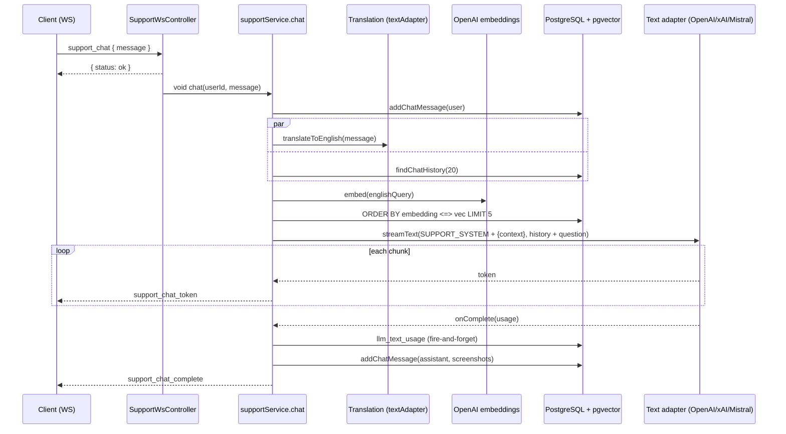

# AI integrations

The backend uses AI in a single product scenario: **Support AI**. This is a tech-support chat that answers from a knowledge base with search through pgvector. Around it there is a prompt admin panel, token accounting and knowledge base management. This page describes how everything is built in the code. The environment variables for AI are listed in [Configuration](/en/backend/configuration) and are not repeated here.

## Provider abstraction

The text adapter contract is described in [`types.ts`](https://github.com/Blazheiko/vibe-template/blob/main/packages/backend/src/app/services/ai/types.ts): the `ITextAdapter` interface has `isConfigured()`, a `model` getter and a **single operation** `streamText(opts, onComplete?)`. It is an async generator of text chunks, so generation is always streamed. `TextStreamOptions` contains `systemPrompt`, `userPrompt`, `temperature`, `maxOutputTokens`, `modelOverride` and an optional `toolCallHandler` for tool calling. When the stream finishes, `onComplete` receives `TokenUsage` (`promptTokens`/`completionTokens`/`totalTokens`), the model name and `finalPrompt`, which is assembled by `buildFinalTextPrompt()`.

| Adapter                                                                                                                                                     | Provider / SDK                                                                                           | Tool calling                     | Usage                                         |
| ----------------------------------------------------------------------------------------------------------------------------------------------------------- | -------------------------------------------------------------------------------------------------------- | -------------------------------- | --------------------------------------------- |
| [`openai-text-adapter.ts`](https://github.com/Blazheiko/vibe-template/blob/main/packages/backend/src/app/services/ai/adapters/openai-text-adapter.ts)       | OpenAI Chat Completions via bare `fetch` to `OPENAI_CHAT_API_URL`, SSE (`stream: true`, `include_usage`) | Yes, one round of tool calls     | Sum of usage from both requests               |
| [`xai-text-adapter.ts`](https://github.com/Blazheiko/vibe-template/blob/main/packages/backend/src/app/services/ai/adapters/xai-text-adapter.ts)             | xAI via `ai` (`streamText`) + `@ai-sdk/xai`, Responses API (`xaiProvider.responses()`)                   | Yes, `stepCountIs(3)`            | `result.usage`                                |
| [`mistralai-text-adapter.ts`](https://github.com/Blazheiko/vibe-template/blob/main/packages/backend/src/app/services/ai/adapters/mistralai-text-adapter.ts) | `@mistralai/mistralai` (`client.chat.stream`)                                                            | No, `toolCallHandler` is ignored | From the last chunk, if the provider sent one |

Separately, there is [`openai-embedding-adapter.ts`](https://github.com/Blazheiko/vibe-template/blob/main/packages/backend/src/app/services/ai/adapters/openai-embedding-adapter.ts) built on the official `openai` SDK. It has the `embed(text)` and `embedBatch(texts)` methods and uses `OPENAI_EMBEDDING_MODEL` and `OPENAI_EMBEDDING_DIMENSIONS`. Embeddings are **OpenAI only**, there is no alternative driver. There is no image generation in the code.

The adapter is selected by [`ai-provider.ts`](https://github.com/Blazheiko/vibe-template/blob/main/packages/backend/src/app/services/ai/ai-provider.ts):

- `textAdapter` is the default adapter. It is chosen by `AI_TEXT_DRIVER`: `openai` (default), `xai` or `mistral`. Any other value stops startup with the error `Invalid AI configuration: AI_TEXT_DRIVER must be one of openai, xai, mistral` (`validateRuntimeConfig`).
- `getTextAdapterForModel(model)` picks an adapter by the model name from the prompt row in the DB: `grok` leads to xAI, `mistral` to Mistral, `gpt`/`openai` to OpenAI. An empty or unknown value returns `textAdapter`. The model from the prompt is then passed to the adapter as `modelOverride`.

## Prompts

Prompts are stored in the `llm_system_prompts` table ([`schema.ts`](https://github.com/Blazheiko/vibe-template/blob/main/packages/backend/src/database/schema.ts)): a unique `type`, `content`, and optional `model`, `temperature`, `max_tokens`. Access to the table is provided by [`prompt-repository.ts`](https://github.com/Blazheiko/vibe-template/blob/main/packages/backend/src/app/repositories/ai/prompt-repository.ts) (`findAll`/`findByType`/`update`). The controller works with three types: `SUPPORT_SYSTEM`, `SUPPORT_FIRST_CHAT`, `SUPPORT_QUERY_TRANSLATION`.

[`prompt-service.ts`](https://github.com/Blazheiko/vibe-template/blob/main/packages/backend/src/app/services/ai/prompt-service.ts) loads all rows into a `Map` at startup (`promptService.load()` in [`index.ts`](https://github.com/Blazheiko/vibe-template/blob/main/packages/backend/src/index.ts)) and then serves them synchronously. The cache has a TTL `PROMPT_CACHE_TTL_MS` (60 s by default): after it expires, a read still returns the current value and starts a background reload, so a prompt change on another instance becomes visible with a delay of at most the TTL; `update()` on its own instance refreshes the cache immediately. There is no invalidation between instances (pub/sub). Details — [Caching and ETag](/en/backend/caching-etag). If a prompt is missing from the DB, the services use defaults: [`config/support.ts`](https://github.com/Blazheiko/vibe-template/blob/main/packages/backend/src/config/support.ts) for the system and first messages, and a constant in [`support-query-translation-service.ts`](https://github.com/Blazheiko/vibe-template/blob/main/packages/backend/src/app/services/support/support-query-translation-service.ts) for translation.

The admin routes of the `prompts` group ([`http-routes.ts`](https://github.com/Blazheiko/vibe-template/blob/main/packages/backend/src/app/routes/http-routes.ts)) pass through the `session_web`, `csrf_guard`, `auth_guard`, `admin_guard` middlewares. They are handled by [`prompt-controller.ts`](https://github.com/Blazheiko/vibe-template/blob/main/packages/backend/src/app/controllers/http/ai/prompt-controller.ts):

- `GET /prompts`, `GET /prompts/:type` read prompts from the cache;
- `PUT /prompts/:type` updates the DB, after which `promptService.update()` reloads the row into the cache;
- `POST /prompts/:type/test` runs the prompt with an arbitrary message through [`prompt-test-service.ts`](https://github.com/Blazheiko/vibe-template/blob/main/packages/backend/src/app/services/ai/prompt-test-service.ts) and `textAdapter` — without its own `fetch` and without a fallback OpenAI call. Provider not configured → `503 service_unavailable`; provider responded with an error → `502 upstream_error`; did not finish within `AI_REQUEST_TIMEOUT_MS` → `504 upstream_timeout`. The provider's error text goes only to the log. If the client closed the request, the provider call is cancelled (`HttpContext.signal`).

## Usage accounting

[`llm-usage-service.ts`](https://github.com/Blazheiko/vibe-template/blob/main/packages/backend/src/app/services/ai/usage/llm-usage-service.ts) writes to the `llm_text_usage` table through `recordText()`; for adapter calls there is `textUsageRecorder(feature, userId, promptId)`, which returns a ready `onComplete`. The write is fire-and-forget: an insert error goes only to `logger.warn`. Each row stores `user_id`, `llm_system_prompt_id`, `model`, `feature`, three token counters and a **prompt fingerprint**: `prompt_sha256` (SHA-256 in hex) and `prompt_chars` (length in characters). The prompt text (`final_prompt`) is **not stored** by default (see [below](#what-the-log-stores-from-the-prompt)).

What gets recorded:

| `feature`                   | Source                                                                                                                                                    | `user_id`                            |
| --------------------------- | --------------------------------------------------------------------------------------------------------------------------------------------------------- | ------------------------------------ |
| `SUPPORT_CHAT`              | Support AI reply and greeting (`support-service.ts`)                                                                                                      | chat user                            |
| `SUPPORT_QUERY_TRANSLATION` | query translation before search (`support-query-translation-service.ts`)                                                                                  | chat user                            |
| `SUPPORT_EMBEDDING`         | embeddings (`support-embedding-service.ts`): chat search, article indexing, `reindexAll`; `final_prompt` is the input text, `completion_tokens` is `NULL` | user for search, `NULL` for indexing |
| `PROMPT_TEST`               | prompt test from the admin panel (`prompt-test-service.ts`)                                                                                               | admin                                |

After a user is deleted, their rows in `llm_text_usage` remain with `user_id = NULL` (foreign key `ON DELETE SET NULL`): the log is accounting of tokens and cost, not user data. The prompt text (only with `AI_USAGE_STORE_PROMPTS=true`) is removed by `llm:purge-prompts` by age, regardless of whose row it is.

**Every call that started has exactly one row** (feat-118), however it ended. The audit is set by [`usage-audit.ts`](https://github.com/Blazheiko/vibe-template/blob/main/packages/backend/src/app/services/ai/usage/usage-audit.ts): `withUsageAudit` wraps every text adapter in [`ai-provider.ts`](https://github.com/Blazheiko/vibe-template/blob/main/packages/backend/src/app/services/ai/ai-provider.ts), and embeddings go through the same `auditCall` in the adapter. For embeddings, reading the result is part of the audited call (feat-119): a response without a vector, or with fewer vectors than texts, produces one `failed` row with the usage reported by the provider, rather than `completed` with an error after it.

- **`status`** (`completed` / `aborted` / `failed`) — how the call ended. `aborted` means the call was cancelled by whoever made it: the connection closed, the response lock or the import lease was lost, or the consumer stopped reading the stream. What decides it is the caller's signal, not the error name (feat-121): the lock cancels with its own reason (`SupportLockLostError`), and `fetch` rejects the request with exactly that. `failed` is a provider error, a timeout (`AI_REQUEST_TIMEOUT_MS`) and any other error, including one that happened before the first chunk.
- **`tokens_estimated`** — where the tokens come from, regardless of status. A usage object without a token count (`usage: {}`) is not usage, and not 0 actual tokens (feat-136). The usage of the first round of a tool call is only a part of the call: the row then has `tokens_estimated = true` with an estimate no lower than this part, and the budget keeps its reserve until the usage of the second round arrives. If the provider reported usage, even before the interruption (the first round of a tool call in OpenAI, the last Mistral chunk), the tokens are actual, `false`. If it did not, the row holds an estimate `⌈characters / 2⌉` of the prompt and the text received so far, `true`. So `aborted` does not mean "estimate".
- **Start boundary** — the first step of the stream, that is, the request has already gone out. In the support pipeline this step goes right after `admission.budget.begin(call)`, so the audit and the budget agree on which calls cost anything ([ADR 0003](https://github.com/Blazheiko/vibe-template/blob/main/docs/adr/0003-llm-budget-reservation.md)). A stream that was created but not started reading writes no row. An adapter without a key does not write one either: it fails before the request.
- **One report.** Completion, error and abort all go through a single `settle`. A repeated call of the same `textUsageRecorder` (for example, a late error handler after completion) does nothing.
- **The budget** receives only actual usage through `onUsage`. If there is no usage, the budget charges its own reserve (ADR 0003), not the estimate from the row.

`NULL` in the counters remains only in rows written before feat-118 without usage, and in the `completion_tokens` of embeddings. `0` is a real zero. Rows written before feat-028 have the old default `0` instead of an unknown value. `GET /admin/usage/text` returns `status` and `tokensEstimated` for every row. `GET /admin/usage/stats` counts `totalTokens` (actual), `estimatedTokens` (estimate), `callsWithoutUsage`, `abortedCalls` and `failedCalls` separately.

The admin `GET /admin/usage/text` (pagination with the filters `userId`, `dateFrom`, `dateTo`, `feature`) and `GET /admin/usage/stats` are served by [`llm-usage-controller.ts`](https://github.com/Blazheiko/vibe-template/blob/main/packages/backend/src/app/controllers/http/ai/usage/llm-usage-controller.ts); the row types are `TextUsageRow` and `TextUsageStatRow` in `shared` (`userId` and tokens are `… | null`; `status`, `tokensEstimated`). The statistics are grouped by `model` × `feature`: `totalCalls`, `totalTokens` (only tokens reported by the provider), `estimatedTokens` (estimate for calls without usage), `callsWithoutUsage`, `abortedCalls` and `failedCalls` (feat-118). The DB queries are run by [`llm-usage-repository.ts`](https://github.com/Blazheiko/vibe-template/blob/main/packages/backend/src/app/repositories/ai/usage/llm-usage-repository.ts).

::: warning Accounting gaps
**Cost is not calculated.** There is no price column, only tokens.
:::

## What the log stores from the prompt

The usage log is accounting of tokens and cost, not an archive of what users wrote. A prompt contains the user's verbatim text (and for the support chat, also the conversation history), so **truncating it does not protect it**: personal data can be anywhere in the text. The contract is as follows:

| What                 | Behavior                                                                                                                                                                                                                                                                                      |
| -------------------- | --------------------------------------------------------------------------------------------------------------------------------------------------------------------------------------------------------------------------------------------------------------------------------------------- |
| Collected by default | `prompt_sha256` (SHA-256 of the UTF-8 text), `prompt_chars` (length in characters by code points, like `char_length` in PostgreSQL), `feature`, `model`, tokens. This is enough to spot a repeated prompt and estimate its size, but not to read it. `final_prompt` = `''`.                   |
| Prompt text          | Only with `AI_USAGE_STORE_PROMPTS=true` (default `false`; the value is read according to the [boolean contract](/en/backend/configuration#boolean-and-integer-values); a typo such as `ture` is a startup error, so it does not enable collection). For debugging prompts on dev/staging.     |
| Who sees it          | An admin via `GET /admin/usage/text`. A row without text is returned with `finalPrompt: null` (not an empty prompt), together with `promptSha256` and `promptChars`; rows from before feat-065 have `null` in both fields until their text is purged.                                         |
| Retention            | With text storage — `AI_USAGE_PROMPT_RETENTION_DAYS` (30 by default): older text is purged by [`llm:purge-prompts`](https://github.com/Blazheiko/vibe-template/blob/main/packages/backend/src/scripts/purge-llm-prompts.ts). Without storage, the script purges everything left in the table. |

**Purging already recorded data.** `pnpm --filter backend llm:purge-prompts [--dry-run] [--all] [--days=<n>]` empties `final_prompt` and, before that, fills in `prompt_sha256`/`prompt_chars` for rows that did not have them (the SHA-256 and length are computed by the DB itself, matching the application). `--dry-run` only counts, `--all` purges everything regardless of age, `--days` overrides the retention; an unknown argument is an error (the purge is irreversible). `--days` together with `--all`, or with `AI_USAGE_STORE_PROMPTS=false` (when all text is deleted), is also an error rather than silently a wider purge (feat-136); a DB or AI configuration error stops the script before the first query. The purge goes through the table in pages of 1000 rows by `id` (feat-125, feat-130): each page is `id > last ORDER BY id LIMIT 1000` by the primary key, and the `UPDATE` (or the count in `--dry-run`) touches only it. So no query scans the whole table, even when there is nothing left to purge, and a large table does not run into `DB_QUERY_TIMEOUT_MS` of the main pool. The script is idempotent; for retention, run it from cron or a scheduler, for example daily. The application itself has no background process that does this.

::: warning What is already recorded
Rows written before feat-065 contain the full text until `llm:purge-prompts` is run (once after the upgrade). DB backups keep them as long as the backups themselves live.
:::

## Support AI and the knowledge base

Articles live in `support_knowledge_base`: `title`, `content`, `category`, `is_active`, a screenshot, `content_version` and the `embedding vector(1536)` column, which is described by a `customType` in [`schema.ts`](https://github.com/Blazheiko/vibe-template/blob/main/packages/backend/src/database/schema.ts). For why the pgvector extension is needed and how to install it, see [Database → pgvector](/en/backend/database#pgvector). The column dimension is `EMBEDDING_COLUMN_DIMENSIONS = 1536` ([`embedding-dimensions.ts`](https://github.com/Blazheiko/vibe-template/blob/main/packages/backend/src/database/embedding-dimensions.ts)); `OPENAI_EMBEDDING_DIMENSIONS` with a different value stops startup: a different dimension requires a column migration and reindexing.

**Indexing** happens in [`support-embedding-service.ts`](https://github.com/Blazheiko/vibe-template/blob/main/packages/backend/src/app/services/support/support-embedding-service.ts). The text `${title}\n\n${content}` is sent to OpenAI embeddings, and the result is written by `setEmbedding()` with raw SQL `::vector`. Indexing is triggered by:

- [`knowledge-base-service.ts`](https://github.com/Blazheiko/vibe-template/blob/main/packages/backend/src/app/services/support/knowledge-base-service.ts) after an article is created and after `title`/`content` change, in the background (`void ... .catch(log)`);
- the admin `POST /admin/knowledge-base/:id/reindex` and `POST /admin/knowledge-base/reindex-all`. The second route sends active articles in batches of `SUPPORT_EMBEDDING_BATCH_SIZE` (50 by default) and responds with the number of vectors **written** (feat-119): an article changed during reindexing is not counted, its indexing is done by the indexing of the edit;
- `POST /admin/knowledge-base/init` imports articles from files ([`knowledge-base-init-service.ts`](https://github.com/Blazheiko/vibe-template/blob/main/packages/backend/src/app/services/support/knowledge-base-init-service.ts)) into an empty database only. The import runs **once across all instances**:
    - `start()` marks the import as `running` before the first `await`, so a second call in the same process immediately gets `409`. An early exit (no OpenAI key, the database is not empty, Redis did not respond) returns the previous state.
    - Between instances, a lease lock `support:kb-init` in Redis applies (the same mechanism as the response lock below, [`redis-lease.ts`](https://github.com/Blazheiko/vibe-template/blob/main/packages/backend/src/app/services/shared/redis-lease.ts)): `SET … NX PX` with an owner token; renewal and release are Lua, only if the token is still ours. The key lives at least 30 s, the import renews it every 10 s, for 1 hour at most. The import learns about a lost lease within the longest DB write (connection wait 2 s + `DB_QUERY_TIMEOUT_MS` + 500 ms, plus 1 s) before the key could expire, and the TTL grows if needed so that two renewals fit before this boundary (feat-135): an article insert or a vector write that started before the loss does not land under the next owner. The second instance gets `409` "already running". The "database is not empty" check runs already under the lock, so an import that another instance has just finished is accounted for too.
    - **All or nothing** (feat-125). First all files are read, then all articles are inserted in **one** `INSERT`, and only then indexed. An import that stopped before the insert leaves no articles, so the next `init` does not get `NOT_EMPTY`. After the insert the database is complete, only vectors may be missing. If the `INSERT` got no response from PostgreSQL (timeout, connection drop), it may have committed: the import then rereads the number of articles and, if there are any, ends as `failed` with `createdArticles` = their count and a hint to run `reindex-all` (feat-130), rather than with `0`. If rereading failed too, the status says the count is unknown and still advises checking the database and running `reindex-all` (feat-135).
    - If the lease is lost (renewal failed or the key already belongs to someone else), the import stops **before the next write**. The lease-loss signal is passed into article indexing (feat-119): it cancels waiting for the OpenAI response and is checked once more right before the vector is written, so no vector is written after the lease is lost. The status is `failed` with the message `Knowledge base initialization stopped: lock lost: … N article(s) imported; run reindex-all for the missing vectors.`; the vectors are completed by `POST /admin/knowledge-base/reindex-all`. A late lock release after the loss does nothing and does not delete the new owner's lock.
    - The state (`GET /admin/knowledge-base/init-status`) is kept in process memory, so it shows only the import of this instance.

**Text version.** Indexing runs in the background, so two quick edits of an article start two indexing runs, and the earlier one may finish later. So that an article does not end up with the vector of the old text, the text has a version `content_version` ([`support-knowledge-repository.ts`](https://github.com/Blazheiko/vibe-template/blob/main/packages/backend/src/app/repositories/support/support-knowledge-repository.ts)):

- An `UPDATE` that changes `title` or `content` increments `content_version` and resets `embedding` to `NULL` in the same query. The article is not found by search with the old vector even if reindexing failed, and `embeddingIndexed` in the response is `false` until the new indexing finishes. Changing `category`, `is_active` or the screenshot does not touch the version or the vector.
- Every indexing run (creation, edit, `reindex`, `reindex-all`, `init`) takes the version together with the text, and `setEmbedding(id, vector, version)` writes only when `content_version = version`. Indexing a text that has since changed writes nothing (an `info` log), and `POST /admin/knowledge-base/:id/reindex` then responds with `indexed: 0`.
- `updated_at` cannot be the version: it is set by `new Date()` (two edits can get the same value), and it is changed by the screenshot.

If the OpenAI key is not set, indexing is skipped with a warning, and search returns an empty list. `clearEmbedding()` resets the vector and updates `updatedAt` in a single `UPDATE`.

**Search** is performed by `searchByEmbedding()` in [`support-knowledge-repository.ts`](https://github.com/Blazheiko/vibe-template/blob/main/packages/backend/src/app/repositories/support/support-knowledge-repository.ts): cosine distance `embedding <=> $vec::vector` among active articles with a non-empty embedding, `ORDER BY distance`, `LIMIT 5`, and only articles with a distance of at most `SUPPORT_SEARCH_MAX_DISTANCE` (`0.8` by default; cosine distance runs from 0 — identical meaning — to 2). If there are no relevant articles, the context is empty, and the prompt tells the model to honestly say there is no answer. The value `0.8` is **not calibrated** on real data: to choose your own, log the `distance` for a few queries with a known answer and take a threshold slightly above the distances of the correct articles.

**The chat** works over WebSocket ([`ws-routes.ts`](https://github.com/Blazheiko/vibe-template/blob/main/packages/backend/src/app/routes/ws-routes.ts), the `support` group, `rateLimit` 60 requests per minute). Transport details are described on the [WebSocket](/en/backend/websocket) page. [`support-controller.ts`](https://github.com/Blazheiko/vibe-template/blob/main/packages/backend/src/app/controllers/ws/support-controller.ts) answers the request with an **admission verdict**: first `supportService.admitChat()` / `admitOpenChat()` (per-user limit and lock, see [Message admission](#message-admission)), and only then `{ status: 'ok' }` and a background start of `runChat()` / `runOpenChat()`. A refusal is the response to the request itself (`status: '429'`), not an `ok` followed by silence. Tokens reach the client as `support_chat_token` events, and at the end `support_chat_complete` arrives (with `screenshots` extracted from `[screenshot:id]` markers; the client shows them via `GET /support/screenshot/:articleId`, which redirects to `CDN_URL`, because chat media is allowed only from our CDN) or `support_chat_error`. The history is read and deleted by the HTTP routes `GET`/`DELETE /support/chat/history`.

## Request flow

The system prompt is assembled by [`support-llm-service.ts`](https://github.com/Blazheiko/vibe-template/blob/main/packages/backend/src/app/services/support/support-llm-service.ts). It substitutes the context for `{context}` verbatim: `$&`, `$'`, `` $` `` and `$$` in the article text are not treated as replacement patterns. If there is no placeholder, it appends the context to the end and logs a warning. An instruction to answer in the user's native language is added separately. A failed translation does not stop the chat: the service returns the original query.

## Chat history

The history is read in two different ways, and neither returns the whole conversation (previously the UI received all of it, while the prompt got a silently truncated one):

- **For the UI — in pages.** `GET /support/chat/history` ([support-controller.ts](https://github.com/Blazheiko/vibe-template/blob/main/packages/backend/src/app/controllers/http/support/support-controller.ts)) returns the **last page** (50 messages by default, `limit` from 1 to 100) in ascending order, as well as `hasMore: true` if there are older ones. For older ones: `?before=<id of the oldest message the client already has>&limit=…`. The cursor is the row `id` (digits without a leading zero, ≤ 18 digits), the order is by `id`, not by `created_at` (rows inserted in the same millisecond have the same time). Invalid `limit`/`before` — `422`. Other users' messages are inaccessible even with another user's cursor. On the frontend, the "Show earlier messages" button loads the previous page and puts it before the one shown, without jumping up; messages added locally and not yet saved do not become a cursor.
- **For the prompt — a fixed slice.** `supportRepository.findRecentForContext(userId, 20)` ([support-repository.ts](https://github.com/Blazheiko/vibe-template/blob/main/packages/backend/src/app/repositories/support/support-repository.ts)): the last 20 messages, regardless of the conversation length, so a long conversation does not inflate the prompt and the cost. This is a separate constant (`SUPPORT_CONTEXT_MESSAGES`), not a side effect of the page limit.

**Behavior change.** A request without parameters no longer returns the entire history: only the last 50 messages and `hasMore`. Clients that do not know about `hasMore` see only the tail of the conversation.

## Message admission

Every chat message costs several paid provider calls (translation, embedding, the reply, and then again as history), so it is **admitted before `ok` is returned**. Admission ([`support-service.ts`](https://github.com/Blazheiko/vibe-template/blob/main/packages/backend/src/app/services/support/support-service.ts), `admitChat` / `admitOpenChat`) checks, in order:

1. **Length.** `message` is no longer than `SUPPORT_MESSAGE_MAX_LENGTH` = 4000 characters (`shared/limits`; the same limit is in the `maxlength` of the input field on the frontend). Longer is an ordinary WS validation error (`validation_failed`, an error frame) and no calls.
2. **Per-user rate.** An atomic counter in Redis (`consumeAuthThrottle`): `supportChatUser` — 20 messages per 60 s, `supportOpenChatUser` — 5 per 60 s (`SUPPORT_CHAT_USER_RATE_LIMIT_*`, `SUPPORT_OPEN_CHAT_USER_RATE_LIMIT_*`, see [Configuration](/en/backend/configuration)). Over the limit — the response is `status: "429"`, `code: "rate_limited"`, `reason: "support_rate_limited"`.
3. **One reply at a time.** The lock `support:inflight:<userId>` ([support-inflight-lock.ts](https://github.com/Blazheiko/vibe-template/blob/main/packages/backend/src/app/services/support/support-inflight-lock.ts), the lease mechanism is [`redis-lease.ts`](https://github.com/Blazheiko/vibe-template/blob/main/packages/backend/src/app/services/shared/redis-lease.ts)): `SET … NX PX` with an **owner token**. While the previous reply is being written, the next message (and the greeting too) gets `status: "429"`, `reason: "support_busy"`. The lock is released by a Lua script **only if it still holds this request's token**: a request that lost the lock will not delete the next one's lock.

    The lock is a **lease**, not an assumption about the reply duration: DB waits in the pipeline are not bounded by `AI_REQUEST_TIMEOUT_MS`, so no fixed TTL guarantees that a slow reply will not outlive the lock. The key lives 30 s, and while the reply is running it renews the key every 5 s (Lua: `PEXPIRE` only if the token is still ours). A dead process stops renewing, and the user is free after 30 s. If renewal fails (Redis is silent, the key is gone or belongs to another request) or the reply lasts longer than `3 × AI_REQUEST_TIMEOUT_MS + 60 s`, the owner learns about the loss **before the key could expire** (by the longest DB write before the end of the TTL — connection wait 2 s + `DB_QUERY_TIMEOUT_MS` + 500 ms, plus 1 s, at least the renewal interval, feat-135: saving a reply that started before the loss will not land next to the next owner's reply; counted from the start of the last successful renewal; a separate timer on a monotonic clock, not a check on the renewal tick, so a late tick does not push the boundary, feat-122): its `AbortSignal` fires, the provider calls are cancelled, and before every paid step (translation, embedding, reply, saving) there is a check — a second reply does not start alongside.

4. **Daily token budget.** Each user has a budget of `AI_SUPPORT_DAILY_TOKEN_BUDGET` tokens per day (UTC; 200000 by default; `0` disables accounting — only outside production, and starting a production-like environment with `0` is an error). The counter is the key `llm:budget:<userId>:<YYYY-MM-DD>` in Redis (TTL 48 h; the `llm_text_usage` log remains an audit and is not read for decisions). The decision and alternatives — [ADR 0003](https://github.com/Blazheiko/vibe-template/blob/main/docs/adr/0003-llm-budget-reservation.md).
    - **Reservation (admission).** After the limit and the lock, a single Lua script ([llm-budget-service.ts](https://github.com/Blazheiko/vibe-template/blob/main/packages/backend/src/app/services/ai/usage/llm-budget-service.ts)) atomically checks `spent + reserve ≤ limit` and adds the reserve; N parallel requests do not see the same remainder. A refusal is `status: "429"`, `reason: "support_budget_exceeded"`, `retryAfterSeconds` until midnight UTC; **the lock taken by this admission is released**. The reserve does not exceed the limit.
    - **Estimate** ([support-budget.ts](https://github.com/Blazheiko/vibe-template/blob/main/packages/backend/src/app/services/support/support-budget.ts)): translation = `tokens(message) + maxTokens(translation)`; embedding = `tokens(message)`; reply = `AI_SUPPORT_PROMPT_ALLOWANCE_TOKENS` (8000: the system prompt, the knowledge base context, the history — their size is unknown at admission) `+ tokens(message) + maxTokens(reply)`. `tokens(text) = ⌈characters / 2⌉` — a **heuristic, not an upper bound**: for CJK, emoji and code the ratio is worse. A greeting is only a "reply".
    - **Reconciliation (end of the run, `release()` — before the lock is released).** A call that **did not start** (the run was stopped: lost lock, closed connection, duplicate message) returns its share; a call that started and reported usage is charged by the **actual** figure (down or up); a call that started **without usage** (a break mid-stream, a timeout, a provider error) leaves the **reserve** charged — cancelling after generation has started is not free. A reconciliation error does not retract the reply: it is logged, and the reserve stays.
    - **The guarantee is approximate:** the budget limits the daily cost to an order of magnitude, not to the token; the last reply of the day may exceed the limit by the difference "actual − reserve", but by no more than one reply (the lock). A conservative reserve means the user hits the limit slightly earlier than the real spend.

If Redis is unavailable, admission gives `service_unavailable`, not `ok`. This also applies to the rate and budget counters (a separate `redis-rate-limit` connection that throws ordinary ioredis errors): the admission exception reaches the WS dispatcher, and `classifyError` recognizes the unavailability of both clients (`isRedisUnavailable`), so it is not an `internal_error`. The response arrives as a transport error (`error`), not in `data`. If the budget reservation failed, the lock taken by this admission is released before the response.

The lock is released **before** the final event (`support_chat_complete` / `support_chat_error`), so a client that sends the next message right after the reply does not get a false "busy".

**A failure after admission** (a provider error, a timeout, a DB failure) reaches the client as a `support_chat_error` event with `message` and `code`: `chat_failed`, `open_chat_failed`, `message_already_received` (a repeat of an already saved message), and, when the reply was stopped because of a lost lock, `chat_interrupted`. A closed connection does not send the event.

**Idempotent retry (`clientMessageId`).** The response to a request can get lost (a timeout, a dropped connection) when the server has already saved the message. The client gives each message a `clientMessageId` (`[A-Za-z0-9_-]{1,64}`, a UUID on the frontend) and, if the response is lost, sends the **same** request again. The message is saved once per `(user_id, client_message_id)` pair — the unique index `support_chat_history_client_message_uidx`, the insert is `ON CONFLICT DO NOTHING` (a parallel retry waits for the original's transaction, then conflicts). The retry goes through admission like any message; if the message already exists, the reply is not generated a second time, and the client receives `support_chat_error` with `code: "message_already_received"`. While the original is still replying, the retry gets `429 support_busy`. Without `clientMessageId` (old clients) every request is saved separately.

Comparing texts in the history to find out about delivery is not allowed: the original `INSERT` may still be running when the `SELECT` has already returned the old history. So the absence of a message in the history never means "not delivered".

**Reply events carry `clientMessageId`** (`support_chat_token`, `support_chat_complete`, `support_chat_error`; the greeting does not have it). The frontend ignores events with a foreign id, so a late `complete`/`error` of an old reply will not finish a new one. On the server, a run that lost the lock sends **nothing**: no tokens (a check before every token), no `complete`, no notification (a check after the reply is saved) — only `chat_interrupted`, and only if it still could. An `INSERT` that has already started cannot be cancelled: the old run's reply may end up in the history next to the reply of the lock's new owner.

**Client on refusal.** An explicit server refusal (`429`, `503`, a validation error) or a failure before sending: the frontend removes the optimistically added message **by its id** (the greeting could have finished after it and before the refusal) and returns the text to the input field. A timeout or a dropped connection is an **unknown delivery status**: the client sends the same request with the same id once. Accepted — everything as usual. Not accepted (even an explicit refusal of the retry: the original may be saved or still running) — the message stays in the conversation, the text is not returned to the field, and a hint is shown to check the conversation before trying again. The `message_already_received` and `chat_interrupted` events make the client reread the history.

## Reliability, cost and security

- **Timeout and cancellation.** Every provider call (OpenAI `fetch`, xAI `abortSignal`, Mistral `fetchOptions.signal`, embeddings `{ signal }`) gets a signal from [`aiRequestSignal`](https://github.com/Blazheiko/vibe-template/blob/main/packages/backend/src/app/services/ai/ai-request-signal.ts): `AI_REQUEST_TIMEOUT_MS` (60 000 ms by default) plus the caller's signal. For HTTP this is `HttpContext.signal` (the client disconnected), for Support AI — the WS connection signal (`WsContext.signal`, aborted in `onClose`): a closed tab stops generation, and this is not logged as a failure. The AI SDK (xAI) reports an abort not with an exception but as an `abort` part of the stream; the adapter turns it into a `TimeoutError`/`AbortError`, so an xAI timeout gives `504`, not an empty successful response.
- **Errors.** Any error in `runChat()`/`runOpenChat()` is caught, logged and turned into a `support_chat_error` event with a generic text and a `code` field (`chat_failed`, `open_chat_failed`, `chat_interrupted`). There are no retries. Cancellation through a closed connection does not send the event (there is nobody to reply to). The prompt test returns `502`/`503`/`504`, see above.
- **Per-user limits.** In addition to the per-IP limit below, there are per-user limits, the message length and "one reply at a time" (see [Message admission](#message-admission)).
- **Rate limit.** For the `support` WS group, a limit of 60 requests per minute per IP applies to each event separately (the key is IP + route URL), not per connection: all tabs and devices behind one IP share this budget. Every message costs at least 3 paid calls: translation, embedding and the reply. The HTTP groups `prompts` and `admin/knowledge-base` are protected by `admin_guard`, but have no `rateLimit` of their own in the group definition.
- **PII.** The provider receives the user's verbatim message and up to the last 20 history messages; there is no filtering or masking of personal data. This text does **not** end up in `llm_text_usage` by default: only the SHA-256 and the length (see [What the log stores from the prompt](#what-the-log-stores-from-the-prompt)); the text only with `AI_USAGE_STORE_PROMPTS=true` and with retention.
- **Secrets.** Keys are set only via env (`OPENAI_API_KEY=<your-openai-key>` and so on). `OPENAI_API_KEY` is shared by the chat and embeddings.

**Response language.** The frontend passes the browser language (`language`, `supportLanguage()`; for example `uk` or `pt-BR`) in `support/support_open_chat` and `support/support_chat`, not the interface language: the interface is translated only into `en`, `uk`, `pl`, while Support AI also replies in other languages from `APP_LOCALE_CODES`. [`support-service.ts`](https://github.com/Blazheiko/vibe-template/blob/main/packages/backend/src/app/services/support/support-service.ts) reduces it to a code from `APP_LOCALE_CODES` (`resolveSupportLanguage`), and if the field is missing or unknown, takes `SUPPORT_DEFAULT_LANGUAGE` (`en` by default). There is no separate language in the user profile.
