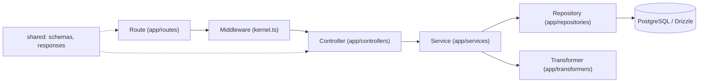

# Backend architecture

The backend (`packages/backend`) is a TypeScript server on uWebSockets.js with no third-party web framework. The code is split into two parts: `src/vendor/` is the actual "framework core" (HTTP/WS server, router, request body reading, rate limit, sessions, logger), and `src/app/` is the application code (routes, controllers, services, repositories, transformers, middleware). The contracts between the backend and the frontend (validation schemas, response types, enums) live in the `shared` workspace package.

## vendor/ and app/ split

| Directory                                                 | Purpose                                                                                                                                                             | Examples                                                                                                                                                                                                                                                                                                 |
| --------------------------------------------------------- | ------------------------------------------------------------------------------------------------------------------------------------------------------------------- | -------------------------------------------------------------------------------------------------------------------------------------------------------------------------------------------------------------------------------------------------------------------------------------------------------- |
| `vendor/start/`                                           | Starting the uWS server, registering routes                                                                                                                         | [server.ts](https://github.com/Blazheiko/vibe-template/blob/main/packages/backend/src/vendor/start/server.ts), [router.ts](https://github.com/Blazheiko/vibe-template/blob/main/packages/backend/src/vendor/start/router.ts)                                                                             |
| `vendor/utils/network/`                                   | Reading headers/body, WS handlers                                                                                                                                   | [http-request-handlers.ts](https://github.com/Blazheiko/vibe-template/blob/main/packages/backend/src/vendor/utils/network/http-request-handlers.ts), [ws-handlers.ts](https://github.com/Blazheiko/vibe-template/blob/main/packages/backend/src/vendor/utils/network/ws-handlers.ts)                     |
| `vendor/utils/routing/`                                   | WS event dispatcher                                                                                                                                                 | [ws-api-dispatcher.ts](https://github.com/Blazheiko/vibe-template/blob/main/packages/backend/src/vendor/utils/routing/ws-api-dispatcher.ts)                                                                                                                                                              |
| `vendor/utils/middlewares/`                               | Running the middleware chain, base guards                                                                                                                           | [execute-httpMiddlewares.ts](https://github.com/Blazheiko/vibe-template/blob/main/packages/backend/src/vendor/utils/middlewares/core/execute-httpMiddlewares.ts), [auth-guard.ts](https://github.com/Blazheiko/vibe-template/blob/main/packages/backend/src/vendor/utils/middlewares/core/auth-guard.ts) |
| `vendor/utils/validation/`                                | Route payload and query validation, `getTypedPayload`                                                                                                               | [validation/](https://github.com/Blazheiko/vibe-template/tree/main/packages/backend/src/vendor/utils/validation)                                                                                                                                                                                         |
| `vendor/utils/rate-limit/`                                | HTTP, WS and upgrade limits (in-memory and Redis)                                                                                                                   | [rate-limit/](https://github.com/Blazheiko/vibe-template/tree/main/packages/backend/src/vendor/utils/rate-limit)                                                                                                                                                                                         |
| `vendor/utils/session/`                                   | Sessions in Redis, cookie signing, CSRF token                                                                                                                       | [session/](https://github.com/Blazheiko/vibe-template/tree/main/packages/backend/src/vendor/utils/session)                                                                                                                                                                                               |
| `vendor/utils/storage/`                                   | File storage (S3)                                                                                                                                                   | [storage/](https://github.com/Blazheiko/vibe-template/tree/main/packages/backend/src/vendor/utils/storage)                                                                                                                                                                                               |
| `vendor/utils/` (other)                                   | `context`, `env`, `helpers`, `tooling` (schema serialization for docs), logger                                                                                      | [utils/](https://github.com/Blazheiko/vibe-template/tree/main/packages/backend/src/vendor/utils)                                                                                                                                                                                                         |
| `vendor/contracts/`, `vendor/types/`, `vendor/constants/` | The `Validator<T>` contract ([ADR 0001](https://github.com/Blazheiko/vibe-template/blob/main/docs/adr/0001-validator-abstraction.md)), shared core types, constants | [contracts/](https://github.com/Blazheiko/vibe-template/tree/main/packages/backend/src/vendor/contracts), [types/](https://github.com/Blazheiko/vibe-template/tree/main/packages/backend/src/vendor/types)                                                                                               |
| `app/routes/`                                             | HTTP and WS route declarations                                                                                                                                      | [http-routes.ts](https://github.com/Blazheiko/vibe-template/blob/main/packages/backend/src/app/routes/http-routes.ts), [ws-routes.ts](https://github.com/Blazheiko/vibe-template/blob/main/packages/backend/src/app/routes/ws-routes.ts)                                                                 |
| `app/middlewares/`                                        | Middleware registry by name                                                                                                                                         | [kernel.ts](https://github.com/Blazheiko/vibe-template/blob/main/packages/backend/src/app/middlewares/kernel.ts)                                                                                                                                                                                         |
| `app/controllers/`                                        | HTTP and WS controllers                                                                                                                                             | [main-controller.ts](https://github.com/Blazheiko/vibe-template/blob/main/packages/backend/src/app/controllers/http/core/main-controller.ts)                                                                                                                                                             |
| `app/services/`                                           | Business logic, returns a `Result` from `better-result`                                                                                                             | [main-service.ts](https://github.com/Blazheiko/vibe-template/blob/main/packages/backend/src/app/services/core/main-service.ts)                                                                                                                                                                           |
| `app/repositories/`                                       | DB access via Drizzle                                                                                                                                               | [user-repository.ts](https://github.com/Blazheiko/vibe-template/blob/main/packages/backend/src/app/repositories/user/user-repository.ts)                                                                                                                                                                 |
| `app/transformers/`                                       | Serializing DB rows into public DTOs                                                                                                                                | [user-transformer.ts](https://github.com/Blazheiko/vibe-template/blob/main/packages/backend/src/app/transformers/user-transformer.ts)                                                                                                                                                                    |
| `app/state/`                                              | In-memory process state (including `listenSocket`)                                                                                                                  | [state.ts](https://github.com/Blazheiko/vibe-template/blob/main/packages/backend/src/app/state/state.ts)                                                                                                                                                                                                 |
| `app/websocket/`                                          | WS application logic: authentication, connection registry, presence                                                                                                 | [ws-coordinator.ts](https://github.com/Blazheiko/vibe-template/blob/main/packages/backend/src/app/websocket/ws-coordinator.ts), [ws-session-auth.ts](https://github.com/Blazheiko/vibe-template/blob/main/packages/backend/src/app/websocket/ws-session-auth.ts)                                         |
| `app/start/`                                              | Startup initialization: registering WS hooks and the validator                                                                                                      | [index.ts](https://github.com/Blazheiko/vibe-template/blob/main/packages/backend/src/app/start/index.ts)                                                                                                                                                                                                 |

For WS, the core does not import application business logic directly: `app/start/index.ts` registers hooks via `registerWsAppHooks` and `registerWsMessageValidator` from `ws-handlers.ts`. For HTTP, the core uses `app/middlewares/kernel.ts` (a middleware registry by string name) and the validators from `app/validate/`.

::: info
There is no separate `events/` directory in `packages/backend/src/app`. Realtime events are implemented through WebSocket routes (`ws-routes.ts`) and `broadcastToChannel` in [server.ts](https://github.com/Blazheiko/vibe-template/blob/main/packages/backend/src/vendor/start/server.ts).
:::

## Layers



- **Route** is the object `defineRoute({ url, method, handler, validator, ResponseSchema, middlewares, rateLimit })` ([define-route.ts](https://github.com/Blazheiko/vibe-template/blob/main/packages/backend/src/app/routing/define-route.ts)). Groups set `prefix`, shared `middlewares` and `rateLimit`; `routesHandler` in [router.ts](https://github.com/Blazheiko/vibe-template/blob/main/packages/backend/src/vendor/start/router.ts) flattens them into a list and adds `appConfig.pathPrefix` (`api` by default, the `API_PATH_PREFIX` variable).
- **Middleware** is a `(context, next)` function; if it did not call `next()`, the handler does not run (see [Middleware](/en/backend/middlewares)).
- **Controller** receives `HttpContext`, calls a service, and returns `respond(context, result, toBody)`, which maps a `Result` error to an HTTP response via `mapControllerError`.
- **Service** is the business logic, returns `Result.ok(...)` / `Result.err(...)`.
- **Repository** holds the Drizzle queries (see [/backend/database](/en/backend/database)).
- **Transformer** removes sensitive fields (`password`, `sessionToken`) and normalizes dates.

Import rules between layers are checked by [`layering.spec.ts`](https://github.com/Blazheiko/vibe-template/blob/main/packages/backend/src/app/layering.spec.ts) (static import analysis, without loading modules):

- controllers, middleware (including `admin_guard`) and `app/websocket` do not import repositories, even as types: data goes through services (`adminUserService`, `userRoleService`, etc.), types come from the service or `shared`;
- outside `app/repositories`, repositories are imported only through the `#app/repositories/index.js` barrel, and the barrel exports every `*-repository.ts` module;
- repositories do not log: the decision "this is worth logging" is made by the service;
- services do not import `#database/db.js` and `#database/schema.js`; only repositories do.

## Contracts in packages/shared

The `shared` package ([index.ts](https://github.com/Blazheiko/vibe-template/blob/main/packages/shared/src/index.ts)) exports `schemas` (input schemas, e.g. `VerifyEmailInputSchema`), `responses` (response schemas, e.g. `InitResponseSchema`), `enums`, `errors`, `brands`, `utils`. Routes import them as `shared/schemas` and `shared/responses`, and controllers import response types (`InitResponse`, `PingResponse`) from `shared`.

## End-to-end example: GET /api/main/init

1. **Route.** In [http-routes.ts](https://github.com/Blazheiko/vibe-template/blob/main/packages/backend/src/app/routes/http-routes.ts) a group with `prefix: "main"` and `middlewares: ["session_web", "csrf_guard"]` contains:

```ts
defineRoute({
  url: "/init",
  method: "get",
  handler: MainController.init.bind(MainController),
  ResponseSchema: ResponseSchemas.InitResponseSchema,
  description: "Initialize app state",
  middlewares: ["auth_guard"],
}),
```

After `routesHandler`, the URL becomes `api/main/init` and the middleware chain is `session_web → csrf_guard → auth_guard`.

2. **Middleware.** `executeMiddlewares` takes the functions from [kernel.ts](https://github.com/Blazheiko/vibe-template/blob/main/packages/backend/src/app/middlewares/kernel.ts). `auth_guard` ([auth-guard.ts](https://github.com/Blazheiko/vibe-template/blob/main/packages/backend/src/vendor/utils/middlewares/core/auth-guard.ts)) sets `responseData.status = 401` when there is no authentication and does not call `next()`.
3. **Controller.** `MainController.init` ([main-controller.ts](https://github.com/Blazheiko/vibe-template/blob/main/packages/backend/src/app/controllers/http/core/main-controller.ts)) calls `mainService.init(session.sessionInfo ?? null)`; on error it uses `mapControllerError`, otherwise it returns `{ status: "ok", ...result.value }`.
4. **Service.** `mainService.init` ([main-service.ts](https://github.com/Blazheiko/vibe-template/blob/main/packages/backend/src/app/services/core/main-service.ts)) checks the session, loads the user via `userRepository.findById(BigInt(userId))`, generates a WS token (`generateWsToken`) and returns the CSRF token, the user data, `wsUrl`, `wsToken` and the storage config.
5. **Repository.** `userRepository.findById` ([user-repository.ts](https://github.com/Blazheiko/vibe-template/blob/main/packages/backend/src/app/repositories/user/user-repository.ts)) reads the `users` row. This endpoint builds the user DTO manually in the service; the `userTransformer.serialize` transformer is used, for example, in [auth-service.ts](https://github.com/Blazheiko/vibe-template/blob/main/packages/backend/src/app/services/auth/auth-service.ts) (see [Repositories](/en/backend/repositories)).
6. **Response.** The handler's return value is written to `responseData.payload` and serialized to JSON in `sendResponse` ([server.ts](https://github.com/Blazheiko/vibe-template/blob/main/packages/backend/src/vendor/start/server.ts)). Details are on the ["Request lifecycle"](/en/backend/request-lifecycle) page.

The simplest route, `GET /api/ping` (`MainController.ping` → `mainService.ping()` → `{ status: "ok" }`), follows the same path, but without middleware and the DB. To see how to add your own resource following these layers, see [/backend/adding-a-feature](/en/backend/adding-a-feature).
