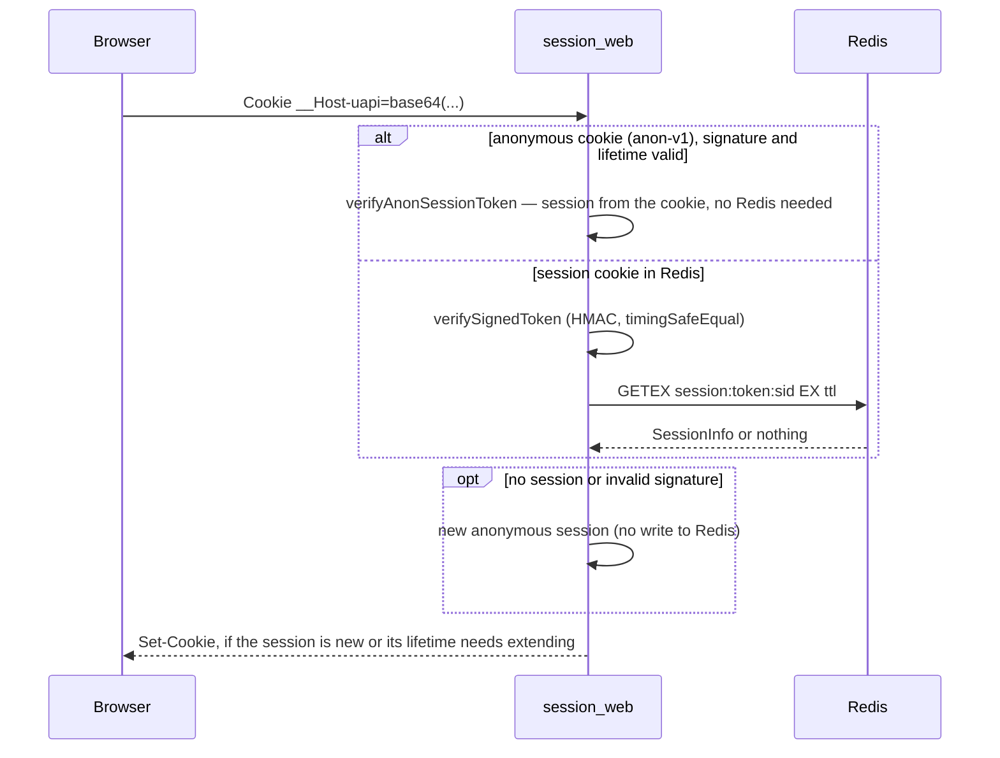

# Authentication

This page describes how the backend recognizes a user: sessions in Redis with an HMAC-signed cookie, the ways to sign in, how to sign a user in and out from code, WebSocket authorization, and roles. Traffic protection (rate limiting, CSRF, CORS, CSP, proxy) is described on the [Security](/en/backend/security) page, and sign-in with Google, GitHub and others is on the [Social login](/en/backend/oauth) page.

## In short, with an example: what happens after sign-in

You can walk through this chain in the browser (DevTools → Network) or with curl, see [First scenario](/en/guide/getting-started#_6-first-scenario-from-login-to-logout).

1. **`GET /api/main/init`** without a cookie. The server creates a guest session, sets the `uapi` cookie and returns `401` with a `csrfToken`.
2. **`POST /api/auth/login`** with an email, a password and the `x-csrf-token` header. The server checks the password, binds the session to the user and updates the cookie:

    ```text
    Set-Cookie: uapi=<…>; Path=/; Expires=…; HttpOnly; Max-Age=86400; SameSite=Lax
    ```

    A wrong password gives `401 {"message":"Invalid email or password","code":"unauthorized"}`, and after 10 failed attempts in a row from one address the server responds with `429` and a `Retry-After: 60` header (verified with the default settings; the limits are described below).

3. **Every following request** carries the cookie automatically. The `session_web` middleware finds the session in Redis, compares its `userToken` with `users.session_token` in the DB (see [Revoking sessions](#revoking-sessions)) and knows who you are. `GET /api/main/init` now returns `200` with the user data, a `wsToken` and a new `csrfToken`.
4. **Protected routes.** `auth_guard` lets through only a session with a user (otherwise `401`), `admin_guard` only the `admin` role (otherwise `403 Admin access required`).
5. **`POST /api/auth/logout`** deletes the session from Redis. The old cookie no longer opens anything, and `init` gives `401` again. `logout-all` rotates `users.session_token`, which revokes all of the user's sessions (sign-out on all devices), and removes their records from Redis.

What lies in Redis after this scenario (keys with the `REDIS_PREFIX` prefix):

```text
uwebsocket:session:<userId>:<sessionId>          session of a signed-in user
uwebsocket:session:anon_session:<sessionId>      guest session, only if it stores data (OAuth state)
uwebsocket:auth:throttle:login_ip:127.0.0.1      counter of sign-in attempts from an IP
uwebsocket:auth:ws:<token>                       one-time WebSocket token (60 s)
```

A regular guest session (before sign-in) is not written to Redis: it lives in the signed cookie (see [Anonymous session](#anonymous-session)).

Below are the cookie format, the signature, rotation and the rest of the mechanisms.

## Signing in and out in code

A developer does not need to work with cookies, Redis or signatures directly. Every HTTP context has two objects: `context.auth` (who the user is, sign-in and sign-out) and `context.session` (data of the current session). They are populated by the `session_web` middleware, so the route must be in a group that has it. The types are `Auth` and `Session` in [`vendor/types/types.d.ts`](https://github.com/Blazheiko/vibe-template/blob/main/packages/backend/src/vendor/types/types.d.ts), the implementation is [`session-handler.ts`](https://github.com/Blazheiko/vibe-template/blob/main/packages/backend/src/vendor/utils/session/session-handler.ts).

### `context.auth`

| Method                     | Returns                          | What it does                                                                                                                                                                                                                                                                                                                                                                                                                                                                                                                                                                                                  |
| -------------------------- | -------------------------------- | ------------------------------------------------------------------------------------------------------------------------------------------------------------------------------------------------------------------------------------------------------------------------------------------------------------------------------------------------------------------------------------------------------------------------------------------------------------------------------------------------------------------------------------------------------------------------------------------------------------- |
| `check()`                  | `boolean`                        | `true` if the session has a `userId`, i.e. the user is signed in. This is the same check `auth_guard` performs.                                                                                                                                                                                                                                                                                                                                                                                                                                                                                               |
| `getUserId()`              | `string \| null`                 | The user id from the session as a string, or `null` for a guest. Convert it to `BigInt(userId)` for a DB query.                                                                                                                                                                                                                                                                                                                                                                                                                                                                                               |
| `getPresentedUserToken()`  | `string \| undefined`            | The `userToken` of the session the request **arrived with**, if `session_web` verified it as current (ADR 0002); `undefined` for a guest or a revoked session. The value is fixed when the session is restored and does not change until the end of the request: `login`, `logout` or a session renewal do not replace it. Services compare it with `users.session_token` when changing credentials (see [Credential changes from a session](#credential-changes-from-a-session)).                                                                                                                            |
| `login(userId, userToken)` | `Promise<boolean>`               | **Signs in** a user: deletes the current session (guest or another user's), creates a new one with a new `sessionId` and CSRF token, and sets the cookie in the response. `userId` is `String(user.id)`, `userToken` is `user.sessionToken` from the `users` table. If either argument is `undefined`, it does nothing and returns `false`. A Redis error is rethrown.                                                                                                                                                                                                                                        |
| `logout()`                 | `Promise<boolean>`               | **Signs out** on this device: deletes the current session and issues a new guest one with a new CSRF token.                                                                                                                                                                                                                                                                                                                                                                                                                                                                                                   |
| `logoutAll()`              | `Promise<{ deleted, complete }>` | Signs out on **all** devices: deletes the records of all of the user's sessions and issues a new guest session, **always**, even if the cleanup stopped or failed. On its own it only cleans Redis; revocation is provided by the rotation of `users.session_token`, which the `logout-all` route performs in `authService.logoutAll` **before** this call. `deleted` is the deletions confirmed by Redis; `complete: false` means Redis is unavailable or the deadline is exhausted (see [Redis as the source of truth](#redis-as-the-source-of-truth)). For a guest it is `{ deleted: 0, complete: true }`. |

After `login`, `logout` and `logoutAll`, the `context.auth` and `context.session` objects within the same request already point to the **new** session: `getUserId()` immediately returns the new user, and `context.session.sessionInfo.data.csrfToken` is the new token that must be handed to the client.

### `context.session`

| Member                    | What it does                                                                                                                                                                          |
| ------------------------- | ------------------------------------------------------------------------------------------------------------------------------------------------------------------------------------- |
| `sessionInfo`             | The current session `{ id, data, createdAt, updatedAt? }` or `null`. `data` holds `userId`, `userToken`, `csrfToken`, `wsToken` and your own fields.                                  |
| `updateSessionData(data)` | **Merges** `data` into the existing session data and saves to Redis. This is how OAuth keeps `oauthState` between the redirect and the callback. To remove a field, pass `undefined`. |
| `changeSessionData(data)` | **Replaces** the session data entirely. Careful: without `userId`/`userToken`/`csrfToken` in the new object the user is effectively signed out and CSRF stops working.                |
| `destroySession()`        | Deletes the current session from Redis without issuing a new one. To sign out, use `auth.logout()`, which also issues a guest session and a cookie.                                   |

### Example: your own sign-in method

The typical scheme: a service finds the user, checks the credentials and calls `auth.login`. This is how [`auth-service.ts`](https://github.com/Blazheiko/vibe-template/blob/main/packages/backend/src/app/services/auth/auth-service.ts) is built (the `buildAuthSuccess` function, which also issues a `wsToken`); a simplified version is below:

```ts
import type { Auth, Session } from '#vendor/types/types.js'

async function signIn(auth: Auth, session: Session, email: string, password: string) {
    const user = await userRepository.findByEmail(email)
    if (user === undefined || !(await validatePassword(password, user.password))) {
        return Result.err(unauthorized('Invalid email or password'))
    }

    // new session, new cookie, new CSRF token
    await auth.login(String(user.id), user.sessionToken)

    return Result.ok({
        user: userTransformer.serialize(user),
        csrfToken: session.sessionInfo?.data.csrfToken,
    })
}
```

The controller passes `context.auth` and `context.session` to the service and returns the result. Be sure to hand the new `csrfToken` to the client: the old one is no longer accepted after sign-in (`403 token_mismatch`).

### Example: sign-out

```ts
async logout(context: HttpContext<EmptyFormInput>): Promise<LogoutResponse> {
    await context.auth.logout()
    return { status: 'success', csrfToken: context.session.sessionInfo?.data.csrfToken }
}
```

The real [`auth-controller.ts`](https://github.com/Blazheiko/vibe-template/blob/main/packages/backend/src/app/controllers/http/auth/auth-controller.ts) does the same through `authService.logout(context.auth, context.session)` and handles errors through `Result`. Sign-out on all devices is `authService.logoutAll`, which also sends a security push notification.

### Checking who makes the request

```ts
async getProfile(context: HttpContext): Promise<ProfileResponse> {
    const userId = context.auth.getUserId()
    if (userId === null) {
        // not reached if the route is protected by auth_guard
        context.responseData.status = 401
        return { status: 'error', message: 'Unauthorized' }
    }
    const user = await userRepository.findById(BigInt(userId))
    // ...
}
```

Usually the check is done not by the controller but by `auth_guard` on the route (see [Middleware](/en/backend/middlewares)). Then `getUserId()` in the controller is guaranteed not to be `null`.

::: warning WebSocket
In a WS context `context.auth` and `context.session` are `null`: the user is determined at connection time, and `context.userData` is available in the handler. See [WebSocket authorization](#websocket-authorization).
:::

## Sessions

### Cookie format

The session cookie is read by [`session-handler.ts`](https://github.com/Blazheiko/vibe-template/blob/main/packages/backend/src/vendor/utils/session/session-handler.ts), and the request's session is managed by the `RequestSession` class ([`request-session.ts`](https://github.com/Blazheiko/vibe-template/blob/main/packages/backend/src/vendor/utils/session/request-session.ts)). Its state is the current `SessionInfo`, a "session only in the cookie" flag (anonymous, not yet written to Redis), the Redis namespace and one deferred check before the response is sent. Transitions between states are the class methods:

- `restore` restores the session from the cookie or starts a new anonymous one;
- the first write of data to an anonymous session moves it to Redis;
- `login` replaces any session with a new user session;
- `logout` and `logoutAll` replace the session with a new anonymous one.

The `attach` method hands them to handlers as `context.session` and `context.auth`. The signature is produced by [`token-handler.ts`](https://github.com/Blazheiko/vibe-template/blob/main/packages/backend/src/vendor/utils/session/token-handler.ts).

- The value before signing: `<userToken>.<sessionId>`. For an anonymous session stored in Redis, the string `anon_session` stands in place of `userToken`. An anonymous session without Redis has its own format, see [Anonymous session](#anonymous-session).
- `sessionId` is generated with `crypto.randomUUID()`.
- Signature: HMAC-SHA256 with the `APP_KEY` key, the hex string truncated to 32 characters. The signature is appended after a dot, and the result is encoded in base64: `base64("<userToken>.<sessionId>.<signature>")`.
- During verification, signatures are compared with `crypto.timingSafeEqual`. The token must consist of exactly 3 parts, and `userToken` must match the pattern `^[a-zA-Z0-9_-]{10,}$`.
- If `APP_KEY` is not set, is shorter than 32 characters, or equals `your-secret-key` or `change-me`, the module throws an error on load and the server does not start.

The cookie name and attributes are set by [`config/session.ts`](https://github.com/Blazheiko/vibe-template/blob/main/packages/backend/src/config/session.ts):

| Parameter                    | Value                                                                                                                             |
| ---------------------------- | --------------------------------------------------------------------------------------------------------------------------------- |
| Name                         | `__Host-uapi` if `SESSION_COOKIE_HOST_PREFIX` is enabled (enabled by default when `appConfig.isProductionLike`), otherwise `uapi` |
| `path` / `httpOnly`          | `/` / `true`                                                                                                                      |
| `secure`                     | `true` for any `APP_ENV` except `local`, and always `true` when `appConfig.isProductionLike`                                      |
| `sameSite`                   | `Lax`                                                                                                                             |
| TTL (`age`, `maxAge`, Redis) | 24 hours (`duration('24h')`) for a user session                                                                                   |
| Anonymous session TTL        | `SESSION_ANON_TTL` (`anonAge`), `2h` by default: for both the cookie and the anonymous session in Redis                           |

`session_web` reads the cookie only under the active name; a cookie under another name (for example `uapi` when the `__Host-` prefix is enabled) is ignored, and the request gets a new anonymous session. At startup, [`validate-runtime-config.ts`](https://github.com/Blazheiko/vibe-template/blob/main/packages/backend/src/app/start/validate-runtime-config.ts) checks that with the `__Host-` prefix the cookie has `Secure=true` and `APP_URL` starts with `https://`. In a production-like environment the prefix is mandatory: `SESSION_COOKIE_HOST_PREFIX=false` stops the start, because a `uapi` cookie without the prefix can be overwritten by a sibling subdomain (`Domain=<parent domain>`).

### Anonymous session

A request without a cookie (or with an invalid or expired one) gets an anonymous session with a CSRF token, without a write to Redis (feat-057). Otherwise every bot request to `main/init` would leave a session in Redis for a day.

- Cookie: `base64("anon-v1.<sessionId>.<csrfToken>.<issuedAt>.<signature>")`, the signature is the same HMAC with `APP_KEY`. The `anon-v1` prefix separates signatures: a user session cookie is not verified as anonymous and vice versa.
- Valid while less than `SESSION_ANON_TTL` has passed since `issuedAt`. When it is older than 15 minutes, the server reissues it with a new `issuedAt` and the same `sessionId` and token (a sliding lifetime, only `Set-Cookie`).
- A reissued anonymous cookie goes through the same check before sending (`beforeSend`) as a cookie of a session in Redis: if in the meantime another request of this session signed in (sign-in leaves a `session_superseded:<sessionId>` marker for 15 minutes for any previous anonymous session) or moved it to Redis (`session:anon_session:<sessionId>`), the slow response does not send its cookie.
- A request that itself moved the session to Redis checks only the sign-in marker before sending: its own Redis record does not block its cookie, while a sign-in done in the meantime does. Sign-in also deletes the `anon_session` record if a parallel request managed to create it.
- A request that itself performed a sign-in or sign-out keeps its cookie. If the check failed (Redis unavailable), the cookie is removed from the response.
- CSRF works as before: `sessionInfo.data.csrfToken` is taken from the cookie, `session_web` returns it in 401/403, and `csrf_guard` compares it with the header.
- Such a cookie cannot be revoked before its expiry. It grants no rights: after sign-in the old anonymous cookie opens only an anonymous session, and its token does not fit the user session.
- As soon as code writes data to an anonymous session (`updateSessionData` / `changeSessionData`, e.g. the OAuth `state`), it moves to Redis as `session:anon_session:<sessionId>` with the TTL `SESSION_ANON_TTL`, and the cookie moves to the `anon_session.<sessionId>` format.

### Redis as the source of truth

### Revoking sessions

A session record in Redis proves only that the session was issued at some point. So revocation does not rely on deleting keys (the deletion may fail to reach Redis) but on `users.session_token` in PostgreSQL ([ADR 0002](https://github.com/Blazheiko/vibe-template/blob/main/docs/adr/0002-session-revocation-via-user-token.md)):

- **A check on every authenticated request.** `sessionHandler` (`session_web`), `wsSessionHandler` (every WS message) and `verifyUpgradeToken` (WS connection) compare the session's `userToken` with the current `users.session_token`, read from the DB without a cache (one primary-key read), in constant time ([`safeEqual`](https://github.com/Blazheiko/vibe-template/blob/main/packages/backend/src/vendor/utils/helpers/safe-equal.ts)). The presented credential-change token from the session is compared the same way (see below). A match means the session is valid; a mismatch or a deleted user means the session is considered revoked: the request becomes anonymous (`401` on `auth_guard`), and the Redis record is removed when possible. Anonymous sessions without a user have no such check.
- **Fail-closed, deadline and cancellation.** The read is limited by `SESSION_TOKEN_CHECK_TIMEOUT_MS` (2000 ms by default, see [Configuration](/en/backend/configuration)): a DB that accepted the query and does not respond gives `503`, not a request waiting forever. There is no deadline in the application code: the read goes through a separate pool of 5 connections ([`session-check-db.ts`](https://github.com/Blazheiko/vibe-template/blob/main/packages/backend/src/database/session-check-db.ts)) whose `statement_timeout` equals the deadline, so the server itself cancels the query (`57014`) and the slot is not left occupied. If the server does not respond at all (a network break), the driver's `query_timeout` fires after `timeout + 500 ms`: the connection is destroyed and the slot is freed. A separate pool is needed because `statement_timeout` is a connection property: on the main pool it is shared by all application queries and therefore much wider (`DB_QUERY_TIMEOUT_MS`, 10 s); as a side effect it isolates authentication from long business queries. After an error `pg-pool` opens a new connection, so during a prolonged outage every check that timed out pays for a handshake (bounded by the pool size). If the DB did not respond, the request is **not** served on the strength of a Redis record alone: HTTP responds with `503 service_unavailable` with `Retry-After: 1` (without the driver text), and a WS connection and messages also get `503`/a refusal. The Redis record is not deleted in this case: as soon as the DB responds, the same cookie works again.
- **Three operations revoke by rotating the token in the DB as the first step:** `change-password` (one conditional `UPDATE … WHERE password = <current hash>`, so of two parallel changes with the same old password exactly one succeeds and the other gets `409`), `reset-password` / `reset-phone/complete`, and `logout-all`. After `change-password` the current client receives a new session already under the new token. `change-password` and `logout-all`, in the same transaction as the rotation, close pending password-reset links (`password_reset_tokens.used_at`) and, like an email reset, the account's pending phone SMS challenges (`reset-phone`, `link-phone`; `sms_auth_challenges.invalidated_at`, feat-121): a link or a code that someone requested before the password change or the sign-out on all devices no longer resets anything after them. A failure to close them rolls the rotation back (feat-109). The server closes the open WebSocket connections of the revoked sessions with code `4001`: at once on the instance that handled the request, and within `WS_SESSION_RECHECK_INTERVAL_MS` on the others ([WebSocket](/en/backend/websocket#revoking-a-session)).
- **Credential changes verify the presented token** (see [below](#credential-changes-from-a-session)): a request that was admitted before the revocation does not change credentials after it.
- **`destroyAllSessions` is memory cleanup only.** Its failure (Redis unavailable, deadline exhausted) is logged and does not change the result of any of the three operations, `logout-all` included: the remaining records are already rejected by the check, and the TTL removes the rest. After a Redis failure the very first request with an old cookie gives `401`, so no repeated cleanup is needed.
- **The cost.** +1 primary-key read per authenticated request and WS message. Caching this value is possible but was deliberately not introduced: it would add a window in which a revoked session is still valid (an invalidation failure, a race between a read and an invalidation).

### Credential changes from a session

The session check at the start of a request does not stop an operation that is already running. If a request passed `session_web` and a revocation (a password change on another device, `logout-all`) was committed while it was working, the request must not change credentials after that. So every change of a `users` row initiated by a signed-in user compares `context.auth.getPresentedUserToken()` with `users.session_token` **in the same statement** as the change itself (`UPDATE … WHERE id = ? AND session_token = <presented>`, [`updateIfSessionToken`](https://github.com/Blazheiko/vibe-template/blob/main/packages/backend/src/app/repositories/user/user-repository.ts)). Taking the expected token from a fresh read is pointless: it already sees the new token.

| Route                                           | Where it is checked                                                                                                                                                                                                                               |
| ----------------------------------------------- | ------------------------------------------------------------------------------------------------------------------------------------------------------------------------------------------------------------------------------------------------- |
| `POST /api/auth/change-password`                | `changePasswordIfCurrent`: `WHERE password = <current hash> AND session_token = <presented>`                                                                                                                                                      |
| `POST /api/auth/link-phone/start`               | password re-authentication (`requireCurrentPasswordReauth`); the password check first spends the per-user `change_password_user` budget (shared with `change-password` and `link-email/start`, feat-109)                                          |
| `POST /api/auth/link-phone/confirm`             | `updateIfSessionToken` when writing the phone                                                                                                                                                                                                     |
| `POST /api/auth/link-email/start`               | issuing the token under a user lock (`issueTokenLocked`)                                                                                                                                                                                          |
| `POST /api/auth/sign-in-methods/unlink`         | the current password (the same `change_password_user` budget) or, for an account without one, a sign-in within the last 10 min; `session_token` is compared again on the row under the lock ([OAuth](/en/backend/oauth#managing-sign-in-methods)) |
| `POST /api/auth/logout-all`                     | `updateIfSessionToken` when rotating the token                                                                                                                                                                                                    |
| `POST /api/avatar/upload`, `DELETE /api/avatar` | `replaceAvatarIfSessionToken` (row under a lock, returns the previous key); the new file in storage is deleted, the old one stays                                                                                                                 |
| `POST /api/push-subscriptions`, `PUT …/:id`     | `withCurrentSession`: the write happens in a transaction under a lock on the user row                                                                                                                                                             |

**A single logout in another tab** (`POST /api/auth/logout`) deletes only the session record in Redis and does not change `users.session_token`, so the checks above do not see it. Operations that do not write to the session themselves therefore ask, right before their irreversible step, whether the record still exists (`context.session.isStored()`, feat-123): `link-email/start` and `oauth/email/resend` before the email, `link-phone/start` before the SMS, `link-phone/confirm` before confirming the challenge, `change-password` before writing the password (feat-134: otherwise `renewSession` would sign the tab you just left back in), `resend-verification-email` before putting the email in the queue, and `POST /api/push-subscriptions/test-push` before sending the push (feat-129). If the record is missing, the response is `401 session_revoked`, and nothing is sent or linked. The check is a required service parameter (feat-129): a call without it does not compile, and controller tests verify that the request's own `session.isStored` is what was passed. Operations that write to the session (OAuth start and callback) see its disappearance in the write itself. A narrower window remains: a logout between this check and the email does not cancel the email.

**The password re-check budget.** `change-password`, `link-email/start`, `link-phone/start` and `sign-in-methods/unlink` spend **one shared** `change_password_user` budget per user (10 attempts per 15 min, feat-109), not a separate `reauthUser` policy as the plan proposed: a separate counter would give twice as many attempts to guess the password through a stolen session. An exhausted budget responds with `429 rate_limited` (feat-123). All the other auth-throttle budgets respond the same way (feat-134): registration, code or link verification, linking, password reset and OAuth email resend; before, they responded with `400`.

Writes to other tables that a claim must clear (push subscriptions) cannot be checked in a single statement. They are done by [`withCurrentSession`](https://github.com/Blazheiko/vibe-template/blob/main/packages/backend/src/app/services/auth/session-guard.ts): the transaction takes the same `FOR UPDATE` lock as the claim and compares the presented token under it. So the request either commits before the claim (and the claim deletes what was written) or sees the rotated token.

The response when the token is no longer current is `401` with `reason: "session_revoked"`, and no changes. For `change-password`, losing the conditional `UPDATE` to **another password change** (two parallel changes with the same old password) remains `409`.

### What `userToken` is

`userToken` is the `users.session_token` column (`nanoid()`, 21 characters, unique, set when the user is created). It is not a session and not a secret for signing in, but a **permanent namespace of the user's sessions** in Redis:

- all sessions of one user on all devices lie under `session:<userToken>:*`, so `logoutAll` finds them with a single `SCAN MATCH` without a separate "user → sessions" index;
- a password change, a password reset (by email and by SMS) and `logout-all` **replace** `session_token` with a new `nanoid()`: sessions with the old value are revoked even if their keys still lie in Redis (see [Revoking sessions](#revoking-sessions));
- the value goes into the signed cookie (`<userToken>.<sessionId>.<signature>`), so the server immediately knows where to look for the session in Redis, and checks the value's currency against the DB.

It is stored in PostgreSQL because it must outlive all sessions: a new session after sign-in takes `userToken` from the user row, while Redis stores only live sessions with a TTL. Without a permanent value in the DB, every sign-in would create a new namespace, and `logoutAll` would not see sessions from other devices.

The client does not need `userToken`: responses with a user (`user-transformer.ts`) do not contain it. By itself it does not open a session (a `sessionId` and an `APP_KEY` signature are also needed), but there is no reason to expose it in JSON accessible from JavaScript either.

Sessions are stored by [`redis-session-storage.ts`](https://github.com/Blazheiko/vibe-template/blob/main/packages/backend/src/vendor/utils/session/redis-session-storage.ts):

- The key looks like `session:<userToken|anon_session>:<sessionId>`. Before every operation `sanitizeRedisKey` checks it: only `[a-zA-Z0-9:_*-]` is allowed, with a length of at most 86 characters.
- A write is done with `SETEX`, a read with `GETEX ... EX`, with the TTL `age` for a user session and `anonAge` for `anon_session`. That is, every read extends the session's life (a sliding TTL).
- If the signature is valid but the key is missing in Redis, a new anonymous session is issued (in the cookie, without a write).
- `destroyAllSessions` (the `logoutAll` call) finds keys via `SCAN MATCH session:<userToken>:*` in batches of 100, not via `KEYS`.
- **The `logoutAll` bound.** The traversal always starts from cursor `0`. The whole `SCAN`/`DEL` loop is bounded by the `REDIS_LOGOUT_ALL_DEADLINE_MS` deadline (2000 ms), counted from its start. Before every `await` the remaining budget is computed, and the command is awaited for no longer than `min(remaining, REDIS_COMMAND_TIMEOUT_MS)`. `destroyAllSessions` returns `{ deleted, complete }` and, when Redis is unavailable or the deadline is exhausted, does not throw but returns `complete: false` and writes a warning to the log; it throws only on an unexpected error (a bug). `deleted` is the number of deletions **confirmed** by Redis responses: a command that was no longer awaited after the deadline may still execute, so more records may actually be deleted.
- **`POST /api/auth/logout-all` always responds `200` after a successful rotation** with a new `csrfToken` and a new guest cookie, and sends a `logout_all` notification: the sessions are already revoked, and the remaining records are just memory. `deletedCount` in the response is `deleted` (less than the number of sessions on an incomplete cleanup; `0` on an unexpected cleanup error, in which case the error goes to the `error`-level log and through it to Sentry). If the rotation **failed** (the session is already revoked, `401 session_revoked`; no user, `404`; a DB error), the cleanup does not run and there is no notification. If Redis is unavailable even before the request, the response is `503` at the session restore stage, and the token in the DB does not change. There is no need to repeat `logout-all` after a failure (and it is impossible: the session is already anonymous); the remaining records are cleaned up by the next full revocation or the TTL.

The `session_web` middleware ([`session-web.ts`](https://github.com/Blazheiko/vibe-template/blob/main/packages/backend/src/vendor/utils/middlewares/ws/session-web.ts)) reads the session cookie. The cookie of a new session is issued immediately, while the cookie of a session unchanged in Redis is reissued no more often than once an hour, to extend the lifetime. The refresh moment is determined by a separate key `session_cookie_refresh:<sessionId>` (`SET NX EX 3600`): the session record is not rewritten in the process, so the refresh cannot resurrect a session that another request has just deleted.

The session record is changed by `updateSessionData` (merge) and `changeSessionData` (replace) from [redis-session-storage.ts](https://github.com/Blazheiko/vibe-template/blob/main/packages/backend/src/vendor/utils/session/redis-session-storage.ts) (feat-111). Both read the record and write a new one with a single Lua script only on top of the same value they read (compare-and-set, with the same TTL):

- the key is already gone (logout in another tab): nothing is created, the result is `null`;
- another request changed the value: the record is reread and the change is applied to the new value (up to three attempts, then `SessionUpdateConflictError`), so parallel updates of different fields are both kept.

`RequestSession.restore`, whose record disappeared while restoring the CSRF token, continues the request as a new anonymous session (new cookie, `auth_guard` → `401`). An OAuth redirect whose session disappeared responds `401 session_revoked` and does not send the browser to the provider with a state that does not exist.

A stored session lives no longer than `SESSION_MAX_AGE_DAYS` (30 days) from `createdAt`, although the 24-hour TTL is extended with every request: an older one, one with an unparseable `createdAt`, or one more than 5 minutes in the future (clock skew) is deleted as soon as it is read, and the request goes on as anonymous. There is one check for all readers ([`session-age.ts`](https://github.com/Blazheiko/vibe-template/blob/main/packages/backend/src/vendor/utils/session/session-age.ts), feat-119): it is performed by the storage's `getSession` (an HTTP request and every WebSocket message) and by the WebSocket upgrade. So an open WS connection does not keep the session alive past its lifetime: the next message gets a refusal, just like an HTTP request. A new user session sets this key immediately; if writing the key fails, the session is still created (the error is only logged), and the cookie will simply be refreshed earlier. Before sending the response (`context.session.beforeSend` after the handler), the server checks that the session whose cookie the request reissues still exists: a slow response does not return to the browser the cookie of a session that another request has replaced in the meantime (a password change, logout-all). Requests that themselves changed the session (login, logout) keep their cookie. If this check fails (Redis unavailable), the cookie is removed from the response, and the handler's response stays unchanged. A residual risk: the browser may receive responses in a different order than the server sent them and store the cookie of an already deleted session. Then the next request gets a new anonymous session (the user signs in again); it does not get the rights of the deleted session.

### Rotation

- `auth.login(userId, userToken)` deletes the previous session from Redis (authenticated or a stored anonymous one) and creates a new one with a new `sessionId` and a new CSRF token. The old session cookie from Redis then opens a new anonymous session with a different token, so a mutation with the old token gets `403 token_mismatch`. An anonymous cookie without Redis stays valid until its expiry but opens only an anonymous session; the token from it does not fit the user session. This protects against session fixation.
- `auth.logout()` deletes the current session and issues a new anonymous one (in the cookie).
- `auth.logoutAll()` deletes the records of all of the user's sessions and issues a new anonymous one (in the cookie). Revocation is the rotation of `users.session_token` in `authService.logoutAll`, which goes first.
- After `login`/`logout`/`logoutAll`, the `context.session.*` helpers within the same request already work with the new session.
- Rotating only the CSRF token without changing `sessionId` is not used: a change of authentication always means a new `sessionId`.

When the session changes (an audit of authentication transitions):

| Flow                                            | What happens to the session                                                                                                                                                                                                                                                                                                                                                                                                                                                                                                                                                                                                                                                                                                                                                                          |
| ----------------------------------------------- | ---------------------------------------------------------------------------------------------------------------------------------------------------------------------------------------------------------------------------------------------------------------------------------------------------------------------------------------------------------------------------------------------------------------------------------------------------------------------------------------------------------------------------------------------------------------------------------------------------------------------------------------------------------------------------------------------------------------------------------------------------------------------------------------------------- |
| Sign-in (email/password, phone), OAuth callback | `auth.login`: a new `sessionId` and token, the previous session is deleted                                                                                                                                                                                                                                                                                                                                                                                                                                                                                                                                                                                                                                                                                                                           |
| `register/phone/complete-profile`               | `auth.login` after the user is created                                                                                                                                                                                                                                                                                                                                                                                                                                                                                                                                                                                                                                                                                                                                                               |
| `register/email`                                | the anonymous session is deleted; sign-in comes after the email is verified                                                                                                                                                                                                                                                                                                                                                                                                                                                                                                                                                                                                                                                                                                                          |
| `register/phone/confirm`, `verify-email`        | the session does not change: only a code or address is confirmed, rights do not change; the email token is consumed atomically in one transaction with its confirmation. `verify-email` for a registration link requires the account password (`password` in the body) or a session of that account: without it `403 password_required`, a wrong one `400 invalid_password` (limit `AUTH_VERIFY_EMAIL_PASSWORD_MAX_ATTEMPTS_PER_HOUR`), and the token is not consumed. An email-linking link works only from the current session of the account that requested it (`403 email_link_wrong_session`)                                                                                                                                                                                                   |
| `change-password`                               | `authService.renewSession`: a new `sessionId`, CSRF and WS token for the same user; the response is `sessionRenewed: true` with `csrfToken`, `wsUrl`, `wsToken`, and the client reconnects the WebSocket. The password and the new `users.session_token` are written in one conditional `UPDATE`: all other sessions are revoked, and the new one is issued already with the fresh token. If issuing the new session fails, the response stays a success with `sessionRenewed: false` (the previous session is already revoked, so the client signs in again)                                                                                                                                                                                                                                        |
| `reset-password`, `reset-phone/complete`        | an anonymous request; the reset token (email) is consumed in one transaction with the password change and the `users.session_token` rotation (this is the revocation): of two parallel requests with one link exactly one succeeds, and a failure after the write rolls everything back and the link stays usable; `destroyAllSessions` runs after the commit, only cleans Redis records, and its failure does not stop the reset. An email reset on an account with an unverified address is a claim (see [OAuth](/en/backend/oauth#linking-by-email)): the address from the email (`password_reset_tokens.target_email`) must match the current one (`409 email_changed` otherwise), and the password, phone, OAuth links, push subscriptions and pending tokens of the previous owner are deleted |
| `link-phone/confirm`, `link-email/*`            | the session does not change: an identifier is added, rights do not change                                                                                                                                                                                                                                                                                                                                                                                                                                                                                                                                                                                                                                                                                                                            |
| Role change                                     | there is no endpoint (the role is changed in the DB); `admin_guard` reads the role from the database on every request, and an open WS connection loses admin access after `WS_ADMIN_RECHECK_INTERVAL_MS` ([WebSocket](/en/backend/websocket#revoking-admin-access))                                                                                                                                                                                                                                                                                                                                                                                                                                                                                                                                  |



## Sign-in methods

The routes of the `auth` group are declared in [`http-routes.ts`](https://github.com/Blazheiko/vibe-template/blob/main/packages/backend/src/app/routes/http-routes.ts). The group has the `session_web` and `csrf_guard` middleware and a rate limit of 10 requests per minute per IP for each route of the group (individual routes have stricter limits of their own). Controllers: [`auth-controller.ts`](https://github.com/Blazheiko/vibe-template/blob/main/packages/backend/src/app/controllers/http/auth/auth-controller.ts) and [`oauth-controller.ts`](https://github.com/Blazheiko/vibe-template/blob/main/packages/backend/src/app/controllers/http/auth/oauth-controller.ts).

- **Email and password**: `POST /auth/register/email` for registration and `POST /auth/login` for sign-in. The sign-in schema [`login.ts`](https://github.com/Blazheiko/vibe-template/blob/main/packages/shared/src/schemas/auth/login.ts) accepts an `identifier` (email or phone) together with a `password` (8–128 characters, `PASSWORD_MIN_LENGTH` and `PASSWORD_MAX_LENGTH` in `shared/limits`). Passwords are hashed by `hashPassword` from `metautil` ([`auth-service.ts`](https://github.com/Blazheiko/vibe-template/blob/main/packages/backend/src/app/services/auth/auth-service.ts)). There are also `forgot-password`, `reset-password`, `verify-email`, `resend-verification-email`, `change-password`, `link-email/start`.
    - **An unknown email or phone and an account without a password** (created through OAuth) respond with the same `401 Invalid email or password` as a wrong password, and **in the same time**: the password is checked through `validatePassword` against a dummy scrypt hash ([`dummy-password-hash.ts`](https://github.com/Blazheiko/vibe-template/blob/main/packages/backend/src/app/services/auth/dummy-password-hash.ts)). The hash is created by the same `hashPassword` from a random password at server startup ([`index.ts`](https://github.com/Blazheiko/vibe-template/blob/main/packages/backend/src/index.ts)), so even the very first miss costs one scrypt like the rest; if this failed at startup (only a warning in the log), the first miss will create the hash. The scrypt parameters match real hashes; a match with it never means sign-in. Without this, a response without scrypt would arrive noticeably faster and reveal that the address is not registered. Registration hashes the password before looking up the address for the same reason.
    - **Signing in to an unverified account** (with `AUTH_STRICT_REGISTRATION=true`) with the **correct** password responds with the same `401 Invalid email or password` as a wrong password: a separate response ("Email verification required", `400`) would reveal to anyone guessing passwords that the account exists and the password was guessed. The attempt counts as failed (the account's sign-in counter is not reset). The owner, who knows the password, is sent the verification email again in the background, no more often than `AUTH_LOGIN_UNVERIFIED_RESEND_INTERVAL_MS` (5 min) per account and within the same hourly (3) and daily (5) budgets as the resend button (feat-203: the interval alone allowed 288 emails a day to an address somebody else may have registered); this does not affect the sign-in response, and an email failure is only logged. The frontend shows a generic failed-sign-in message for this.
    - **Registration** hashes the password **before** looking up the email, so a taken address and a new one are handled for equally long (hashing takes tens of milliseconds, and the response time could be used to determine whether the address is registered). The response is the same for both. In the `AUTH_STRICT_REGISTRATION=true` mode what happens to the caller's session is the same too: it is destroyed in every branch — the address is free, taken, or the race was lost. The session used to be destroyed only for a free address, and whether the caller was still in their session told whether the email was registered. So a registration sent from a signed-in session signs it out.
    - **A repeated start of a phone reset** (`reset-phone/start`). Within the cooldown the answer is `429 resend_cooldown_active`, and that refusal does not spend the hourly SMS limit of the number (nothing is sent). After the cooldown the session that started the reset gets a **new code**, and the previous challenge is cancelled: it used to get the old challenge back with no SMS, so a user the code never reached could not get another one (feat-160). A request from **another session** opens a challenge **of its own** next to it, and the other one stays valid (feat-204): such a session used to get the generic answer with no challenge, so whoever started first held the only challenge of the number, and the owner got the codes by SMS with no `challengeId` to use them with. Cancelling someone else's reset is still impossible: a start retires only the challenges of its own session. A number has at most two live reset challenges; a third session gets the generic answer, sends nothing and spends no SMS limit. The cooldown is counted per number, whoever sent the last code.
    - **Accepted risk: the hourly SMS limit of a number** (`AUTH_SMS_MAX_SENDS_PER_PHONE_PER_HOUR`, 3). Anyone who knows the number spends it: three starts of a reset or a registration, and the owner gets `429` until the hour ends, while for a phone-only account this is the only way to recover. The limit is there so that nobody can have SMS sent to a number without end and at the service's cost; lifting it for "another session" would lift it for everyone.
    - **A daily limit of code attempts** (feat-204). A challenge allows a few wrong codes and a number gets a few challenges an hour, for ever: hundreds of guesses a day at a 6-digit code. So every code tried against one number in `reset-phone/complete` spends the daily budget `AUTH_RESET_PHONE_MAX_CODE_ATTEMPTS_PER_DAY` (10), which a new challenge does not renew; once it is spent the answer is `429`. A completed reset clears it. The other side: ten wrong codes from a third party block the reset for that number until the day ends.
    - **The SMS is sent after the answer** (feat-204), like the reset email: a number that needs an SMS used to answer later than one that does not, which told which numbers are phone-only accounts. A failed send does not change the answer: the challenge is cancelled and the failure is logged.
    - **Parallel requests with the same email or phone** (registration, `register/phone/complete-profile`, `link-phone/confirm`) may both pass the check before either of them writes the user. Then the second write is rejected by a unique index (`users_email_unique_non_null_idx` on `LOWER(email)` or `users.phone`), and the losing request gets the same response as for an already taken value, not `500`: registration by email gets the generic message (in the `AUTH_STRICT_REGISTRATION=false` mode the winner signs in, and the loser only gets the generic message, without sign-in and without deleting the session), `complete-profile` gets `409 Phone already exist`, `link-phone/confirm` gets `409 Phone is already linked to another account` (this request's challenge is already used, so the linking must be started again). The verification email, the closing of the phone-registration challenge and sign-in happen only after a successful write; the `link-phone/confirm` challenge is confirmed before the write, so for the losing request it stays used.
- **Phone and SMS**: `register/phone/start`, `register/phone/confirm`, `register/phone/complete-profile`, `reset-phone/start`, `reset-phone/complete`, `link-phone/start`, `link-phone/confirm`. Enabled by `AUTH_PHONE_ENABLED` ([`config/auth.ts`](https://github.com/Blazheiko/vibe-template/blob/main/packages/backend/src/config/auth.ts)). OTP codes are stored as HMAC-SHA256 with the `AUTH_OTP_HMAC_KEY` key (or `APP_KEY` if the former is not set) ([`otp-verification-hash.ts`](https://github.com/Blazheiko/vibe-template/blob/main/packages/backend/src/app/services/auth/otp-verification-hash.ts)). If phone sign-in is enabled and the key is shorter than 32 characters, the server does not start. The three SMS flows (registration, linking, password reset) share one challenge mechanism in [`sms-challenge.ts`](https://github.com/Blazheiko/vibe-template/blob/main/packages/backend/src/app/services/auth/sms-challenge.ts): `findPendingChallenge` (429 until the resend time), `issueSmsChallenge` (in a transaction under an advisory lock on the phone and flow: recheck the resend time, close the old ones, write — feat-134: of two parallel starts that both passed `findPendingChallenge`, the second waits for the first and gets the same 429, not a second live challenge; send the code and store only its hash; a provider or write failure, like a challenge closed in the meantime, closes the new challenge), `verifySmsCode` and `confirmChallenge`. Before every code comparison `verifySmsCode` atomically spends an attempt (`consumeAttempt`: one `UPDATE … WHERE attempt_count < AUTH_SMS_MAX_INVALID_ATTEMPTS`, which also checks that the challenge is not confirmed, not closed and not expired). So parallel requests compare no more codes than the limit allows. A correct code spends an attempt too, so `AUTH_SMS_MAX_INVALID_ATTEMPTS` limits the number of checks. A challenge on which an attempt can no longer be spent responds "… no longer valid" without comparing. A wrong code that exhausted the limit closes the challenge only if it is not yet confirmed (`markInvalidatedIfPending`). The SMS repository methods accept a transaction (`executor`). `reset-phone/complete` (feat-106), after verifying the code, locks the user row, checks on the locked row that the account still has no email and the phone is the same, and in one transaction confirms the challenge, closes other phone challenges and email reset links, and rotates the password together with `users.session_token`. A refusal or failure at any of these steps rolls everything back, including the confirmation, so the code can be entered again within the limit; a spent attempt stays spent. A business refusal returned as `Result.err` is rolled back by [`withTransactionResult`](https://github.com/Blazheiko/vibe-template/blob/main/packages/backend/src/app/services/shared/transaction-result.ts), because `withTransaction` rolls back only on an exception.
- **Social login (OAuth)**: Google, Facebook, GitHub and GitLab through the `arctic` library. What to configure and how to add a provider is on the [Social login](/en/backend/oauth) page.

### Linking reveals that an address is taken (decision D4)

Linking an email or phone to your own account when the address already belongs to another account responds `409 Email is already linked to another account` or `409 Phone is already linked to another account` ([auth-service.ts](https://github.com/Blazheiko/vibe-template/blob/main/packages/backend/src/app/services/auth/auth-service.ts)). A repeated address verification email for an OAuth account responds the same way ([oauth-service.ts](https://github.com/Blazheiko/vibe-template/blob/main/packages/backend/src/app/services/auth/oauth-service.ts)). That is, a user linking an address learns that it is registered. Unlike sign-in and registration (see above), here it is a **deliberate decision** (D4 in the [fix plan](https://github.com/Blazheiko/vibe-template/blob/main/docs/plan/code-review-2026-11-03-plan.md)), not an oversight: a clear error matters more than "code sent" followed by a code that never arrives.

The disclosure is acceptable because it is limited:

- **Only an authenticated user.** The routes `POST /api/auth/link-email/start`, `/api/auth/link-phone/start`, `/api/auth/link-phone/confirm` and `/api/auth/oauth/email/resend` have `auth_guard`. Linking an email or phone also requires the **current password**, and failed attempts spend the `changePasswordUser` budget.
- **Limits per target and per user** are charged **before** the taken-address check, so a blocked attempt reveals nothing (see [Security → limits](/en/backend/security)):
    - email: `linkEmailTarget` (3 per address per hour), `linkEmailUser` (3 per account per hour) and the `linkEmailUserCooldown` pause;
    - phone: `linkPhoneIp` (10 per IP), `linkPhoneUser` (3 per account per hour, `AUTH_PHONE_LINK_MAX_ATTEMPTS_PER_USER_PER_HOUR`, feat-117) and `smsSendPhone` (3 per number per hour).
- **The check at confirmation** (`link-phone/confirm`) comes only after the correct SMS code for that number.

So one account checks at most 3 email addresses and 3 phone numbers per hour, no matter which IPs it works from. If even that is too much for your application, the decision can be changed: respond the same way ("code sent") and send nothing for a taken address.

The SMS provider is selected with `AUTH_SMS_PROVIDER`. The runtime-config validator forbids `AUTH_SMS_PROVIDER=fake` in production-like environments and requires explicitly setting `AUTH_SMS_PROVIDER_ALLOW_FAKE=true` and `AUTH_FAKE_SMS_CODE`.

## WebSocket authorization

1. An authenticated client calls `GET /main/update-ws-token` (`auth_guard`). [`generate-ws-token-service.ts`](https://github.com/Blazheiko/vibe-template/blob/main/packages/backend/src/app/services/auth/generate-ws-token-service.ts) puts an `auth:ws:<token>` key into Redis with a 60 s TTL and the data `{ sessionId, userId, userToken }`.
2. The client opens `/<pathPrefix>/websocket` and passes the token as the first element of `Sec-WebSocket-Protocol`. `handleUpgrade` in [`ws-handlers.ts`](https://github.com/Blazheiko/vibe-template/blob/main/packages/backend/src/vendor/utils/network/ws-handlers.ts) checks the token format: length `accessTokenLength`, only `[a-zA-Z0-9]` characters. If the format is wrong, the server responds `401`.
3. [`ws-session-auth.ts`](https://github.com/Blazheiko/vibe-template/blob/main/packages/backend/src/app/websocket/ws-session-auth.ts) (`verifyUpgradeToken`) reads the token and deletes it in the same step (`GETDEL`: one token opens one connection), finds the session `session:<userToken>:<sessionId>`, checks that the `userId` in the session matches the `userId` in the token, and compares `userToken` with `users.session_token` (a revoked session → refusal; the DB did not respond → `503`, not access on the strength of a Redis record alone).
4. Every message goes through `wsSessionHandler`, which likewise compares `userToken` with the DB (DB unavailable → the message is not processed, and the client gets a `503` message). If the session does not exist, is revoked or has no `userId`, the client gets an unauthorized message and the connection is closed with code `4001`.

## Roles: `auth_guard` and `admin_guard`

- [`auth-guard.ts`](https://github.com/Blazheiko/vibe-template/blob/main/packages/backend/src/vendor/utils/middlewares/core/auth-guard.ts) returns `401 unauthorized` if `auth.check()` is false.
- [`admin-guard.ts`](https://github.com/Blazheiko/vibe-template/blob/main/packages/backend/src/app/middlewares/admin-guard.ts) loads the user from the DB and returns `403` with the canonical error `code: 'forbidden'` if `role !== 'admin'`. Admin groups attach `["session_web", "csrf_guard", "auth_guard", "admin_guard"]`.
