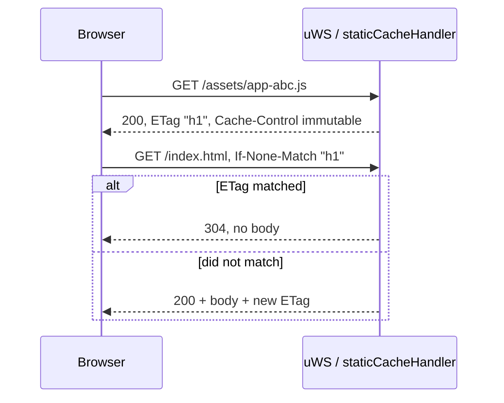

# Caching and ETag

The backend has two caching layers: an in-memory static file cache with ETag/`Cache-Control` for the browser, and several in-process in-memory caches. The JSON API is not cached by default: responses carry `Cache-Control: no-store`. How to enable static serving (`SERVE_STATIC`, `CDN_URL`) is described in [Deployment](/en/backend/deployment). How a request passes through the server is described in [Request lifecycle](/en/backend/request-lifecycle).

## Static files: in-memory cache

Everything is implemented in [`static-server.ts`](https://github.com/Blazheiko/vibe-template/blob/main/packages/backend/src/vendor/start/static-server.ts):

- **When:** only with `appConfig.serveStatic`. The `cacheStaticSource()` function recursively reads `./public` once at startup (with `APP_ENV=manual-test`, `./public-test`; this is a local mode, the Docker image does not have this directory) relative to `process.cwd()`. Files and directories whose names start with `.` are skipped.
- **What:** only files with extensions from the `ALLOWED_STATIC_EXTENSIONS` whitelist are taken (html, css, js, mjs, json, webmanifest, images, fonts, audio/video). The rest is ignored. Binary files are stored as `Buffer`, text files as a `utf8` string ([`isBinaryExtension`](https://github.com/Blazheiko/vibe-template/blob/main/packages/backend/src/vendor/utils/helpers/file-utils.ts)).
- **Memory limits:** files up to `STATIC_MAX_MEMORY_FILE_SIZE` (1 MiB by default) are put in RAM until the total (including compressed variants) exceeds `STATIC_MAX_MEMORY_TOTAL` (64 MiB). The rest is served by **streaming from disk** (`fs.createReadStream` with uWS backpressure: `tryEnd` / `onWritable`); their content is not read at startup. `index.html` is always in memory: the SPA fallback serves it. At startup `Static files cached` is logged with `files`, `memoryBytes` and `streamedFromDisk`. Changes on disk after startup are not picked up; a restart is needed.
- **Routes:** in [`server.ts`](https://github.com/Blazheiko/vibe-template/blob/main/packages/backend/src/vendor/start/server.ts) (`configureHttp`) a separate `server.get(key, …)` → `staticCacheHandler` is registered for each cached path. The `/` path gets a copy of `/index.html`.
- **Compression:** for text types (`html`, `js`, `mjs`, `css`, `svg`, `json`, `webmanifest`, `txt`, `xml`) of 1 KiB or more, the server prepares `br` (quality 9) and `gzip` (level 9) variants at startup and keeps them in memory if they are smaller than the original. The variant is chosen by `Accept-Encoding` (`br` → `gzip` → no compression; `q=0` disables an encoding) with `Content-Encoding`; a response for such a file always has `Vary: Accept-Encoding`, including `304`. For example, the main bundle of 873 428 B is served as 251 055 B in `br`. Streamed files are not compressed. The `Content-Length` of streaming is the file size at startup: if the file has since become shorter (a rebuild of `public/` under a running server), the response is closed with a `warn` rather than hanging.

## ETag

`computeEtag` computes SHA-1 of the file content in base64url and wraps the result in quotes (a strong ETag, for example `"q1w2…"`). The hashes are computed once at startup and stored in the cache entry. For streamed files the ETag is weak, built from size and `mtime`: `W/"<size hex>-<mtime hex>"`. A comment in the code explains why the validator must depend on the content and not the length: after a rebuild, `index.html` usually changes only asset hashes of the same length.

`If-None-Match` is parsed by [`matchesIfNoneMatch`](https://github.com/Blazheiko/vibe-template/blob/main/packages/backend/src/vendor/utils/network/if-none-match.ts) per RFC 9110 §13.1.2: `*` matches any file, a comma-separated list is checked element by element, the comparison is weak (`W/"x"` = `"x"`). A match gives `304` without a body.



## Cache-Control by file type

| Type                                                                                       | `Cache-Control`                                                                | Other headers                                                                                         |
| ------------------------------------------------------------------------------------------ | ------------------------------------------------------------------------------ | ----------------------------------------------------------------------------------------------------- |
| HTML (`.html`, `/`, SPA fallback)                                                          | `public, max-age=0, must-revalidate` (`HTML_CACHE_CONTROL`)                    | `ETag`, `content-type`, `setSecurityHeaders` (nosniff, X-Frame-Options, Referrer-Policy, HSTS)        |
| `/assets/*` (Vite hashed names)                                                            | `public, max-age=31536000, immutable`                                          | `ETag`, `Content-Type`, `X-Content-Type-Options: nosniff`, `Vary` / `Content-Encoding` for compressed |
| Everything else from the whitelist (`manifest.json`, `service-worker.js`, icons, audio, …) | `no-cache` — the browser caches but checks the ETag every time (a cheap `304`) | the same                                                                                              |

The MIME type is taken from [`MIME_TYPES`](https://github.com/Blazheiko/vibe-template/blob/main/packages/backend/src/vendor/constants/mime-types.ts) by extension. If the extension is not in the map, `default` is used.

## SPA fallback and security

Requests that did not match any cached path go to `server.any('/*')`. If it is a `GET` outside `/${pathPrefix}/` and `serveStatic` is enabled, `staticHandler` is called:

- `isUrlSafe` rejects URLs containing `..`, `\0`, `%2e%2e`, `%00` → `400 Bad Request`. More about protection is in [Security](/en/backend/security).
- A URL **without a dot** gets `index.html` through the same `handleHtmlRequest`, that is, with ETag and `must-revalidate`.
- A URL with a dot that is not in the cache gets `404` with an empty body.

The HTML shell (and `index.html` for the SPA fallback) and any other `.html` / `.htm` file, including one streamed from disk, gets the `document` CSP, SVG gets the `svg` CSP, `/service-worker.js` and other files get no CSP (`setSecurityHeaders(res, [], cspKind)` in `static-server.ts`). The rules are in [Security](/en/backend/security#content-security-policy).

## API responses

`sendResponse` in [`server.ts`](https://github.com/Blazheiko/vibe-template/blob/main/packages/backend/src/vendor/start/server.ts) sets `content-type: application/json`, the security headers, the headers and cookies from `responseData`, and CORS. Every API response, both from `sendResponse` and errors from `sendErrorResponse` (422, 429, 500, etc.), gets `Cache-Control: no-store` (`setApiCacheHeader` in [`http-response-handlers.ts`](https://github.com/Blazheiko/vibe-template/blob/main/packages/backend/src/vendor/utils/network/http-response-handlers.ts)): responses contain session and personal data, so the browser and intermediate proxies must not store them. If a controller itself set `Cache-Control` in `responseData.headers` (case-insensitively), its value stays and `no-store` is not added. No `ETag` is set on JSON responses. Static files have their own rules (above).

CORS: if `ENABLED_CORS=true`, `setCorsHeader` writes `Vary: Origin` and `Access-Control-Max-Age` = `maxAge` from [`config/cors.ts`](https://github.com/Blazheiko/vibe-template/blob/main/packages/backend/src/config/cors.ts) (currently `90` seconds, changed only in code). So the browser caches the preflight result for 90 s.

## Other in-memory caches

- **AI prompts:** [`prompt-service.ts`](https://github.com/Blazheiko/vibe-template/blob/main/packages/backend/src/app/services/ai/prompt-service.ts) keeps a `Map<PromptType, PromptRow>`. It is filled by `promptService.load()` at startup ([`index.ts`](https://github.com/Blazheiko/vibe-template/blob/main/packages/backend/src/index.ts)), and `update()` re-reads the changed row from the DB and puts it into the cache immediately. The TTL is `PROMPT_CACHE_TTL_MS` (60 s): an expired cache answers with the current values and re-reads all prompts in the background (one re-read at a time; on error the old values stay). The cache lives separately in each process, so a change on one instance reaches the others with a delay of up to the TTL; there is no pub/sub invalidation.
- Sessions, throttle and tokens in Redis are state, not a cache. See [Authentication](/en/backend/auth).

## Frontend: Service Worker

[`service-worker.ts`](https://github.com/Blazheiko/vibe-template/blob/main/packages/frontend/src/service-worker.ts) (built via [`vite.sw.config.ts`](https://github.com/Blazheiko/vibe-template/blob/main/packages/frontend/vite.sw.config.ts)) precaches the `PRECACHE_FILES` list from [`sw-precache.ts`](https://github.com/Blazheiko/vibe-template/blob/main/packages/frontend/src/utils/sw-precache.ts) on `install`: `/`, icons, splash, the manifest screenshots. Every path of the list must exist in `public/`; a unit test checks it. The HTML shell (navigations, the network-first strategy) is stored under the path without the query string: a one-time token from `/reset-password?token=…` does not stay in Cache Storage, and an offline navigation gets the copy stored for the same path. For `/assets/`, `/icons/`, `/audio/`, `.css`, etc. (`isStaticAsset`) it uses a cache-first strategy. The cache name is `BUILD_TIMESTAMP`. Old caches are deleted on `activate`.

## Checking with curl

An example (illustrative, values are made up):

```bash
curl -I http://localhost:3000/index.html
# HTTP/1.1 200 OK
# content-type: text/html; charset=UTF-8
# Cache-Control: public, max-age=0, must-revalidate
# ETag: "3n0Yq…"

curl -I -H 'If-None-Match: "3n0Yq…"' http://localhost:3000/index.html
# HTTP/1.1 304 Not Modified
```

The port and MIME depend on your configuration ([Configuration](/en/backend/configuration)).

## How to change the behavior

- The `Cache-Control` values are set by constants in `static-server.ts` (`HTML_CACHE_CONTROL`, `IMMUTABLE_CACHE_CONTROL`, `REVALIDATE_CACHE_CONTROL`); the rule "`immutable` only for `/assets/`" is in `cacheControlFor`.
- Memory limits are `STATIC_MAX_MEMORY_FILE_SIZE`, `STATIC_MAX_MEMORY_TOTAL` ([Configuration](/en/backend/configuration)).
- The extension whitelist is set in `ALLOWED_STATIC_EXTENSIONS`.
- **Dev:** the frontend is served by the Vite dev server, `SERVE_STATIC` is usually `false`. **Prod:** either `SERVE_STATIC=true` with the `public` directory in the image (this is what the [Dockerfile](https://github.com/Blazheiko/vibe-template/blob/main/Dockerfile) does: `SERVE_STATIC=true`), or separate hosting/CDN (`CDN_URL`). With a CDN, the caching headers are set by the CDN. See [Deployment](/en/backend/deployment).

::: info History
Previously the ETag was built from the file length and URL. Now it is a SHA1 hash of the content, computed once at startup; why it is done this way is explained in a comment in [static-server.ts](https://github.com/Blazheiko/vibe-template/blob/main/packages/backend/src/vendor/start/static-server.ts). The `etag-improvements.md` note with the MD5 / mtime / CRC32 options was removed in feat-009 ([last version](https://github.com/Blazheiko/vibe-template/blob/8f3479f/packages/backend/src/docs/etag-improvements.md)).
:::
