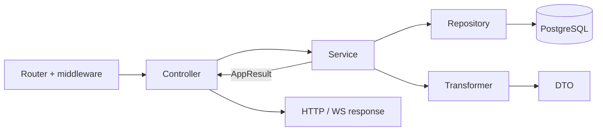

# Controllers

A controller is the backend's **inbound adapter**: it sits between the transport (HTTP via uWebSockets.js or a WebSocket event) and the business logic. The router and middleware have already parsed the request, checked the session and CSRF, and validated the payload against a schema from `shared`; the controller receives a ready `HttpContext` / `WsContext` and only has to "translate" the request into the service's language, and the service's result into the protocol's language.

## Why this layer exists

- **Transport isolation.** Only the controller knows about `context.responseData`, status codes, cookies, headers, the session and the WS socket. Services know nothing about HTTP, so the same logic can be called from an HTTP route, a WS event, a script or a test.
- **A single entry point per route.** Every line in [http-routes.ts](https://github.com/Blazheiko/vibe-template/blob/main/packages/backend/src/app/routes/http-routes.ts) / [ws-routes.ts](https://github.com/Blazheiko/vibe-template/blob/main/packages/backend/src/app/routes/ws-routes.ts) points to a specific controller method, so from a route it is easy to find the code that serves it.
- **A predictable response format.** The controller builds a `{ status: 'success', ... }` response using a type from `shared/responses`, and turns service errors into the canonical body and the right status with a single function, `mapControllerError`. The client always sees the same error shape.
- **Thin by rule.** A controller contains no business rules and does not touch the DB or external APIs. Because of this it hardly needs separate testing, and all logic worth testing is concentrated in services. The boundary is checked by [`layering.spec.ts`](https://github.com/Blazheiko/vibe-template/blob/main/packages/backend/src/app/layering.spec.ts).

The typical work of a controller method: get `userId` and the payload from the context → call one service method → return `respond(context, result, toBody)`, which on error gives the canonical body and status (`mapControllerError`) and on success the body from `toBody` → if needed, set a status, cookie or header. An explicit `Result.isError` remains where there is more logic after the error or success (status `201`, a redirect, a second action).



## Structure

Controllers live in [`src/app/controllers`](https://github.com/Blazheiko/vibe-template/tree/main/packages/backend/src/app/controllers):

- `http/` — HTTP route handlers, grouped by domain;
- `ws/` — WebSocket event handlers ([admin-ws-controller.ts](https://github.com/Blazheiko/vibe-template/blob/main/packages/backend/src/app/controllers/ws/admin-ws-controller.ts), [support-controller.ts](https://github.com/Blazheiko/vibe-template/blob/main/packages/backend/src/app/controllers/ws/support-controller.ts));
- `shared/` — `respond` / `respondWs` and `mapControllerError` / `mapWsControllerError` ([controller-error.ts](https://github.com/Blazheiko/vibe-template/blob/main/packages/backend/src/app/controllers/shared/controller-error.ts)) and `requireUserId` ([require-user-id.ts](https://github.com/Blazheiko/vibe-template/blob/main/packages/backend/src/app/controllers/shared/require-user-id.ts)): the session user's id as a `bigint` or `null`, in which case the controller responds with `mapControllerError(context, unauthorized())`.

There is no separate `static/` folder in controllers: static file serving lives in the vendor layer.

A controller is a default-exported object (`export default { ... }`) with async methods. In routes a method is passed as `handler: AuthController.login.bind(AuthController)` ([http-routes.ts](https://github.com/Blazheiko/vibe-template/blob/main/packages/backend/src/app/routes/http-routes.ts), [ws-routes.ts](https://github.com/Blazheiko/vibe-template/blob/main/packages/backend/src/app/routes/ws-routes.ts)).

::: tip Numeric ids in the path and the query
An id from a path parameter or the query (`:id`, `:subscriptionId`, `:articleId`, `userId`, `cursor`) is read by [`parseEntityId`](https://github.com/Blazheiko/vibe-template/blob/main/packages/backend/src/app/controllers/shared/parse-id.ts): decimal digits only and no more than PostgreSQL's `bigint`. A value outside that (30 digits, `0x10`, `-5`) is refused by the controller the same way as a non-numeric id (`400` or `404`) instead of reaching the query, where it would be a `500` (feat-161).
:::

## Handler context

A short cheat sheet below; each field is covered in the sections [HttpContext in detail](#httpcontext-in-detail) and [WsContext in detail](#wscontext-in-detail).

The types are defined in [vendor/types/types.d.ts](https://github.com/Blazheiko/vibe-template/blob/main/packages/backend/src/vendor/types/types.d.ts):

```ts
export interface HttpContext<TPayload = unknown, TQuery = null> {
    requestId: string
    logger: Logger
    httpData: HttpData<TPayload, TQuery>
    responseData: ResponseData
    session: Session
    auth: Auth
}
export interface WsContext<TPayload = unknown> {
    requestId: string
    ws: MyWebSocket
    wsData: WsData<TPayload>
    responseData: WsResponseData
    userData: UserConnection | null
    session: null
    auth: null
    logger: Logger
}
```

| What you need    | HTTP                                                               | WS                                     |
| ---------------- | ------------------------------------------------------------------ | -------------------------------------- |
| Validated body   | `getTypedPayload(context)`                                         | `getTypedPayload(context)`             |
| Path parameters  | `context.httpData.params['id']` (strings)                          | —                                      |
| Query            | `context.httpData.query` (typed if there is a `queryValidator`)    | —                                      |
| Current user     | `context.auth.getUserId()` (`string \| null`)                      | `context.userData?.userId`             |
| Session          | `context.session.sessionInfo`, `updateSessionData(...)`            | `session: null`                        |
| Status / headers | `context.responseData.status = 201`, `responseData.setHeader(...)` | `context.responseData.status` (string) |

[`getTypedPayload`](https://github.com/Blazheiko/vibe-template/blob/main/packages/backend/src/vendor/utils/validation/get-typed-payload.ts) works with both contexts and returns the payload that has already passed the route validator (see [Validation](/en/backend/validation)). Path parameters are read directly, for example in [oauth-controller.ts](https://github.com/Blazheiko/vibe-template/blob/main/packages/backend/src/app/controllers/http/auth/oauth-controller.ts): `context.httpData.params["provider"] ?? ""`.

## HttpContext in detail

The context is created for every request in [http-context.ts](https://github.com/Blazheiko/vibe-template/blob/main/packages/backend/src/vendor/utils/context/http-context.ts). Initially `session` and `auth` are stubs (`getUserId()` → `null`, `login()` → `false`); the real implementations are supplied by the session middleware: [session-handler.ts](https://github.com/Blazheiko/vibe-template/blob/main/packages/backend/src/vendor/utils/session/session-handler.ts) restores the request session (`RequestSession`, [request-session.ts](https://github.com/Blazheiko/vibe-template/blob/main/packages/backend/src/vendor/utils/session/request-session.ts)) and binds its methods to the context. So on a route without the session middleware, `auth.getUserId()` always returns `null`.

Besides the fields below, there is `requestId` (the request UUID) and `signal`, an `AbortSignal` that fires when the client dropped the connection before the response. It is worth passing to long operations (`fetch`, LLM calls).

### `logger: Logger`

A child [pino](https://getpino.io/) logger with `requestId` already added, so all records of one request are easy to correlate. Pass the context object as the first argument and the message as the second; put the error in the `err` field so that pino serializes it:

```ts
context.logger.info({ userId }, 'Avatar uploaded')
context.logger.error({ err: result.error }, 'Failed to load history')
```

Do not log passwords, tokens or full request bodies.

### `httpData: HttpData<TPayload, TQuery>`

Everything that came from the client. A read-only object.

| Field         | Type                                | Description                                                                                                                                                                |
| ------------- | ----------------------------------- | -------------------------------------------------------------------------------------------------------------------------------------------------------------------------- |
| `method`      | `Method`                            | The route's HTTP method (`'get'`, `'post'`, …).                                                                                                                            |
| `ip`          | `string \| null \| undefined`       | Client IP (taking trusted proxies into account).                                                                                                                           |
| `params`      | `Record<string, string>`            | Path parameters (`:id` → `params['id']`). Always strings: convert numbers and `bigint` yourself.                                                                           |
| `payload`     | `TPayload \| null`                  | Request body after the route validator. Read it through `getTypedPayload(context)`, not directly.                                                                          |
| `query`       | `TQuery`                            | The validated query object, **not** `URLSearchParams`. Without a `queryValidator` it is `null` (accessing fields is a TS error). See [Validation](/en/backend/validation). |
| `headers`     | `Map<string, string>`               | Request headers, names in lowercase: `headers.get('user-agent')`.                                                                                                          |
| `contentType` | `string \| undefined`               | The request `Content-Type`.                                                                                                                                                |
| `cookies`     | `Map<string, string>`               | Request cookies: `cookies.get('name')`.                                                                                                                                    |
| `isJson`      | `boolean`                           | Whether the body arrived as JSON.                                                                                                                                          |
| `files`       | `Map<string, UploadedFile> \| null` | Files from `multipart/form-data`: `{ name, filename, type, data: ArrayBuffer }`. `null` if there are no files.                                                             |
| `hasFile`     | `(name: string) => boolean`         | Whether there is a file with this field name.                                                                                                                              |

```ts
async getItem(context: HttpContext<unknown, ListQuery>) {
    const id = context.httpData.params['id'] ?? ''
    const { page, limit } = context.httpData.query
    const lang = context.httpData.headers.get('accept-language')
    if (!context.httpData.hasFile('avatar')) { /* ... */ }
    const file = context.httpData.files?.get('avatar')
}
```

### `responseData: ResponseData`

What goes to the client apart from the body (the body is the value the method returns).

| Field / method                     | Description                                                                                                                                                                                                                                                |
| ---------------------------------- | ---------------------------------------------------------------------------------------------------------------------------------------------------------------------------------------------------------------------------------------------------------- |
| `status: number`                   | HTTP status, `200` by default. `200` with an empty body (`null`) becomes `204`; `3xx`, `204`, `205` are sent without a body.                                                                                                                               |
| `setHeader(name, value)`           | Adds a response header (for example `Location` for `302`, `Cache-Control`).                                                                                                                                                                                |
| `setCookie(name, value, options?)` | Sets a cookie. Options that are not specified are taken from `cookiesConfig.default` ([config/cookies.ts](https://github.com/Blazheiko/vibe-template/blob/main/packages/backend/src/config/cookies.ts)). There is an overload `setCookie(cookie: Cookie)`. |
| `deleteCookie(name, options?)`     | Sends `Set-Cookie` with `Max-Age=0`. `path` must match the `Path` of the original cookie, otherwise the browser will not delete it.                                                                                                                        |
| `headers`, `cookies`               | Accumulated headers / cookies. Change them through the methods above.                                                                                                                                                                                      |
| `payload`                          | The framework puts the handler's result here itself: do not touch it in a controller.                                                                                                                                                                      |
| `middlewareData`                   | Arbitrary data that middleware pass further along the chain.                                                                                                                                                                                               |
| `aborted`                          | An internal flag; use `context.signal` for cancellation.                                                                                                                                                                                                   |

```ts
context.responseData.status = 302
context.responseData.setHeader('Location', redirectUrl)
context.responseData.setCookie('oauth_state', state, { maxAge: 600, httpOnly: true })
context.responseData.deleteCookie('oauth_state', { path: '/' })
return null
```

### `session: Session`

The server-side session in Redis ([redis-session-storage.ts](https://github.com/Blazheiko/vibe-template/blob/main/packages/backend/src/vendor/utils/session/redis-session-storage.ts)). A session always exists, even for an anonymous user; the cookie with its id is set by the middleware. An anonymous session is kept in a signed cookie and gets into Redis on the first `updateSessionData`/`changeSessionData` ([Anonymous session](/en/backend/auth#anonymous-session)).

| Field / method            | Description                                                                                                                                                                 |
| ------------------------- | --------------------------------------------------------------------------------------------------------------------------------------------------------------------------- |
| `sessionInfo`             | `{ id, data, createdAt, updatedAt? }` or `null`. `data: SessionData` contains `userId`, `userToken`, `wsToken`, `csrfToken` and your keys.                                  |
| `updateSessionData(data)` | **Merges** `data` into the current session data (`{ ...old, ...data }`) and returns the updated `SessionInfo` (or `null` if the session no longer exists).                  |
| `changeSessionData(data)` | **Replaces** the session data entirely. Careful: you can wipe `userId`/`csrfToken`; almost always you need `updateSessionData`.                                             |
| `destroySession()`        | Deletes the current session from Redis (does nothing for an anonymous session in a cookie). To log a user out, use `auth.logout()`: it also issues a new anonymous session. |

```ts
const wsToken = context.session.sessionInfo?.data.wsToken
await context.session.updateSessionData({ locale: 'uk' })
```

`sessionInfo` is a snapshot at the start of the request: after `updateSessionData`, take the data from the result it returns.

### `auth: Auth`

Authentication on top of the session.

| Method                     | Description                                                                                                                                                                                                                                                                                                                            |
| -------------------------- | -------------------------------------------------------------------------------------------------------------------------------------------------------------------------------------------------------------------------------------------------------------------------------------------------------------------------------------- |
| `getUserId()`              | The current user's `userId` as a **string** or `null`. For repositories, convert it: `BigInt(userId)`.                                                                                                                                                                                                                                 |
| `check()`                  | `true` if the user is logged in.                                                                                                                                                                                                                                                                                                       |
| `login(userId, userToken)` | Destroys the old session, creates a new one with `userId`/`userToken` and sets a new cookie (protection against session fixation). Returns `false` if an argument is `undefined`.                                                                                                                                                      |
| `logout()`                 | Deletes the current session and issues a new anonymous one. Returns `true`.                                                                                                                                                                                                                                                            |
| `logoutAll()`              | Deletes the records of all the user's sessions and always issues a new anonymous one; returns `{ deleted, complete }` (`complete: false` means Redis is unavailable or the deadline was exceeded). Revocation is the rotation of `users.session_token`, which the `logout-all` route does in `authService.logoutAll` before this call. |

```ts
const userId = context.auth.getUserId()
if (userId === null) return mapControllerError(context, unauthorized())

const result = await authService.login(payload)
// A second action follows the success, so the check stays explicit (no respond()).
if (Result.isError(result)) return mapControllerError(context, result.error)
await context.auth.login(result.value.userId, result.value.userToken)
```

The "is the user logged in" check at the route level is usually done by the auth middleware (see [Routing](/en/backend/routing) and [Middleware](/en/backend/middlewares)); in a controller `getUserId()` is needed to pass the id to a service.

## WsContext in detail

The context is created for every WS message in [ws-context.ts](https://github.com/Blazheiko/vibe-template/blob/main/packages/backend/src/vendor/utils/context/ws-context.ts) by the [ws-api-dispatcher.ts](https://github.com/Blazheiko/vibe-template/blob/main/packages/backend/src/vendor/utils/routing/ws-api-dispatcher.ts) dispatcher. The session and authentication are already checked at connection time (upgrade), so `session` and `auth` are always `null` here: the user comes from `userData`. There are also `requestId`, `logger` (with `requestId` and `userId`) and `signal`, which fires when the connection closes.

### `ws: MyWebSocket`

The uWebSockets.js socket of the current connection (`WebSocket<UserConnection>` + `id`). You need it when you have to act on the connection itself, not just reply:

- `ws.subscribe(topic)` / `ws.unsubscribe(topic)` — subscribe to a pub/sub channel (this is what [admin-ws-channel-service.ts](https://github.com/Blazheiko/vibe-template/blob/main/packages/backend/src/app/services/admin/admin-ws-channel-service.ts) does);
- `ws.getUserData()` — the same object as `context.userData`.

Do **not** send the response to the current message through `ws.send`: just return a value from the method. Do broadcasts to other clients through the `communication/` services (broadcast).

### `wsData: WsData<TPayload>`

| Field            | Description                                                                                           |
| ---------------- | ----------------------------------------------------------------------------------------------------- |
| `payload`        | The validated and frozen (`Object.freeze`) event payload. Read it through `getTypedPayload(context)`. |
| `ws`             | Same as `context.ws`.                                                                                 |
| `middlewareData` | Data passed by WS middleware.                                                                         |
| `status`         | An internal field (`'200'`); the response status is set through `responseData.status`.                |

### `responseData: WsResponseData`

The response envelope the dispatcher sends to the client: `{ event, timestamp, status, data, error }`.

| Field                | Description                                                                                                                         |
| -------------------- | ----------------------------------------------------------------------------------------------------------------------------------- |
| `event`, `timestamp` | Copied from the incoming message so the client can match the response to the request. Do not change them.                           |
| `status: string`     | `'200'` by default. Set a string, for example `'403'`, when you return an error.                                                    |
| `data`               | The dispatcher puts the value returned by the method here.                                                                          |
| `error`              | Filled by the dispatcher for system errors (`not_found`, `validation_failed`, `internal_error`, rate limit) with `status: 'error'`. |

Return a service error as data through `respondWs` (or `mapWsControllerError` when there is more logic after the error): it sets `status` by the error's `_tag` (`'403'` for `Forbidden`), logs 5xx and returns the canonical body:

```ts
subscribeOnlineUsers(context: WsContext): AdminOnlineUsersWsResponse {
    const result = adminWsChannelService.subscribeCurrentAdminConnection(context.ws)
    return respondWs(context, result, () => ({ status: 'success' }))
}
```

The dispatcher will catch an unhandled exception from a controller and respond with `internal_error`, but do not use `throw` for expected errors.

### `userData: UserConnection | null`

Connection data collected during the upgrade ([types.d.ts](https://github.com/Blazheiko/vibe-template/blob/main/packages/backend/src/vendor/types/types.d.ts)):

| Field                      | Description                                                             |
| -------------------------- | ----------------------------------------------------------------------- |
| `userId`                   | `string \| undefined` — the user id; for services use `BigInt(userId)`. |
| `sessionId`, `userToken`   | The session the connection was opened with.                             |
| `uuid`                     | Unique connection id (one user can have several tabs).                  |
| `role`                     | `'user' \| 'admin'`.                                                    |
| `appType`                  | `'web' \| 'pwa'`.                                                       |
| `ip`, `ip2`, `userAgent`   | Client data.                                                            |
| `isAdminChannelSubscribed` | Whether the connection is subscribed to the admin channel.              |
| `timeStart`                | Connection time (ms).                                                   |

The type allows `null` and `userId: undefined`, so check before use:

```ts
const userData = context.userData
if (userData?.userId === undefined) {
    context.responseData.status = '401'
    return appErrorToPayload(unauthorized())
}
const payload = getTypedPayload(context)
void supportService.chat(BigInt(userData.userId), payload.message, userData.uuid, context.signal)
```

## Returning data and status

The value a method returns becomes the response body; the status is successful by default, and another one is set through `context.responseData.status` (for example `201` in [admin-knowledge-base-controller.ts](https://github.com/Blazheiko/vibe-template/blob/main/packages/backend/src/app/controllers/http/admin/admin-knowledge-base-controller.ts), `302` for redirects in OAuth). Response types come from `shared` (`shared/responses`).

## Error mapping

Service errors (`AppError`) are turned into the canonical response by a single function:

```ts
export function mapControllerError(
    context: Pick<HttpContext<unknown, unknown>, 'responseData' | 'logger' | 'signal'>,
    error: AppError,
): ReturnType<typeof appErrorToPayload> {
    applyAppErrorStatus(context.responseData, error)
    report(context, error)
    return appErrorToPayload(error)
}
```

`respond(context, result, toBody?)` is the usual end of a method on top of `mapControllerError`: an error becomes the canonical body, a value becomes the response body as is or through `toBody`. `respondWs` does the same for WS.

[`applyAppErrorStatus`](https://github.com/Blazheiko/vibe-template/blob/main/packages/backend/src/app/services/shared/apply-service-status.ts) sets the HTTP status by `_tag` (`BadRequest`→400, `Unauthorized`→401, `Forbidden`→403, `NotFound`→404, `Conflict`→409, `RateLimited`→429 + `Retry-After`, `Internal`→500 — the table is in [errors.ts](https://github.com/Blazheiko/vibe-template/blob/main/packages/backend/src/app/services/shared/errors.ts)), and the body has the shape `{ status: 'error', message, code, reason? }`. The same body is built by [`appErrorToPayload`](https://github.com/Blazheiko/vibe-template/blob/main/packages/backend/src/app/services/shared/app-error-payload.ts) for WS too. The WS variant `mapWsControllerError` from the same [controller-error.ts](https://github.com/Blazheiko/vibe-template/blob/main/packages/backend/src/app/controllers/shared/controller-error.ts) writes the status into the response as a string (`'500'`), because WS has no HTTP status.

**Logging 5xx.** Both functions call [`reportAppError`](https://github.com/Blazheiko/vibe-template/blob/main/packages/backend/src/app/services/shared/report-app-error.ts) through `context.logger`, so the record has `requestId` and `userId`. An error with status 500 or higher (`Internal`, `ServiceUnavailable`, `UpstreamError`, `UpstreamTimeout`) is written once as `error` with the root cause (`cause`, if the error was created from an exception) and goes to Sentry. 4xx are not logged: they are expected responses. If the client has already disconnected (`context.signal.aborted`), nothing is written, because nobody reads the response. A service does not need to log an error it returns to the controller: otherwise Sentry gets two events. A controller that responds to an error without `mapControllerError` (the OAuth callback redirect) calls `reportControllerError` from the same module. A separate `logger.info('<method> handler')` at the start of a method is not needed: the route and `requestId` are already in the logger context.

A typical controller method is shown in [Step 7](/en/backend/adding-a-feature#step-7-controller).

## HTTP controller groups

| Folder           | Responsibility                               | Example route                                    |
| ---------------- | -------------------------------------------- | ------------------------------------------------ |
| `core/`          | `ping`, client initialization, WS token      | `main/init`                                      |
| `auth/`          | Registration, login, password reset, OAuth   | `auth/login`, `auth/oauth/:provider/redirect`    |
| `notifications/` | Push subscriptions and test push             | `push-subscriptions/:subscriptionId`             |
| `user/`          | User avatar                                  | `avatar` prefix                                  |
| `support/`       | Support chat history, article screenshots    | `support/chat/history`                           |
| `admin/`         | Knowledge base, online users, history, users | `admin/knowledge-base/:id`, `admin/users-online` |
| `ai/`            | Prompts and LLM usage statistics             | `prompts/:type`, `admin/usage/stats`             |

Group prefixes are in [http-routes.ts](https://github.com/Blazheiko/vibe-template/blob/main/packages/backend/src/app/routes/http-routes.ts); details are in [Routing](/en/backend/routing).

Controllers do not access repositories or external APIs directly: this is checked by [`layering.spec.ts`](https://github.com/Blazheiko/vibe-template/blob/main/packages/backend/src/app/layering.spec.ts).

## Controller checklist

**Controller:**

- [ ] get `userId` (`context.auth` / `context.userData`), the payload (`getTypedPayload`), `params`, `query`;
- [ ] call one service method;
- [ ] return `respond(context, result, toBody)` (HTTP) or `respondWs` (WS); `toBody` builds the `{ status: 'success', ... }` response using a type from `shared`;
- [ ] if needed — status (`201`, `302`), cookies, headers, session.

**Never in a controller:** direct repository imports, `fetch` to external APIs, `throw` for expected errors.

## Related layers

- [Controllers](/en/backend/controllers) — HTTP/WS adapters: accept the request and return the response.
- [Services](/en/backend/services) — business logic, return `AppResult<T>`.
- [Repositories](/en/backend/repositories) — the only place where SQL is written.
- [Transformers](/en/backend/transformers) — convert DB rows into public DTOs.

The overall picture is in [Architecture](/en/backend/architecture), a step-by-step example is in [Adding a feature](/en/backend/adding-a-feature).
