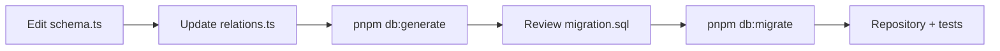

# Database

The backend works with PostgreSQL through Drizzle ORM. The `drizzle-orm` and `drizzle-kit` packages are pinned to the release candidate `1.0.0-rc.5` in [`packages/backend/package.json`](https://github.com/Blazheiko/vibe-template/blob/main/packages/backend/package.json); upgrade them together and to the same exact version. The driver is `pg` (`node-postgres`). Redis is used separately — as a session store and for throttling.

## In brief, by example: adding a column

**Task:** the notes from the [How to add a feature](/en/backend/adding-a-feature) tutorial need to be pinnable.

1. Add the field to the table in `packages/backend/src/database/schema.ts`:

    ```ts
    pinned: boolean('pinned').notNull().default(false),
    ```

2. Generate a migration (no database is needed for this):

    ```bash
    pnpm --filter backend db:generate --name add_notes_pinned
    ```

    ```sql
    -- src/drizzle/migrations/<timestamp>_add_notes_pinned/migration.sql
    ALTER TABLE "notes" ADD COLUMN "pinned" boolean DEFAULT false NOT NULL;
    ```

3. Apply it: `pnpm --filter backend db:migrate`.

**Result:** the column exists in the database, and the `NoteRow` type in the repository got the field `pinned: boolean` by itself, because it is inferred from the schema. `pnpm typecheck` will show the places where the new field needs to be handled, for example in the transformer, if you return it to the client.

`DEFAULT false` matters here: without a default and with `notNull()`, the migration would fail on a table that already has rows. Commit migrations together with the `schema.ts` change. The connection, schema, migrations and seed are described in detail below.

## Connection

The parameters come from the `PGSQL_*` env variables (see [`.env.example`](https://github.com/Blazheiko/vibe-template/blob/main/packages/backend/.env.example) and [Configuration](/en/backend/configuration)):

| Variable         | Example in `.env.example` |
| ---------------- | ------------------------- |
| `PGSQL_HOST`     | `127.0.0.1`               |
| `PGSQL_PORT`     | `5432`                    |
| `PGSQL_USER`     | `postgres`                |
| `PGSQL_PASSWORD` | `postgres`                |
| `PGSQL_DB_NAME`  | `vibe_template`           |
| `PGSQL_SSL`      | `false`                   |

The runtime config is [`src/config/database.ts`](https://github.com/Blazheiko/vibe-template/blob/main/packages/backend/src/config/database.ts); the pool and the Drizzle client are created in [`src/database/db.ts`](https://github.com/Blazheiko/vibe-template/blob/main/packages/backend/src/database/db.ts):

```ts
const pool = new pg.Pool({
    ...connectionOptions, // host, port, ..., ssl: toPgSsl(PGSQL_SSL)
    max: 10,
    connectionTimeoutMillis: 2000,
    statement_timeout: databasePoolConfig.queryTimeoutMs, // DB_QUERY_TIMEOUT_MS, 10000
    query_timeout: databasePoolConfig.queryTimeoutMs + QUERY_TIMEOUT_GRACE_MS, // + 500
})

const db = drizzle({
    client: pool,
    relations,
    logger: sqlLoggingEnabled(appConfig), // !appConfig.isProductionLike
})
```

**Query timeout.** Every query of the main pool is limited by `DB_QUERY_TIMEOUT_MS` (10 s by default): the server cancels it (`statement_timeout`, SQLSTATE `57014`) and the connection stays usable; if the server does not respond at all, the driver's `query_timeout` fires after 500 ms and `pg-pool` destroys the connection. Without this, a hung query would hold a pool connection forever. The session check and `GET /ready` use their own connections with shorter deadlines ([`session-check-db.ts`](https://github.com/Blazheiko/vibe-template/blob/main/packages/backend/src/database/session-check-db.ts), [`readiness-probe.ts`](https://github.com/Blazheiko/vibe-template/blob/main/packages/backend/src/database/readiness-probe.ts)).

**Connection encryption (`PGSQL_SSL`).** The connection options are shared by the main pool, the session-check pool, the `/ready` connection, `drizzle-kit`, `db:create` and `db:seed` ([`pool-options.ts`](https://github.com/Blazheiko/vibe-template/blob/main/packages/backend/src/database/pool-options.ts)), so the value applies everywhere at once. `false` (the default) — no TLS; `true` — TLS with verification of the server certificate; `require` — TLS without certificate verification (encryption without authenticating the server, like `sslmode=require` in libpq). Any other value is a startup error, not a silent fallback to an unencrypted connection. In a production-like environment with `PGSQL_SSL=false`, a warning is logged at startup (a managed DB without TLS is a risk; for a DB in a trusted private network it is a deliberate choice).

**Time zone.** Date columns are declared as `timestamp` without a time zone, and Drizzle treats them as UTC. So that values set by the DB itself (`defaultNow()`, `now()`) are also in UTC, `connectionOptions` sets `options: '-c TimeZone=UTC'` for the main pool, the session-check pool and the `/ready` connection; `db:seed` passes the same parameter. It does not depend on the PostgreSQL server's time zone.

**SQL logging.** Drizzle prints every query together with its parameters, that is, with the email, identifiers and everything else passed as a parameter. That is why it is disabled in a production-like environment ([`sql-logging.ts`](https://github.com/Blazheiko/vibe-template/blob/main/packages/backend/src/database/sql-logging.ts): `APP_IS_PRODUCTION=true` or `APP_ENV=prod`/`production`) and enabled in the rest.

`drizzle-kit` has its own [`drizzle.config.ts`](https://github.com/Blazheiko/vibe-template/blob/main/packages/backend/drizzle.config.ts): it takes the connection from the same `resolveDatabaseConfig()` as the application, `schema: "./src/database/schema.ts"`, `out: "./src/drizzle/migrations"`, the journal table `drizzle.__drizzle_migrations`, `strict: true`.

## Schema and relations

The tables are described in a single file [`src/database/schema.ts`](https://github.com/Blazheiko/vibe-template/blob/main/packages/backend/src/database/schema.ts) (`pgTable`, `pgEnum`, indexes, `customType`), for example `export const users = pgTable('users', { ... })`. The `src/drizzle/` directory contains only migrations; the schema and relations live in `src/database`.

Relations are defined through Relational Queries v2 in [`src/database/relations.ts`](https://github.com/Blazheiko/vibe-template/blob/main/packages/backend/src/database/relations.ts):

```ts
export const relations = defineRelations(schema, (r) => ({
    users: {
        oauthAccounts: r.many.oauthAccounts({ from: r.users.id, to: r.oauthAccounts.userId }),
        // ...
    },
}))
```

The `relations` object is passed to `drizzle({ relations })`, so `db.query.<table>.findMany/findFirst` with `with` are available. However, repositories do not use them at the moment — queries are written with the core query builder, as in [`user-repository.ts`](https://github.com/Blazheiko/vibe-template/blob/main/packages/backend/src/app/repositories/user/user-repository.ts):

```ts
async findById(id) {
  return await db
    .select()
    .from(users)
    .where(eq(users.id, id))
    .limit(1)
    .then((rows) => rows.at(0));
},
```

Row types are inferred via `InferSelectModel<typeof users>` / `InferInsertModel<typeof users>`. Services open transactions through `withTransaction` (see [Repositories](/en/backend/repositories#transactions)).

One-time tokens live in four tables with the same base (`user_id`, `token_hash`, `expires_at`, `used_at`): `email_verifications`, `email_link_verifications` (`target_email`), `password_reset_tokens` (`target_email` — the address the email was sent to) and `oauth_link_verifications` (the `oauth_link_verifications` migration): a pending link of an OAuth identity to an existing account, with the provider profile (`provider`, `provider_user_id`, `provider_email`, `provider_name`, `provider_avatar`), the account address at the time of sending (`target_email`) and the hash of the browser session id the login started from (`session_binding_hash`). Provider tokens are not stored. See [OAuth](/en/backend/oauth#linking-by-email).

## pgvector

PostgreSQL must have the [pgvector](https://github.com/pgvector/pgvector) extension (`vector`). This requirement is **mandatory even when AI is not configured**: the schema itself uses the `vector` type, so without the extension neither `db:create` nor the initial migration will pass.

### Why the extension is needed

Support AI answers user questions based on a knowledge base (RAG: first find relevant articles, then pass them to the LLM as context). Searching articles by keywords works poorly: users phrase a question in different words than the article's author. So the search goes by meaning through embeddings, and this needs vector arithmetic in the DB:

1. **Storage.** Each article in `support_knowledge_base` has a column `embedding vector(1536)` ([`schema.ts`](https://github.com/Blazheiko/vibe-template/blob/main/packages/backend/src/database/schema.ts), `customType` `vector1536`). It holds the vector that OpenAI embeddings (`text-embedding-3-small`, 1536 dimensions) return for the text `title + content`. The vector is written only for the version of the text (`content_version`) it was made from ([AI → Text version](/en/backend/ai)).
2. **Search.** The user's question is translated into English, turned into a vector the same way, and the DB looks for the nearest articles by cosine distance, using the pgvector `<=>` operator ([`searchByEmbedding`](https://github.com/Blazheiko/vibe-template/blob/main/packages/backend/src/app/repositories/support/support-knowledge-repository.ts)):

    ```sql
    SELECT id, title, content, embedding <=> $1::vector AS distance
    FROM support_knowledge_base
    WHERE is_active = true AND embedding IS NOT NULL
    ORDER BY distance ASC
    LIMIT 5;
    ```

3. **Answer.** The found articles are substituted into the system prompt in place of `{context}`, and the LLM answers based only on them.

Without pgvector, you would have to keep the vectors in a separate vector DB (one more service, synchronization with PostgreSQL) or load all the vectors into the application and compute the distance in JavaScript. pgvector gives search in a single SQL query alongside the rest of the article's data, with PostgreSQL transactions and backups. The full scenario is described on the [AI](/en/backend/ai#support-ai-and-the-knowledge-base) page.

### Where it shows up in the code

| Place                                                                                                                                                                   | What it does                                                                                                      |
| ----------------------------------------------------------------------------------------------------------------------------------------------------------------------- | ----------------------------------------------------------------------------------------------------------------- |
| [`create-database.ts`](https://github.com/Blazheiko/vibe-template/blob/main/packages/backend/src/db/create-database.ts)                                                 | `CREATE EXTENSION IF NOT EXISTS vector` in the target DB                                                          |
| [`20261017193054_init/migration.sql`](https://github.com/Blazheiko/vibe-template/blob/main/packages/backend/src/drizzle/migrations/20261017193054_init/migration.sql)   | the column `"embedding" vector(1536)`; the migration does not create the extension itself                         |
| [`support-knowledge-repository.ts`](https://github.com/Blazheiko/vibe-template/blob/main/packages/backend/src/app/repositories/support/support-knowledge-repository.ts) | `setEmbedding` (`::vector`, only at the current `content_version`), `clearEmbedding`, `searchByEmbedding` (`<=>`) |

### What happens without the extension

- `db:create` fails on `CREATE EXTENSION IF NOT EXISTS vector` with an error like `extension "vector" is not available`.
- If the DB was created another way, `db:migrate` fails on the initial migration: `type "vector" does not exist`.

### How to get PostgreSQL with pgvector

- **Docker (locally):** the `pgvector/pgvector` image, for example `pgvector/pgvector:pg16` (it is started by `pnpm services:up`, see [Services via Docker Compose](/en/guide/getting-started#services-via-docker-compose)). The regular `postgres` image does not contain the extension.
- **Installed PostgreSQL:** the pgvector package for your PostgreSQL version, for example `brew install pgvector` (Homebrew) or `postgresql-16-pgvector` (apt, the PGDG repository). Other ways are described in the [pgvector README](https://github.com/pgvector/pgvector#installation).
- **Managed services:** most cloud PostgreSQL offerings support pgvector, but the extension has to be allowed or enabled according to the provider's documentation.

`CREATE EXTENSION` may require DB owner or superuser privileges. If the user from `PGSQL_USER` does not have them, the DB administrator runs the command once manually, and `db:create` will afterwards only confirm that the extension exists (`IF NOT EXISTS`).

To check that the extension is present:

```sql
SELECT extversion FROM pg_extension WHERE extname = 'vector';
```

### Limitations of the current implementation

- The column dimension is `1536` (`EMBEDDING_COLUMN_DIMENSIONS`); `OPENAI_EMBEDDING_DIMENSIONS` must match it, otherwise startup stops. A different model or dimension requires a column migration and re-indexing of the articles.
- There is no vector index (HNSW / IVFFlat), so the search scans all active articles. For a support knowledge base of hundreds of articles this is enough; for larger volumes, add an index `USING hnsw (embedding vector_cosine_ops)` with a migration.

## Migrations

Migrations live in [`src/drizzle/migrations`](https://github.com/Blazheiko/vibe-template/blob/main/packages/backend/src/drizzle/migrations) in the Drizzle 1.0 "folder per migration" format: each `<timestamp>_<name>` folder contains `migration.sql` and `snapshot.json`. Since `1.0.0-rc.5`, snapshots are incremental (version `9`): the first migration stores the full schema (`ddl`), the following ones only the difference (`deltas`). drizzle-kit does not accept a snapshot in the older format and asks you to run `drizzle-kit up`; this conversion does not change the migration SQL:

| Migration                                                                                                                                                                                                                       | What it does                                                                                                                                                                                                                                                                                                                                                                                                                       |
| ------------------------------------------------------------------------------------------------------------------------------------------------------------------------------------------------------------------------------- | ---------------------------------------------------------------------------------------------------------------------------------------------------------------------------------------------------------------------------------------------------------------------------------------------------------------------------------------------------------------------------------------------------------------------------------- |
| `20261017193054_init`                                                                                                                                                                                                           | the initial schema                                                                                                                                                                                                                                                                                                                                                                                                                 |
| [`20261024152453_llm_usage_nullable`](https://github.com/Blazheiko/vibe-template/blob/main/packages/backend/src/drizzle/migrations/20261024152453_llm_usage_nullable/migration.sql)                                             | `llm_text_usage`: `prompt_tokens`, `completion_tokens`, `total_tokens` and `user_id` become nullable (`NULL` = the provider did not report usage / a system call without a user), the `0` defaults are removed; `llm_text_feature` gets `SUPPORT_EMBEDDING`. Existing rows are not changed. `ALTER TYPE … ADD VALUE` cannot be rolled back with a simple `DROP`                                                                    |
| [`20261024171546_drop_users_is_admin`](https://github.com/Blazheiko/vibe-template/blob/main/packages/backend/src/drizzle/migrations/20261024171546_drop_users_is_admin/migration.sql)                                           | `users`: `DROP COLUMN is_admin`. The admin flag is only `role = 'admin'`. **Irreversible:** the column values are lost; before applying, check that `is_admin` never diverges from `role` (`SELECT count(*) FROM users WHERE is_admin <> (role = 'admin')`)                                                                                                                                                                        |
| [`20261101093458_support_client_message_id`](https://github.com/Blazheiko/vibe-template/blob/main/packages/backend/src/drizzle/migrations/20261101093458_support_client_message_id/migration.sql)                               | `support_chat_history`: the `client_message_id varchar(64)` column and a unique index on `(user_id, client_message_id)`. Resending the same support message (after a lost answer) does not create a second row (`onConflictDoNothing`)                                                                                                                                                                                             |
| [`20261101113023_drop_oauth_tokens`](https://github.com/Blazheiko/vibe-template/blob/main/packages/backend/src/drizzle/migrations/20261101113023_drop_oauth_tokens/migration.sql)                                               | `oauth_accounts`: `DROP COLUMN access_token`, `refresh_token`. Provider tokens are not stored. **Irreversible:** the column values are lost                                                                                                                                                                                                                                                                                        |
| [`20261101124616_llm_usage_prompt_hash`](https://github.com/Blazheiko/vibe-template/blob/main/packages/backend/src/drizzle/migrations/20261101124616_llm_usage_prompt_hash/migration.sql)                                       | `llm_text_usage`: the `prompt_sha256 varchar(64)` and `prompt_chars integer` columns (nullable). The prompt's hash and length stay after `llm:purge-prompts` clears the text; for older rows the purge fills them in itself                                                                                                                                                                                                        |
| [`20261102053350_llm_usage_set_null_support_history_index`](https://github.com/Blazheiko/vibe-template/blob/main/packages/backend/src/drizzle/migrations/20261102053350_llm_usage_set_null_support_history_index/migration.sql) | `llm_text_usage.user_id`: the foreign key is `ON DELETE SET NULL` instead of `CASCADE`, so the usage journal (tokens, cost) survives account deletion and the row is no longer linked to a person; the prompt text, if it was stored, is removed by `llm:purge-prompts` by age. `support_chat_history`: an index `(user_id, created_at)` replaces `(user_id)`; chat history, unlike usage, is still deleted together with the user |
| [`20261103055308_oauth_link_verifications`](https://github.com/Blazheiko/vibe-template/blob/main/packages/backend/src/drizzle/migrations/20261103055308_oauth_link_verifications/migration.sql)                                 | a new `oauth_link_verifications` table (one-time tokens for linking OAuth to an existing account, `ON DELETE CASCADE` from `users`, index `(user_id, provider)`, `UNIQUE token_hash`) and the `password_reset_tokens.target_email` column — the address the email went to ([Schema and relations](#schema-and-relations))                                                                                                          |
| [`20261104143331_kb_content_version`](https://github.com/Blazheiko/vibe-template/blob/main/packages/backend/src/drizzle/migrations/20261104143331_kb_content_version/migration.sql)                                             | `support_knowledge_base`: `content_version integer NOT NULL DEFAULT 1`. The version grows when the article text changes, and the embedding is stored only for the version it was computed from: an indexing of an older text that finishes last writes nothing                                                                                                                                                                     |
| [`20261104165815_llm_usage_status`](https://github.com/Blazheiko/vibe-template/blob/main/packages/backend/src/drizzle/migrations/20261104165815_llm_usage_status/migration.sql)                                                 | `llm_text_usage`: an enum `status` (`completed` / `aborted` / `failed`, default `completed`) and `tokens_estimated boolean NOT NULL DEFAULT false`. A row is written for every call that started, and the token estimate is flagged ([AI → Usage accounting](/en/backend/ai))                                                                                                                                                      |
| [`20261111120018_sms_challenge_drop_send_count`](https://github.com/Blazheiko/vibe-template/blob/main/packages/backend/src/drizzle/migrations/20261111120018_sms_challenge_drop_send_count/migration.sql)                       | `sms_auth_challenges`: `DROP COLUMN send_count`. Nothing wrote or read the column (always `1`); the SMS resend limit is held by `resend_available_at` and the SMS budget. The values are not needed, nothing is lost                                                                                                                                                                                                               |

## Scripts

Run in the backend package (`pnpm --filter ./packages/backend <script>`):

| Script           | Command                           | What it does                                                                                                                                                                                                                            |
| ---------------- | --------------------------------- | --------------------------------------------------------------------------------------------------------------------------------------------------------------------------------------------------------------------------------------- |
| `db:create`      | `tsx src/db/create-database.ts`   | connects to the `postgres` DB, creates `PGSQL_DB_NAME` if it does not exist, and runs `CREATE EXTENSION IF NOT EXISTS vector` ([code](https://github.com/Blazheiko/vibe-template/blob/main/packages/backend/src/db/create-database.ts)) |
| `db:create:prod` | `node dist/db/create-database.js` | the same from the built code                                                                                                                                                                                                            |
| `db:generate`    | `drizzle-kit generate`            | generates a new migration folder from the difference between the schema and the snapshot                                                                                                                                                |
| `db:migrate`     | `drizzle-kit migrate`             | applies the pending migrations                                                                                                                                                                                                          |
| `db:studio`      | `drizzle-kit studio`              | the Drizzle Studio web interface                                                                                                                                                                                                        |
| `db:seed`        | `tsx src/db/seed.ts`              | idempotently inserts the initial prompts, and with `--demo` also demo accounts, see [Seed](#seed) ([code](https://github.com/Blazheiko/vibe-template/blob/main/packages/backend/src/db/seed.ts))                                        |
| `db:seed:prod`   | `node dist/db/seed.js`            | the same from the built code                                                                                                                                                                                                            |

## Seed

`db:seed` can be run repeatedly: it skips existing rows and overwrites nothing. Everything runs in a single transaction, so on an error nothing is left in the DB and the command exits with code 1. The logic is in [`src/db/seed/run-seed.ts`](https://github.com/Blazheiko/vibe-template/blob/main/packages/backend/src/db/seed/run-seed.ts).

| What                                                                                                    | When               | Repeated run                                                                                 |
| ------------------------------------------------------------------------------------------------------- | ------------------ | -------------------------------------------------------------------------------------------- |
| The prompts `SUPPORT_SYSTEM`, `SUPPORT_FIRST_CHAT`, `SUPPORT_QUERY_TRANSLATION` in `llm_system_prompts` | always             | `ON CONFLICT (type) DO NOTHING`: prompts edited in the admin panel stay as they are          |
| An admin (`SEED_ADMIN_EMAIL` / `SEED_ADMIN_PASSWORD`) and, optionally, a regular user (`SEED_USER_*`)   | only with `--demo` | an existing user (looked up by `LOWER(email)`) is skipped; password and role are not changed |

- The prompt texts come from the same defaults as the services' runtime fallback ([`config/support.ts`](https://github.com/Blazheiko/vibe-template/blob/main/packages/backend/src/config/support.ts)), so the first seed does not change AI behavior. Without rows in the table, AI works on these fallbacks, but the admin panel cannot change the prompt: `UPDATE` does not create a missing row.
- Seed does not depend on `APP_ENV`: without `--demo`, accounts are not created in any environment. With `--demo` in a production-like environment, a warning is printed.
- The email is normalized (`trim().toLowerCase()`), the password is hashed with `hashPassword` from `metautil`, and `email_verified_at` is the current time.
- If `SEED_ADMIN_EMAIL` already belongs to a user with `role = 'user'`, seed finishes successfully with the warning `exists_without_admin_role`: the role is not promoted automatically.
- Idempotency is guaranteed for sequential runs. The user's existence is checked with a `SELECT` before the `INSERT`, so of two simultaneous `--demo` runs one may fail on the unique email index. The transaction is then rolled back, and a repeated run finishes successfully.
- The error is printed without SQL parameters, `detail` and the pg error text, because they may contain an email, a password hash and a `session_token`. Only the error name and the fields `code`, `constraint`, `table`, `column` are printed; the text is kept only for system errors like `ECONNREFUSED` ([`describe-error.ts`](https://github.com/Blazheiko/vibe-template/blob/main/packages/backend/src/db/seed/describe-error.ts)).
- For each record, the report prints `inserted` or `skipped (<reason>)`: `already_exists`, `exists_without_admin_role`, `missing_credentials`, `demo_disabled`.

::: info Prompt cache
The backend reads prompts at startup (`promptService.load()` in [`src/index.ts`](https://github.com/Blazheiko/vibe-template/blob/main/packages/backend/src/index.ts)) and reloads them in the background once the cache is older than `PROMPT_CACHE_TTL_MS` (60 s by default, [`prompt-service.ts`](https://github.com/Blazheiko/vibe-template/blob/main/packages/backend/src/app/services/ai/prompt-service.ts)). Prompts inserted by a seed while the backend runs show up without a restart, within the TTL.
:::

### The first admin in production

The demo scenario is not intended for production. Options:

1. Register the usual way and promote the role manually:

    ```sql
    UPDATE users SET role = 'admin' WHERE LOWER(email) = '<admin-email>';
    ```

2. Run `pnpm db:seed:prod --demo` once with `SEED_ADMIN_EMAIL` and `SEED_ADMIN_PASSWORD` set temporarily, and then remove them from the environment right away.

## How to change the schema



1. Change the tables in `src/database/schema.ts`; for new relations, `relations.ts`.
2. `db:generate` will create a new folder in `src/drizzle/migrations`; check the SQL by hand.
3. `db:migrate` will apply it to the local DB.
4. Add methods to the corresponding repository (see [Architecture](/en/backend/architecture) and [Adding a feature](/en/backend/adding-a-feature)).

## Redis

The `ioredis` client is created in [`src/database/redis.ts`](https://github.com/Blazheiko/vibe-template/blob/main/packages/backend/src/database/redis.ts) from the config `#config/redis.js` (`REDIS_HOST`, `REDIS_PORT`, `REDIS_PASSWORD`, `REDIS_PREFIX`). It is used by the session store ([`redis-session-storage.ts`](https://github.com/Blazheiko/vibe-template/blob/main/packages/backend/src/vendor/utils/session/redis-session-storage.ts)), WS authentication, password reset and authentication throttling. More details in [Authentication](/en/backend/auth).

The client fails fast instead of hanging: with no offline queue and no retries, and with a command timeout of `REDIS_COMMAND_TIMEOUT_MS` (500 ms); when Redis is unavailable, requests get `503 service_unavailable`. The contract and limitations are in [Redis failure](/en/backend/security#redis-failure).
