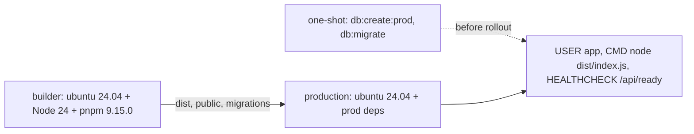

# Deployment

This page describes how to build the application for production, what the [`Dockerfile`](https://github.com/Blazheiko/vibe-template/blob/main/Dockerfile) contains and what conditions are required at startup. Environment variables are described in detail on the [Configuration](/en/backend/configuration) page, and security on the [Security](/en/backend/security) page. Here they are only mentioned.

## Build

The root script `pnpm build` runs `pnpm -r build` ([`package.json`](https://github.com/Blazheiko/vibe-template/blob/main/package.json)). pnpm orders packages by workspace dependencies, so `shared` is built first. The `Dockerfile` sets the order explicitly: `shared` → `frontend` → `backend`.

- **backend**: `tsc --build` ([`packages/backend/package.json`](https://github.com/Blazheiko/vibe-template/blob/main/packages/backend/package.json)) compiles `src/` into `dist/` (`outDir`/`rootDir` in [`tsconfig.json`](https://github.com/Blazheiko/vibe-template/blob/main/packages/backend/tsconfig.json)). At runtime the aliases `#app/*`, `#config/*`, `#vendor/*`, `#database/*`, `#drizzle/*` and `#logger` are resolved through the `imports` field in `package.json` and point to `./dist/...`, so `node dist/index.js` (`pnpm start`) works without `tsx`.
- **frontend**: `build` runs the type check, `vite build` and a separate service worker build (`vite.sw.config.ts`), see [`packages/frontend/package.json`](https://github.com/Blazheiko/vibe-template/blob/main/packages/frontend/package.json). The result goes to `packages/frontend/dist`.
- There is no separate copy-static script. The frontend is copied into `packages/backend/public` by the `Dockerfile` itself (`cp -r packages/frontend/dist packages/backend/public`).

### How the frontend is served

The backend serves static files only with `SERVE_STATIC=true` ([`config/app.ts`](https://github.com/Blazheiko/vibe-template/blob/main/packages/backend/src/config/app.ts), default `false`). Then [`static-server.ts`](https://github.com/Blazheiko/vibe-template/blob/main/packages/backend/src/vendor/start/static-server.ts) caches the `./public` directory relative to `process.cwd()` in memory at startup (with `APP_ENV=manual-test`, `./public-test` is used instead). `/` serves `index.html`. The alternative is to serve `frontend/dist` from separate hosting or a CDN (`CDN_URL`, see [Routing and CDN](/en/backend/configuration#routing-and-cdn)).

::: warning
The `Dockerfile` copies the frontend into `public` and sets `SERVE_STATIC=true` and `APP_ENV=production`, so the container serves the frontend without any extra variables. If the frontend is served by a proxy or CDN, override with `-e SERVE_STATIC=false`. When `SERVE_STATIC=true` but there is no `public` directory, the server prints a warning and starts without static files ([`static-server.ts`](https://github.com/Blazheiko/vibe-template/blob/main/packages/backend/src/vendor/start/static-server.ts)). `.env.example` has `SERVE_STATIC=false`, because in dev the frontend is served by Vite.
:::

### CSP when a proxy serves the frontend

With `SERVE_STATIC=true` the backend sets the CSP on HTML itself (see [Content-Security-Policy](/en/backend/security#content-security-policy)). If HTML is served by nginx or a CDN, the document policy has to be set there, with the same exception for the service worker:

```nginx
location = /service-worker.js {
    # a CSP on the response with the worker script would apply to the worker itself
    add_header Cache-Control "no-cache";
}

location / {
    try_files $uri /index.html;
    add_header Content-Security-Policy "default-src 'self'; base-uri 'self'; object-src 'none'; frame-ancestors 'none'; form-action 'self'; script-src 'self'; style-src 'self' 'unsafe-inline' https://fonts.googleapis.com; style-src-elem 'self' 'unsafe-inline' https://fonts.googleapis.com; img-src 'self' data: blob: https://cdn.example.com; font-src 'self' data: https://fonts.gstatic.com; connect-src 'self' https://api.example.com wss://api.example.com; upgrade-insecure-requests" always;
}
```

The values can be taken from the backend's response: `curl -sS -D - -o /dev/null https://<backend>/` with `SERVE_STATIC=true`.

### Local production-like run

`pnpm prod:local` ([`scripts/prod-local.sh`](https://github.com/Blazheiko/vibe-template/blob/main/scripts/prod-local.sh)) builds `shared`, the frontend (with `VITE_BASE_URL=http://localhost:<PORT>`, without Sentry) and the backend, copies `frontend/dist` into `backend/public` like the `Dockerfile` does, and starts the backend with `SERVE_STATIC=true`. It needs PostgreSQL and Redis from `packages/backend/.env`. Since this is plain http, the script sets `APP_ENV=local` and `APP_IS_PRODUCTION=false` (otherwise `getWsUrl()` would produce `wss://`, and `upgrade-insecure-requests` would break all requests). `PROD_LOCAL_SKIP_BUILD=true` skips the build.

The same image that goes to production can be run locally in [docker-compose.yml](https://github.com/Blazheiko/vibe-template/blob/main/docker-compose.yml) together with PostgreSQL, Redis, S3 and Mailpit: `pnpm app:build` builds `vibe-template:local` ([`scripts/docker-build.sh`](https://github.com/Blazheiko/vibe-template/blob/main/scripts/docker-build.sh)), `pnpm app:up` starts the one-shot `migrate` service (`db:create:prod`, `db:migrate`) and then `app`. This is exactly the scheme with `depends_on: condition: service_completed_successfully` below. Details and the list of variables that compose overrides: [Quick start](/en/guide/getting-started#the-whole-app-in-docker-compose).

## Dockerfile



**The `builder` stage**

1. The `ubuntu:24.04` image. Node.js 24 is installed from NodeSource, pnpm `9.15.0` is enabled via corepack.
2. First only `package.json`, `pnpm-lock.yaml`, `pnpm-workspace.yaml` and the `package.json` files of the three packages are copied, then `pnpm install --frozen-lockfile` runs. This way the dependency layer is cached.
3. `COPY . .` copies the project without what [`.dockerignore`](https://github.com/Blazheiko/vibe-template/blob/main/.dockerignore) excludes: `.git`, `node_modules`, `dist`, `coverage`, test reports, the VitePress cache and all `.env`/`.env.*` except `.env.example`. So local secrets end up neither in the build context nor in the builder stage layers, and the local `packages/frontend/.env` is not baked into the frontend bundle — Vite sees only `VITE_SENTRY_*` from the build arguments.
4. The `API_PATH_PREFIX`, `VITE_BASE_URL`, `VITE_AUTH_PHONE_ENABLED` and `VITE_SENTRY_*` build arguments (DSN, ENABLED, ENVIRONMENT, RELEASE, sample rates) become `ENV`, because Vite bakes them into the bundle at build time. The Vite config derives `VITE_API_PATH_PREFIX` from `API_PATH_PREFIX` itself ([one source](/en/backend/configuration#one-source-for-the-api-address-and-prefix)).
5. `shared`, `frontend` and `backend` are built, after which `frontend/dist` is copied into `backend/public`.

**The `production` stage**

1. `ubuntu:24.04` + Node 24 + pnpm again. `COREPACK_HOME=/opt/corepack` (readable by everyone), so that the `app` user runs the already prepared pnpm without a network. A system user `app` (uid < 1000) is created with the home directory `/home/app` — pnpm needs it for one-shot runs.
2. `pnpm install --frozen-lockfile --prod --filter backend...` installs only the production dependencies of the backend and its workspace dependencies. `drizzle-kit` is in the backend's `dependencies`, so it ends up in the image.
3. `ENV NODE_ENV=production`.
4. From `builder` the following are copied: `packages/backend/dist`, `packages/shared/dist`, `packages/backend/public`, `packages/backend/public-test`, `drizzle.config.ts` together with `src/config/database.ts`, `src/drizzle/migrations` and `docs/support-knowledge-base` (read by [`knowledge-base-init-service.ts`](https://github.com/Blazheiko/vibe-template/blob/main/packages/backend/src/app/services/support/knowledge-base-init-service.ts)).
5. `EXPOSE 3000`, `WORKDIR /app/packages/backend`, `USER app`. The application files belong to root and are read-only: at runtime the application writes nothing to disk.
6. `HEALTHCHECK` (interval 30 s, timeout 5 s, start-period 20 s, retries 3): `curl -fsS http://127.0.0.1:${PORT:-3000}/api/ready | grep -q '"status":"ok"'` — readiness: the container is `healthy` only when PostgreSQL and Redis respond (see [Observability](/en/backend/observability#health-check)). The body is checked, not just the code: with `SERVE_STATIC=true` any unknown path returns `index.html` with status 200 (SPA fallback), so a status-only check would pass even with a wrong path.
7. `CMD ["node", "dist/index.js"]` — PID 1 is Node, so `SIGTERM` from `docker stop` reaches `stopGracefully`. Migrations are **not** run at startup.

What the image does not contain:

- `.env` is not copied into the production stage. Configuration is passed via `-e`/`--env-file`. `dotenv/config` in [`index.ts`](https://github.com/Blazheiko/vibe-template/blob/main/packages/backend/src/index.ts) simply will not find the file.
- There are no `src/` sources (except migrations), devDependencies or `tsx` either.

### Commands

```sh
docker build -t vibe-template .
# with Sentry for the frontend:
docker build -t vibe-template --build-arg VITE_SENTRY_DSN=<dsn> --build-arg VITE_SENTRY_ENABLED=true .

# once before rolling out a new version (the same image, without -p):
docker run --rm --env-file ./production.env vibe-template pnpm db:create:prod
docker run --rm --env-file ./production.env vibe-template pnpm db:migrate

docker run -d -p 3000:3000 --env-file ./production.env vibe-template
```

::: warning Startup change (feat-019)
Before feat-019 the container ran `db:create:prod` and `db:migrate` itself on every start. Now these are separate one-shot runs: if you skip them, the new version starts on the old schema. In Kubernetes this is an init container or a `Job` before rollout, in Compose a separate service with `restart: "no"` that the application depends on (`depends_on: condition: service_completed_successfully`).
:::

**A different `API_PATH_PREFIX`: the prefix has to be set at build time too.** The API prefix is compiled into the SPA at build time (from `API_PATH_PREFIX` of the builder stage), while the server reads its own `API_PATH_PREFIX` at startup. An image built without the build-arg contains a SPA with the `api` prefix; started with `API_PATH_PREFIX=v1`, the SPA's calls do not reach the API (a `GET` gets `index.html`, anything else `404`). So the prefix is passed twice:

```sh
docker build -t vibe-template --build-arg API_PATH_PREFIX=v1 .
docker run -d -e API_PATH_PREFIX=v1 --env-file ./production.env vibe-template
```

The same goes for `VITE_BASE_URL` (an API on another origin) and `VITE_AUTH_PHONE_ENABLED`: the [Dockerfile](https://github.com/Blazheiko/vibe-template/blob/main/Dockerfile) takes them as build-args. The local `pnpm app:build` ([docker-build.sh](https://github.com/Blazheiko/vibe-template/blob/main/scripts/docker-build.sh)) takes the prefix from `API_PATH_PREFIX` in `packages/backend/.env` (or from the environment variable), that is from the same file the container reads at startup. In compose, `app` and `migrate` get `API_PATH_PREFIX` in the same order: from the shell, else from `packages/backend/.env` (which `pnpm app:up` passes as `--env-file`), else `api`. So `API_PATH_PREFIX=v1 pnpm app:build && API_PATH_PREFIX=v1 pnpm app:up` gives the SPA and the server `/v1`, and the healthcheck of the `app` service asks for `/v1/ready`. `make verify-compose` (part of `make check`) checks this through `docker compose config`. Compose puts the value into the healthcheck as is, without normalization, so write the prefix without slashes (`v1`, not `/v1/`).

The frontend build puts a `build-meta.json` file next to `index.html` with the prefix the SPA was built for. At startup with `SERVE_STATIC=true` the server compares it with `API_PATH_PREFIX` ([static-build-meta.ts](https://github.com/Blazheiko/vibe-template/blob/main/packages/backend/src/vendor/start/static-build-meta.ts)) and, on a mismatch, logs an error with the fields `builtFor` and `served`; the server still starts. When the file is missing (static files from another source), the check says nothing.

**Healthcheck with a different `PORT` or `API_PATH_PREFIX`.** The built-in check knows only `PORT` and the `api` prefix. For a different prefix, override it at startup, otherwise the container becomes `unhealthy`:

```sh
docker run -d -e API_PATH_PREFIX=v1 \
  --health-cmd "curl -fsS http://127.0.0.1:3000/v1/ready | grep -q '\"status\":\"ok\"' || exit 1" \
  --env-file ./production.env vibe-template
```

The healthcheck hits `/api/ready` (readiness): when the DB or Redis is unavailable the container becomes `unhealthy`. Docker does not restart the container itself; an orchestrator that respects health will take it out of load balancing. Liveness without dependencies is `/api/ping`.

`production.env` is your file with variables per the [Configuration](/en/backend/configuration) page (the secrets in it are only yours, they are not in the repository). Host and port are set via `HOST` (default `0.0.0.0`) and `PORT` (default `3000`).

### Verification (2026-10-24, feat-019)

macOS, Docker Desktop, `docker build --no-cache`:

|               | Before   | After    |
| ------------- | -------- | -------- |
| Build context | 83.45 MB | 124.7 kB |
| Build time    | 337 s    | 172 s    |
| Image size    | 813 MB   | 813 MB   |

- Secrets: the canary marker in the root `.env` and `packages/shared/.env` was found neither in the builder stage (`grep -r` over the whole filesystem), nor in any layer of the final image (`docker save` + `grep`), nor in `docker history`; there are no `.env` files in the images. A positive control with the same commands finds `.env.example` in the builder stage and `stopGracefully` in the layers.
- One-shot `pnpm db:create:prod` and `pnpm db:migrate` as the `app` user on a clean PostgreSQL with pgvector — successful; there are no migrations in the log at application startup.
- `id -u` in the container is `999` (`app`); PID 1 is Node; `healthy` by default; with `API_PATH_PREFIX=v1` the container works but becomes `unhealthy`, and with an overridden `--health-cmd` it is `healthy`.
- `docker stop -t 10` — the log shows `stop SIGTERM` and `server stop type: SIGTERM`, stop in 1 s, exit code 0.

## Runtime

- **Variables**: the full list is on the [Configuration](/en/backend/configuration) page; for production-like mode (`APP_IS_PRODUCTION` or `APP_ENV`/`NODE_ENV` with the value `production`/`prod`) see [Production-like mode](/en/backend/configuration#production-like-mode). The image sets `NODE_ENV=production` and `APP_ENV=production`: `secure` on cookies and the CSP config (`config/csp.ts`, in particular `wss:` in `getWsUrl()`) read exactly `APP_ENV`. For a staging environment, override `APP_ENV` at startup.
- **TLS and proxy**: the server listens on HTTP (`server.listen(host, port)` in [`server.ts`](https://github.com/Blazheiko/vibe-template/blob/main/packages/backend/src/vendor/start/server.ts)), so TLS is terminated on a reverse proxy. Behind a proxy `TRUST_PROXY=true` and `TRUSTED_PROXY_CIDRS` are needed, see [Trust proxy](/en/backend/security#trust-proxy-and-ip-detection).
- **Unix socket**: if `APP_UNIX_PATH` is set and non-empty, the server calls `listen_unix` instead of TCP, and `HOST`/`PORT` are then ignored. An empty `APP_UNIX_PATH=` (as in `.env.example`) means TCP on `HOST:PORT`. The socket path is limited by the OS (`sun_path`): up to 103 bytes on macOS, up to 107 on Linux. A longer path stops startup with the error `Invalid app configuration: APP_UNIX_PATH is … bytes`: uWS crashes on it in native code without a single line in the log. If `listen` / `listen_unix` fails (port busy, directory missing, no permissions), startup ends with `Failed to listen on …` and exit code 1, rather than leaving a process that serves nothing (feat-112). Behind nginx on a unix socket set `TRUST_UNIX_SOCKET_PROXY=true`: there is no peer address on the socket, so without the flag all clients are `unknown` with a shared limit budget, and with it the IP is taken from `X-Forwarded-For` / `X-Real-IP`, which nginx sets.
- **Graceful shutdown**: [`index.ts`](https://github.com/Blazheiko/vibe-template/blob/main/packages/backend/src/index.ts) handles `SIGINT`, `SIGHUP`, `SIGTERM` and `uncaughtException`. `stopGracefully` first closes the listen socket (new connections are not accepted), then closes all WebSocket connections with code `4201` and revokes their tokens in parallel: a Redis failure is only logged and does not stop the rest of the shutdown (feat-112). An upgrade that was still waiting for token verification then gets `503` instead of opening a socket; shutdown waits up to 3 s for the `user_online` disconnect records that the just-closed sockets started, so that `pool.end()` does not cut them off (feat-138). Then it does a Sentry `flush` (2 s), closes the PostgreSQL pool and Redis, and then calls `process.exit(0)`. In a container PID 1 is Node (`CMD` in exec form), so `docker stop` ends via `stopGracefully` with code 0.
- **Sentry**: the backend reads `SENTRY_DSN`, `SENTRY_ENVIRONMENT`, `SENTRY_RELEASE` and so on at runtime ([`config/sentry.ts`](https://github.com/Blazheiko/vibe-template/blob/main/packages/backend/src/config/sentry.ts)). The frontend needs `VITE_SENTRY_*` as `--build-arg` at build time.

### Rate limit at the edge

The backend's local limits (L1, routes, level-1 upgrade, WS messages) live in the memory of each process and protect the process itself; with N instances their budget is N×. Sensitive actions (login, registration, SMS, password reset) and the level-2 upgrade are restricted by a shared budget in Redis, see [Request rate limiting](/en/backend/security#rate-limiting). A limit on the reverse proxy is an optional extra layer at the entrance, not a replacement for a missing feature. An example for nginx with the default paths (`API_PATH_PREFIX=api`):

```nginx
limit_req_zone  $binary_remote_addr zone=api:10m rate=10r/s;
limit_req_zone  $binary_remote_addr zone=ws_upgrade:10m rate=1r/s;
limit_conn_zone $binary_remote_addr zone=ws_conn:10m;

# By default nginx replies 503; the client needs 429.
limit_req_status  429;
limit_conn_status 429;

location /api/websocket {
    limit_req  zone=ws_upgrade burst=20 nodelay;
    limit_conn ws_conn 20;
    proxy_pass http://backend;
    proxy_http_version 1.1;
    proxy_set_header Upgrade $http_upgrade;
    proxy_set_header Connection "upgrade";
    # Any proxy_set_header here cancels inherited ones: repeat the forwarding headers.
    proxy_set_header X-Forwarded-For $remote_addr;
    proxy_set_header X-Real-IP       $remote_addr;
}

location /api/ {
    limit_req zone=api burst=50 nodelay;
    proxy_pass http://backend;
    # uWebSockets.js answers 505 to HTTP/1.0, nginx's default for upstreams.
    proxy_http_version 1.1;
    proxy_set_header X-Forwarded-For $remote_addr;
    proxy_set_header X-Real-IP       $remote_addr;
}
```

A `limit_req_zone` zone is shared only within one nginx. If there are several independent edge nodes, each counts its own quota. Details in the [nginx documentation](https://nginx.org/en/docs/http/ngx_http_limit_req_module.html). For the backend to see the client's real IP, `TRUST_PROXY=true` and `TRUSTED_PROXY_CIDRS` are needed.

::: danger Overwrite the forwarding headers
Without `proxy_set_header` nginx forwards the client's `X-Forwarded-For` as is. The backend trusts nginx and takes the rightmost untrusted IP from the chain, that is, the value the client wrote itself. By rotating a forged `X-Forwarded-For` you can bypass all per-IP limits of the backend, including the login limit. The nginx edge limit stays in force.

- If nginx is the first node that accepts the client, the simplest option is to set `X-Forwarded-For $remote_addr` and `X-Real-IP $remote_addr`, as in the example. `$proxy_add_x_forwarded_for` is also safe: it appends the real IP on the right, and `getIP()` walks the chain from right to left and skips only trusted proxies, so the client's forged prefix is ignored. But for this every trusted proxy must append to the chain correctly, and `TRUSTED_PROXY_CIDRS` must exactly match the addresses of these proxies.
- `proxy_set_header` is inherited from the parent level only when the `location` has no `proxy_set_header` of its own ([nginx documentation](https://nginx.org/en/docs/http/ngx_http_proxy_module.html#proxy_set_header)). That is why in the WS block, where `Upgrade` and `Connection` are set, the forwarding headers must be repeated.
- If there is another trusted load balancer in front of nginx, use `$proxy_add_x_forwarded_for` and add the balancer's address to `TRUSTED_PROXY_CIDRS`. Or `set_real_ip_from` + `real_ip_header` in nginx.
  :::

Check: with a low backend limit, send several requests, each with a different forged `X-Forwarded-For`. The quota should run out just as it does without the header:

```sh
for i in 1 2 3 4 5 6; do
  curl -s -o /dev/null -w '%{http_code}\n' -H "X-Forwarded-For: 203.0.113.$i" https://<host>/api/main/init
done
```

## Database in production

- `pnpm db:create:prod` (`node dist/db/create-database.js`) creates the DB and runs `CREATE EXTENSION IF NOT EXISTS vector`, so PostgreSQL must include pgvector. What this requirement is and how to meet it on managed PostgreSQL, see [Database → pgvector](/en/backend/database#pgvector).
- `pnpm db:migrate` (`drizzle-kit migrate`) works in the image because it contains `drizzle-kit`, `drizzle.config.ts`, `src/config/database.ts` and `src/drizzle/migrations`. The application, `db:create:prod` and `db:migrate` take `PGSQL_*` with the same defaults; in production still set them explicitly.
- Migrations are a separate one-shot run of the image before rollout (see [Commands](#commands)); application replicas do not run them, so there is no race between replicas.

## Redis and S3

- Redis is required: sessions are stored in it, and during shutdown the application closes the connection to it. See [Redis](/en/backend/database#redis) and [Configuration → Redis](/en/backend/configuration#redis).
- [`corsS3.xml`](https://github.com/Blazheiko/vibe-template/blob/main/corsS3.xml) in the root is the CORS configuration of the S3/MinIO bucket: only `GET`/`HEAD` from the application's origin (placeholder `https://app.example.com`). Files are uploaded and deleted by the backend, so the browser does not need write access to the bucket. It is applied manually to the bucket, the code does not read it. For several environments see [`corsS3.prod.example.xml`](https://github.com/Blazheiko/vibe-template/blob/main/corsS3.prod.example.xml).

## CI/CD

There are four workflows in `.github/workflows`:

- [`ci.yml`](https://github.com/Blazheiko/vibe-template/blob/main/.github/workflows/ci.yml) — on every PR and push to `main`: the `quality` job (`make check` and coverage), `e2e` (Playwright) and `e2e-live` (the SPA against the real backend, PostgreSQL and Redis).
- [`pg-tests.yml`](https://github.com/Blazheiko/vibe-template/blob/main/.github/workflows/pg-tests.yml) — the `*.pg.test.ts` integration tests against PostgreSQL with pgvector (`pnpm --filter backend test:pg`), when the backend or `shared` changes.
- [`redis-tests.yml`](https://github.com/Blazheiko/vibe-template/blob/main/.github/workflows/redis-tests.yml) — the `*.redis.test.ts` integration tests against Redis (`pnpm --filter backend test:redis`), on the same paths.
- [`docs.yml`](https://github.com/Blazheiko/vibe-template/blob/main/.github/workflows/docs.yml) — builds and deploys this documentation site.

::: warning
There is no workflow that builds and publishes the Docker image or deploys the application. The image is built and published manually.
:::

## Checklist

- [ ] PostgreSQL with pgvector is available, all `PGSQL_*` are set explicitly.
- [ ] Redis is available.
- [ ] `pnpm db:create:prod` and `pnpm db:migrate` were run as a one-shot image run before rollout.
- [ ] The healthcheck matches your `PORT` / `API_PATH_PREFIX`.
- [ ] `CSRF_ALLOWED_ORIGINS` with the frontend origin: the image sets `APP_ENV=production`, and without this variable the server does not start ([CSRF](/en/backend/security#csrf)).
- [ ] `APP_ENV=production`, `APP_KEY` and the remaining items from the [security checklist](/en/backend/security#production-checklist).
- [ ] TLS on the proxy, `TRUST_PROXY` and `TRUSTED_PROXY_CIDRS` configured (on a unix socket — `TRUST_UNIX_SOCKET_PROXY=true`).
- [ ] It is decided who serves the frontend: `SERVE_STATIC=true` or separate hosting/CDN.
- [ ] `VITE_SENTRY_*` passed as build-args, `SENTRY_*` as runtime env.
- [ ] If `API_PATH_PREFIX` is not `api`: the image was built with `--build-arg API_PATH_PREFIX=<the same prefix>`, and the startup log has no error about a SPA built for another prefix.
- [ ] The bucket CORS ([`corsS3.xml`](https://github.com/Blazheiko/vibe-template/blob/main/corsS3.xml)) is restricted to your domain.
