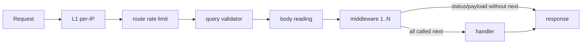

# Middleware

Middleware are functions that run **before** a route handler and can stop it from running: check the session, the CSRF token, a permission of the role. Which middleware run for a request is determined by the `middlewares` field on the route and its groups — see [Routing](/en/backend/routing#a-route-is-the-single-source-of-truth).

## In short, by example: closing a route to anonymous users

Middleware are set as a list of names on a route group (or on a single route) and run in order before the handler.

```ts
{
    group: [ /* defineRoute({ contract: ..., handler: ... }) */ ],
    prefix: 'notes',
    middlewares: ['session_web', 'csrf_guard', 'auth_guard'],
}
```

| Middleware set                                              | Who gets through                             | Others get                                                   |
| ----------------------------------------------------------- | -------------------------------------------- | ------------------------------------------------------------ |
| none                                                        | everyone (like `GET /api/ping`)              | —                                                            |
| `session_web`, `csrf_guard`, `auth_guard`                   | logged-in users only                         | `401 unauthorized`                                           |
| `session_web`, `csrf_guard`, `auth_guard`, `can:users.read` | only a role with the `users.read` permission | `401` without login, `403` for a role without the permission |

Responses of `GET /api/admin/users` (`can:users.read`):

```text
no cookie             → 401 {"status":"error","code":"unauthorized","message":"Session expired or not found",...}
role w/o users.read   → 403 {"status":"error","code":"forbidden","message":"Access denied",...}
```

`session_web` must come first: the rest read the session that it sets up. The full list of middleware and how to add your own is below.

::: tip Web route or public API
`session_web` and `csrf_guard` are needed by routes that our frontend calls in the browser. Put routes for external clients (another server, a mobile app) in a separate group without them. Why and how: [Web routes and public API](/en/backend/web-and-api-routes).
:::

## Kernel middleware

All middleware are registered by name in [`src/app/middlewares/kernel.ts`](https://github.com/Blazheiko/vibe-template/blob/main/packages/backend/src/app/middlewares/kernel.ts). There are two maps, one per transport: `httpMiddlewares` (type `Middleware`, context `HttpContext`) and `wsMiddlewares` (`Middleware<WsContext>`). This way each middleware gets the context it was written for. If a WS route names an HTTP middleware or vice versa, it is a `No middleware <name>` error, as for an unknown name.

| Name                  | File                                                                                                                                                                   | What it does                                                                                                                                                                                                                                                                                                                                            |
| --------------------- | ---------------------------------------------------------------------------------------------------------------------------------------------------------------------- | ------------------------------------------------------------------------------------------------------------------------------------------------------------------------------------------------------------------------------------------------------------------------------------------------------------------------------------------------------- |
| `session_web`         | [`vendor/utils/middlewares/ws/session-web.ts`](https://github.com/Blazheiko/vibe-template/blob/main/packages/backend/src/vendor/utils/middlewares/ws/session-web.ts)   | cookie-based session (used in HTTP groups)                                                                                                                                                                                                                                                                                                              |
| `csrf_guard`          | [`app/middlewares/csrf-guard.ts`](https://github.com/Blazheiko/vibe-template/blob/main/packages/backend/src/app/middlewares/csrf-guard.ts)                             | for `post/put/patch/delete` checks Origin/Referer and the CSRF token from the `csrfConfig.headerName` header (compared with `timingSafeEqual`); with `enforce = false` it only logs violations                                                                                                                                                          |
| `auth_guard`          | [`vendor/utils/middlewares/core/auth-guard.ts`](https://github.com/Blazheiko/vibe-template/blob/main/packages/backend/src/vendor/utils/middlewares/core/auth-guard.ts) | `401` with `code: "unauthorized"` if `auth.check()` is false                                                                                                                                                                                                                                                                                            |
| `can:<permission>`    | [`app/middlewares/permission-guard.ts`](https://github.com/Blazheiko/vibe-template/blob/main/packages/backend/src/app/middlewares/permission-guard.ts)                 | reads the role from the DB on every request; `403` with `forbidden` and `Access denied` if the role lacks the permission. Goes after `auth_guard`                                                                                                                                                                                                       |
| `ws_can:<permission>` | [`app/middlewares/ws-permission-guard.ts`](https://github.com/Blazheiko/vibe-template/blob/main/packages/backend/src/app/middlewares/ws-permission-guard.ts)           | for WS routes: the role of the connection (`userData.role`); without the permission or while the connection's admin channel is paused ([role sync](/en/backend/websocket#role-sync)) — `status "403"` with `forbidden` without calling the handler. HTTP `auth_guard`/`can:` do not work on WS: the WS context has no `auth` and no HTTP `responseData` |

`kernel.ts` generates `can:<permission>` and `ws_can:<permission>` for every permission of the catalog [`shared/src/access`](https://github.com/Blazheiko/vibe-template/blob/main/packages/shared/src/access/index.ts) (`can:kb.read`, `can:users.read`, …); which route needs which permission is in [Roles and capabilities](/en/reference/roles-capabilities).

Details of sessions and CSRF are on the [Authentication](/en/backend/auth) and [Security](/en/backend/security#csrf) pages.

## How the chain runs

[`execute-httpMiddlewares.ts`](https://github.com/Blazheiko/vibe-template/blob/main/packages/backend/src/vendor/utils/middlewares/core/execute-httpMiddlewares.ts) implements a classic `next()` chain: `executeMiddlewares` for HTTP and `executeWsMiddlewares` for the WS dispatcher take middleware from their transport's map by name (an unknown name is a `No middleware <name>` error) and return `true` only if **every** middleware called `next()`. The handler runs when the chain has passed and `responseData.status` stayed in the 2xx range.



## Custom middleware

The template is like `permission-guard.ts`: a function of type `Middleware` that either sets `status`/`payload` and returns, or calls `await next()`.

```ts
import type { HttpContext, Middleware } from '#vendor/types/types.js'
import { forbidden } from '#app/services/shared/errors.js'
import { appErrorToPayload } from '#app/services/shared/app-error-payload.js'
import { applyAppErrorStatus } from '#app/services/shared/apply-service-status.js'

const myGuard: Middleware = async (
    context: HttpContext,
    next: () => Promise<void>,
): Promise<void> => {
    if (context.auth.getUserId() === null) {
        const error = forbidden('Forbidden')
        applyAppErrorStatus(context.responseData, error) // 403
        context.responseData.payload = appErrorToPayload(error) // { status: 'error', code: 'forbidden', ... }
        return
    }
    await next()
}

export default myGuard
```

Next: import it in `kernel.ts`, add a key to `httpMiddlewares` (for example `my_guard: myGuard`; a WS middleware goes in `wsMiddlewares`, with the type `Middleware<WsContext>`, like `ws-permission-guard.ts`) and put the name in the `middlewares` of a route or group. Order matters: `auth_guard`/`can:<permission>` must come after `session_web`. A full feature example is in [Adding a feature](/en/backend/adding-a-feature).
