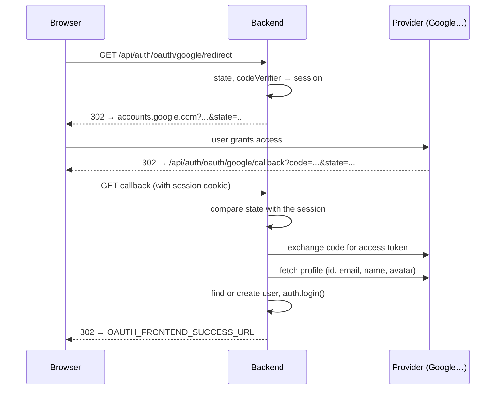

# Social login

A user can sign in with a social network account instead of a password. The backend supports four providers: **Google**, **Facebook**, **GitHub** and **GitLab**. The OAuth 2.0 protocol is implemented by the [`arctic`](https://arcticjs.dev/) library. Code: [`config/oauth.ts`](https://github.com/Blazheiko/vibe-template/blob/main/packages/backend/src/config/oauth.ts), [`oauth-service.ts`](https://github.com/Blazheiko/vibe-template/blob/main/packages/backend/src/app/services/auth/oauth-service.ts), [`oauth-controller.ts`](https://github.com/Blazheiko/vibe-template/blob/main/packages/backend/src/app/controllers/http/auth/oauth-controller.ts).

::: info Buttons in the frontend
The frontend shows buttons **only for configured** providers: the [`SocialAuthButtons.vue`](https://github.com/Blazheiko/vibe-template/blob/main/packages/frontend/src/components/SocialAuthButtons.vue) component loads the list once from `GET /api/auth/oauth/providers`. If no provider is configured, the "or sign in with" block is not shown at all.
:::

## How it works

The routes live in the `auth/oauth` group with the `session_web` and `csrf_guard` middleware (CSRF is not checked on `GET`, so redirects from the provider go through).

| Route                                    | What it does                                                                                                              |
| ---------------------------------------- | ------------------------------------------------------------------------------------------------------------------------- |
| `GET /api/auth/oauth/providers`          | list of configured providers: `{ status: 'ok', providers: ['google', …] }`; no login required                             |
| `GET /api/auth/oauth/:provider/redirect` | generates `state` (and a PKCE `codeVerifier` for Google), stores them in the session, `302` to the provider page          |
| `GET /api/auth/oauth/:provider/callback` | the provider sends the user back here with `code` and `state`; the backend logs them in and sends a `302` to the frontend |



First the controller compares the `state` from the query with the stored one in constant time (`safeEqual`, feat-123). A mismatch is an `OAuth state mismatch` redirect **without** consuming: a navigation that another site makes to the callback with a forged `state` (SameSite=Lax sends the cookie on navigation) does not break a login that is already in progress. Only then, before doing anything on behalf of the callback, the controller **consumes** `oauthState` and `oauthCodeVerifier` with a single atomic `consumeSessionData` operation ([`redis-session-storage.ts`](https://github.com/Blazheiko/vibe-template/blob/main/packages/backend/src/vendor/utils/session/redis-session-storage.ts), feat-119/120). It removes them only if the stored record still holds the **same** `state` that this request read (compare-and-set; after a conflict the check is repeated on the fresh record). There are three possible outcomes:

- **no session** (logout in another tab after the read) → redirect to the `session_revoked` error, `handleCallback` is not called: no accounts, no emails, no new session;
- **`state` is already different**: another callback consumed the same `state` (a double request), or a new OAuth start wrote its own → redirect to the `OAuth state was already used or replaced` error; the new `state` stays in place;
- **consumed** → only this callback proceeds.

If Redis does not respond, that is also an error redirect without a login. A narrower window remains: a logout that arrives after `state` has been consumed but before the login does not cancel the login the user has just completed with the provider.

What happens in the callback ([`oauthService.handleCallback`](https://github.com/Blazheiko/vibe-template/blob/main/packages/backend/src/app/services/auth/oauth-service.ts)):

1. **`state` check.** The value from the query is compared in constant time with what was stored in the session at the redirect step ([`safeEqual`](https://github.com/Blazheiko/vibe-template/blob/main/packages/backend/src/vendor/utils/helpers/safe-equal.ts)). A mismatch is `OAuth state mismatch`: this rejects a forged callback (CSRF on login). By this point `oauthState` and `oauthCodeVerifier` have already been consumed (see above).
2. **Exchange `code` for tokens** through `arctic` and request the profile from the provider API. The `code` exchange and the profile request are limited to 10 s (`OAUTH_PROVIDER_TIMEOUT_MS`, feat-125, feat-130; `arctic` sends the exchange with its own `fetch` without a signal, so the deadline is applied from outside: the callback stops waiting, and the request itself ends with an undici timeout): a provider that hangs makes the login fail with an error instead of holding the callback (and the browser) until the HTTP client timeout, about 300 s. The access token is used **once**, for this request, and is not stored afterwards (see [below](#what-is-stored)). Facebook receives the token in the `Authorization: Bearer` header rather than in the query string: in a URL it ends up in proxy and CDN logs and in `Referer`. A profile API response with a non-`2xx` code (expired token, rate limit, failure) is an error, not a profile: `fetchJson` throws, and the login ends with `Failed to exchange authorization code` (feat-108). A GitHub address list that is not an array is read as "no verified address".
3. **The identifier is required.** An empty or non-string/non-numeric profile `id` is rejected before any lookup (`Could not retrieve account id from provider`, feat-108): the account is looked up by `(provider, provider_user_id)`, and an empty `id` would become one shared account for everyone whose profile the provider did not return.
4. **Email is required.** If the provider did not return an email, the login does not happen (`Could not retrieve email from provider`). The email is lowercased. Together with the email, the backend determines whether the provider is the **owner of the mailbox** (`emailTrust`, see [below](#trust-in-the-address)).
5. **User lookup** (see the table in [Linking by email](#linking-by-email)):
    - there is a record in `oauth_accounts` with this provider and the user's id at the provider → login. The link and `session_token` are read **again under a lock on the user row** (`FOR UPDATE`): if a claim has just deleted the link, the login is rejected with the reason `oauth_link_revoked`;
    - otherwise, if there is a user with this email → linking (Google mailbox owner) or an email with a confirmation link (everyone else);
    - otherwise a new user is created without a password (`password: null`) with the name and avatar from the profile. The user and their first link are created in **one transaction**: if a parallel callback for the same identity committed first, the unique `provider` + `provider_user_id` pair rolls back this transaction together with the user, and the decision is made again, now based on the winner's link (login to the same account). No extra user is left behind.
6. **Login.** `auth.login(...)` is called, the same function as for password login (see [Authentication](/en/backend/auth#signing-in-and-out-in-code)): a new session, a new cookie. The user receives a "new login" push.
7. **Redirect to the frontend**, always with status `302`: success is `OAUTH_FRONTEND_SUCCESS_URL` (`/?oauth=success`); a link waiting for email confirmation is `OAUTH_FRONTEND_LINK_PENDING_URL` (`/?oauth=link_pending`, the login did **not** happen); an error is `OAUTH_FRONTEND_ERROR_URL` (`/?error=oauth_failed`). `reason=` is appended to the error URL for `oauth_link_revoked`, `email_changed`, `oauth_already_linked` and `too_many_attempts`; all other errors get a generic message.

**Where the user lands after signing in.** The router guard sends an anonymous visitor of a protected page to `/login?redirect=<path>`. After a form sign-in the frontend goes to that path ([`useCompleteSignIn.ts`](https://github.com/Blazheiko/vibe-template/blob/main/packages/frontend/src/composables/useCompleteSignIn.ts)), not to `/account`. An OAuth sign-in leaves the application and comes back to `/?oauth=success`, so a click on a provider button puts the path into the tab's `sessionStorage` ([`post-sign-in-target.ts`](https://github.com/Blazheiko/vibe-template/blob/main/packages/frontend/src/utils/post-sign-in-target.ts)), and it is taken from there once after the return. In both cases only a path inside the application is accepted ([`safe-redirect.ts`](https://github.com/Blazheiko/vibe-template/blob/main/packages/frontend/src/utils/safe-redirect.ts): it starts with a single `/`, has no `\` and no control characters); the stored value is checked again when read and is good for 10 minutes. Without `redirect` a sign-in leads to `/account`.

## What is stored

The `oauth_accounts` table holds `provider`, `provider_user_id`, `provider_email`, `provider_name`, `provider_avatar` and the creation/update time. The `provider` + `provider_user_id` pair is unique. The name of a new account (`users.name`, 100 characters) is the name from the provider's profile cut to the length of the column; `oauth_accounts.provider_name` keeps it whole (feat-161). When `users.avatar` holds the provider's picture URL rather than a storage key, replacing or deleting the avatar makes no storage request for that value. **Provider tokens (`access_token`, `refresh_token`) are not stored**: no code ever read them, and a plain-text token in the DB is a risk with no benefit (a leaked backup or dump gives access to accounts at the providers). The columns were removed by the `drop_oauth_tokens` migration; they were nullable, so the rollback is `ADD COLUMN access_token text, ADD COLUMN refresh_token text` (the data that was there is not restored).

If you need access to the provider API on behalf of the user (offline), the tokens must be stored **encrypted** with a key separate from `APP_KEY`, and only when there is code that reads them.

### What ends up in the logs

The email and name from the profile are personal data. The OAuth login log contains the provider and a **masked** email (`u***r@e*****e.com`, `maskEmailForLogs`), without the name, without the id at the provider and without tokens. The redirect to the provider (`GET /auth/oauth/:provider/redirect`) logs only the provider's name: the authorization URL carries the single-use `state` and the PKCE challenge, so it stays out of the log.

## Linking by email

Protection against account pre-hijacking ([plan](https://github.com/Blazheiko/vibe-template/blob/main/docs/plan/oauth-pre-hijack-plan.md)): an attacker creates an account with the victim's address in advance (with a password, via Facebook, with a linked phone) and waits for the victim to sign in through OAuth. That is why linking by email and the `users.email` value itself rely only on **proof of mailbox ownership**.

### Trust in the address

| Provider | `emailTrust`                                                                                                                                                                                                                                                                                              |
| -------- | --------------------------------------------------------------------------------------------------------------------------------------------------------------------------------------------------------------------------------------------------------------------------------------------------------- |
| Google   | `authoritative` only for `@gmail.com` / `@googlemail.com` with `verified_email: true` or for Google Workspace (`hd` equals the address domain) with `verified_email: true` ([Google documentation](https://developers.google.com/identity/gsi/web/guides/verify-google-id-token)); otherwise `unverified` |
| GitHub   | `unverified`; the address is taken from `/user/emails` (primary and verified) only as an address to send an email to                                                                                                                                                                                      |
| GitLab   | `unverified`; the address comes from OpenID Connect `/oauth/userinfo` (if it has `email_verified`), otherwise from `/api/v4/user`                                                                                                                                                                         |
| Facebook | `unverified`: the Graph API has no "email verified" flag                                                                                                                                                                                                                                                  |

### What happens

| Situation                                           | Google `authoritative`                        | Everyone else (`unverified`)                                                                                                                                                                            |
| --------------------------------------------------- | --------------------------------------------- | ------------------------------------------------------------------------------------------------------------------------------------------------------------------------------------------------------- |
| A user with this email exists, address verified     | linking and login                             | **no login**: a "link provider" email goes to the account address, redirect to `link_pending`                                                                                                           |
| A user with this email exists, address not verified | **claim** (see below), linking and login      | same email; confirmation performs the claim                                                                                                                                                             |
| No such user                                        | new user with `email` and `email_verified_at` | new user with **`email = null`**; the address stays in `oauth_accounts.provider_email`, and the first-address confirmation email goes there (`email_link_verifications`); the login happens immediately |

- **The "link provider" email** (`oauth_link_verifications`, TTL 30 min) works only in the browser session where the login started: the token stores a hash of the session id, and confirmation compares it with the hash of the current session in constant time ([`safeEqual`](https://github.com/Blazheiko/vibe-template/blob/main/packages/backend/src/vendor/utils/helpers/safe-equal.ts)). The link leads to the frontend `/oauth/link/confirm?token=…`, which calls `POST /api/auth/oauth/link/confirm` with `{ token }`. Opened in another browser, it gives `403 oauth_link_wrong_session`, and the token stays valid. If the account address changed after sending, `409 email_changed`; if this identity is already linked, `409 oauth_already_linked`. A pending link for one provider does not cancel a pending link for another.
- **The "sign-in method added" notice** (feat-198, [`sign-in-method-notice.ts`](https://github.com/Blazheiko/vibe-template/blob/main/packages/backend/src/app/services/auth/sign-in-method-notice.ts)). A linked identity signs in to the account after a password change or reset and after "log out everywhere" too, so a link to an account that is already verified (a confirmed link or an authoritative Google) is announced on its own, not as an ordinary "new sign-in": the `sign_in_method_added` push and an email to the account's address with the provider's name. The provider's profile name is quoted only when it does not look like an address or a link and has no control characters (`mailSafeDisplayName`); otherwise the email says just "a GitHub account". The notice is sent after the link is committed, without waiting: an email or push failure is only logged, and it goes out even if the session after the link could not be created. A claim is announced as `account_claimed`, without this email.
- **Email limits.** Every path that sends an address confirmation email (the "link provider" email, the first email of a new OAuth user and its `resend`) charges the same budgets as [email linking from the account page](/en/backend/security) before issuing a token and sending: `linkEmailTarget` (address), `linkEmailUser` and `linkEmailUserCooldown` (account). When a budget is exhausted: the callback redirects with `reason=too_many_attempts`, without a token and without cancelling the owner's pending link; `resend` returns `429 rate_limited` with `reason: too_many_attempts` (feat-134); the first email is simply not sent (the login stays). The general OAuth route limit per IP does not replace this: an attacker with many IPs cannot flood the victim's mailbox or cancel their link again and again.
- **The first address** of a new user is confirmed by the `/verify-email` link only from this account's session (`403 email_link_wrong_session` otherwise), so a click by the victim on an email the attacker initiated does nothing. To resend the email: `POST /api/auth/oauth/email/resend` (a logged-in user without an email; the address is taken from `provider_email`, there is no need to enter it).
- **Claim** is the first proof of mailbox ownership on an account with an unverified email (authoritative Google, a confirmed link, [password reset by email](/en/backend/auth)). In one transaction under a row lock: the address is checked again, `email_verified_at` is set, the password and phone are cleared, all OAuth links and push subscriptions are deleted, all pending tokens and SMS challenges are invalidated, `session_token` is rotated (old sessions are revoked, ADR 0002). The account data stays.

::: warning Already deployed copies of the template
Records created before this change are not checked against the new rules: GitHub/GitLab users have `email_verified_at` based on the provider response, Facebook users have an unverified `email`, and already linked identities simply sign in. Resetting `email_verified_at` by itself does **not** remove an existing attacker link: it is removed by the claim, when the owner signs in through authoritative Google or resets the password. The queries below only **flag candidates** for manual review; they do not prove an attack:

```sql
-- non-Google provider links created before the address was verified
SELECT u.id, u.email, o.provider, o.created_at, u.email_verified_at
FROM oauth_accounts o JOIN users u ON u.id = o.user_id
WHERE o.provider <> 'google' AND (u.email_verified_at IS NULL OR o.created_at < u.email_verified_at);
```

For a confirmed candidate: delete the suspicious link, reset `email_verified_at`, rotate `session_token`, notify the owner and advise them to reset the password.
:::

## What you need to make it work

### 1. Register the application with the provider

In each provider's developer console, create an OAuth application and get a **Client ID** and **Client Secret**.

| Provider | Where to create it                                                                                              | Scopes the backend requests           |
| -------- | --------------------------------------------------------------------------------------------------------------- | ------------------------------------- |
| Google   | [Google Cloud Console → Credentials](https://console.cloud.google.com/apis/credentials), type "Web application" | `openid`, `profile`, `email` (+ PKCE) |
| Facebook | [Meta for Developers](https://developers.facebook.com/apps/), product "Facebook Login"                          | `email`, `public_profile`             |
| GitHub   | [GitHub → Settings → Developer settings → OAuth Apps](https://github.com/settings/developers)                   | `user:email`                          |
| GitLab   | [GitLab → Preferences → Applications](https://gitlab.com/-/user_settings/applications)                          | `openid`, `email`, `read_user`        |

GitLab is connected to `https://gitlab.com`. For a self-hosted GitLab instance, change the address in `createGitLabClient()` and `fetchGitLabUserInfo()`.

::: warning GitLab: enable the `openid` and `email` scopes
The backend requests `openid`, `email` and `read_user` from GitLab: GitLab exposes the email verification flag (`email_verified`) only through OpenID Connect. In the GitLab OAuth application settings (**Preferences → Applications** → your application) all three scopes must be checked.

If the application was created earlier with only `read_user`, **update it before deploying this version**: otherwise GitLab will reject authorization with an `invalid_scope` error, and GitLab login will stop working. Details: [GitLab as an OpenID Connect provider](https://docs.gitlab.com/integration/openid_connect_provider/).
:::

### 2. Set the Redirect URI

In the provider's application settings, add an **Authorized redirect URI**. It must lead to the backend callback and **exactly** match what is in `.env`:

```text
https://app.example.com/api/auth/oauth/<provider>/callback
```

The provider will send the browser back to exactly this address, and the browser must send the cookie of the session created at the redirect step. So the domain in the Redirect URI is the one on which the user opened the application.

::: tip Local development
In dev the frontend runs on `http://localhost:5173`, and Vite proxies `/api` to the backend. Specify the Redirect URI through the frontend port: `http://localhost:5173/api/auth/oauth/google/callback`. If you specify `:3000`, the session cookie from `:5173` will not reach it and the login will end with `Missing OAuth parameters`. Google and GitHub allow `http://localhost`; Facebook requires HTTPS for everything except `localhost`.
:::

### 3. Fill in `.env`

```bash
GOOGLE_CLIENT_ID=<client-id>
GOOGLE_CLIENT_SECRET=<client-secret>
GOOGLE_REDIRECT_URI=http://localhost:5173/api/auth/oauth/google/callback

# where to send the user after login (optional)
OAUTH_FRONTEND_SUCCESS_URL=/?oauth=success
OAUTH_FRONTEND_ERROR_URL=/?error=oauth_failed
```

The same goes for `FACEBOOK_*`, `GITHUB_*` and `GITLAB_*`. The full list of variables is in [Configuration → OAuth](/en/backend/configuration#oauth). The Client Secret is a secret: do not commit it.

Restart the backend and open `http://localhost:5173/api/auth/oauth/google/redirect`: you should be redirected to the Google sign-in page.

::: info Unconfigured provider
A provider is considered configured when all three variables are set: `*_CLIENT_ID`, `*_CLIENT_SECRET` and `*_REDIRECT_URI`. An unconfigured provider is not in `GET /api/auth/oauth/providers`, so there is no button for it, and going directly to `/api/auth/oauth/<provider>/redirect` returns `404 Provider not configured`.
:::

### Common errors

All callback errors lead to `OAUTH_FRONTEND_ERROR_URL` (status `302`); the cause is visible in the backend logs (`oauth callback failed`).

| Log message                           | Cause                                                                                                                                                                                                                       |
| ------------------------------------- | --------------------------------------------------------------------------------------------------------------------------------------------------------------------------------------------------------------------------- |
| `Missing OAuth parameters`            | the callback has no `code`/`state` or the session has no `oauthState` (different domain, different browser, session expired, the user cancelled the login)                                                                  |
| `OAuth state mismatch`                | `state` did not match: an old link or a callback from someone else's session                                                                                                                                                |
| `OAuth code exchange failed`          | wrong Client Secret, Redirect URI does not match the registered one, `code` already used                                                                                                                                    |
| `oauth provider returned empty email` | the user did not grant access to the email or has no verified address                                                                                                                                                       |
| `oauth link mailed`                   | a user with this email already exists and the provider is not the mailbox owner: a link confirmation email went to the account address, the frontend gets `?oauth=link_pending` (see [Linking by email](#linking-by-email)) |
| `Provider not configured: <name>`     | not all three variables `*_CLIENT_ID`, `*_CLIENT_SECRET`, `*_REDIRECT_URI` are set for the provider                                                                                                                         |
| `Unsupported provider: <name>`        | the URL has a provider that is not in `SUPPORTED_PROVIDERS`                                                                                                                                                                 |

## How to add a new provider

The example below is for **Discord**. `arctic` supports more than 50 providers ([list](https://arcticjs.dev/)), and the steps are the same for each. All backend changes are in two files: `config/oauth.ts` and `oauth-service.ts`. There is no need to change the routes: `:provider` in the URL already accepts any name.

### 1. Config and environment variables

[`config/oauth.ts`](https://github.com/Blazheiko/vibe-template/blob/main/packages/backend/src/config/oauth.ts):

```ts
discord: {
    clientId: env['DISCORD_CLIENT_ID'] ?? '',
    clientSecret: env['DISCORD_CLIENT_SECRET'] ?? '',
    redirectUri: env['DISCORD_REDIRECT_URI'] ?? '',
},
```

Add these three variables to `packages/backend/.env.example` and to the table on the [Configuration](/en/backend/configuration#oauth) page.

### 2. Service

In [`oauth-service.ts`](https://github.com/Blazheiko/vibe-template/blob/main/packages/backend/src/app/services/auth/oauth-service.ts):

```ts
import { Discord /* , Google, ... */ } from 'arctic'

// 1. allow the provider
const SUPPORTED_PROVIDERS = ['google', 'facebook', 'github', 'gitlab', 'discord'] as const

// 2. client factory
function createDiscordClient(): Discord {
    return new Discord(
        oauthConfig.discord.clientId,
        oauthConfig.discord.clientSecret,
        oauthConfig.discord.redirectUri,
    )
}

// 3. user profile → OAuthUserInfo
async function fetchDiscordUserInfo(accessToken: string): Promise<OAuthUserInfo> {
    const data = await fetchJson<JsonObject>('https://discord.com/api/users/@me', {
        Authorization: `Bearer ${accessToken}`,
    })
    const id = typeof data['id'] === 'string' ? data['id'] : ''
    const avatarHash = typeof data['avatar'] === 'string' ? data['avatar'] : null
    return {
        id,
        email: typeof data['email'] === 'string' ? data['email'] : '',
        name:
            typeof data['global_name'] === 'string'
                ? data['global_name']
                : typeof data['username'] === 'string'
                  ? data['username']
                  : '',
        avatar:
            avatarHash !== null
                ? `https://cdn.discordapp.com/avatars/${id}/${avatarHash}.png`
                : null,
        // Discord's `verified` says the address was checked once, not that Discord hosts the
        // mailbox: a mailed link proves it (feat-097).
        emailTrust: 'unverified',
    }
}
```

The `emailTrust` field is required: it decides whether the login is linked to an existing user with the same email right away or only through a confirmation email (see [Linking by email](#linking-by-email)). Set `authoritative` only when the provider itself hosts the mailbox (as Google does for Gmail and Workspace); an "email verified" flag is not enough for that, so everyone else gets `unverified`, like GitHub, GitLab and Facebook.

In `getAuthorizationUrl`, add a branch before GitLab (it comes last as the "otherwise" case):

```ts
if (provider === 'discord') {
    const url = createDiscordClient().createAuthorizationURL(state, null, ['identify', 'email'])
    return Result.ok({ url: url.toString(), state, codeVerifier: null })
}
```

In `handleCallback`, add the code exchange branch before GitLab; as for the other providers, the exchange is wrapped in `withinProviderDeadline` so a hung provider does not hold the request:

```ts
} else if (provider === 'discord') {
    logger.info('provider discord')
    const tokens = await withinProviderDeadline(
        createDiscordClient().validateAuthorizationCode(code, null),
    )
    userInfo = await fetchDiscordUserInfo(tokens.accessToken())
} else {
    // gitlab
}
```

The signatures of `createAuthorizationURL` and `validateAuthorizationCode` differ between providers: some require PKCE (`codeVerifier`, like Google), others do not (GitHub), and for a third kind it can be passed or `null` (Discord). See the provider's page in the `arctic` documentation. If the provider requires PKCE, generate a `codeVerifier` with `generateCodeVerifier()` and return it from `getAuthorizationUrl`: the controller will store it in the session, as for Google.

The shared code does the rest: finding or creating the user, writing to `oauth_accounts` with `provider = 'discord'`, `auth.login` and the redirect. The `provider` column is 50 characters long, so no DB migration is needed.

### 3. Provider type and frontend

The provider list also exists in a shared type: add `'discord'` to `OAuthProviderSchema` in [`shared/src/responses/oauth-controller.ts`](https://github.com/Blazheiko/vibe-template/blob/main/packages/shared/src/responses/oauth-controller.ts). Then `GET /api/auth/oauth/providers` will be able to return it.

In [`SocialAuthButtons.vue`](https://github.com/Blazheiko/vibe-template/blob/main/packages/frontend/src/components/SocialAuthButtons.vue), add the name to `LABELS` (TypeScript will remind you, because `LABELS` has the type `Record<OAuthProvider, string>`) and, optionally, an icon:

```ts
const LABELS: Record<OAuthProvider, string> = {
    google: 'Google',
    // ...
    discord: 'Discord',
}
```

There is no need to add the button separately: it appears on its own as soon as the `DISCORD_*` variables are set on the backend. The component builds the link (`/api/auth/oauth/discord/redirect`); it is a plain link, not a `fetch`, because the browser has to navigate to the provider page itself.

### 4. Verification

1. Register the application in the [Discord Developer Portal](https://discord.com/developers/applications), with the Redirect URI `http://localhost:5173/api/auth/oauth/discord/callback`.
2. Fill in `DISCORD_*` in `.env`, restart the backend.
3. Make sure `GET /api/auth/oauth/providers` returns `discord`, click the button, grant access: you will be sent back to `/?oauth=success`, already logged in. A row with `provider = 'discord'` will appear in the `oauth_accounts` table.
4. Run `pnpm --filter backend typecheck` and `pnpm --filter backend test`.
