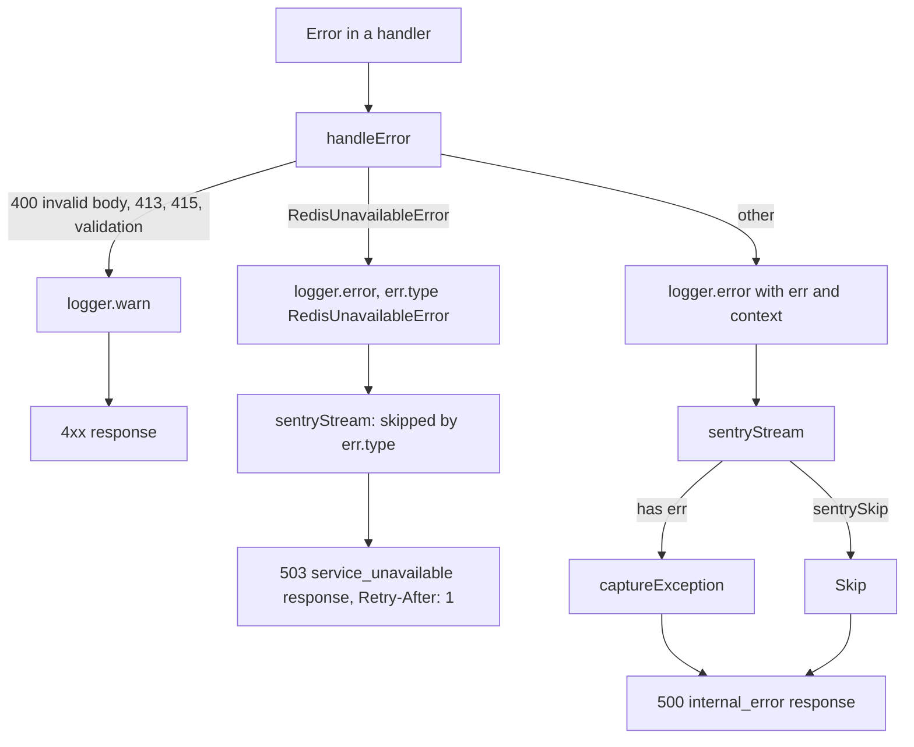

# Observability

This page describes how the backend writes logs, what ends up in Sentry, how liveness and readiness work, and what the template does not have yet (metrics). Sentry environment variables are listed in [Configuration](/en/backend/configuration), HTTP error handling in [Request lifecycle](/en/backend/request-lifecycle), and the frontend's Sentry build arguments in [Deployment](/en/backend/deployment).

## Logging

The logger is [pino](https://getpino.io) 10, a single instance exported from [logger.ts](https://github.com/Blazheiko/vibe-template/blob/main/packages/backend/src/vendor/utils/logger.ts) (import `#vendor/utils/logger.js`).

- **Level.** `LOG_LEVEL` ([`config/logging.ts`](https://github.com/Blazheiko/vibe-template/blob/main/packages/backend/src/config/logging.ts)): `fatal`, `error`, `warn`, `info` (default), `debug`, `trace` or `silent`, case-insensitive. An unknown value stops startup (`Invalid logging configuration`).
- **Format.** If `APP_ENV` is `prod` or `production`, logs go to stdout as JSON lines (`destination({ sync: false })`). In other environments `pino-pretty` is used with colors; the package is imported dynamically and only outside production.
- **Streams.** `multistream` has two streams: the main one (stdout) and `sentryStream` at `error` level, which forwards errors to Sentry (see below).
- **Serializers.** `bigint` → string; `err` and `error` use the standard pino serializer on top of a safe copy of the error (see [DB errors in logs](#db-errors-in-logs)).
- **Redaction.** There is no pino `redact` option. Masking is done manually: the `maskEmailForLogs`, `maskPhoneForLogs` and `maskTokenForLogs` helpers in [mask-sensitive.ts](https://github.com/Blazheiko/vibe-template/blob/main/packages/backend/src/vendor/utils/helpers/mask-sensitive.ts). The rule for a new log entry is to keep out of it what the user wrote or provided and what works as a secret: the text of a support message is logged by its length only (`originalLength`), the recipients of an email are masked, a session token is logged by its first 4 characters only (`maskTokenForLogs` in `session-handler.ts` and `ws-session-auth.ts`), a failed push is logged with the `statusCode` and the error name without the `WebPushError` object (it carries the subscription's endpoint and the headers and body of the push service's answer), and the OAuth redirect is logged with the provider only, without the URL that carries the `state`.

### DB errors in logs

A query error can carry user data. The message of a `pg` error may quote values (`invalid input syntax for type bigint: "…"`), and `detail` may contain a row or a key; pino embeds the `cause` message into the record. The drizzle client with `paramsInErrors: true` additionally puts the query parameters (password hash, `session_token`, email) into the `message` and `stack` of `DrizzleQueryError` and keeps `query` / `params` as fields; the application's `db` does not enable this option, and the protection is there in case someone turns it on. That is why the logger and Sentry receive not the error itself but its copy from [scrub-error.ts](https://github.com/Blazheiko/vibe-template/blob/main/packages/backend/src/vendor/utils/errors/scrub-error.ts) (`toSafeError`):

- **A DB error** (`DrizzleQueryError` or `pg` `DatabaseError`) keeps only `code`, `constraint`, `table`, `column`, `schema`, `routine`, `severity`. The message is fixed: `Failed query (params redacted)` or `Database error (code=23505 constraint=users_email_unique)`. `stack` is rebuilt from this message and the frames (`at …`). Frames are taken only **after** the real error header, so a message line that looks like a frame (`    at …`, quoted by the DB) does not get into the stack (feat-126).
- **Any error** loses the `query`, `params`, `detail`, `where`, `internalQuery`, `hint` fields.
- `cause`, `AggregateError.errors` and errors in fields are handled the same way, recursively (cycles are preserved, depth is limited), including errors inside plain objects and arrays in fields (`details: { failures: [err] }`, feat-126). A `cause` that is not an error is discarded.
- The copy has the same prototype, so `err.type` (the class name, e.g. `RedisUnavailableError`) does not change.
- The original error is not modified: [db-errors.ts](https://github.com/Blazheiko/vibe-template/blob/main/packages/backend/src/app/repositories/db-errors.ts) reads it further down.

The `err` and `error` keys (and an error as the first argument, `logger.error(err)`) are cleaned by the serializers. When a call provides no message, pino takes `msg` from the error itself before the serializers run, so the `logMethod` hook replaces it with a safe copy in advance (feat-127). Errors among the format arguments (`logger.error({ … }, 'failed: %s', err)`) are also replaced by the hook with safe copies, because pino substitutes them into `msg` as is; likewise the bindings of a child logger (`logger.child({ lastError })`) are cleaned, which pino writes into every record bypassing `formatters.log` (feat-137). An error elsewhere in the record (`logger.error({ context: { failure: err } }, …)`, an array of failures, a class instance field — feat-137) is cleaned and serialized by `formatters.log` ([`toSafeValue`](https://github.com/Blazheiko/vibe-template/blob/main/packages/backend/src/vendor/utils/errors/scrub-error.ts), feat-126), without changing the caller's objects:

- an error is only an `Error` or an object with string `name`, `message` and `stack`; a plain object with a `message` field (a `{ code, message }` response, `payload: { message }`) is logged as is (feat-127);
- only the path to the replaced error is copied, so a record without errors is not copied; a shared reference is processed once;
- a cycle becomes `[Circular]`, and a subtree deeper than 32 levels becomes `[Truncated]`, so that an error beneath them does not reach the log raw;
- a class instance is traversed as an object of its own fields (feat-137); a value with `toJSON` is treated as the result of `toJSON()`, because that is what pino writes: an error that `toJSON` returns or contains is replaced with a safe copy, and a `toJSON` that throws becomes `[toJSON failed]` (feat-139); `Buffer`, dates, `Map`, `Set` are not traversed.

Error text inserted into `msg` by hand is written as is.

The same applies outside the logger:

- `console.error` in `index.ts` (startup failure, shutdowns) prints the safe copy.
- Sentry cleans `extra`, `contexts` and breadcrumb data **on a copy**: the objects passed by the caller are not modified, and errors in them are replaced with safe copies. A class instance is cleaned as an object of its own fields, because that is what Sentry sends after normalization; dates, `Map`, `Set`, buffers stay as they are (feat-127). A value with `toJSON` (`URL`, `Decimal`) is cleaned as the result of `toJSON()`, because that is how Sentry serializes it; before, having no own fields, it went out as `{}`. A `URL` is sent as a string without secrets: query parameter values, fragment and userinfo are replaced with `[Filtered]`, the keys stay (feat-139). A value deeper than 8 levels becomes `[Truncated]` rather than being sent as is (feat-139). In the safe copy of an error from `extra`, sensitive own fields are removed and the rest is cleaned like any value (feat-137).
- The `knowledge-base/init-status` status shows only the safe message for a DB error.

### Request logger

For every HTTP request and WS message a child logger `logger.child({ requestId })` is created, where `requestId` is `randomUUID()`. The HTTP `requestId` is generated at the first step of handling (`server.ts`), before the body is read, so 413/415/422 errors have it too. When `session_web` has restored a session with a user, the request logger is replaced with `child({ userId })`; the WS logger gets `userId` from the connection data. It is available in controllers as `ctx.logger` ([http-context.ts](https://github.com/Blazheiko/vibe-template/blob/main/packages/backend/src/vendor/utils/context/http-context.ts), [ws-context.ts](https://github.com/Blazheiko/vibe-template/blob/main/packages/backend/src/vendor/utils/context/ws-context.ts)).

### What is logged on error

`handleError` in [server.ts](https://github.com/Blazheiko/vibe-template/blob/main/packages/backend/src/vendor/start/server.ts) writes through `logger.child({ requestId, userId, route, method })` — every record below has these fields (`userId` when known):

| Error                                         | Level   | Fields                                                          |
| --------------------------------------------- | ------- | --------------------------------------------------------------- |
| `PayloadTooLargeError`                        | `warn`  | `limit`, `contentType`                                          |
| `MalformedBodyError`                          | `warn`  | `bodyKind` (without the request body and the parser error text) |
| `UnsupportedMediaTypeError`                   | `warn`  | `receivedContentType`, `allowedKinds`                           |
| `ValidationError`, `ParameterValidationError` | `warn`  | `err`                                                           |
| `RedisUnavailableError` (503 response)        | `error` | `err` + context; does not go to Sentry (see below)              |
| anything else (500 response)                  | `error` | `err` + `requestId`, `userId`, `route`, `method` (context)      |

For API routes the context contains `requestId`, `userId`, `route.url`, `route.method`; for the route documentation service handler — only `route` and `method`. `userId` is taken at the moment of the error: for 413/415/422 it is absent, because the body is read and validated before the session middleware. Response codes are in [Request lifecycle](/en/backend/request-lifecycle).

### Service errors (`AppError`)

Services return errors as a `Result` and do not throw them, so `handleError` does not see them. They are logged by the controller layer: `mapControllerError` and `mapWsControllerError` call [`reportAppError`](https://github.com/Blazheiko/vibe-template/blob/main/packages/backend/src/app/services/shared/report-app-error.ts) through the request logger. Details are in [Controllers](/en/backend/controllers#error-mapping).

| `AppError`                                          | Level       | Fields                                  | Sentry                                           |
| --------------------------------------------------- | ----------- | --------------------------------------- | ------------------------------------------------ |
| 4xx (`BadRequest`, `NotFound`, `Conflict`, etc.)    | not written | —                                       | no                                               |
| `Internal`, `UpstreamError`, `UpstreamTimeout`      | `error`     | `err` (root cause), `appError` (`_tag`) | yes                                              |
| `ServiceUnavailable`, cause is Redis unavailability | `error`     | `err`, `appError`, `sentrySkip: true`   | no, the event comes from the Redis health module |
| `ServiceUnavailable`, another cause                 | `error`     | `err`, `appError`                       | yes                                              |

Also in [index.ts](https://github.com/Blazheiko/vibe-template/blob/main/packages/backend/src/index.ts): `uncaughtException` is logged as `error` with `sentrySkip: true` and separately sent through `sentryService.captureException`; on graceful shutdown `sentryService.flush(2000)` is called.

## Sentry (backend)

### Initialization

[sentry-bootstrap.ts](https://github.com/Blazheiko/vibe-template/blob/main/packages/backend/src/sentry-bootstrap.ts) is the first import in [index.ts](https://github.com/Blazheiko/vibe-template/blob/main/packages/backend/src/index.ts): it loads `dotenv/config` and calls `sentryService.init()`. The config is [config/sentry.ts](https://github.com/Blazheiko/vibe-template/blob/main/packages/backend/src/config/sentry.ts):

- Sentry is active only if `SENTRY_DSN` is non-empty and `SENTRY_ENABLED` is not `false`. Otherwise all service methods are no-ops.
- `Sentry.init` receives `dsn`, `environment` (`SENTRY_ENVIRONMENT` or `APP_ENV`), `release`, `tracesSampleRate` (default `0`). No additional `integrations` are set — the defaults from `@sentry/node` 11 apply.
- A `Sentry.init` failure does not stop the application: a `console.warn` is written and Sentry stays disabled.

```dotenv
SENTRY_DSN=https://<public-key>@<org>.ingest.sentry.io/<project-id>
SENTRY_ENVIRONMENT=production
SENTRY_RELEASE=<git-sha>
SENTRY_TRACES_SAMPLE_RATE=0
```

### PII and sanitization

`sendDefaultPii` was removed in Sentry 11, so [sentry-service.ts](https://github.com/Blazheiko/vibe-template/blob/main/packages/backend/src/app/services/observability/sentry-service.ts) explicitly turns collection off via `dataCollection`: `userInfo`, `cookies`, `httpBodies: []`, `genAI` inputs/outputs, `databaseQueryData`, `queues`, `stackFrameVariables` — all `false`.

In addition, the `sanitizeEvent` event processor:

- removes from `tags` the keys matching `/token|secret|password|cookie|auth|api[_-]?key|bearer/i`; from `extra`, `contexts` and `breadcrumbs[].data` — at any depth, together with the `query` + `params` pair;
- replaces DB error messages in `exception.values[].value` (Sentry builds them from the original error when it catches an uncaught exception itself), as well as the `Failed query: …` text in `message`, `breadcrumbs[].message` and the strings of `extra` / `contexts`;
- removes the `authorization` and `cookie` headers and those matching the same regex;
- removes `request.data` if `status_code >= 400`, otherwise truncates it to 10 KB.

`sentryService.captureException` passes a safe copy of the error (`toSafeError`) to Sentry, and `sentryStream` passes a record already serialized by the logger from such a copy.

Of the user, only the `id` is sent to Sentry (`scope.setUser({ id })`).

### What ends up in Sentry

Logs are forwarded by `sentryStream` in [logger.ts](https://github.com/Blazheiko/vibe-template/blob/main/packages/backend/src/vendor/utils/logger.ts). The rules:

1. A level below `error` (50) is ignored — `warn` (4xx in `handleError`) does not go to Sentry.
2. `sentrySkip: true` — skip (used when the error was sent manually). Records with `err.type === "RedisUnavailableError"` are skipped as well: the incident has already been recorded by the Redis health module, see [Redis failure](#redis-failure).
3. If there is an `err` or `error` field → `captureException`.
4. Otherwise, only with `sentryCapture: true` → `captureMessage(msg, "error")`.

The tags `requestId`, `route`, `method` and `user.id` are added to the event if they are present in the log record. `AppError` (objects with `_tag`) are normalized into an `Error` named `AppError.<tag>`.

```ts
// a message without an exception — only with an explicit flag
ctx.logger.error({ sentryCapture: true, orderId }, 'Payment webhook mismatch')

// already sent manually — do not duplicate
logger.error({ err, sentrySkip: true }, 'event uncaughtException')
```



### Redis failure

The state of the main Redis client is held by [redis-health.ts](https://github.com/Blazheiko/vibe-template/blob/main/packages/backend/src/database/redis-health.ts): `healthy` or `unavailable`.

- **One event per incident.** The `healthy → unavailable` transition (the client's first `error`/`close` event or the first `RedisUnavailableError` from `withRedis`) writes a single `logger.error({ sentryCapture: true }, "Redis unavailable")` — this is the only Sentry event per incident.
- **While the incident lasts**, the module writes a `warn` `"Redis still unavailable"` no more than once a minute and sends a background `PING` every 2 s.
- **Recovery** happens on the first of these signals: a successful command through `withRedis`, a successful background `PING`, or a `ready` event after reconnect. Then an `info` `"Redis recovered"` with `downMs` is written, the state becomes `healthy`, and the next failure again produces one event.
- **Per process, not per cluster.** Each process has its own state, so N instances will produce N events; Sentry groups them itself.
- **Other records do not duplicate the event.** `sentryStream` skips records where `err.type === "RedisUnavailableError"` (a field written by the pino serializer). This wrapper is thrown only by the main client. The rate-limit client throws raw ioredis errors (`err.type === "Error"`), so `reportAppError` itself marks such records `sentrySkip: true` when `isRedisUnavailable(cause)`. `isRedisUnavailable` looks only at signs that only ioredis produces (`MaxRetriesPerRequestError`, `Command timed out`, `Connection is closed`, `Stream isn't writeable`). A bare socket code (`ECONNREFUSED` etc.) does not count: S3, PostgreSQL or SMTP produce it just the same, and such a failure must be a 500 with a Sentry event. Socket codes are taken into account only by `withRedis` of the main client (`isRedisCommandUnavailable`), where the source is known. The rate-limit client has no separate health module: its failure is visible only in stdout (`warn` `"Rate-limit Redis connection error"`).
- **A deliberate decision about stdout.** `logger.error` from `handleError` and from the controller layer (`reportAppError` for an `AppError` with a 5xx status); infrastructure failures that reach `handleError` as an exception during a failure stay in stdout on every request: this is diagnostics of specific requests, and their volume is bounded by the requests themselves. The "once a minute" limit applies only to the health module. If log volume becomes a problem, the next step is to downgrade these records to `warn`, not to remove them.

### Observability services

[app/services/observability](https://github.com/Blazheiko/vibe-template/blob/main/packages/backend/src/app/services/observability/sentry-service.ts) has only `sentryService`: `init`, `isEnabled`, `captureException`, `captureMessage`, `withScope`, `flush`. Tests are in [sentry-service.spec.ts](https://github.com/Blazheiko/vibe-template/blob/main/packages/backend/src/app/services/observability/sentry-service.spec.ts).

## Sentry (frontend)

The frontend uses `@sentry/vue` ([sentry-service.ts](https://github.com/Blazheiko/vibe-template/blob/main/packages/frontend/src/utils/sentry-service.ts), [sentry-config.ts](https://github.com/Blazheiko/vibe-template/blob/main/packages/frontend/src/utils/sentry-config.ts)). Settings are provided at build time via `VITE_SENTRY_DSN`, `VITE_SENTRY_ENABLED`, `VITE_SENTRY_ENVIRONMENT` (default — Vite `MODE`), `VITE_SENTRY_RELEASE`, `VITE_SENTRY_TRACES_SAMPLE_RATE`, `VITE_SENTRY_REPLAYS_SESSION_SAMPLE_RATE`, `VITE_SENTRY_REPLAYS_ON_ERROR_SAMPLE_RATE`. As on the backend, `dataCollection` turns PII collection off. How to pass these values into a Docker build is in [Deployment](/en/backend/deployment).

Before sending, the service cleans data on all three outputs. `beforeSend` (errors) keeps only `id` from `user`, masks the `Authorization`/`Cookie` headers, removes sensitive keys from `request.data`, and in `request.url`, `extra` and breadcrumbs replaces with `[Filtered]` the values of sensitive query parameters (`token`, `code`, `state`, `access_token`, `id_token`, `secret` and any matching `/password|token|secret|cookie|auth|api[_-]?key|bearer/i`), including a URL inside any string. `beforeBreadcrumb` does the same for breadcrumbs. `beforeSendSpan` cleans tracing: the Vue Router integration copies every query parameter into a `query.<name>` span attribute and the URL into `url.full`/`url.query`, and `beforeSend` does not see spans; without this hook opening `/reset-password?token=…` with `VITE_SENTRY_TRACES_SAMPLE_RATE` > 0 would send a valid token. The `router.onError` handler in [main.ts](https://github.com/Blazheiko/vibe-template/blob/main/packages/frontend/src/main.ts) puts only `to.path` and the route name into `extra`, without the query.

**Session Replay and one-time tokens** (feat-205). None of the three hooks above is called for a replay, and the replay records the page address in events of the DOM recorder, which the SDK does not let the application rewrite (`beforeAddRecordingEvent` sees only the integration's own events). So masking is not enough here: the token of a mailed link (`/reset-password`, `/verify-email`, `/oauth/link/confirm`) is **taken out of the address before Sentry starts**. The path is compared the way Vue Router compares it: regardless of case, trailing `/` and percent-encoding, so `/Reset-Password` and `/reset-password/` are handled like the exact spelling (feat-211). [`strip-url-token.ts`](https://github.com/Blazheiko/vibe-template/blob/main/packages/frontend/src/utils/strip-url-token.ts) is the first import of `main.ts`: it moves `?token=` to `sessionStorage` and cleans the address with `history.replaceState`, before the router is created; a router guard (`redirectWithoutUrlToken`) does the same for a navigation inside the application. The page takes the token with `readUrlToken` and erases it after a successful use ([`one-time-url-token.ts`](https://github.com/Blazheiko/vibe-template/blob/main/packages/frontend/src/utils/one-time-url-token.ts)); a reload of the page does not lose it. The second line is `beforeAddRecordingEvent` (masks URLs in the replay's own events) and an event processor for `replay_event` (masks `urls` and `request.url` in the segment header). The check on the real SDK in a real browser is [`e2e/sentry/replay-url-token.spec.ts`](https://github.com/Blazheiko/vibe-template/blob/main/packages/frontend/e2e/sentry/replay-url-token.spec.ts): no envelope carries the canary token, and a control test shows that a token left in the address of another page does reach the replay. So a secret in the query of any **other** page will be sent by a replay: do not put secrets in a query.

## Health check

`GET /api/ping` ([http-routes.ts](https://github.com/Blazheiko/vibe-template/blob/main/packages/backend/src/app/routes/http-routes.ts) → `MainController.ping` in [main-controller.ts](https://github.com/Blazheiko/vibe-template/blob/main/packages/backend/src/app/controllers/http/core/main-controller.ts) → `mainService.ping` in [main-service.ts](https://github.com/Blazheiko/vibe-template/blob/main/packages/backend/src/app/services/core/main-service.ts)) returns a static:

```json
{ "status": "ok" }
```

`/api/ping` is **liveness**: it only confirms that the process is listening on the port and checks nothing.

`GET /api/ready` is **readiness** ([`readiness-service.ts`](https://github.com/Blazheiko/vibe-template/blob/main/packages/backend/src/app/services/core/readiness-service.ts)): in parallel, `SELECT 1` in PostgreSQL (through `healthRepository`) and a `PING` of the main Redis, each check with a `READINESS_CHECK_TIMEOUT_MS` timeout (1000 ms by default). PostgreSQL is checked through a separate connection ([`readiness-probe.ts`](https://github.com/Blazheiko/vibe-template/blob/main/packages/backend/src/database/readiness-probe.ts)), not through the main pool or the session verification pool: a busy main pool is load, not unavailability, so `/ready` then responds `200` and within the deadline, and the check does not compete with authentication. The timeout is split in half between acquiring a connection and the query (`statement_timeout`, `query_timeout`), so in the worst case a check takes the timeout rather than twice as long, and the next one after a failure does not wait needlessly (feat-138); a connection that ran out of time is destroyed, and the next check opens a new one. Only one DB check runs at a time: a request that arrives while the previous one has not finished gets its result instead of starting a new one, so frequent healthchecks against a DB that accepted the connection and is silent hold one connection rather than piling them up. Such a request used to get "not ready" at once — and a healthy instance answered `503` when two checkers (an orchestrator and a load balancer) asked at the same moment (feat-159). If both answered — `200 { "status": "ok" }`; otherwise `503 { "status": "unavailable" }` without details, and what exactly failed is in the `warn` "Readiness check failed" (`failed: ["redis"]` etc.). The route has no session or CSRF; the global per-IP limit applies, but the healthcheck frequency is orders of magnitude below the threshold. S3 and SMTP are not checked. The Docker image's `HEALTHCHECK` is configured on `/ready` (see [Deployment](/en/backend/deployment)).

Verified live: stopping Redis → `503` in ~0.05 s; stopping PostgreSQL → `503`, `/ping` still `ok`; after the DB returned, `/ready` is `200` again.

::: tip PostgreSQL connection drop
When an idle connection drops (restart, failover), `pg.Pool` emits `error`. Without a handler Node turned this into an `uncaughtException`, and the server stopped — found during feat-030. Now [`db.ts`](https://github.com/Blazheiko/vibe-template/blob/main/packages/backend/src/database/db.ts) logs the event (`PostgreSQL pool: idle client error`), the pool replaces the client itself, and `/ready` responds `503` while the DB is unavailable.
:::

## Metrics and tracing

- There are no Prometheus/OpenTelemetry metrics in the backend: among the dependencies in [package.json](https://github.com/Blazheiko/vibe-template/blob/main/packages/backend/package.json) there are only `@sentry/node`, `pino`, `pino-pretty`. `@opentelemetry/api` in the lockfile is a transitive dependency, not used in the code.
- Tracing is possible only through Sentry performance: `SENTRY_TRACES_SAMPLE_RATE` > 0 (default `0` — tracing is off).

## In practice

**Reading logs locally.** `pnpm dev:backend` prints pretty logs. To find all records of one request, search for its `requestId`. In production (`APP_ENV=production`) logs are JSON, which is convenient to filter with `jq`:

```bash
docker logs <container> | jq 'select(.level >= 50)'
docker logs <container> | jq 'select(.requestId == "<uuid>")'
```

**Checking Sentry.** Set `SENTRY_DSN` and restart the backend, then call in code (for example, temporarily in a handler of a local route) `logger.error({ err: new Error('sentry test') }, 'sentry test')` — an `error`-level record goes to Sentry. There is no dedicated test route: the dead `MainController.testSentryError` was removed (item 27 in [code-issues-found-during-docs.md](https://github.com/Blazheiko/vibe-template/blob/main/docs/plan/code-issues-found-during-docs.md)).
