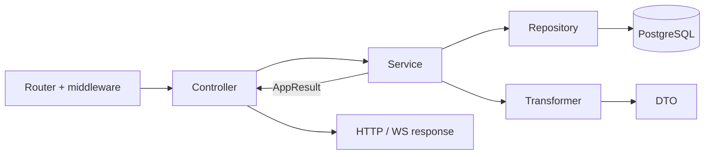

# Repositories

A repository is the **data access layer**: the only place where (by design) SQL is written through Drizzle. Each repository is responsible for one table or a closely related group of tables and gives services a set of named operations — `findById`, `findByEmail`, `create`, `markUsed` — instead of raw queries.

## Why this layer is needed

- **SQL in one place.** A service speaks the language of the domain ("find the user by email"), not the language of queries. When the schema, an index or the way of searching changes (for example, `LOWER(email)`), one repository method is fixed, not all the services.
- **Types from the schema.** Row types (`UserRow`, `UserInsert`) are derived from Drizzle tables via `InferSelectModel` / `InferInsertModel`, so changing a column immediately highlights all the places it is used.
- **Testable services.** Services import repositories only through the barrel `#app/repositories/index.js`, so in tests it is easy to replace with `vi.mock` and check business logic without PostgreSQL.
- **Clear responsibility.** A repository does not make business decisions, does not log and does not wrap errors in `Result` — it only reads and writes data. The decision "what to do if the record does not exist" is made by the service.
- **Query optimization in one place.** Pagination, aggregates in SQL, batch loading of related data without N+1, pgvector search — all of these are implementation details hidden behind a simple method.

For the DB schema and migrations see [Database](/en/backend/database).



## Structure

Repositories live in [`app/repositories/`](https://github.com/Blazheiko/vibe-template/blob/main/packages/backend/src/app/repositories/index.ts), grouped by domain: `ai/`, `auth/`, `communication/`, `health/`, `notifications/`, `support/`, `user/`. Each module exports an **object literal** (not a class) with async methods, often typed with an interface, for example `export const userRepository: IUserRepository = { ... }` in [user-repository.ts](https://github.com/Blazheiko/vibe-template/blob/main/packages/backend/src/app/repositories/user/user-repository.ts).

The barrel [repositories/index.ts](https://github.com/Blazheiko/vibe-template/blob/main/packages/backend/src/app/repositories/index.ts) re-exports all repositories and their types (`UserRow`, `PromptType`, `KbArticleRow`, …). Outside `app/repositories` imports go only through it; this and the completeness of the barrel are checked by [`layering.spec.ts`](https://github.com/Blazheiko/vibe-template/blob/main/packages/backend/src/app/layering.spec.ts).

## DB access

Each repository imports the single Drizzle instance and the tables from the schema:

```ts
import { db } from '#database/db.js'
import { users } from '#database/schema.js'
import type { InferInsertModel, InferSelectModel } from 'drizzle-orm'

export type UserRow = InferSelectModel<typeof users>
export type UserInsert = InferInsertModel<typeof users>
```

Row types are derived from tables via `InferSelectModel` / `InferInsertModel`, and update types via `Partial<Pick<...>>` ([user-repository.ts](https://github.com/Blazheiko/vibe-template/blob/main/packages/backend/src/app/repositories/user/user-repository.ts)).

### Transactions

Several writes that must happen together or not at all are run by a service through `withTransaction` ([transaction.ts](https://github.com/Blazheiko/vibe-template/blob/main/packages/backend/src/app/repositories/transaction.ts)): it opens a Drizzle transaction, commits when the callback returns, and rolls back when it throws. Repository methods that can take part in such a transaction accept an optional last argument `executor` (`DbExecutor`: `db` or `tx`); without it they work on `db`, as before. Currently `userRepository.update` / `updateIfSessionToken` work this way, and in the three token repositories — `create`, `invalidatePendingByUserId` and `markUsed`. `userRepository.lockById(id, tx)` reads the user row with `FOR UPDATE`: all flows that consume or issue a one-time token take this lock first and therefore run one after another for a single user.

```ts
// lock → check → consume → action → invalidate the rest (one-time-token.ts)
const outcome = await runTokenTransaction(passwordResetRepository, token, {
    apply: (user, tx) => userRepository.update(user.id, { password, sessionToken }, tx),
    invalidate: [passwordResetRepository],
})
// outcome.kind: 'applied' | 'unusable' (used / expired) | 'rejected' (check refused) | 'user_missing'
// a transaction failure is thrown; a unique index violation is read by isUniqueViolation (repositories/db-errors.ts)
```

## Typical methods and return values

- **`create`** — `db.insert(...).values(...).returning()`; if no row came back, an `Error` is thrown (`"Failed to create user"`). The `createdAt`/`updatedAt` fields are set by the repository itself.
- **`findBy*`** — `select().from().where().limit(1).then((rows) => rows.at(0))`; a missing record is `undefined`, not `null` and not an exception.
- **`update` / `delete`** — return the updated row (`UserRow | undefined`) or a `boolean`.
- Repositories return **raw Drizzle rows** (`bigint` id, `Date`) or narrow projections (`AdminUserListRow` with `select({ id, name, ... })`). They do not return `Result`, and throw on a DB failure. A unique index violation that means a business outcome is recognized by the service via [`isUniqueViolation`](https://github.com/Blazheiko/vibe-template/blob/main/packages/backend/src/app/repositories/db-errors.ts): Drizzle wraps the pg error in `DrizzleQueryError`, and the code `23505` is in `cause`. A service calls repositories without a wrapper ([ADR 0004](https://github.com/Blazheiko/vibe-template/blob/main/docs/adr/0004-result-for-expected-outcomes.md)), for example `await userRepository.findById(...)` in [main-service.ts](https://github.com/Blazheiko/vibe-template/blob/main/packages/backend/src/app/services/core/main-service.ts).

## Query patterns

| Pattern                                                         | Example                                                                                                                                                                                                                                                                                                                                                                                                                                                                                                               |
| --------------------------------------------------------------- | --------------------------------------------------------------------------------------------------------------------------------------------------------------------------------------------------------------------------------------------------------------------------------------------------------------------------------------------------------------------------------------------------------------------------------------------------------------------------------------------------------------------- |
| Dynamic `WHERE` from an `SQL[]` array + `and(...)`              | `listAdminUsers` in [user-repository.ts](https://github.com/Blazheiko/vibe-template/blob/main/packages/backend/src/app/repositories/user/user-repository.ts), `buildHistoryWhereClause` in [user-online-repository.ts](https://github.com/Blazheiko/vibe-template/blob/main/packages/backend/src/app/repositories/communication/user-online-repository.ts)                                                                                                                                                            |
| `limit`/`offset` pagination                                     | `findText` in [llm-usage-repository.ts](https://github.com/Blazheiko/vibe-template/blob/main/packages/backend/src/app/repositories/ai/usage/llm-usage-repository.ts), `findAll` in [support-knowledge-repository.ts](https://github.com/Blazheiko/vibe-template/blob/main/packages/backend/src/app/repositories/support/support-knowledge-repository.ts)                                                                                                                                                              |
| Clamped `limit` (1..100) + parallel `count()` via `Promise.all` | `listAdminUsers`, `listHistory`                                                                                                                                                                                                                                                                                                                                                                                                                                                                                       |
| `sql` fragments                                                 | case-insensitive search `LOWER(email)`, atomic increment `attemptCount + 1` in [sms-auth-challenge-repository.ts](https://github.com/Blazheiko/vibe-template/blob/main/packages/backend/src/app/repositories/auth/sms-auth-challenge-repository.ts), `count(*)` in `getTextStats`                                                                                                                                                                                                                                     |
| pgvector                                                        | `setEmbedding` and `clearEmbedding` — a plain `update().set()` (the vector as a `[…]` literal with the condition `content_version = version`, `NULL` together with `updatedAt` in one query); `searchByEmbedding` — `db.execute` with the `<=>` operator and `::vector`, columns and table are substituted from schema objects, not strings; in [support-knowledge-repository.ts](https://github.com/Blazheiko/vibe-template/blob/main/packages/backend/src/app/repositories/support/support-knowledge-repository.ts) |

Joins, upsert (`onConflict*`) and transactions are not used in repositories. Related data is loaded with a separate query for the whole result set, not per row: `findByUserIdWithLogs` in [push-subscription-repository.ts](https://github.com/Blazheiko/vibe-template/blob/main/packages/backend/src/app/repositories/notifications/push-subscription-repository.ts) fetches the subscriptions, and then in one query the 5 most recent logs of each via `row_number() over (partition by subscription_id order by sent_at desc, id desc)` ([push-notification-log-repository.ts](https://github.com/Blazheiko/vibe-template/blob/main/packages/backend/src/app/repositories/notifications/push-notification-log-repository.ts)). Aggregates are computed in SQL (`count(case …)`), not in JS.

A pgvector search fragment:

```ts
sql`
    SELECT id, title, content, screenshot_key, screenshot_mime,
           embedding <=> ${vecStr}::vector AS distance
    FROM support_knowledge_base
    WHERE is_active = true AND embedding IS NOT NULL
    ORDER BY distance ASC
    LIMIT ${limit}
`
```

The result of `db.execute` is mapped to camelCase by hand and normalizes `id`/`distance`, which may arrive as strings. The pgvector extension is required, see [Database → pgvector](/en/backend/database#pgvector).

## Redis

There are no Redis repositories: in `app/repositories/` all modules work only with PostgreSQL. Redis is used directly from services and the WS layer — [auth-throttle-service.ts](https://github.com/Blazheiko/vibe-template/blob/main/packages/backend/src/app/services/auth/auth-throttle-service.ts) (Lua `INCR`+`EXPIRE`, key `auth:throttle:*`), [generate-ws-token-service.ts](https://github.com/Blazheiko/vibe-template/blob/main/packages/backend/src/app/services/auth/generate-ws-token-service.ts) (`setex`), [ws-session-auth.ts](https://github.com/Blazheiko/vibe-template/blob/main/packages/backend/src/app/websocket/ws-session-auth.ts) (`auth:ws:*`).

## Summary table

| Repository                                                                                                                                                                      | Table(s)                                    | Key methods                                                                                                                               |
| ------------------------------------------------------------------------------------------------------------------------------------------------------------------------------- | ------------------------------------------- | ----------------------------------------------------------------------------------------------------------------------------------------- |
| [`userRepository`](https://github.com/Blazheiko/vibe-template/blob/main/packages/backend/src/app/repositories/user/user-repository.ts)                                          | `users`                                     | `create`, `findById`, `findByEmail`, `findByPhone`, `findBySessionToken`, `listAdminUsers`, `emailExistsForOtherUser`, `update`, `delete` |
| [`oauthAccountRepository`](https://github.com/Blazheiko/vibe-template/blob/main/packages/backend/src/app/repositories/auth/oauth-account-repository.ts)                         | `oauthAccounts`                             | `findByProviderAndProviderId`, `findByUserId`, `create`                                                                                   |
| [`emailVerificationRepository`](https://github.com/Blazheiko/vibe-template/blob/main/packages/backend/src/app/repositories/auth/email-verification-repository.ts)               | `emailVerifications`                        | `create`, `findByTokenHash`, `invalidatePendingByUserId`, `markUsed`, `burn`                                                              |
| [`emailLinkVerificationRepository`](https://github.com/Blazheiko/vibe-template/blob/main/packages/backend/src/app/repositories/auth/email-link-verification-repository.ts)      | `emailLinkVerifications`                    | same                                                                                                                                      |
| [`passwordResetRepository`](https://github.com/Blazheiko/vibe-template/blob/main/packages/backend/src/app/repositories/auth/password-reset-repository.ts)                       | `passwordResetTokens`                       | same                                                                                                                                      |
| [`smsAuthChallengeRepository`](https://github.com/Blazheiko/vibe-template/blob/main/packages/backend/src/app/repositories/auth/sms-auth-challenge-repository.ts)                | `smsAuthChallenges`                         | `findLatestPendingForPhoneFlow`, `markIssued`, `incrementAttemptCount`, `markConfirmed`, `markInvalidated`                                |
| [`userOnlineRepository`](https://github.com/Blazheiko/vibe-template/blob/main/packages/backend/src/app/repositories/communication/user-online-repository.ts)                    | `userOnline`                                | `create`, `findBySocketUuid`, `completeBySocketUuid`, `listHistory`, `countHistory`                                                       |
| [`pushSubscriptionRepository`](https://github.com/Blazheiko/vibe-template/blob/main/packages/backend/src/app/repositories/notifications/push-subscription-repository.ts)        | `pushSubscriptions`, `pushNotificationLogs` | `findByEndpoint`, `findByUserIdWithLogs`, `update`, `touchLastUsed`, `deactivate`, `delete`, `getLogsBySubscriptionId`                    |
| [`pushNotificationLogRepository`](https://github.com/Blazheiko/vibe-template/blob/main/packages/backend/src/app/repositories/notifications/push-notification-log-repository.ts) | `pushNotificationLogs`                      | `insertMany`, `countsBySubscription`, `latestBySubscriptionIds`                                                                           |
| [`llmUsageRepository`](https://github.com/Blazheiko/vibe-template/blob/main/packages/backend/src/app/repositories/ai/usage/llm-usage-repository.ts)                             | `llmTextUsage`                              | `insertText`, `findText`, `countText`, `getTextStats`                                                                                     |
| [`promptRepository`](https://github.com/Blazheiko/vibe-template/blob/main/packages/backend/src/app/repositories/ai/prompt-repository.ts)                                        | `llmSystemPrompts`                          | `findAll`, `findByType`, `update`                                                                                                         |
| [`supportRepository`](https://github.com/Blazheiko/vibe-template/blob/main/packages/backend/src/app/repositories/support/support-repository.ts)                                 | `supportChatHistory`                        | `addChatMessage`, `addUserMessageOnce`, `findChatHistory`, `deleteAllChatHistory`                                                         |
| [`supportKnowledgeRepository`](https://github.com/Blazheiko/vibe-template/blob/main/packages/backend/src/app/repositories/support/support-knowledge-repository.ts)              | `supportKnowledgeBase`                      | `findAll`, `create`, `update`, `replaceScreenshot`, `setEmbedding`, `searchByEmbedding`                                                   |
| [`healthRepository`](https://github.com/Blazheiko/vibe-template/blob/main/packages/backend/src/app/repositories/health/health-repository.ts)                                    | —                                           | `pingDatabase` (`SELECT 1` for the health check)                                                                                          |

## Rules

- Repositories contain only data access: building queries, setting `createdAt`/`updatedAt`. Business decisions (session checks, error codes) belong in services.
- A one-time token (password reset, email confirmation, email linking) is consumed atomically: `markUsed` is `UPDATE … SET used_at = clock_timestamp() WHERE id = ? AND used_at IS NULL AND expires_at > clock_timestamp() RETURNING *`, so of two parallel requests with the same token only one gets the row (the other gets `undefined`). `clock_timestamp()`, not `now()`: `now()` is fixed at the start of the transaction, and a token that expired while the transaction waited for the lock would pass the check. An expired token found before the transaction is marked used by `burn`.
- The token transaction is driven by a single helper, `runTokenTransaction` in [`one-time-token.ts`](https://github.com/Blazheiko/vibe-template/blob/main/packages/backend/src/app/services/auth/one-time-token.ts): user lock → `check` of the row (a refusal consumes the token and changes nothing else) → consume → `apply` (password change, confirmation, new email) → invalidate the user's remaining pending tokens in the given tables by `user_id`, **without** an exception by `id` (ids of different tables are unrelated, and the consumed token is no longer pending). A failure after the write rolls everything back, and the link stays usable. Issuing is `issueTokenLocked`: under the same lock, a row check, invalidation of previous tokens and insertion of a new one in a single transaction, so two parallel requests leave exactly one valid token; the email is sent after commit, and if sending fails, the previous link is already invalid and the user simply repeats the request.
- The three token repositories are one and the same [`createTokenRepository`](https://github.com/Blazheiko/vibe-template/blob/main/packages/backend/src/app/repositories/auth/token-repository.ts) over three tables (they were not merged: a migration with no gain).
- Repositories do not log: `completeBySocketUuid` returns `false`, and the "no record found on disconnect" warning is written by `userOnlineService`.
- Repositories are called only from services; controllers, middleware and the WS coordinator go through services.

## Testing

There are no separate spec files for repositories. They are mocked in service tests via `vi.mock` of the barrel module, for example in [push-subscription-service.spec.ts](https://github.com/Blazheiko/vibe-template/blob/main/packages/backend/src/app/services/notifications/push-subscription-service.spec.ts):

```ts
vi.mock('#app/repositories/index.js', () => ({
    pushSubscriptionRepository: pushSubscriptionRepositoryMock,
}))
```

Repositories are mocked the same way in `auth-service.spec.ts`, `main-service.spec.ts`, `support-service.spec.ts`, `knowledge-base-service.spec.ts` and others. Since services that access `db` directly bypass this mock, for them you will have to mock `#database/db.js`.

## Related layers

- [Controllers](/en/backend/controllers) — HTTP/WS adapters: accept a request and return a response.
- [Services](/en/backend/services) — business logic, return `AppResult<T>`.
- [Repositories](/en/backend/repositories) — the only place where SQL is written.
- [Transformers](/en/backend/transformers) — converting DB rows into public DTOs.

For the overall picture see [Architecture](/en/backend/architecture), for a step-by-step example see [Adding a feature](/en/backend/adding-a-feature).
