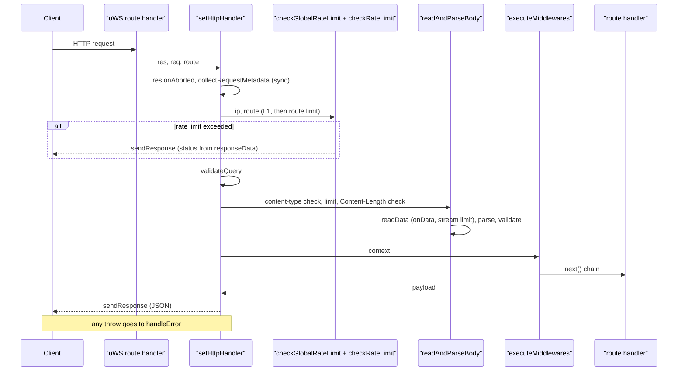
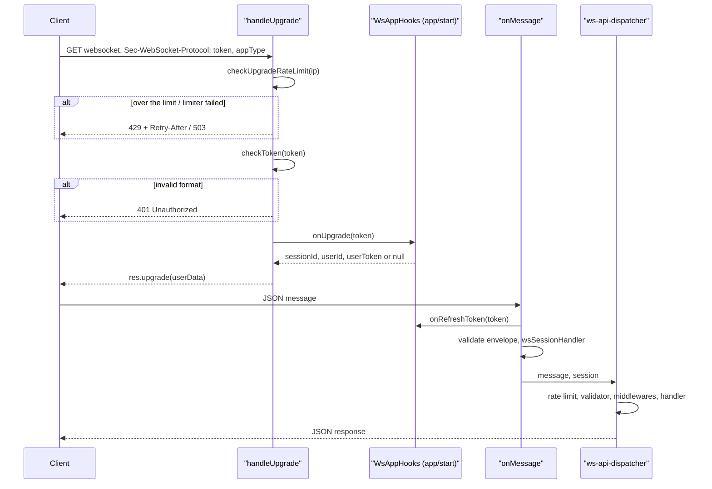

# Request lifecycle

This page follows the path of an HTTP request and a WebSocket connection from process start to sending the response. Everything described below is implemented in `packages/backend/src/vendor/`; the links point to the current code.

## Server startup

[index.ts](https://github.com/Blazheiko/vibe-template/blob/main/packages/backend/src/index.ts), in the `start()` function:

1. `validateRuntimeConfig()` — configuration check (see [/en/backend/configuration](/en/backend/configuration));
2. `promptService.load()`;
3. `routesHandler(httpRoutes)` and `routesHandler(wsRoutes)` from [router.ts](https://github.com/Blazheiko/vibe-template/blob/main/packages/backend/src/vendor/start/router.ts) expand the groups into a flat list of `RouteItem` (the `appConfig.pathPrefix` prefix, merging of `middlewares`, inheritance of `rateLimit`, extraction of `:param` into `parametersKey`);
4. `createWsRoutesByUrl` builds the WS route table (exact URL match only, no `:param`);
5. `initServer(...)` from [server.ts](https://github.com/Blazheiko/vibe-template/blob/main/packages/backend/src/vendor/start/server.ts) calls `configureWebsockets`, `configureHttp` and `listen` (or `listen_unix` if `unixPath` is set). The listen token is stored in `state.listenSocket`.

The `SIGINT`/`SIGHUP`/`SIGTERM` signals trigger `stopGracefully`: `stopServer` (closing all WS and the listen socket), `sentryService.flush`, closing the DB pool and Redis.

## Registering HTTP handlers

`configureHttp` registers: the static cache (if `serveStatic`), every route via `registerHttpRoute` (`server.get/post/put/patch/del`), and the catch-all `server.any("/*")`, which:

- for `OPTIONS` with `corsConfig.enabled` responds `200` with CORS headers (preflight);
- for an unknown path under `/<pathPrefix>/` returns `404` `{ status: "error", code: "not_found", message: "Route not found" }`;
- for other `GET` requests serves static files (`staticHandler`), otherwise `404`.

`setCorsHeader` always writes `Vary: Origin`, and `Access-Control-Allow-*` only if `Origin` is in `corsConfig.allowedOrigins`.

## Handling an HTTP request (setHttpHandler)



Steps in [server.ts](https://github.com/Blazheiko/vibe-template/blob/main/packages/backend/src/vendor/start/server.ts):

1. **Refusal during shutdown.** If `state.listenSocket === undefined`, the connection is closed (`res.close()`).
2. **onAborted.** Registered once; the flag is passed to `readData` through the `RequestAbortSignal` object, because in uWS `onAborted` is a single slot. After an abort no response is written.
3. **Metadata synchronously.** Before the first `await`, `collectRequestMetadata` collects cookies (`parseCookies`), query, headers (`getHeaders`, without `cookie`, with `validateHeader` validation), route parameters (`extractParameters` with `validateParameter`), the IP (`getIP`), `content-type` and `bodyKind`. `hasBody` is `true` for `post`, `put` and `patch` (`BODY_METHODS` in [body-methods.ts](https://github.com/Blazheiko/vibe-template/blob/main/packages/backend/src/vendor/utils/routing/body-methods.ts)); for `get` and `delete` the body is not read.
4. **Rate limit before reading the body.** First `checkGlobalRateLimit` (L1: one budget per IP for all API requests, 600 per minute by default), then `checkRateLimit` ([http-rate-limit.ts](https://github.com/Blazheiko/vibe-template/blob/main/packages/backend/src/vendor/utils/rate-limit/http-rate-limit.ts)): the route limit, otherwise the group's, and with no limit it lets the request through. Both checks are synchronous so as not to miss `onData`. API 404s, the `OPTIONS` preflight and `/<pathPrefix>/doc/routes` do not go through `setHttpHandler`, but L1 is called for them separately. Details are in [Rate limiting](/en/backend/security#rate-limiting).
5. **Query.** `validateQuery` validates the query only if the route has a `queryValidator`, otherwise `httpData.query === null`.
6. **Body.** `readAndParseBody` (details below).
7. **Context and middleware.** `HttpData` is built, `contextHandler` creates the context; `executeMiddlewares` ([execute-httpMiddlewares.ts](https://github.com/Blazheiko/vibe-template/blob/main/packages/backend/src/vendor/utils/middlewares/core/execute-httpMiddlewares.ts)) runs the chain. The handler is called only if all middleware called `next()` and `responseData.status` is in the 2xx range. After the handler (and before sending) the server calls `context.session.beforeSend` if the session layer set it: this way the response does not return a session cookie that another request has deleted in the meantime (see [Authentication](/en/backend/auth#redis-as-the-source-of-truth)).
8. **Response.** `sendResponse` writes the status, `content-type: application/json` (only when there is a body), security headers, headers and cookies from `responseData`, CORS; the body is `makeJson(payload)`. Responses with an empty payload are in the [Response without data](#response-without-data) section.

## Request body: types and limits

`detectBodyKind` in [http-request-handlers.ts](https://github.com/Blazheiko/vibe-template/blob/main/packages/backend/src/vendor/utils/network/http-request-handlers.ts):

| Content-Type                                               | BodyKind                        | Limit (config/app.ts)    | Env                           | Default    |
| ---------------------------------------------------------- | ------------------------------- | ------------------------ | ----------------------------- | ---------- |
| `/^application\/json\s*(;\|$)/i`                           | `json`                          | `maxJsonBodySize`        | `APP_MAX_JSON_BODY_SIZE`      | 2 097 152  |
| `multipart/form-data…`                                     | `multipart`                     | `maxMultipartBodySize`   | `APP_MAX_MULTIPART_BODY_SIZE` | 52 428 800 |
| `application/octet-stream…`                                | `octet`                         | `maxOctetStreamBodySize` | `APP_MAX_OCTET_BODY_SIZE`     | 52 428 800 |
| `application/x-www-form-urlencoded…`, `text/plain…`, other | `urlencoded` / `text` / `other` | `maxBodySize`            | `APP_MAX_BODY_SIZE`           | 2 097 152  |

These are global limits by type. A route can **narrow** them with the `maxBodySize` option (bytes, an integer > 0; the smaller of the two applies, it cannot be widened; for multipart this is the whole body, i.e. the file plus the wrapper): that is how the avatar is limited to 10 MiB + 64 KiB, and the KB screenshot to 5 MiB + 64 KiB. `maxBodySize` on a route of a method without a body, or with an invalid value, is a startup error (`routesHandler`).

Values are read via `parseSize` in [config/app.ts](https://github.com/Blazheiko/vibe-template/blob/main/packages/backend/src/config/app.ts): only a positive safe integer number of bytes, otherwise the default (see [Configuration](/en/backend/configuration#request-body-limits)). Route limits are visible in the playground (`bodyLimits`). JSON is detected by a regular expression, so `application/json; charset=utf-8` is `json`, and `application/json-patch+json` is `other`.

The order in `readAndParseBody`:

1. A method without a body (`hasBody === false`) — the body is not read, `payload = null`.
2. No `Content-Type`:
    - a route without a `validator` — the body is not read, `payload = null`;
    - a route with a `validator`, and body framing is present (`Transfer-Encoding` or a non-zero `Content-Length`; `0`, `00` etc. mean zero bytes, [RFC 9110 §8.6](https://www.rfc-editor.org/rfc/rfc9110.html#section-8.6), and an invalid value is treated as a body) — `UnsupportedMediaTypeError` with `receivedContentType: null` → **415** before reading the body;
    - a route with a `validator`, no framing — the body is considered empty and is validated as `{}` (the same as an empty JSON body): required fields → **422**, schema defaults are applied.
3. `bodyKind` must be in `route.allowedContentTypes` (`["json"]` by default), otherwise `UnsupportedMediaTypeError` → **415**. For example, the avatar upload declares `allowedContentTypes: ["multipart"]`.
4. Early rejection: if `Content-Length` is an integer and larger than the limit (the smaller of the global limit by type and `route.maxBodySize`), `PayloadTooLargeError` is thrown → **413** without reading the body. The whitespace around the value has already been removed by `getHeaders`. A `Content-Length` equal to the limit is not rejected early.
5. `readData` collects chunks from `res.onData` and aborts reading with `PayloadTooLargeError` as soon as the sum **exceeds** the limit: a body of exactly the limit in bytes passes, limit + 1 does not. Bytes are counted, not characters, and a multibyte UTF-8 character can be split between chunks. This protects against chunked bodies and a false `Content-Length`. On a real uWS the client receives the full 413 response without waiting for the end of its body: both when only headers with an oversized `Content-Length` were sent, and when the limit is exceeded on a non-final chunked chunk ([http-body-limits.transport.spec.ts](https://github.com/Blazheiko/vibe-template/blob/main/packages/backend/src/vendor/start/http-body-limits.transport.spec.ts)).
6. Parsing: `json` → `JSON.parse` (object only, empty body → `{}`; invalid JSON or a non-object → `MalformedBodyError`, with no body excerpt in the message), `multipart` → `getParts` from uWS (fields in payload, files in `files`), `urlencoded` → `URLSearchParams`, `text` → a string, `octet` → a single file (name from `content-disposition` or `x-filename`).
7. If there is a `route.validator` and a payload — `validateRoutePayload`. If there is no validator, `payload` becomes `null` (files are kept). The `octet` parser always returns `payload: null` and the file in `files`, so a `validator` on an `octet` route is not called: the contract of binary upload routes is not defined yet.

### Request without `Content-Type`

The behavior from step 2 is the API contract of this template. The RFC does not require it: per [RFC 9110 §8.3](https://www.rfc-editor.org/rfc/rfc9110.html#section-8.3), a recipient without a `Content-Type` may guess the type or treat the content as `application/octet-stream`. The template chooses an explicit refusal, so as not to read content of an unknown type and so that a route with a `validator` never receives `payload = null`.

`Transfer-Encoding` counts as body framing even if the chunked body turns out to be empty ([RFC 9112 §6.3](https://www.rfc-editor.org/rfc/rfc9112.html#section-6.3)): the decision is made before reading, so an empty chunked request without a `Content-Type` also gets 415.

| Request to a route with a `validator`           | Response                                                  |
| ----------------------------------------------- | --------------------------------------------------------- |
| no `Content-Type` and no body                   | validation of `{}`: 422 with a list of fields, or success |
| no `Content-Type`, with `Content-Length > 0`    | 415, `details.receivedContentType: null`                  |
| no `Content-Type`, `Transfer-Encoding: chunked` | 415, even if there are no bytes                           |

Check it with `curl` (for a request with a body, `-H 'Content-Type:'` removes the header that `curl` adds to `-d` itself):

```bash
curl -X POST http://127.0.0.1:3000/api/auth/login                                              # 422
curl -X POST -H 'Content-Type:' -d '{"email":"a@b.c"}' http://127.0.0.1:3000/api/auth/login   # 415
```

## Response without data

An empty payload is only `null` or `undefined` returned by the handler; `false`, `0` and `""` are data and are serialized to JSON. The `sendResponse` rules ([server.ts](https://github.com/Blazheiko/vibe-template/blob/main/packages/backend/src/vendor/start/server.ts)):

| Situation                                    | Response                                                 |
| -------------------------------------------- | -------------------------------------------------------- |
| 3xx (including 304)                          | no body                                                  |
| status 204 or 205                            | no body, even if there is a payload                      |
| 200 and an empty payload                     | **204 No Content**, no body                              |
| other 2xx (201, 202, …) and an empty payload | the same status, no body                                 |
| 4xx/5xx and an empty payload                 | `{ status: "error", code, message }`, `application/json` |
| otherwise                                    | `makeJson(payload)`, `application/json`                  |

A response without a body has no `Content-Type`: `sendResponse` does not write it and skips `Content-Type` and `Content-Length` from `responseData.headers` (name matched case-insensitively), because the framing of such a response is set by uWS. Other headers, cookies, security headers and CORS are written as usual, so an action without data can set a cookie in a 204. 204 and 304 are finished via `res.endWithoutBody()`, because `res.end()` in uWS adds `Content-Length: 0`, and a 204 cannot have that header ([RFC 9110 §8.6](https://www.rfc-editor.org/rfc/rfc9110.html#section-8.6)); the remaining responses without a body go out with `Content-Length: 0`. Statuses without a body follow [RFC 9110 §15.3.5](https://www.rfc-editor.org/rfc/rfc9110.html#section-15.3.5), [§15.3.6](https://www.rfc-editor.org/rfc/rfc9110.html#section-15.3.6), [§15.4.5](https://www.rfc-editor.org/rfc/rfc9110.html#section-15.4.5).

The `code` for 4xx/5xx is taken from the shared `ErrorCode` (`shared/errors`) according to the table in `buildStatusErrorBody` ([http-response-handlers.ts](https://github.com/Blazheiko/vibe-template/blob/main/packages/backend/src/vendor/utils/network/http-response-handlers.ts)): 400 `bad_request`, 401 `unauthorized`, 403 `forbidden`, 404 `not_found`, 409 `conflict`, 413 `payload_too_large`, 415 `unsupported_media_type`, 422 `validation_failed`, 429 `rate_limited`, 502 `upstream_error`, 503 `service_unavailable`, 504 `upstream_timeout`; any other 4xx is `bad_request`, any other 5xx is `internal_error`. `message` is the status's reason phrase from `node:http`, and without one — `"Error"`. Middleware and `applyAppErrorStatus` set the payload themselves, so this rule is a fallback for a handler that set an error status without a body.

## Error handling (handleError)

An exception becomes a response through [`classifyError`](https://github.com/Blazheiko/vibe-template/blob/main/packages/backend/src/vendor/utils/network/errors/classify-error.ts): a shared classification for HTTP and WebSocket. It produces the status, `code`, `message`, `details`, HTTP headers and the log level. `handleError` in `server.ts` only logs the result and sends `{ status: "error", code, message, details? }`; the WS dispatcher and `onMessage` put the same `code`/`message`/`details` into an `error` envelope. Error classes extend [`HttpError`](https://github.com/Blazheiko/vibe-template/blob/main/packages/backend/src/vendor/utils/network/errors/http-error.ts) and describe their own response, so a new error type needs no changes in `server.ts`.

The order of checks in `classifyError` is fixed: first Redis unavailability (`503`, `Retry-After: 1`, `sentrySkip`), then `HttpError`, then everything else (`500`). Redis goes first because `RedisUnavailableError` is also an `HttpError`, and the general branch would lose `sentrySkip`.

| Error                                 | Status             | `code`                                                                                                 |
| ------------------------------------- | ------------------ | ------------------------------------------------------------------------------------------------------ |
| `PayloadTooLargeError`                | 413                | `payload_too_large` (+ `details.limit`, `details.contentType`)                                         |
| `MalformedBodyError`                  | 400                | `bad_request` (`message: "Malformed json body"`)                                                       |
| `UnsupportedMediaTypeError`           | 415                | `unsupported_media_type` (+ `details.receivedContentType`: a string or `null`, `details.allowedKinds`) |
| `ValidationError`                     | `error.statusCode` | `error.code`, `details.kind: "validation"`                                                             |
| `ParameterValidationError`            | `error.statusCode` | `error.code`, `details.kind: "parameter_validation"`                                                   |
| `RedisUnavailableError`               | 503                | `service_unavailable`, header `Retry-After: 1`                                                         |
| `SessionVerificationUnavailableError` | 503                | `service_unavailable`, header `Retry-After: 1`                                                         |
| anything else                         | 500                | `internal_error` (the error text only when `env === "local"`)                                          |

The response to an exception preserves what the request had already decided about the session: a session cookie set before the failure (the session may have already been replaced, for example during login) is written after the same `session.beforeSend` as in a normal response. Other cookies the handler managed to set are discarded along with its headers: they belong to a result that did not happen. CORS headers are always set; Origin is read before the request is parsed, so even a 400 for an invalid path parameter has them. Without this, the client would be left with the cookie of an already deleted session, and a browser from another origin could not read the error body.

4xx (400, 413, 415, 422) are logged as `warn`, 5xx as `error` with context for Sentry. Redis unavailability is also detected from the raw ioredis errors of the rate-limit client (`Command timed out`, `Stream isn't writeable`, etc.), while a bare socket code (`ECONNREFUSED` from S3 or the DB) is a 500.

`RedisUnavailableError` ([redis-unavailable-error.ts](https://github.com/Blazheiko/vibe-template/blob/main/packages/backend/src/vendor/utils/network/errors/redis-unavailable-error.ts)) means that the main Redis client is unavailable (the connection is not `ready` or the command did not finish within `REDIS_COMMAND_TIMEOUT_MS`). The response is `503 service_unavailable` with `message: "Service temporarily unavailable. Try again later."` and `Retry-After: 1`; the ioredis error text does not reach the response even with `APP_ENV=local`. The `logger.error` record ("Request failed: Redis unavailable") stays in stdout but does not go to Sentry — see [Observability](/en/backend/observability#redis-failure). The service layer (login, logout, WS token) gives the same `503`: the Redis exception is not wrapped in the service ([ADR 0004](https://github.com/Blazheiko/vibe-template/blob/main/docs/adr/0004-result-for-expected-outcomes.md)) and reaches `handleError`; [`classifyError`](https://github.com/Blazheiko/vibe-template/blob/main/packages/backend/src/vendor/utils/network/errors/classify-error.ts) checks Redis unavailability as its first branch and turns it into the `503`. The body format is `{ status: "error", code, message, details? }` (`sendErrorResponse`).

`SessionVerificationUnavailableError` ([session-verification-unavailable-error.ts](https://github.com/Blazheiko/vibe-template/blob/main/packages/backend/src/vendor/utils/network/errors/session-verification-unavailable-error.ts)) is thrown by `sessionHandler` when it could not verify the session's `userToken` against `users.session_token` (the DB is unavailable). The response is the same, `503 service_unavailable` with `Retry-After: 1`, without the driver text: the request is not served based on the session record in Redis alone (see [Session revocation](/en/backend/auth#revoking-sessions)). Unlike the Redis error, the `logger.error` of this case goes to Sentry too: DB unavailability is an incident.

## WebSocket: upgrade and messages

The endpoint is `/<pathPrefix>/websocket` (`configureWebsockets`: `idleTimeout: 120`, `maxPayloadLength: 1 MB`, `maxBackpressure: 64 KB`, no compression).



- **Upgrade** ([ws-handlers.ts](https://github.com/Blazheiko/vibe-template/blob/main/packages/backend/src/vendor/utils/network/ws-handlers.ts), `handleUpgrade`): first the per-IP upgrade limit (`429`/`503`), then the token: it is passed as the first value of `Sec-WebSocket-Protocol`, the second is the application type (`web`/`pwa`). An invalid format → `401`. The `onUpgrade` hook (in [app/start/index.ts](https://github.com/Blazheiko/vibe-template/blob/main/packages/backend/src/app/start/index.ts) it is `wsSessionAuth.verifyUpgradeToken`) returns the access data that is put into `userData`.
- **Messages** (`onMessage`): binary messages are ignored; the string `ping` → `pong`; otherwise the JSON is validated by the registered validator, the session is checked (`wsSessionHandler`; with no session — `closeExpiredSession`), and the message is passed to [ws-api-dispatcher.ts](https://github.com/Blazheiko/vibe-template/blob/main/packages/backend/src/vendor/utils/routing/ws-api-dispatcher.ts).
- **Dispatcher**: the route is looked up by the part of `event` before `:`, then `checkRateLimitWs`, `validateRoutePayload` (if there is a `validator`), middleware and the handler. An unknown event → a `not_found` error ("Route not found", [ws-api-dispatcher.ts](https://github.com/Blazheiko/vibe-template/blob/main/packages/backend/src/vendor/utils/routing/ws-api-dispatcher.ts); more in [WebSocket](/en/backend/websocket)), exceptions are classified by the same `classifyError`: validation errors → `validation_failed`, Redis unavailability → `service_unavailable`, everything else → `internal_error`.

For sessions, CSRF and authentication, see [Authentication](/en/backend/auth) and [Security](/en/backend/security).

::: info Out of scope
Body limits are set by body type, and a route can only narrow them with the `maxBodySize` option (see [above](#request-body-types-and-limits)); the WS limit (`maxPayloadLength`, 1 MB) is not configurable via env. The history of decisions is in the [original plan](https://github.com/Blazheiko/vibe-template/blob/main/docs/plan/http-body-limits-original-plan.md) and the [feat-008 plan](https://github.com/Blazheiko/vibe-template/blob/main/docs/plan/http-body-limits-plan.md). A `PATCH` body is read; `DELETE` deliberately does not read a body (see [Routing → Methods and request body](/en/backend/routing#methods-and-request-body)).
:::
