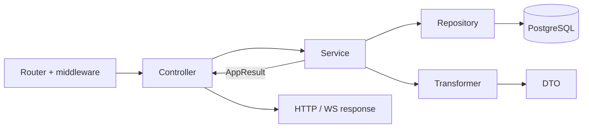
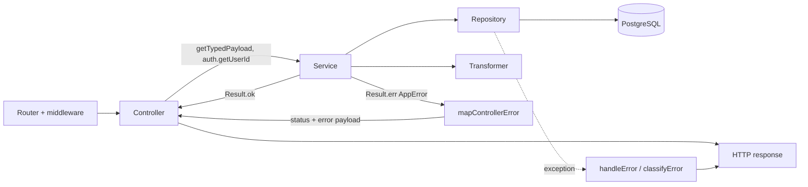

# Services

A service is the **heart of the application**: this is where business rules, permission and resource-ownership checks, and orchestration of several repositories and external integrations (email, push, LLM, Sentry, Redis) live. A service does not know where the call came from — an HTTP controller, a WS handler, or a background script — and returns the result as an `AppResult<T>` value, not as an HTTP response.

## Why this layer exists

- **Business logic in one place.** A rule like "a user can delete only their own push subscription" or "after N failed attempts — `429`" is written once in the service and works the same for every entry point.
- **Independence from the transport.** A service has no access to `responseData`, cookies, or sockets. It can be called from any controller, from another service, or from a test without starting a server.
- **Explicit expected errors in the types.** What the client must tell apart (`NotFound`, `Conflict`, `RateLimited`, a wrong password), the service returns as `Result.err(AppError)`. TypeScript will not let a controller forget to handle such an error, and the tag unambiguously determines the HTTP status.
- **Infrastructure failures are thrown** ([ADR 0004](https://github.com/Blazheiko/vibe-template/blob/main/docs/adr/0004-result-for-expected-outcomes.md)). A repository, Redis or S3 call is not wrapped: the exception reaches the transport, and `classifyError` produces a 500 `internal_error` (or 503 for Redis) with a log entry and a Sentry event. The session cookie the request already set (for example, after login) goes into the response; the handler's other cookies are discarded.
- **The main place for tests.** Since all the logic is here and the dependencies are plain ES imports, a service is tested with mocked repositories and transformers, without a DB.



## Structure

Services live in [`src/app/services`](https://github.com/Blazheiko/vibe-template/tree/main/packages/backend/src/app/services). There are no index files in the domains — imports go from the specific file.

| Domain           | Responsibility                                                                             |
| ---------------- | ------------------------------------------------------------------------------------------ |
| `actions/`       | Only the `ToolDefinition` / `ToolCallHandler` types for tool calls                         |
| `admin/`         | Online users, online history, admin subscription to the WS channel                         |
| `ai/`            | LLM provider adapters (OpenAI, Mistral, xAI), prompts, usage tracking (`usage/`)           |
| `auth/`          | Registration/login, OAuth, password reset, email/SMS verification, throttle, WS token      |
| `communication/` | Broadcast, presence in WS, online status, the WebSocket URL                                |
| `core/`          | `mainService`: init, session, WS token refresh                                             |
| `notifications/` | Email, push subscriptions and push sending                                                 |
| `observability/` | Sentry integration                                                                         |
| `shared/`        | `AppError`/`AppResult`, 5xx logging (`reportAppError`), error-to-HTTP/WS mapping, language |
| `statistics/`    | Push subscription statistics                                                               |
| `support/`       | Support chat, knowledge base, embeddings, LLM, request translation                         |
| `user/`          | Avatar                                                                                     |

## How services are declared

There is no DI container. A service is a module singleton object (`export const authService = { ... }`, [auth-service.ts](https://github.com/Blazheiko/vibe-template/blob/main/packages/backend/src/app/services/auth/auth-service.ts)) or a standalone function (`export async function consumeAuthThrottle`, [auth-throttle-service.ts](https://github.com/Blazheiko/vibe-template/blob/main/packages/backend/src/app/services/auth/auth-throttle-service.ts)). Dependencies are plain ES imports of repositories and transformers from `#app/repositories/index.js` and `#app/transformers/index.js` (see [Repositories](/en/backend/repositories)). A factory is used only for the AI adapter: `export const textAdapter = createTextAdapter()` in [ai-provider.ts](https://github.com/Blazheiko/vibe-template/blob/main/packages/backend/src/app/services/ai/ai-provider.ts).

## Results and errors

Services return `AppResult<T> = Result<T, AppError>` from `better-result` for expected outcomes, and throw on infrastructure failures. `AppError` is a union discriminated by `_tag` ([errors.ts](https://github.com/Blazheiko/vibe-template/blob/main/packages/backend/src/app/services/shared/errors.ts)); the constructors are `badRequest` (400), `unauthorized` and `sessionRevoked` (401, `reason: session_revoked`), `forbidden` (403), `notFound` (404), `conflict` (409), `rateLimited` (429), `internal` and `internalMessage` (500, without a `cause`), `serviceUnavailable` (503), and `upstreamError` (502) and `upstreamTimeout` (504) for AI provider failures. Repository calls are not wrapped ([ADR 0004](https://github.com/Blazheiko/vibe-template/blob/main/docs/adr/0004-result-for-expected-outcomes.md)); a best-effort step (deleting an old file from S3) catches the exception locally and writes a `warn`. An example is [Step 6](/en/backend/adding-a-feature#step-6-service).

Business rules (resource owner checks, throttle, token generation, messages) live in services.

## Testing services

`*.spec.ts` tests live next to the service. The pattern: mock `#app/repositories/index.js` and `#app/transformers/index.js` with `vi.mock`, import the service dynamically after the mocks, check `Result.isOk` / `Result.isError` for expected outcomes and `rejects` for a repository failure. A snippet from [push-subscription-service.spec.ts](https://github.com/Blazheiko/vibe-template/blob/main/packages/backend/src/app/services/notifications/push-subscription-service.spec.ts):

```ts
vi.mock('#app/repositories/index.js', () => ({
    pushSubscriptionRepository: pushSubscriptionRepositoryMock,
}))

afterEach(() => {
    vi.resetModules()
    vi.clearAllMocks()
})

it('returns serialized subscriptions', async () => {
    pushSubscriptionRepositoryMock.findByUserIdWithLogs.mockResolvedValue([{ id: 1n }])

    const { pushSubscriptionService } = await import('./push-subscription-service.js')
    const result = await pushSubscriptionService.getSubscriptions(7n)

    expect(Result.isOk(result)).toBe(true)
})
```

## Call flow



## Service checklist

- [ ] business rules, permission and ownership checks;
- [ ] repository calls (unwrapped, a failure is thrown) and serialization through transformers;
- [ ] external integrations (email, push, LLM, Sentry);
- [ ] `AppResult<T>` for expected outcomes, with no access to `responseData`.

## Related layers

- [Controllers](/en/backend/controllers) — HTTP/WS adapters: they accept a request and return a response.
- [Services](/en/backend/services) — business logic, return `AppResult<T>`.
- [Repositories](/en/backend/repositories) — the only place where SQL is written.
- [Transformers](/en/backend/transformers) — turning DB rows into public DTOs.

For the overall picture see [Architecture](/en/backend/architecture), and for a step-by-step example see [Adding a feature](/en/backend/adding-a-feature).
