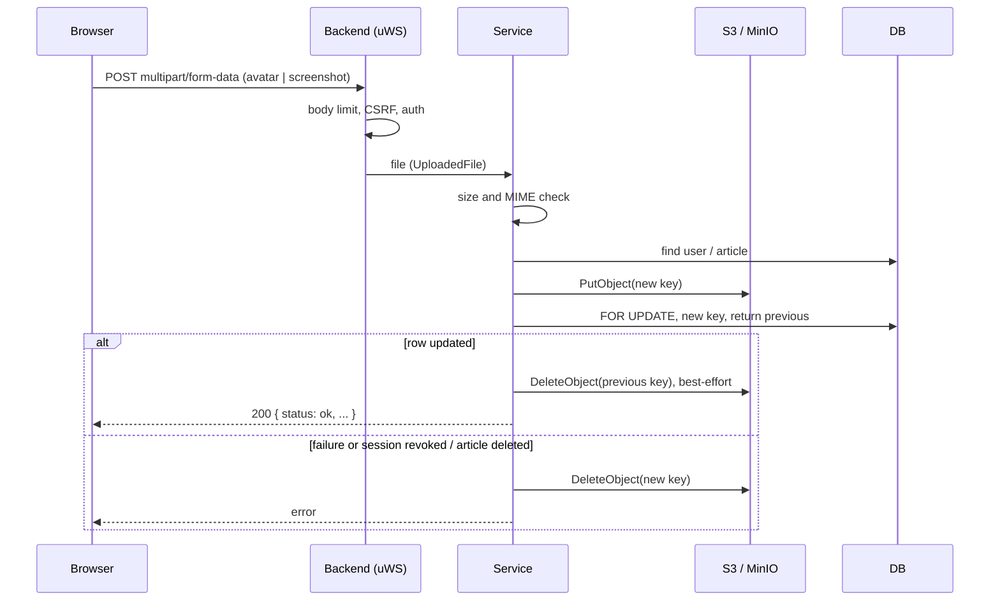

# File storage (S3)

The backend stores user files in S3-compatible storage (AWS S3, MinIO, DigitalOcean Spaces, etc.). All work with it goes through a single wrapper module over `@aws-sdk/client-s3`: [`s3.ts`](https://github.com/Blazheiko/vibe-template/blob/main/packages/backend/src/vendor/utils/storage/s3.ts). Currently two features use the storage: user avatars and knowledge base (support) article screenshots.

The `S3_*` environment variables are described in the [S3 storage](/en/backend/configuration#s3-storage) section. We do not repeat them here.

## Client setup

The config is read from [`config/disk.ts`](https://github.com/Blazheiko/vibe-template/blob/main/packages/backend/src/config/disk.ts): `s3Region`, `s3AccessKeyId`, `s3SecretAccessKey`, `s3Endpoint`, `s3Bucket`, `s3Prefix`, `s3StaticDataPrefix`, `s3DynamicDataPrefix`.

[`s3.ts`](https://github.com/Blazheiko/vibe-template/blob/main/packages/backend/src/vendor/utils/storage/s3.ts) creates a single `S3Client` when the module is imported:

- **Endpoint.** If `S3_ENDPOINT` is empty, the SDK works with standard AWS. If the endpoint is set without a scheme, `https://` is added to it. This is how the old `minio` client behaved.
- **Region.** `S3_REGION` or `us-east-1`. An empty string is also replaced with the default (`||`, not `??`), because the SDK does not accept an empty region.
- **`forcePathStyle`** is enabled for any custom endpoint that does not contain `amazonaws.com`. So MinIO and Spaces are addressed path-style (`https://host/bucket/key`).
- **`requestChecksumCalculation` / `responseChecksumValidation` = `WHEN_REQUIRED`.** Newer SDK versions add CRC checksums by default, and some S3-compatible stores reject such requests.
- At startup, `endpoint`, `bucket` and `region` are written to the log. Access keys never reach the log.

The test [`s3.spec.ts`](https://github.com/Blazheiko/vibe-template/blob/main/packages/backend/src/vendor/utils/storage/s3.spec.ts) checks three scenarios: `buildObjectKey` adds the configured prefixes, `deleteFromS3` deletes the key with the same prefixes as upload and presign, and an endpoint without a scheme yields HTTPS and path-style addressing.

## Object keys

`buildObjectKey(key)` (exported from `s3.ts`) builds the full key like this: `${S3_PREFIX ?? 'app'}/${S3_DYNAMIC_DATA_PREFIX ?? 'uploads'}/${key}`. Slashes at the edges of the prefixes are trimmed. Only the **relative** key is stored in the database:

| Data                  | Relative key                              | Where it is built                                                                                                                                     |
| --------------------- | ----------------------------------------- | ----------------------------------------------------------------------------------------------------------------------------------------------------- |
| Avatar                | `avatars/<userId>/<uuid>.<ext>`           | [avatar-service.ts](https://github.com/Blazheiko/vibe-template/blob/main/packages/backend/src/app/services/user/avatar-service.ts)                    |
| KB article screenshot | `knowledge-base/<articleId>/<uuid>.<ext>` | [knowledge-base-service.ts](https://github.com/Blazheiko/vibe-template/blob/main/packages/backend/src/app/services/support/knowledge-base-service.ts) |

The extension (`jpg`, `png`, `webp`) and the object's `ContentType` come from the type detected from the file content (see below); the client's file name does not affect the key.

## Module operations

| Function                                       | What it does                                                                                                                                                     |
| ---------------------------------------------- | ---------------------------------------------------------------------------------------------------------------------------------------------------------------- |
| `uploadToS3(key, body, contentType, options?)` | `PutObjectCommand` with `buildObjectKey(key)`, `ContentType` and `ContentLength`. Optionally passes `ACL: 'public-read'` (`publicRead`) and `ContentDisposition` |
| `deleteFromS3(key)`                            | `DeleteObjectCommand` with `buildObjectKey(key)`: like the other functions, it takes a relative key                                                              |
| `presignUrl(key, expirySeconds = 3600)`        | Presigned **GET** URL via `@aws-sdk/s3-request-presigner` (`getSignedUrl`)                                                                                       |
| `downloadFromS3(key)`                          | `GetObjectCommand`, returns `{ data: Buffer, contentType }`                                                                                                      |

Presigned PUT and multipart upload from the browser directly into the bucket are **not implemented** in the code.

## How uploading works

Both scenarios work the same way: the browser sends `multipart/form-data` **to the backend**, and the backend checks the file and puts it into S3 itself.

- **Avatar:** `POST /avatar/upload`, field `avatar`, middleware `session_web`, `csrf_guard`, `auth_guard`. Deletion: `DELETE /avatar/` ([http-routes.ts](https://github.com/Blazheiko/vibe-template/blob/main/packages/backend/src/app/routes/http-routes.ts), [avatar-controller.ts](https://github.com/Blazheiko/vibe-template/blob/main/packages/backend/src/app/controllers/http/user/avatar-controller.ts)).
- **KB screenshot:** `POST /admin/knowledge-base/:id/screenshot`, field `screenshot`, additionally `admin_guard` ([admin-knowledge-base-controller.ts](https://github.com/Blazheiko/vibe-template/blob/main/packages/backend/src/app/controllers/http/admin/admin-knowledge-base-controller.ts)).

Both routes have `allowedContentTypes: ['multipart']` and `EmptyFormInputSchema`. The global body limit for multipart is set by `APP_MAX_MULTIPART_BODY_SIZE` (50 MB by default, [app.ts](https://github.com/Blazheiko/vibe-template/blob/main/packages/backend/src/config/app.ts)), but each of the two routes **narrows it with its own `maxBodySize`**: the allowed file size plus headroom for the multipart wrapper (`MULTIPART_OVERHEAD_BYTES`, 64 KiB: boundary lines, part headers, a few small text fields). For the avatar this is 10 MiB + 64 KiB, for the KB screenshot 5 MiB + 64 KiB ([upload-limits.ts](https://github.com/Blazheiko/vibe-template/blob/main/packages/backend/src/app/services/shared/upload-limits.ts)). A file exactly at the allowed size passes, while a body over the limit is rejected with `413` before reading (by `Content-Length`) or in the middle of the stream (chunked), so 50 MB is not collected in memory for a file the service would reject anyway. The `avatar` group additionally has a rate limit of 10 requests per minute per IP. The file check in the service remains (it gives a clear `400` error). For more on body reading, see [Request lifecycle](/en/backend/request-lifecycle).

Checks in the services:

| Feature    | Max size | Allowed MIME                            |
| ---------- | -------- | --------------------------------------- |
| Avatar     | 10 MB    | `image/jpeg`, `image/png`, `image/webp` |
| Screenshot | 5 MB     | `image/png`, `image/jpeg`, `image/webp` |

The type is checked **by content**: [`detectImageType`](https://github.com/Blazheiko/vibe-template/blob/main/packages/backend/src/vendor/utils/storage/detect-image-type.ts) reads the file signature (PNG `89 50 4E 47 0D 0A 1A 0A`, JPEG `FF D8 FF`, WebP `RIFF…WEBP`). A file is accepted only when the detected type is allowed **and** matches the `Content-Type` declared in the multipart part; otherwise `400 bad_request` ("Invalid file type"). GIF, SVG and other formats are not recognized and are rejected.

Replacing an avatar and a KB screenshot follows the same order ([avatar-service.ts](https://github.com/Blazheiko/vibe-template/blob/main/packages/backend/src/app/services/user/avatar-service.ts), [knowledge-base-service.ts](https://github.com/Blazheiko/vibe-template/blob/main/packages/backend/src/app/services/support/knowledge-base-service.ts)):

1. The new object is uploaded under a new random key. If S3 refused, the row and the old object stay as they were.
2. The row is locked (`SELECT … FOR UPDATE` in a transaction), the new key is written into it, and the repository returns **the key that was in the row at that moment** (`replaceAvatarIfSessionToken`, `replaceScreenshot`). For the avatar this happens only while the session is still current.
3. Exactly that previous key is deleted (best-effort: an error is only written to the log as `warn`).

If step 2 changed nothing (the session was revoked, the article was deleted), the just-uploaded object is deleted. If step 2 **threw an error**, the transaction could have committed while the response was lost (connection dropped on `COMMIT`). So the new object is deleted only when PostgreSQL itself answered with an error (it has an SQLSTATE and `severity`; a Node code like `EPIPE` or `EPERM` is not such an answer, feat-135), meaning the transaction was rolled back (feat-130). If there was no answer (timeout, dropped connection), the object stays with a `warn`, because an extra file in storage is less harmful than a broken image. Re-reading the row (feat-125) did not distinguish these cases: from another connection, a `COMMIT` still in flight (synchronous replication, a hung socket) is not visible. The previous key is taken from the locked row, not from a read before the upload. So of two parallel replacements, each deletes what the other wrote, and exactly the object the row points to remains in storage. Deleting an avatar or a screenshot, as well as deleting an article (`DELETE … RETURNING screenshot_key`), likewise delete the key obtained from that same query: an upload that slipped in between the read and the delete does not leave an orphaned object. Changing a screenshot does not change the article's `content_version`, so it does not invalidate its indexing ([AI → Text version](/en/backend/ai)).



## How files are served

- **Avatars** are uploaded with `ACL: public-read` (decision R1) and read directly from the CDN. The backend gives the frontend `cdnUrl` (`CDN_URL`), `s3Prefix` and `s3DynamicDataPrefix` ([main-service.ts](https://github.com/Blazheiko/vibe-template/blob/main/packages/backend/src/app/services/core/main-service.ts)). The frontend builds the URL in `getStorageFileUrl` ([storage-url.ts](https://github.com/Blazheiko/vibe-template/blob/main/packages/frontend/src/utils/storage-url.ts), [avatar-url.ts](https://github.com/Blazheiko/vibe-template/blob/main/packages/frontend/src/utils/avatar-url.ts)). If `CDN_URL` is empty, the avatar is not shown.
- **KB screenshots** are public: this is reference content, not a secret. The admin uploads them with `ACL: public-read` ([knowledge-base-service.ts](https://github.com/Blazheiko/vibe-template/blob/main/packages/backend/src/app/services/support/knowledge-base-service.ts)). `GET /support/screenshot/:articleId` (requires `auth_guard`) responds, for an **active** article, with `302` and `Location: <CDN_URL>/<full key>` ([support-controller.ts](https://github.com/Blazheiko/vibe-template/blob/main/packages/backend/src/app/controllers/http/support/support-controller.ts)). If `CDN_URL` is empty, the route returns `404`. For a deactivated article (`isActive = false`) the response is `404` as well: deactivation takes the article out of the support chat together with its screenshot (feat-160). The file itself stays public in the storage under its key (the key contains a UUID and cannot be guessed).

::: warning Rule: support chat media only from our CDN
Images and links that the user sees in the support chat must lead only to our origin or to `CDN_URL`. Direct links to the S3 endpoint, presigned URLs and third-party hosts are forbidden: `img-src` in the CSP allows only `'self'` and the `CDN_URL` origin, and the browser checks the origin after a redirect too. Screenshots uploaded before this change without `public-read` must be made public (ACL or a bucket policy for the `knowledge-base/` prefix), otherwise the CDN will return `403`.
:::

::: warning Avatars uploaded before feat-023
Previously, avatars went into the bucket without `public-read`. If the bucket or prefix is not opened by the storage or CDN policy, such old objects stay private: they must be re-uploaded or have their ACL set separately.
:::

## Local development

[`docker-compose.yml`](https://github.com/Blazheiko/vibe-template/blob/main/docker-compose.yml) has an `s3` service: SeaweedFS in `weed mini` mode on port `8333` (`make services-up` or `pnpm services:up` starts it together with PostgreSQL, Redis and Mailpit). The `S3_BUCKET` bucket is created on start, the key is `S3_ACCESS_KEY_ID` / `S3_SECRET_ACCESS_KEY` (dev defaults `devaccesskey` / `devsecretkey`), and anonymous reads are allowed only under `S3_BUCKET/S3_PREFIX/`, so avatars and screenshots open from `CDN_URL`. For a backend on the host, set this in `packages/backend/.env` (as [`.env.example`](https://github.com/Blazheiko/vibe-template/blob/main/packages/backend/.env.example) suggests too):

```bash
S3_ENDPOINT=http://127.0.0.1:8333   # without a scheme it will be https://
S3_REGION=us-east-1
S3_BUCKET=vibe-template
S3_ACCESS_KEY_ID=devaccesskey
S3_SECRET_ACCESS_KEY=devsecretkey
S3_PREFIX=app
S3_DYNAMIC_DATA_PREFIX=uploads
CDN_URL=http://127.0.0.1:8333/vibe-template
```

For a local endpoint path-style is enabled automatically. The application container of the `app` profile gets the same variables from `docker-compose.yml` and writes to `http://s3:8333` over the compose network.

The bucket CORS is described by [`corsS3.xml`](https://github.com/Blazheiko/vibe-template/blob/main/corsS3.xml): only `GET` and `HEAD` from the app origin (the placeholder `https://app.example.com`, replace it with your own). All uploads and deletions go through the backend with server-side keys, so the browser does not need `PUT`/`POST`. For an example with several environments, see [`corsS3.prod.example.xml`](https://github.com/Blazheiko/vibe-template/blob/main/corsS3.prod.example.xml). It is applied to the bucket manually; the code does not read these files.

## Security

- KB screenshots and avatars are public and served through `CDN_URL`. `presignUrl` (default TTL 3600 s) is not used in browser scenarios: its host is the S3 endpoint, which is not in the CSP `img-src`.
- `ACL: public-read` is used by both uploads: avatars and KB screenshots.
- Object names are generated by the server (`randomUUID`), so the client cannot choose the path or overwrite someone else's file.
- Keep the `S3_*` secrets only in the environment, see [Security](/en/backend/security#production-checklist).
