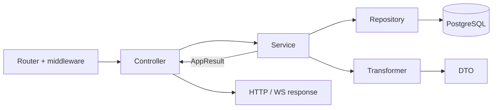

# Transformers

A transformer is a **pure serialization function**: it takes a row returned by a repository (with a `bigint` id, `Date` objects and internal fields) and turns it into a public DTO that is safe to send to the client as JSON.

## Why this layer exists

- **Data safety.** A `users` row contains the password hash and `sessionToken`. The transformer explicitly drops these fields, so they never end up in a response even if a service returns the "whole user". Without this layer it is easy to leak something extra to the client by accident.
- **JSON compatibility.** `bigint` is not serialized by `JSON.stringify`, and `Date` must be returned in a single format. The transformer converts ids to `string` and dates to a UTC ISO string (`toISOString()`). The response schema describes this already-converted format — see [Response validation](/en/backend/response-validation#how-a-response-is-checked).
- **Stable public contract.** Internal column names (`createdAt`) may change, while the client expects `created_at`. The transformer is the one place that defines how an entity looks from the outside; derived fields (`emailVerified: boolean` instead of `emailVerifiedAt`) are added here too.
- **Reuse.** The same user is returned from login, registration and OAuth — all of them call `userTransformer.serialize`, so the response shape is identical.
- **Easy to test.** A transformer has no dependencies or side effects: input row → output object.



## How they work

Transformers in [`app/transformers/`](https://github.com/Blazheiko/vibe-template/blob/main/packages/backend/src/app/transformers/index.ts) are objects with `serialize` / `serializeArray` methods (push subscriptions also have `serializeWithLogs` / `serializeArrayWithLogs`, and push logs have `serializeSummary`). There are `userTransformer`, `pushSubscriptionTransformer`, `pushNotificationLogTransformer` and `promptTransformer`. They:

- convert `bigint` ids to `string`;
- convert `Date` to a UTC ISO string via `toISOString()` (the format `2026-10-25T10:00:00.000Z` does not depend on the process time zone); `userTransformer` and `pushSubscriptionTransformer` also rename `createdAt`/`updatedAt` → `created_at`/`updated_at`;
- strip sensitive fields: [user-transformer.ts](https://github.com/Blazheiko/vibe-template/blob/main/packages/backend/src/app/transformers/user-transformer.ts) drops `password` and `sessionToken` (the session namespace in Redis, see [Authentication](/en/backend/auth#what-usertoken-is)) and adds the derived `emailVerified: boolean`.

```ts
serialize(user: UserRow): SerializedUser {
    const { id, password: _password, sessionToken: _sessionToken, createdAt, updatedAt, emailVerifiedAt, ...rest } = user
    return { ...rest, id: String(id), created_at: createdAt.toISOString(), /* ... */ }
}
```

The result type (`SerializedUser`, `SerializedPushSubscription`) is derived from the row type via `Omit<...> & {...}`, so it lives in the backend and is **not imported** from `packages/shared`. Response schemas in [packages/shared/src/responses](https://github.com/Blazheiko/vibe-template/blob/main/packages/shared/src/responses/main-controller.ts) are described separately (ArkType). The DTO-to-schema match is checked by the compiler — `defineRoute` compares the controller result with the schema ([Handler response type](/en/backend/routing#handler-response-type)) — and by response validation at runtime ([Response validation](/en/backend/response-validation)).

## Where they are used

Transformers are called in **services**: `userTransformer` in [auth-service.ts](https://github.com/Blazheiko/vibe-template/blob/main/packages/backend/src/app/services/auth/auth-service.ts); `pushSubscriptionTransformer` in [push-subscription-service.ts](https://github.com/Blazheiko/vibe-template/blob/main/packages/backend/src/app/services/notifications/push-subscription-service.ts) and [push-subscription-statistics-service.ts](https://github.com/Blazheiko/vibe-template/blob/main/packages/backend/src/app/services/statistics/push-subscription-statistics-service.ts).

`pushNotificationLogTransformer` is used in `push-subscription-service.ts` and inside `pushSubscriptionTransformer.serializeWithLogs`; `promptTransformer` in [prompt-controller.ts](https://github.com/Blazheiko/vibe-template/blob/main/packages/backend/src/app/controllers/http/ai/prompt-controller.ts) (the prompts service caches DB rows).

Exceptions: `mainService.init` assembles the user object by hand (see ["Architecture"](/en/backend/architecture)); admin lists, the knowledge base, and support and online history serialize rows in their own services without a dedicated transformer.

## Testing

Transformers are pure functions, so they are tested without mocks: [user-transformer.spec.ts](https://github.com/Blazheiko/vibe-template/blob/main/packages/backend/src/app/transformers/user-transformer.spec.ts) checks that `password` and `sessionToken` do not end up in the DTO. In service tests, transformers are mocked through the barrel:

```ts
vi.mock('#app/transformers/index.js', () => ({
    pushSubscriptionTransformer: pushSubscriptionTransformerMock,
}))
```

## Related layers

- [Controllers](/en/backend/controllers) — HTTP/WS adapters: they accept a request and return a response.
- [Services](/en/backend/services) — business logic, return `AppResult<T>`.
- [Repositories](/en/backend/repositories) — the only place where SQL is written.
- [Transformers](/en/backend/transformers) — turning DB rows into public DTOs.

For the overall picture see [Architecture](/en/backend/architecture); for a step-by-step example see [Adding a feature](/en/backend/adding-a-feature).
