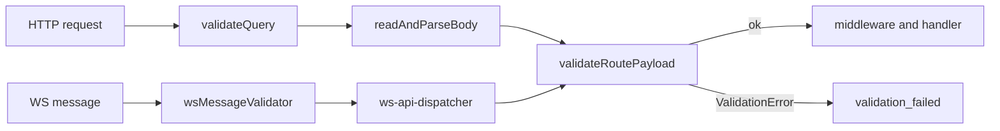

# Validation

Input data (the HTTP request body, query, the payload of a WS message, and the WS message envelope itself) is checked with ArkType schemas (`@arktype/type`). The server core (`vendor/`) does not work with ArkType directly, but with the neutral `Validator<T>` contract; the concrete library is plugged in by an adapter in `app/validate`. The general request processing order is described in [Request lifecycle](/en/backend/request-lifecycle), and route fields in [Routing and middleware](/en/backend/routing). Checking output data against `ResponseSchema` is described in [Response validation](/en/backend/response-validation).

## A quick example

**Task:** the `POST /api/notes` route must accept only a non-empty `title` of up to 200 characters and an optional `body`, and reject everything else.

1. Describe the schema in `shared` (from the tutorial [How to add a feature](/en/backend/adding-a-feature#step-1-input-schema-in-shared)):

    ```ts
    export const CreateNoteInputSchema = type({
        title: '1 <= string <= 200',
        'body?': 'string <= 5000',
        '+': 'reject', // extra fields are an error
    })
    ```

2. Write it as `body` in the schema registry entry for the route's contract (for query, `query`); the route names only the contract ([step 8 of the tutorial](/en/backend/adding-a-feature#step-8-contract-and-route-registration)):

    ```ts
    // app/routes/contract-schemas/notes.ts
    create: { body: CreateNoteInputSchema, response: ResponseSchemas.CreateNoteResponseSchema },
    ```

3. In the controller, take the already validated data: `getTypedPayload(context)` returns `CreateNoteInput`.

**Result:** an invalid request never reaches the controller.

| Request body                | Response                                        |
| --------------------------- | ----------------------------------------------- |
| `{"title":"Buy milk"}`      | `200`, note created                             |
| `{"title":""}`              | `422`, `"messages":["title must be non-empty"]` |
| `{"title":"x","done":true}` | `422`, `"messages":["done must be removed"]`    |

Checking the shape of the data (type, length, extra fields) belongs in the schema. Checking the substance (whether the record exists, whether the user is allowed) belongs in the service, see [First route](/en/guide/first-endpoint#step-2-service). Below is how it all works inside.

## The `Validator<T>` contract

[vendor/contracts/validator.ts](https://github.com/Blazheiko/vibe-template/blob/main/packages/backend/src/vendor/contracts/validator.ts):

```ts
// One problem of a field; `path` is dot-separated (`nested.name`), `''` for the root.
export interface ValidationIssue {
    path: string
    message: string
}

export type ValidationResult<T> =
    { ok: true; value: T } | { ok: false; messages: string[]; issues?: ValidationIssue[] }

export interface Validator<T> {
    validate(input: unknown): ValidationResult<T>
    describe?(): unknown
}

export type InferPayload<V> = V extends Validator<infer T> ? T : unknown
```

- `validate` is synchronous and does not throw exceptions; it returns a union result.
- `describe` is optional: it returns the schema for route documentation (`GET /<prefix>/doc/routes` and the api-playground). [serialize-routes.ts](https://github.com/Blazheiko/vibe-template/blob/main/packages/backend/src/vendor/utils/routing/serialize-routes.ts) understands three forms of the result:
    - an ArkType type: converted by [serialize-ark-schema.ts](https://github.com/Blazheiko/vibe-template/blob/main/packages/backend/src/vendor/utils/tooling/serialize-ark-schema.ts);
    - a ready-made description `{ expression: string, fields?: { name, type, required }[], jsonSchema? }`: passed through as is, invalid `fields` items are dropped;
    - a JSON Schema object (has `type`, `properties`, `anyOf`, `oneOf`, `allOf`, `$ref`, `enum` or `const`): `fields` is taken from the top-level `properties` and `required`, `expression` from `type`, and the schema itself goes into `jsonSchema`.

    Any other result, or a missing `describe`, means the route is serialized without `inputSchema` / `querySchema`.

### ArkType adapter

[app/validate/adapters/arktype-adapter.ts](https://github.com/Blazheiko/vibe-template/blob/main/packages/backend/src/app/validate/adapters/arktype-adapter.ts) — `arkValidator(schema)` calls the schema, and if the result is `type.errors`, returns `{ ok: false, messages, issues }`: `issues` has one `{ path, message }` entry per ArkType error (`path` is `propString`, for example `nested.name`; `''` for the root), and `messages` holds the same `message` values as strings. A custom adapter may omit `issues`, in which case the error contains only `messages`. `describe()` returns the schema itself.

The active engine is pinned by a single line in [app/validate/index.ts](https://github.com/Blazheiko/vibe-template/blob/main/packages/backend/src/app/validate/index.ts):

```ts
export { arkValidator as defaultValidator, arkValidator } from './adapters/arktype-adapter.js'
```

## How a route gets its validator

A route gets a **schema**, not a validator. An HTTP route takes its schemas from the registry entry of its contract (`body`, `query`, `response` in [`app/routes/contract-schemas/`](https://github.com/Blazheiko/vibe-template/blob/main/packages/backend/src/app/routes/contract-schemas/index.ts)), and `defineRoute` ([contract-registry.ts](https://github.com/Blazheiko/vibe-template/blob/main/packages/backend/src/app/routing/contract-registry.ts)) wraps them itself via `defaultValidator` into the `validator` and `queryValidator` fields. A WS route passes the schema to `validator` directly, and `defineWsRoute` wraps it ([define-ws-route.ts](https://github.com/Blazheiko/vibe-template/blob/main/packages/backend/src/app/routing/define-ws-route.ts)). There is no need to wrap `arkValidator(...)` manually.

- `validator` is the schema of the body (HTTP, from `body` of the registry entry) or payload (WS). On HTTP it is allowed only for `post`, `put` and `patch` (for them the `route-contracts.spec.ts` test requires it); on `get`/`delete` it causes a startup error, because the body is not read there ([Methods and request body](/en/backend/routing#methods-and-request-body)). Without `Content-Type` and without a body, `{}` is validated, so a handler with a `validator` never receives `payload = null` (except for `octet` routes).
- `queryValidator` is the query schema (HTTP only, from `query` of the registry entry). `defineRoute` applies `onUndeclaredKey("reject")` to it (extra keys cause an error) or, with `queryAllowExtra: true`, `onUndeclaredKey("delete")` (extra keys are removed). `queryArrays` lists the keys that may repeat (collected into `string[]`); see [flatten-query.ts](https://github.com/Blazheiko/vibe-template/blob/main/packages/backend/src/vendor/utils/validation/flatten-query.ts).

Example from [http-routes.ts](https://github.com/Blazheiko/vibe-template/blob/main/packages/backend/src/app/routes/http-routes.ts):

```ts
// app/routes/contract-schemas/auth.ts — the registry entry
login: {
    body: LoginInputSchema,
    response: ResponseSchemas.LoginResponseSchema,
},

// app/routes/http-routes.ts — the route
defineRoute({
    contract: authContracts.login,
    handler: AuthController.login.bind(AuthController),
    description: 'Login a user by email or phone identifier',
}),
```

### Type inference

`defineRoute` infers the `payload` type from the output of the registry entry's `body` schema, and the `query` type from the output of the `query` schema (or `null` if the entry has none). The handler result is checked against the input type (`inferIn`) of the `response` schema; see [Handler response type](/en/backend/routing#handler-response-type). For handlers declared separately (controller methods) there is the helper `InferQuery<typeof Schema>` in [app/validate/index.ts](https://github.com/Blazheiko/vibe-template/blob/main/packages/backend/src/app/validate/index.ts); at the contract level there is `InferPayload<V>`. In shared schemas the type is usually exported next to the schema via `typeof Schema.infer` / `["inferIn"]`.

## Where validation runs

All paths come down to [validateRoutePayload](https://github.com/Blazheiko/vibe-template/blob/main/packages/backend/src/vendor/utils/validation/validate-route-payload.ts): it calls `validator.validate`, and on `ok: false` does `throw new ValidationError(messages, undefined, issues)`.



- **HTTP query**: `validateQuery` in [server.ts](https://github.com/Blazheiko/vibe-template/blob/main/packages/backend/src/vendor/start/server.ts), before the body is read. Without `queryValidator`, `httpData.query === null`.
- **HTTP body**: `readAndParseBody` in the same file, after parsing, if there is a `route.validator` and the payload is not `null`. Without a validator the payload becomes `null` (see [Lifecycle](/en/backend/request-lifecycle)).
- **WS envelope**: [ws-message-validator.ts](https://github.com/Blazheiko/vibe-template/blob/main/packages/backend/src/app/validate/ws-message-validator.ts) (`{ payload, event, timestamp }`) is registered in [app/start/index.ts](https://github.com/Blazheiko/vibe-template/blob/main/packages/backend/src/app/start/index.ts) via `registerWsMessageValidator` and is called in `onMessage` of [ws-handlers.ts](https://github.com/Blazheiko/vibe-template/blob/main/packages/backend/src/vendor/utils/network/ws-handlers.ts).
- **WS payload**: in [ws-api-dispatcher.ts](https://github.com/Blazheiko/vibe-template/blob/main/packages/backend/src/vendor/utils/routing/ws-api-dispatcher.ts), after rate limit and before middleware. Details: [WebSocket](/en/backend/websocket).

## Schemas

| Location                                                                                                        | Purpose                                                                                                   |
| --------------------------------------------------------------------------------------------------------------- | --------------------------------------------------------------------------------------------------------- |
| [packages/shared/src/schemas](https://github.com/Blazheiko/vibe-template/tree/main/packages/shared/src/schemas) | main input schemas (auth, main, support, push-subscription, query, ws...), shared by frontend and backend |

Example schema ([shared/src/schemas/auth/register-email.ts](https://github.com/Blazheiko/vibe-template/blob/main/packages/shared/src/schemas/auth/register-email.ts)):

```ts
import { type } from '@arktype/type'

export const RegisterEmailInputSchema = type({
    name: 'string >= 1 & string <= 100',
    email: 'string.email & string <= 255',
    password: 'string >= 8 & string <= 32',
    token: 'string <= 60',
    '+': 'reject',
})

export type RegisterEmailInput = typeof RegisterEmailInputSchema.infer
```

`'+': 'reject'` forbids unknown keys. Query schemas arrive as strings, so they use parser morphs, e.g. `type('string.integer.parse').pipe(type('number > 0'))` in [query/common.ts](https://github.com/Blazheiko/vibe-template/blob/main/packages/shared/src/schemas/query/common.ts); default values are set with `.default('50')` (previously this was done with tuple casts `[schema, '=', '50']`, which `@arktype/type` 2.2.9 no longer needs), and what the schema infers for the handler is pinned in [`type-checks.ts`](https://github.com/Blazheiko/vibe-template/blob/main/packages/shared/src/schemas/query/type-checks.ts) and compared at compile time.

## Checkers: headers, cookies, parameters

[app/validate/checkers](https://github.com/Blazheiko/vibe-template/tree/main/packages/backend/src/app/validate/checkers) are not schemas but regex/length checks for the "raw" transport. They are used in [http-request-handlers.ts](https://github.com/Blazheiko/vibe-template/blob/main/packages/backend/src/vendor/utils/network/http-request-handlers.ts):

| Checker             | Rules                                                                                | Behavior on violation                              |
| ------------------- | ------------------------------------------------------------------------------------ | -------------------------------------------------- |
| `validateHeader`    | name `^[a-zA-Z0-9\-_]+$`, 1–256 characters; value: printable ASCII and tab, ≤ 3072   | header is silently dropped (`getHeaders`)          |
| `validateCookie`    | name/value by regex, limit `appConfig.reasonableCookieLimit`, valid percent-encoding | cookie is silently dropped (`parseCookies`)        |
| `validateParameter` | `^[a-zA-Z0-9\-_./]*$`, ≤ 256 characters                                              | `ParameterValidationError` → **400** `bad_request` |

## Error format

[ValidationError](https://github.com/Blazheiko/vibe-template/blob/main/packages/backend/src/app/validate/errors/validation-error.ts) has `code = "validation_failed"`, `statusCode = 422`, `messages: string[]` and `issues?: ValidationIssue[]`.

HTTP response (the error handler in [server.ts](https://github.com/Blazheiko/vibe-template/blob/main/packages/backend/src/vendor/start/server.ts)) has status **422**:

```json
{
    "status": "error",
    "code": "validation_failed",
    "message": "Validation failure",
    "details": {
        "kind": "validation",
        "messages": [
            "email must be an email address (was \"x\")",
            "password must be at least length 8 (was 3)"
        ],
        "issues": [
            { "path": "email", "message": "email must be an email address (was \"x\")" },
            { "path": "password", "message": "password must be at least length 8 (was 3)" }
        ]
    }
}
```

`messages` has one string per field (previously a single `summary` string with all errors); clients that display `messages` work as before. To highlight fields in a form, use `issues[].path`. The type is `ValidationErrorDetails` in [`shared/src/errors/error-codes.ts`](https://github.com/Blazheiko/vibe-template/blob/main/packages/shared/src/errors/error-codes.ts).

A path parameter error has status **400**, `code: "bad_request"`, `details.kind: "parameter_validation"`, `details.parameter`.

In WS (for both the envelope and the payload) the response is `status: "error"` with an `error` envelope created by `createWsErrorEnvelope("validation_failed", "Validation failure", { details: { kind: "validation", messages, issues } })`: the same `messages` and `issues` as in HTTP. There is no HTTP status. For the envelope format, see [WebSocket](/en/backend/websocket).

## Response schemas (`ResponseSchema`)

`ResponseSchema` (the ArkType `BaseType` in [types.d.ts](https://github.com/Blazheiko/vibe-template/blob/main/packages/backend/src/vendor/types/types.d.ts)) is used twice. [serialize-routes.ts](https://github.com/Blazheiko/vibe-template/blob/main/packages/backend/src/vendor/utils/routing/serialize-routes.ts) turns it into `outputSchema` for the route documentation page. And [router.ts](https://github.com/Blazheiko/vibe-template/blob/main/packages/backend/src/vendor/start/router.ts) builds a `responseCheck` from it at startup: a runtime check of the controller result; the reaction to a violation is set by `RESPONSE_VALIDATION_CONTRACT` (`strict` / `log`). The object is checked before JSON serialization; details in [Response validation](/en/backend/response-validation). Response schemas come from `shared/responses`.

## What remains ArkType-specific

The decision on the validator abstraction is recorded in [ADR 0001](https://github.com/Blazheiko/vibe-template/blob/main/docs/adr/0001-validator-abstraction.md) and implemented: `vendor/start/server.ts` and `ws-api-dispatcher.ts` work only with `Validator<T>`. The following remain deliberately tied to ArkType:

- `ResponseSchema?: BaseType` in `vendor/types/types.d.ts`;
- runtime response validation ([validate-response.ts](https://github.com/Blazheiko/vibe-template/blob/main/packages/backend/src/vendor/utils/validation/validate-response.ts)) calls the schema directly and recognizes errors via `type.errors`, not via `Validator<T>`;
- the contract schema registry (`SchemaEntry` in [contract-registry.ts](https://github.com/Blazheiko/vibe-template/blob/main/packages/backend/src/app/routing/contract-registry.ts)), `defineRoute`/`defineWsRoute` and `InferQuery` are typed via `Type` from `@arktype/type`;
- doc serialization of `ResponseSchema` (`outputSchema`) is ArkType-only; `validator` / `queryValidator` schemas are serialized through the validator's `describe()`, so the core would accept them from other engines too (see [the contract](#the-validator-t-contract));
- the WS envelope schema in `ws-message-validator.ts`.

::: warning Plan
Not implemented from the original plan (see ADR 0001): exporting `InputSchema` from `app/validate/index.ts` (§3.6); a demonstration `nativeValidator(predicate)` (§9); moving `RouteConfig`/`ResponseSchema` from `vendor/types` to `app/routing/types.ts` (§5.6, a separate PR).
:::

## Recipe: validation for a new route

1. Describe the schema in `packages/shared/src/schemas/<domain>/` via `type({...})` with `'+': 'reject'` and export it together with its type; add it to the package's `index.ts`.
2. For HTTP, write the schema as `body` (and/or `query`) in the `app/routes/contract-schemas/` registry entry for the route's contract; for WS, pass it to `validator` in `defineWsRoute`. Do not wrap it manually.
3. Type the handler: the payload type is inferred automatically; for separately declared handlers, use `InferQuery<typeof Schema>` or the type from the schema.
4. Check for a 422 with `validation_failed` on an invalid body. For the full walkthrough, see [Adding a feature](/en/backend/adding-a-feature).

### Replacing the validation library

The code supports this only as a **global** replacement: a new adapter implementing `Validator<T>` and a change to the `defaultValidator` export in `app/validate/index.ts`. But you would also have to rewrite all schemas in `shared`, the types of the contract registry and of `defineRoute`/`defineWsRoute`/`InferQuery` (they are built on ArkType's `Type`), `ws-message-validator.ts` and the doc serialization. The project uses a single validator: the contract registry passes the raw schema (`body: SomeSchema`), `defineRoute` does the wrapping, and engines cannot be mixed per route ([ADR 0001](https://github.com/Blazheiko/vibe-template/blob/main/docs/adr/0001-validator-abstraction.md)).
