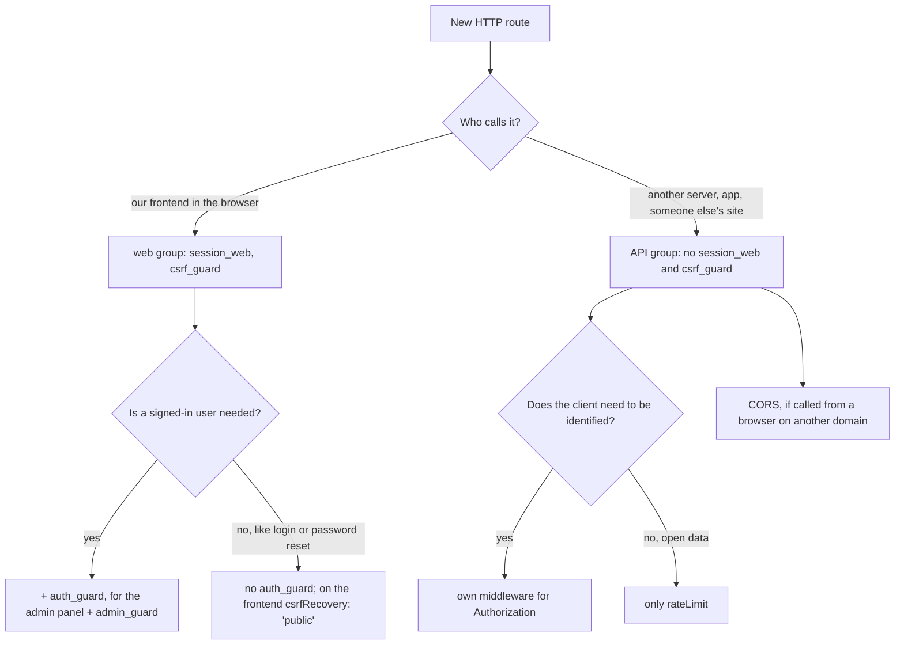

# Web routes and public API

The backend serves HTTP routes of two kinds, and each needs its own set of middleware:

| Route kind           | Who calls it                                                    | How the client proves itself                | Group middleware                                     |
| -------------------- | --------------------------------------------------------------- | ------------------------------------------- | ---------------------------------------------------- |
| **Web route**        | the SPA from `packages/frontend` in the user's browser          | the session cookie the browser sends itself | `session_web`, `csrf_guard`                          |
| **Public API route** | another server, a mobile app, a script, someone else's frontend | a request header the client adds explicitly | none (`session_web` and `csrf_guard` are not needed) |

Both kinds are declared the same way, via `defineRoute` in [`http-routes.ts`](https://github.com/Blazheiko/vibe-template/blob/main/packages/backend/src/app/routes/http-routes.ts), and have the same validation, limits and security headers. They differ only in the group the route lives in. This page explains why, how to choose the right group and what breaks if you get it wrong.

::: tip The rule in one sentence
Put a route that our frontend calls into a group with `middlewares: ['session_web', 'csrf_guard', ...]`. Put a route for external clients into a separate group without these two middleware, and do not read the cookie in it.
:::

## Why there are two kinds

A CSRF attack is possible only when the browser adds credentials to a request **by itself**. Cookies are exactly like that: if the user is signed in to the application, the browser sends the session cookie with every request to this site, even when the request was initiated by someone else's page. The server cannot tell such a request from a real one by the cookie alone. That is why web routes need `csrf_guard`: it checks signals that someone else's page cannot forge (`Sec-Fetch-Site`, `Origin`, the CSRF token from a header). In detail — in [CSRF in plain words](/en/guide/csrf).

The public API does not have this mechanism and should not have it:

- An external client does not live in a browser next to our session. It has no `uapi` cookie, no CSRF token from `GET /api/main/init`, and a server client often does not send `Origin` at all.
- API credentials (a key, a token) are passed in a header, for example `Authorization`. A browser never adds such a header on its own, so someone else's page cannot "borrow" it from the user. There is nothing to forge, so there is nothing to protect with a token.

Both rules follow from this. A web route without `csrf_guard` is a vulnerability. An API route with `session_web` and `csrf_guard` is an API that an external client will not be able to call.

## What `session_web` and `csrf_guard` do

Both middleware are registered in [`kernel.ts`](https://github.com/Blazheiko/vibe-template/blob/main/packages/backend/src/app/middlewares/kernel.ts), the full description is in [Middleware](/en/backend/middlewares).

**`session_web`** ([session-web.ts](https://github.com/Blazheiko/vibe-template/blob/main/packages/backend/src/vendor/utils/middlewares/ws/session-web.ts)) reads the session cookie and fills in `context.session` and `context.auth`:

- there is no cookie or it has expired → an **anonymous session** with its own CSRF token is created, and the response gets a `Set-Cookie` with it. Such a session is not written to Redis until it stores data ([Anonymous session](/en/backend/auth#anonymous-session));
- a signed-in session cookie → the session is read from Redis, and `userToken` is checked against `users.session_token` in the database so that a revoked session does not pass ([ADR 0002](/en/backend/auth#revoking-sessions));
- after the middleware chain it adds `csrfToken` to responses formed by the middleware themselves (`401` from `auth_guard`, `403` from `csrf_guard`), so that an anonymous client can get the token.

**`csrf_guard`** ([csrf-guard.ts](https://github.com/Blazheiko/vibe-template/blob/main/packages/backend/src/app/middlewares/csrf-guard.ts)) checks only `post`, `put`, `patch` and `delete`. `GET` passes without checks. For unsafe methods it checks in turn `Sec-Fetch-Site`, `Origin`/`Referer` (the `CSRF_ALLOWED_ORIGINS` list) and the `x-csrf-token` header, which must match the **session's** token. That is why `csrf_guard` does not work without `session_web` before it: without a session there is no token to compare with. Details in [Security → CSRF](/en/backend/security#csrf).

What these middleware cost per request:

| Middleware    | Cost                                                                                                                                               |
| ------------- | -------------------------------------------------------------------------------------------------------------------------------------------------- |
| `session_web` | for a signed-in user: a Redis read and a PostgreSQL query; for a client without a cookie: a new anonymous session and `Set-Cookie` in the response |
| `csrf_guard`  | only in-memory checks; for unsafe methods it requires `Origin`/`Referer` and the session token                                                     |

## Web routes

### How to declare

A route goes into a group where `session_web` comes first and `csrf_guard` second. Role checks (`auth_guard`, `admin_guard`) are added after them, on the group or on an individual route:

```ts
{
    group: [
        defineRoute({
            url: '/',
            method: 'get',
            handler: NotesController.list.bind(NotesController),
            ResponseSchema: ResponseSchemas.NoteListResponseSchema,
            description: 'List notes of the current user',
        }),
        defineRoute({
            url: '/',
            method: 'post',
            handler: NotesController.create.bind(NotesController),
            validator: NoteCreateInputSchema,
            ResponseSchema: ResponseSchemas.NoteResponseSchema,
            description: 'Create a note',
        }),
    ],
    prefix: 'notes',
    description: 'Notes of the signed-in user (web)',
    middlewares: ['session_web', 'csrf_guard', 'auth_guard'],
},
```

All groups in `http-routes.ts` are built this way: `auth`, `auth/oauth`, `main`, `push-subscriptions`, `avatar`, `support`, `prompts` and `admin`. The order matters: `csrf_guard` and `auth_guard` read the session that `session_web` sets up.

### What the client must provide

Web routes are designed for the SPA from this repository, and the frontend meets all the conditions itself ([`base-api.ts`](https://github.com/Blazheiko/vibe-template/blob/main/packages/frontend/src/utils/base-api.ts)):

1. **The session cookie.** The browser sends it automatically. The frontend and the API must be on the same site (the same domain or subdomains of one domain), because the cookie has `SameSite=Lax`.
2. **The CSRF token.** It is taken from `GET /api/main/init` (and from the login and logout responses) and sent in the `x-csrf-token` header with every `POST`/`PUT`/`PATCH`/`DELETE`.
3. **An `Origin` from the `CSRF_ALLOWED_ORIGINS` list.** The browser adds it itself.

How to call a web route with curl, if you need to for a check: [CSRF → Testing via curl](/en/guide/csrf#testing-with-curl-or-the-api-playground).

## Public API routes

### How to declare

API routes go into a **separate group without `session_web` and `csrf_guard`**, with their own prefix, so they are easy to tell apart from web routes and to limit separately:

```ts
{
    group: [
        defineRoute({
            url: '/orders/:id',
            method: 'get',
            handler: PublicOrdersController.show.bind(PublicOrdersController),
            ResponseSchema: ResponseSchemas.PublicOrderResponseSchema,
            description: 'Public API: order status',
        }),
        defineRoute({
            url: '/orders',
            method: 'post',
            handler: PublicOrdersController.create.bind(PublicOrdersController),
            validator: PublicOrderCreateInputSchema,
            ResponseSchema: ResponseSchemas.PublicOrderResponseSchema,
            description: 'Public API: create an order',
            rateLimit: { windowMs: 60_000, maxRequests: 10 },
        }),
    ],
    prefix: 'v1',
    description: 'Public API for external clients (no cookie session, no CSRF)',
    rateLimit: { windowMs: 60_000, maxRequests: 60 },
},
```

The routes get the addresses `/api/v1/orders/:id` and `/api/v1/orders` (the global prefix `API_PATH_PREFIX` is added to all routes, see [Routing → Groups and prefixes](/en/backend/routing#groups-and-prefixes)). The repository already has two routes without middleware: `GET /api/ping` and `GET /api/ready`.

### What the handler receives

Without `session_web` the handler works with the default context ([http-context.ts](https://github.com/Blazheiko/vibe-template/blob/main/packages/backend/src/vendor/utils/context/http-context.ts)):

| What                          | Value                                                                                      |
| ----------------------------- | ------------------------------------------------------------------------------------------ |
| `context.session.sessionInfo` | `null`                                                                                     |
| `context.auth.check()`        | `false`                                                                                    |
| `context.auth.getUserId()`    | `null`                                                                                     |
| response cookie               | none: the backend does not set a session cookie and does not read Redis/DB for the session |

So in an API route handler you cannot rely on `context.auth` or `requireUserId`: there is never a session user there. Who is calling the API is determined from a request header.

### API client authentication

`auth_guard` and `admin_guard` check the **cookie session**. In a group without `session_web`, `auth_guard` always answers `401 unauthorized`, even if the client sent the correct key in `Authorization`. For an API you need a separate middleware that checks credentials from the header.

::: warning Plan
The template does not have API key authentication yet: there is no keys table, middleware or environment variables for them. Below is a skeleton you can start from. It is not part of the repository.
:::

```ts
// src/app/middlewares/api-key-guard.ts (example)
import type { HttpContext, Middleware } from '#vendor/types/types.js'

const apiKeyGuard: Middleware = async (
    context: HttpContext,
    next: () => Promise<void>,
): Promise<void> => {
    const header = context.httpData.headers.get('authorization') ?? ''
    const key = header.startsWith('Bearer ') ? header.slice('Bearer '.length) : ''

    // isKnownApiKey is your check: the key hash in the database, compared via safeEqual
    // (#vendor/utils/helpers/safe-equal.js), not a plain ===.
    if (key === '' || !(await isKnownApiKey(key))) {
        context.responseData.status = 401
        context.responseData.payload = {
            status: 'error',
            code: 'unauthorized',
            message: 'Invalid API key',
        }
        return
    }

    await next()
}

export default apiKeyGuard
```

Then register it in `httpMiddlewares` in `kernel.ts` (for example `api_key_guard: apiKeyGuard`) and specify it in the API group: `middlewares: ['api_key_guard']`. How to write your own middleware is in [Middleware → Custom middleware](/en/backend/middlewares#custom-middleware).

Take API credentials **only from the header**. If the API starts reading them from a cookie, the browser will again send them automatically, and the same CSRF problem that `csrf_guard` protects against will come back.

### CORS for browser clients

Server clients and mobile apps do not need CORS. It is needed only when the public API is called by JavaScript from a page on a **different** domain. CORS is configured globally for all routes ([Security → CORS](/en/backend/security#cors)):

- `ENABLED_CORS=true` and the exact client origins in `CORS_ALLOWED_ORIGINS`;
- the `Authorization` header is already allowed in `Access-Control-Allow-Headers` ([cors.ts](https://github.com/Blazheiko/vibe-template/blob/main/packages/backend/src/config/cors.ts)). A custom header like `X-API-Key` would have to be added there separately, so `Authorization: Bearer …` is more convenient;
- leave `CREDENTIONALS_CORS` as `false` for such an API: an API without cookies does not need `Access-Control-Allow-Credentials`, and this variable affects all routes, including web routes.

### Rate limits

Web routes are also protected by the fact that only our frontend calls them. The public API is open to any client, so set `rateLimit` on the API group and a stricter one on routes that change data or are expensive. The limit is counted per IP and route, and on top of it the global per-IP limit `HTTP_GLOBAL_RATE_LIMIT_*` applies ([Security → Request rate limiting](/en/backend/security#rate-limiting)).

## Why an API route cannot be put in a web group

Group middleware is added **before** the route's middleware (`middlewares.concat(route.middlewares)` in [router.ts](https://github.com/Blazheiko/vibe-template/blob/main/packages/backend/src/vendor/start/router.ts)), and a route cannot turn it off: there is no field like "skip `csrf_guard`". A route in the `main` group will always run `session_web` and `csrf_guard`.

What an external client will see if its route ended up in a web group:

| Client request                                                      | Response                                                                                                                                  |
| ------------------------------------------------------------------- | ----------------------------------------------------------------------------------------------------------------------------------------- |
| `POST` from a server, without `Origin` and `Referer`                | `403 csrf_invalid`, `reason: origin_mismatch` (because `CSRF_STRICT_ORIGIN=true`)                                                         |
| `POST` with an `Origin` from the list, but without a session cookie | `403 csrf_invalid`, `reason: token_mismatch`: the token of the anonymous session that `session_web` just created is unknown to the client |
| `GET`                                                               | passes, but every response carries a `Set-Cookie` with a new anonymous session                                                            |
| any request to a group with `auth_guard`                            | `401 unauthorized`: `auth_guard` does not read the `Authorization` header                                                                 |

That is why an API needs **its own group**, not an exception inside a web group.

## What breaks in the opposite case

A web route placed outside a web group breaks more quietly:

| Mistake                                                                             | Consequence                                                                                                                                                                          |
| ----------------------------------------------------------------------------------- | ------------------------------------------------------------------------------------------------------------------------------------------------------------------------------------ |
| a data-changing route without `session_web` and `csrf_guard`, but with `auth_guard` | `401` for everyone: without `session_web` there is no user                                                                                                                           |
| `csrf_guard` without `session_web`                                                  | `403 token_mismatch` on every `POST`/`PUT`/`PATCH`/`DELETE`: there is no session whose token can be compared                                                                         |
| `session_web` without `csrf_guard` on a data-changing route                         | **a CSRF vulnerability**: someone else's page can send a request on behalf of a signed-in user, and the cookie will confirm their identity. Tests and typecheck will not notice this |
| `csrf_guard` before `session_web`                                                   | the same as `csrf_guard` without `session_web`: the guard runs before the session exists                                                                                             |

The last two cases are caught by the test [`web-and-api-routes.spec.ts`](https://github.com/Blazheiko/vibe-template/blob/main/packages/backend/src/app/routes/web-and-api-routes.spec.ts): it requires that every route with `session_web` is immediately followed by `csrf_guard`, and that every `POST`/`PUT`/`PATCH`/`DELETE` in `http-routes.ts` has `csrf_guard`. When the first data-changing public API route appears in the template, the second check will have to be narrowed to web groups, for example by excluding the API prefix.

## How to choose a group for a new route



Checklist:

- [ ] The route lives in the group that matches its client, not in the first one at hand.
- [ ] In a web group `session_web` comes first, `csrf_guard` second.
- [ ] An API route does not read the cookie and does not use `context.auth`; credentials are taken from the header.
- [ ] The API group has `rateLimit`.
- [ ] For browser API clients CORS is configured without `CREDENTIONALS_CORS`.
- [ ] The `documentation/backend/` pages are updated, as the [workflow](/en/guide/workflow) requires.

## API only, without a frontend

If the project uses the backend without `packages/frontend` (see the README, "Backend-only / API services"), there may be no web groups at all, and then no route needs `session_web` and `csrf_guard`. Note:

- the `auth`, `main`, `support`, `admin` and other groups from the template are web routes for the SPA. They are removed or kept together with their middleware, not moved to the API without `session_web`;
- the CSRF configuration is checked at startup regardless of routes: in a production-like environment the server does not start without `CSRF_ALLOWED_ORIGINS` ([validate-runtime-config.ts](https://github.com/Blazheiko/vibe-template/blob/main/packages/backend/src/app/start/validate-runtime-config.ts)). Set in it the address the admin tool will work from, or the origin of the API itself;
- Redis is still needed: it is checked by the readiness route `GET /api/ready`, and WebSocket and shared limits run on it ([Security → Shared limits](/en/backend/security#shared-limits-redis)).
