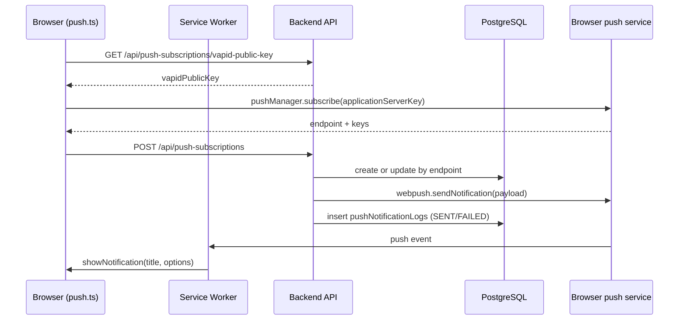

# Web Push notifications

Web Push lets the server show the user a system notification **even when the tab with the application is closed**: the message is delivered by the browser's push service (Google FCM for Chrome, Mozilla autopush for Firefox, Apple for Safari), and shown by a Service Worker. The template already has everything needed: subscription in the frontend, storing subscriptions in PostgreSQL, sending through the [`web-push`](https://github.com/web-push-libs/web-push) library, a send log and statistics. All you need to make it work is VAPID keys.

## How it works

1. The user enables notifications in the account ([`UserAccount.vue`](https://github.com/Blazheiko/vibe-template/blob/main/packages/frontend/src/views/UserAccount.vue)). The browser asks for permission (`Notification.requestPermission()`).
2. The frontend takes the **public** VAPID key from the backend and asks the browser to create a subscription: `pushManager.subscribe({ userVisibleOnly: true, applicationServerKey })`.
3. The browser registers with its push service and returns the subscription: a unique `endpoint` (a URL at the push service) and the encryption keys `p256dh` and `auth`.
4. The frontend sends the subscription to the backend, and the backend stores it in the `push_subscriptions` table.
5. When an event happens (a new sign-in, a password change, a support reply), the backend encrypts the payload with the subscription's keys, signs the request with the **private** VAPID key and makes a `POST` to the `endpoint`.
6. The push service verifies the signature, wakes up the browser's Service Worker, and it shows the notification. A click opens `data.url`.

## What VAPID keys are

**VAPID** (Voluntary Application Server Identification, [RFC 8292](https://www.rfc-editor.org/rfc/rfc8292)) is the way your server proves to the browser's push service that it is allowed to send messages to a particular subscription.

- It is a **pair of ECDSA keys on the P-256 curve**: public and private, in base64url format.
- The **public key** is not secret. The frontend passes it to the browser as `applicationServerKey` when subscribing, and the push service "binds" the subscription to it.
- The **private key** is a secret and exists only on the server. The backend uses it to sign a short JWT in the `Authorization` header of every push request. The push service verifies the signature with the public key from the subscription. So even if someone learns the `endpoint`, they cannot send a message without the private key.
- **`VAPID_SUBJECT`** is the contact of the server's owner (a `mailto:` or `https:` URL). The push service receives it to contact you if something is wrong with your requests.

::: tip VAPID does not encrypt the message
VAPID only identifies the server. The message content is encrypted separately with the subscription's own keys (`p256dh`, `auth`, [RFC 8291](https://www.rfc-editor.org/rfc/rfc8291)), so the push service cannot see what you send. The `web-push` library does both.
:::

::: warning Keys cannot simply be changed
Each subscription is bound to the public key it was created with. If you replace the keys, all existing subscriptions will stop working: the push service will reject the requests, and users will have to subscribe again. Generate keys once per environment and store the private key as a secret (a secret manager, CI variables), not in the repository.
:::

### Generating keys

The backend has a script [`generate-vapid-keys.ts`](https://github.com/Blazheiko/vibe-template/blob/main/packages/backend/src/scripts/generate-vapid-keys.ts):

```bash
# print a new key pair
pnpm --filter backend push:vapid

# write the keys directly to packages/backend/.env
pnpm --filter backend push:vapid --write
```

- From the repository root, the same is run by `pnpm push:vapid` (and `pnpm push:vapid --write`).
- Without flags, the script only prints the lines `VAPID_PUBLIC_KEY=...` and `VAPID_PRIVATE_KEY=...`, which you need to add to `.env`.
- `--write` updates `VAPID_PUBLIC_KEY` and `VAPID_PRIVATE_KEY` in `packages/backend/.env` and leaves the rest of the file alone. If the file does not exist, it creates it.
- If the private key is already set in `.env`, `--write` refuses (exit code `1`) so as not to accidentally break existing subscriptions. To replace the keys anyway, add `--force`.

After generating, set `VAPID_SUBJECT` (for example `mailto:admin@your-domain.com`) and restart the backend.

### Configuration

[`config/push.ts`](https://github.com/Blazheiko/vibe-template/blob/main/packages/backend/src/config/push.ts) reads the following variables:

| Variable                          | Default                                                                                       | Purpose                                                                                                  |
| --------------------------------- | --------------------------------------------------------------------------------------------- | -------------------------------------------------------------------------------------------------------- |
| `VAPID_PUBLIC_KEY`                | `''`                                                                                          | the public key, given to the frontend                                                                    |
| `VAPID_PRIVATE_KEY`               | `''`                                                                                          | the private key, a secret                                                                                |
| `VAPID_SUBJECT`                   | `mailto:admin@vibe-template.example`                                                          | the contact for the push service                                                                         |
| `PUSH_ALLOWED_ENDPOINT_HOSTS`     | `fcm.googleapis.com,updates.push.services.mozilla.com,.notify.windows.com,web.push.apple.com` | hosts of push services allowed to be an `endpoint` (see [Endpoint restrictions](#endpoint-restrictions)) |
| `PUSH_MAX_SUBSCRIPTIONS_PER_USER` | `20`                                                                                          | the maximum number of subscriptions per account                                                          |

On the first send, [`push-notification-sender-service.ts`](https://github.com/Blazheiko/vibe-template/blob/main/packages/backend/src/app/services/notifications/push-notification-sender-service.ts) calls `webpush.setVapidDetails(...)`. If the keys are empty, it writes `VAPID keys not configured — push notifications disabled` and sends nothing (`{ sent: 0, failed: 0 }`). `GET /push-subscriptions/vapid-public-key` and `POST /push-subscriptions/test-push` respond `500 VAPID keys not configured` in this case, so subscribing is impossible. The rest of the application works.

## Notification types

Each notification has a type `notificationType`, and a subscription has an optional list `notificationTypes` (`'mention' | 'system'`) that it wants to receive. An empty list means "all types".

| Type      | What it is                                       |
| --------- | ------------------------------------------------ |
| `system`  | account security notifications                   |
| `mention` | messages addressed to the user (a support reply) |

## HTTP routes

The `push-subscriptions` group in [`http-routes.ts`](https://github.com/Blazheiko/vibe-template/blob/main/packages/backend/src/app/routes/http-routes.ts) with the `session_web` and `csrf_guard` middleware; every route except `vapid-public-key` has `auth_guard` (an anonymous request → `401` before the controller); the controller is [`push-subscription-controller.ts`](https://github.com/Blazheiko/vibe-template/blob/main/packages/backend/src/app/controllers/http/notifications/push-subscription-controller.ts). The frontend calls them with the `/api` prefix ([`utils/api.ts`](https://github.com/Blazheiko/vibe-template/blob/main/packages/frontend/src/utils/api.ts)).

| Method   | Path                                             | Purpose                                                                                                                                                                                                                                                                               |
| -------- | ------------------------------------------------ | ------------------------------------------------------------------------------------------------------------------------------------------------------------------------------------------------------------------------------------------------------------------------------------- |
| `GET`    | `/push-subscriptions/vapid-public-key`           | The public VAPID key                                                                                                                                                                                                                                                                  |
| `POST`   | `/push-subscriptions/test-push`                  | A test push to the current user; body `{ title?, body? }` (`PushSubscriptionTestInputSchema`: up to 200 / 1000 characters), the response contains `sent`/`failed`; if the session record was deleted by a logout in another tab, `401 session_revoked` and nothing is sent (feat-129) |
| `GET`    | `/push-subscriptions`                            | The user's subscriptions                                                                                                                                                                                                                                                              |
| `POST`   | `/push-subscriptions`                            | Create a subscription (`CreateSubscriptionInputSchema`)                                                                                                                                                                                                                               |
| `GET`    | `/push-subscriptions/:subscriptionId`            | One subscription                                                                                                                                                                                                                                                                      |
| `PUT`    | `/push-subscriptions/:subscriptionId`            | Update (`UpdateSubscriptionInputSchema`)                                                                                                                                                                                                                                              |
| `DELETE` | `/push-subscriptions/:subscriptionId`            | Delete                                                                                                                                                                                                                                                                                |
| `GET`    | `/push-subscriptions/:subscriptionId/logs`       | The send log                                                                                                                                                                                                                                                                          |
| `GET`    | `/push-subscriptions/:subscriptionId/statistics` | Statistics                                                                                                                                                                                                                                                                            |
| `PUT`    | `/push-subscriptions/:subscriptionId/deactivate` | Deactivate                                                                                                                                                                                                                                                                            |

The send log in responses (`GET /push-subscriptions`, `GET /:subscriptionId` → `notificationLogs`, `GET /:subscriptionId/logs`) contains `status`, `statusCode` and `reason` (`gone` for 404/410, `rejected` for another code, `network_error` with no response, `null` for `SENT`); the transport error text (`errorMessage`) and `responseData` are not returned to the client (feat-104).

Routes with `:subscriptionId` work only with the user's own subscriptions. `GET /:subscriptionId`, `PUT`, `DELETE`, `…/statistics` and `…/deactivate` give the same response `404 Subscription not found` for someone else's id and for a nonexistent one: another user's record is not changed and does not appear in the response. For `PUT` and `deactivate` this is ensured by the `UPDATE … WHERE id AND user_id … RETURNING` itself in the [repository](https://github.com/Blazheiko/vibe-template/blob/main/packages/backend/src/app/repositories/notifications/push-subscription-repository.ts), with no repeated read by a single id. `GET /:subscriptionId/logs` does not look up the subscription: the log is filtered by owner, so for someone else's id and for a nonexistent one it is a `200` with an empty `data` list (other users' records are not returned). Moving a subscription to another user is possible only through `POST /push-subscriptions` with the same keys (see below).

## Endpoint restrictions

The backend makes a `POST` to the `endpoint` supplied by the browser, so only addresses of push services are stored ([`push-endpoint-policy.ts`](https://github.com/Blazheiko/vibe-template/blob/main/packages/backend/src/app/services/notifications/push-endpoint-policy.ts), feat-104):

- `https:` only, the default port, no `user:password@`, no IP address instead of a host;
- the host equals an entry of `PUSH_ALLOWED_ENDPOINT_HOSTS` or, for an entry with a leading dot (`.notify.windows.com`), is its subdomain on a DNS label boundary: `wns2-par02p.notify.windows.com` matches, `evilnotify.windows.com` and `notify.windows.com.evil.io` do not. The host is compared in lowercase, without a trailing dot, in punycode.

The endpoint is stored and looked up in its **canonical form** (`canonicalPushEndpoint`, feat-125): the host in lowercase and without a trailing dot, no default port, and percent-encoding in the path and query normalized per RFC 3986 §6.2.2 (`%41` is `A`, `%3d` is `%3D`; feat-130). A different query (an appended `?x=1`) remains a different endpoint: WNS passes the token in the query, so it cannot be discarded, and such an endpoint only wastes the push service's quota, because the browser drops a payload it cannot decrypt. `https://FCM.GOOGLEAPIS.COM./fcm/send/…` and `https://fcm.googleapis.com/fcm/send/…` lead to the same push service and are considered one endpoint, so the "subscription belongs to another user" check sees them as one.

A different `endpoint` in `POST /push-subscriptions` gives `400` with `reason: "push_endpoint_not_allowed"`. Before every send the endpoint is checked again: a subscription stored before the restriction or under a wider list receives no request (a `warn` in the log). An invalid `PUSH_ALLOWED_ENDPOINT_HOSTS` value stops startup (`Invalid push configuration`).

`web-push` sends through `https.request`, which does not follow redirects; a response outside `2xx`, including `3xx`, is `FAILED`. The application does not pass `web-push` any `proxy` or `agent` options. Both facts are pinned by tests (`push-transport-redirect.spec.ts` on a real TLS server, `push-notification-sender-service.spec.ts`).

A new subscription (including one moved from another account) beyond `PUSH_MAX_SUBSCRIPTIONS_PER_USER` gives `409` with `reason: "push_subscription_limit"`; the count is done under a lock on the user's row, so two parallel requests for the last slot cannot both succeed. `POST /push-subscriptions/test-push` (which sends to all devices) has its own limit of 5 requests per minute.

## Storing a subscription

In `createSubscription`, [`push-subscription-service.ts`](https://github.com/Blazheiko/vibe-template/blob/main/packages/backend/src/app/services/notifications/push-subscription-service.ts) looks up the subscription by `endpoint` (it is unique across all users). If the subscription belongs to another user, it is moved to the current one only when `p256dhKey` and `authKey` match the stored ones (the same browser, an account switch); otherwise — `409 conflict`, and the subscription stays with the old owner. If it exists, it updates the keys `p256dhKey`/`authKey`, the device metadata, `notificationTypes`, `timezone` and sets `isActive: true` again; otherwise it creates a new record. `POST` and `PUT` write in a transaction under a lock on the user's row and only while the presented session token is current ([`withCurrentSession`](https://github.com/Blazheiko/vibe-template/blob/main/packages/backend/src/app/services/auth/session-guard.ts)): a request from a session that was revoked by an account claim gets `401 session_revoked` and does not return the attacker's device (see [Authentication](/en/backend/auth#credential-changes-from-a-session)). Work with the table goes through the repository, see [Repositories](/en/backend/repositories).

## Sending and the payload format

`pushNotificationSenderService.sendToUser(userId, payload, { skipIfOnline?, notificationType? })`:

1. If `skipIfOnline` is set and the user has an active WebSocket connection (`wsConnectionRegistry.isUserOnline`), the push is skipped (see [WebSocket](/en/backend/websocket)).
2. The list of active subscriptions is taken; if a subscription has a non-empty `notificationTypes` that does not contain `notificationType`, it is skipped.
3. For each subscription, the request runs with a 10 s deadline for the whole exchange, from connection to the last byte of the response (`PUSH_SEND_TIMEOUT_MS`; feat-138, feat-139: a push service that hangs or answers byte by byte does not hold up sending, and the record becomes `network_error`). The request is built by web-push (`generateRequestDetails`: VAPID headers, an encrypted body), and sent by [`push-transport.ts`](https://github.com/Blazheiko/vibe-template/blob/main/packages/backend/src/app/services/notifications/push-transport.ts): web-push's own timeout is only a socket idle timeout. Redirects are still not followed. The request body is JSON:

```json
{
    "notification": {
        "title": "...",
        "body": "...",
        "icon": "/icons/icon_192x192.png",
        "badge": "/icons/badge-72.png",
        "vibrate": [200, 100, 200],
        "data": { "url": "/", "...": "payload.data" },
        "tag": "...",
        "actions": [
            { "action": "open", "title": "Open" },
            { "action": "close", "title": "Close" }
        ]
    }
}
```

Active subscriptions (taking `notificationType` into account) are processed in parallel, with at most `PUSH_SEND_CONCURRENCY = 5` requests to the push service at once. The result of each attempt is a `pushNotificationLogs` row with the status `SENT` (and the response `statusCode`) or `FAILED` (with an `errorMessage`, which stays in the database and the server logs); after all sends, the rows are written with a single `insertMany` through [`push-notification-log-repository.ts`](https://github.com/Blazheiko/vibe-template/blob/main/packages/backend/src/app/repositories/notifications/push-notification-log-repository.ts), and `lastUsedAt` of the successful subscriptions is updated with a single `touchLastUsed`. If writing fails, the error is logged, and the `{ sent, failed }` result matches the actual responses of the push service.

**Expired subscriptions:** a push service response of `410` or `404` deactivates the subscription (`pushSubscriptionRepository.deactivate`). There is no separate background cleanup or deletion of inactive records.

**Business events** ([`user-notification-service.ts`](https://github.com/Blazheiko/vibe-template/blob/main/packages/backend/src/app/services/notifications/user-notification-service.ts)). The push is sent without waiting: a failure or a slow push service does not change or delay the response, and the error is only a `warn`.

| Event                                  | Where                                                     | `notificationType` | `skipIfOnline` |
| -------------------------------------- | --------------------------------------------------------- | ------------------ | -------------- |
| New sign-in (`new_sign_in`)            | a successful `login` (email/phone) and the OAuth callback | `system`           | no             |
| Password change (`password_changed`)   | `POST /auth/change-password`                              | `system`           | no             |
| Password reset (`password_reset`)      | reset by email token and by SMS                           | `system`           | no             |
| Logout from all devices (`logout_all`) | `POST /auth/logout-all`                                   | `system`           | no             |
| Support reply                          | a saved Support AI reply (`support/support_chat`)         | `mention`          | yes            |

Security notifications go to all active subscriptions, including the device the action was performed from: subscriptions are not bound to a session. A support reply arrives only when the user has no open WS connection; since closing the connection stops generation, in practice this is the case where the tab was closed after the reply had already been saved. A subscription whose `notificationTypes` does not contain the corresponding type receives no push. There is also a separate `test-push` endpoint.

::: warning Limits of `skipIfOnline`
"Online" means just one thing: **this process** has at least one open WS connection of the user ([`ws-connection-registry.ts`](https://github.com/Blazheiko/vibe-template/blob/main/packages/backend/src/app/websocket/ws-connection-registry.ts), an in-memory `Map`, `isUserOnline` = `userStorage.has(userId)`). It follows that:

- **Several instances.** A connection on another instance is not visible: a user who is online there is considered offline, and the push will arrive. There is no shared registry (Redis or the like).
- **A background tab is online too.** An open connection in a minimized tab or on a locked phone suppresses the push even though the user does not see the message.
- **The moment of the check.** The state is read once before sending; a connection that closed right after the check no longer brings the push back.
- **A drop without close.** Until the server notices the break (heartbeat), the connection is counted as open.
  :::

## Statistics

[`push-subscription-statistics-service.ts`](https://github.com/Blazheiko/vibe-template/blob/main/packages/backend/src/app/services/statistics/push-subscription-statistics-service.ts) computes `totalNotifications`, `sentNotifications`, `failedNotifications`, `pendingNotifications`, `successRate` (%), `last7DaysCount`, `lastUsed`, `isActive`. The counters come from a single SQL query `countsBySubscription` (`count(case …)`), and the application computes the 7-day boundary and passes it as a parameter.

## Frontend

- The subscription is in [`stores/push.ts`](https://github.com/Blazheiko/vibe-template/blob/main/packages/frontend/src/stores/push.ts) (the device description for the server is in [`utils/push-device.ts`](https://github.com/Blazheiko/vibe-template/blob/main/packages/frontend/src/utils/push-device.ts)): it checks `registration.pushManager.getSubscription()`, gets the VAPID key from `/api/push-subscriptions/vapid-public-key`, calls `pushManager.subscribe({ applicationServerKey })` and sends the data to `POST /api/push-subscriptions`.
- In its `push` handler, [`service-worker.ts`](https://github.com/Blazheiko/vibe-template/blob/main/packages/frontend/src/service-worker.ts) parses the JSON, merges `payload.notification` with the defaults and calls `showNotification`; `notificationclick` closes the notification and opens `data.url`. The address comes from the payload, so [`notification-target.ts`](https://github.com/Blazheiko/vibe-template/blob/main/packages/frontend/src/utils/notification-target.ts) accepts only an address of the same origin (otherwise — `/`): a foreign host, port or scheme, `//host`, `/\host`, `javascript:` are rejected. An already open window is found by matching the origin and `pathname`, not by a substring in the URL, so `/support/archive` is not mistaken for `/support`.



## Local testing

1. Generate the keys: `pnpm --filter backend push:vapid --write`, and restart the backend.
2. The Service Worker is registered only in the production build (see [Frontend → PWA](/en/frontend/#pwa)), and push requires `localhost` or HTTPS. Build the frontend and serve it from the backend or via `vite preview`.
3. Sign in, enable notifications in the account and allow them in the browser.
4. Call `POST /api/push-subscriptions/test-push` (body `{}` or `{ "title": "…", "body": "…" }`, with a CSRF token) with an active session. The result is visible in the response (`sent`/`failed`), in the backend logs and through `/:subscriptionId/logs`.

Unit tests: `pnpm --filter backend test`, including [`push-subscription-service.spec.ts`](https://github.com/Blazheiko/vibe-template/blob/main/packages/backend/src/app/services/notifications/push-subscription-service.spec.ts).
