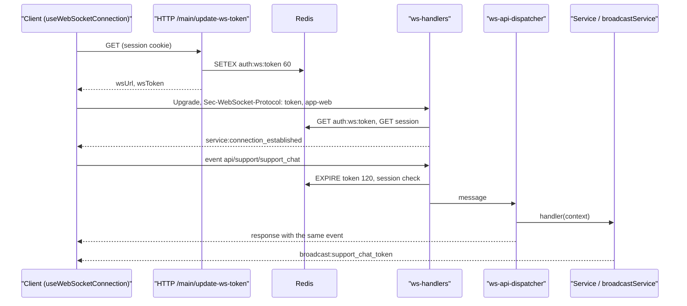

# WebSocket

The backend keeps a single WebSocket endpoint `/<pathPrefix>/websocket` (by default `/api/websocket`) on the same uWebSockets.js server as HTTP. Through it, the client calls WS routes in a request-response style, and the server sends push events (`broadcast:*`). The general upgrade and message path is described on the [Request lifecycle](/en/backend/request-lifecycle) page, the token scheme in the [WebSocket authorization](/en/backend/auth#websocket-authorization) section, and the `defineWsRoute` syntax on the [Routing](/en/backend/routing) and [Middleware](/en/backend/middlewares) pages. This page collects everything specific to WS: the server structure, the protocol, push events, heartbeat, the client and the limits.

## In brief, by example: send an event from the server

**Task:** when a user creates a note, all of their open tabs must learn about it without a page refresh.

1. Describe the event payload in the [broadcast-events.ts](https://github.com/Blazheiko/vibe-template/blob/main/packages/shared/src/schemas/ws/broadcast-events.ts) registry — without it `tsc` will not accept the event name:

    ```ts
    export const BroadcastEventSchemas = {
        // ...
        note_created: type({ note: NoteSchema }),
    } as const
    ```

1. In the service, after a successful creation, call `broadcastService`:

    ```ts
    import { broadcastService } from '#app/services/communication/broadcast-service.js'

    const note = noteTransformer.serialize(createdResult.value)
    broadcastService.broadcastMessageToUser(String(userId), 'note_created', { note })
    ```

1. Every WebSocket connection of this user receives the message (captured from a real connection):

    ```json
    {
        "event": "broadcast:note_created",
        "status": 200,
        "payload": {
            "note": {
                "id": "4",
                "title": "New",
                "body": null,
                "created_at": "2026-10-25T17:26:14.928+02:00"
            }
        }
    }
    ```

1. On the frontend, events with the `broadcast:` prefix are handled by [useBroadcastHandler.ts](https://github.com/Blazheiko/vibe-template/blob/main/packages/frontend/src/composables/useBroadcastHandler.ts): add a `payload` guard in [ws-payload-guards.ts](https://github.com/Blazheiko/vibe-template/blob/main/packages/frontend/src/utils/ws-payload-guards.ts) and a `note_created` handler in `handlers`, following the `support_chat_token` example, and pass the event on through the event bus. The parity test `ws-payload-guards.spec.ts` requires a guard for every registry event.

::: warning Service tests
`broadcast-service.ts` imports the server, and the server requires `APP_KEY` at startup. Without a mock, a service unit test will fail with `APP_KEY must be set...`. Add this to the test:

```ts
vi.mock('#app/services/communication/broadcast-service.js', () => ({
    broadcastService: { broadcastMessageToUser: vi.fn() },
}))
```

:::

Besides targeted events there are channels (`broadcastMessageToChannel`), such as the admin channel with the list of online users. Requests from the client to the server go through WS routes. All of this is described below.

## Connecting

### Getting a token over HTTP

A browser `WebSocket` cannot pass a cookie session as an authorization header, so the client first obtains a short-lived WS token:

1. `GET /<pathPrefix>/main/update-ws-token` (the `main` group with `session_web` + `csrf_guard`, and `auth_guard` on the route) — [http-routes.ts](https://github.com/Blazheiko/vibe-template/blob/main/packages/backend/src/app/routes/http-routes.ts).
2. `MainController.updateWsToken` → `mainService.updateWsToken` ([main-controller.ts](https://github.com/Blazheiko/vibe-template/blob/main/packages/backend/src/app/controllers/http/core/main-controller.ts), [main-service.ts](https://github.com/Blazheiko/vibe-template/blob/main/packages/backend/src/app/services/core/main-service.ts)) returns `{ wsUrl, wsToken }`.
3. [generate-ws-token-service.ts](https://github.com/Blazheiko/vibe-template/blob/main/packages/backend/src/app/services/auth/generate-ws-token-service.ts) generates a 16-character key and writes `auth:ws:<token>` to Redis with a 60 s TTL and the data `{ sessionId, userId, userToken }`.
4. `wsUrl` is built by [get-ws-url-service.ts](https://github.com/Blazheiko/vibe-template/blob/main/packages/backend/src/app/services/communication/get-ws-url-service.ts): `wss://` for `production`/`prod`, otherwise `ws://`, then `<domain>/<pathPrefix>/websocket`.

### Upgrade

`handleUpgrade` in [ws-handlers.ts](https://github.com/Blazheiko/vibe-template/blob/main/packages/backend/src/vendor/utils/network/ws-handlers.ts) first checks the per-IP upgrade limit ([upgrade-rate-limit.ts](https://github.com/Blazheiko/vibe-template/blob/main/packages/backend/src/vendor/utils/rate-limit/upgrade-rate-limit.ts), 60 per minute by default): exceeding it gives `429` with `Retry-After`, and a counter failure gives `503`. It then parses `Sec-WebSocket-Protocol` by comma: the first element is the token, the second is the application type (`app-web` → `web`, `app-pwa` → `pwa`, anything else → `web` with a warning). The token is checked by format (`accessTokenLength` = 16, only `[a-zA-Z0-9]`), otherwise `401 Invalid token format`. Next the `onUpgrade` hook is called, that is `wsSessionAuth.verifyUpgradeToken` from [ws-session-auth.ts](https://github.com/Blazheiko/vibe-template/blob/main/packages/backend/src/app/websocket/ws-session-auth.ts), and the server returns the token itself to the client as the selected subprotocol. If the main Redis client is unavailable, the upgrade is rejected **before** `res.upgrade` with a `503 Service Unavailable` response with `Retry-After: 1` (no `4001`); after the first unavailable command, the second one (the session `get`) is not executed.

```ts
const token = protocols[0] ?? ''
const appType = normalizeAppTypeProtocol(protocols[1] ?? '')
```

If `verifyUpgradeToken` did not find a live session for a token of the correct format, the upgrade is rejected **before** `res.upgrade` with a `401 Session expired` response: the connection does not open. The browser sees this as a failed handshake (close `1006`), and the client refreshes the token over HTTP (see below). If the data exists, the client receives `service:connection_established` with `socket_id` (the connection UUID) and `activity_timeout: 30`.

On every incoming message, `onRefreshToken` extends the TTL of `auth:ws:<token>` to 120 s, and in `onClose` and `closeAllWs` (graceful shutdown, code `4201`) the token is deleted via `onRevokeToken`. `closeAllWs` first closes every connection with code `4201` and revokes the tokens only afterwards, in parallel: a Redis failure during revocation is only logged and does not leave connections open (feat-112). After `closeAllWs` the server no longer upgrades: an upgrade that was still waiting for token verification gets `503 Server is shutting down` (feat-138). So a token is single-use per connection: a new connection requires a new `update-ws-token` call.

## Server structure

| Module                                                                                                                                                           | Role                                                                                                                                 |
| ---------------------------------------------------------------------------------------------------------------------------------------------------------------- | ------------------------------------------------------------------------------------------------------------------------------------ |
| [vendor/start/server.ts](https://github.com/Blazheiko/vibe-template/blob/main/packages/backend/src/vendor/start/server.ts)                                       | `configureWebsockets`: registers `server.ws(...)`, uWS options, `broadcastToChannel` (`server.publish`)                              |
| [vendor/utils/network/ws-handlers.ts](https://github.com/Blazheiko/vibe-template/blob/main/packages/backend/src/vendor/utils/network/ws-handlers.ts)             | transport: `handleUpgrade`, `onOpen`, `onMessage`, `onClose`, `closeAllWs`; the `WsAppHooks` application hooks and message validator |
| [app/start/index.ts](https://github.com/Blazheiko/vibe-template/blob/main/packages/backend/src/app/start/index.ts)                                               | glues vendor and app: `registerWsMessageValidator` and `registerWsAppHooks`                                                          |
| [app/websocket/ws-session-auth.ts](https://github.com/Blazheiko/vibe-template/blob/main/packages/backend/src/app/websocket/ws-session-auth.ts)                   | verifies, extends and revokes the WS token in Redis                                                                                  |
| [app/websocket/ws-coordinator.ts](https://github.com/Blazheiko/vibe-template/blob/main/packages/backend/src/app/websocket/ws-coordinator.ts)                     | `handleConnected` / `handleDisconnected`: user role, registry, `userOnlineService`, presence                                         |
| [app/websocket/ws-connection-registry.ts](https://github.com/Blazheiko/vibe-template/blob/main/packages/backend/src/app/websocket/ws-connection-registry.ts)     | in-memory connection registry                                                                                                        |
| [vendor/utils/routing/ws-api-dispatcher.ts](https://github.com/Blazheiko/vibe-template/blob/main/packages/backend/src/vendor/utils/routing/ws-api-dispatcher.ts) | routes messages to a handler                                                                                                         |

Hook wiring in [app/start/index.ts](https://github.com/Blazheiko/vibe-template/blob/main/packages/backend/src/app/start/index.ts):

```ts
registerWsAppHooks({
    onUpgrade: (token) => wsSessionAuth.verifyUpgradeToken(token),
    onConnected: (ws, userData) => websocketCoordinator.handleConnected(ws, userData),
    onDisconnected: (ws, userData, code) =>
        websocketCoordinator.handleDisconnected(ws, userData, code),
    onRefreshToken: (token) => wsSessionAuth.refreshToken(token),
    onRevokeToken: (token) => wsSessionAuth.revokeToken(token),
})
```

### What is tracked

- **Transport** (`ws-handlers.ts`): a `Set<MyWebSocket>` of all open sockets — only for `closeAllWs` on shutdown.
- **Registry** (`ws-connection-registry.ts`): `Map<userId, { ip, userAgent, appType, connections: Map<uuid, { ws, ip, userAgent, appType }> }>`. Each connection stores its own `ip`, `userAgent` and `appType`, so the summaries (`appType`, `getOnlineUserMeta`) never read `ws.getUserData()` of a stored socket: on a closed socket uWS throws `Invalid access of closed uWS.WebSocket` (feat-107). One user can have several connections (tabs, PWA); `appType` becomes `pwa` if at least one connection is a PWA. `registerConnection` returns `true` for the first connection, `unregisterConnection` returns `true` for the last one. There are also `isUserOnline`, `findOnlineUsers`, `forEachConnection`, `getConnection`, `getOnlineUsers`, `getOnlineUserMeta`.
- **Channels**: uWS pub/sub is used (`ws.subscribe` / `server.publish`). The code has one channel — `admin` ([admin-ws-channel-service.ts](https://github.com/Blazheiko/vibe-template/blob/main/packages/backend/src/app/services/admin/admin-ws-channel-service.ts)); only a connection with `role === 'admin'` can subscribe, and the subscriber counter is kept in memory. The connection role is read from the DB once, on open, so revoking admin access on an open connection is described in [Revoking admin access](#revoking-admin-access).
- **Online history in the DB**: `userOnlineService.trackConnected/trackDisconnected` are called from the coordinator without `await` (errors are only logged). Disconnect waits until the connection row has been written (feat-124): otherwise the `UPDATE` of a connection that closed before the `INSERT` committed found no row, and the row stayed open forever. A connection whose row was not written (a DB failure, or the socket closed while the role was being read) writes no disconnect row.

In `handleDisconnected` the connection is removed from the registry **synchronously, before any `await`**, so that broadcast loops do not touch an already closed uWS socket.

A socket is dead from the moment uWS calls the `close` handler: after that any access to it throws. There is no separate heartbeat for detection: a half-dead connection is closed by `idleTimeout`, and then `close` fires too. So `onClose` (feat-107), before the first `await`:

1. reads `userData` and sets `userData.closed = true`;
2. removes the socket from `wsStorage`;
3. starts `onDisconnected`, whose synchronous part removes the connection from the registry;
4. only then waits for Redis (`onRevokeToken`) and for `onDisconnected` to finish.

After `await findRole(...)`, `handleConnected` checks `userData.closed`. A socket closed while the role was being read does not get into the registry: its `close` has already run and will not be called again. If `onConnected` fails (for example, a DB error while reading the role), the connection is closed with code `1011` (feat-133): the client has already received `connection_established`, but outside the registry it gets no broadcasts, and push would behave as if the user were offline. The client reconnects on any code outside 4000–4099 and registers again. Likewise, the message handler's response (`sendJson`) checks `userData.closed`: if the client left while the handler was working (an AI reply, a slow query), nothing is sent and nothing is logged as an error (feat-124). The same applies to the `4001` close when the session was not found after the `await` of the session lookup (feat-128). The `admin_user_online_upsert` event is sent only if the user is still in the registry: its snapshot is read from the DB, and a disconnect in the meantime has already sent `remove`, so a late upsert would leave a "ghost" in the admin list. The `user_online` row is closed (`UPDATE` by socket uuid) only after the connection `INSERT` has finished, and regardless of its outcome: a failed `INSERT` might have committed (a timeout or a dropped connection after `COMMIT`), so without the `UPDATE` the row would stay open. If the row truly does not exist, the `UPDATE` finds nothing and writes a `warn` (feat-128).

::: warning `app/state/user-storage.ts`
[user-storage.ts](https://github.com/Blazheiko/vibe-template/blob/main/packages/backend/src/app/state/user-storage.ts) (`getUserByToken`/`setUserByToken`/`deleteToken` on a `Map`) is not imported anywhere in the current code. The real connection state lives in `ws-connection-registry.ts`.
:::

All these structures live in the memory of a single process: with several instances, the registry, channels and presence are not shared.

## Message protocol

The client sends text JSON (binary messages are ignored with an error log). The shape is checked by [ws-message-validator.ts](https://github.com/Blazheiko/vibe-template/blob/main/packages/backend/src/app/validate/ws-message-validator.ts) (ArkType via the `defaultValidator` adapter):

```ts
const WsMessageSchema = type({
    payload: 'Record<string, unknown> | null',
    event: 'string',
    'id?': '0 < string <= 64',
    timestamp: 'number',
})
```

An example request from the client:

```json
{
    "event": "api/support/support_chat",
    "id": "3f2c9a4e-…",
    "timestamp": 1760000000000,
    "payload": { "message": "..." }
}
```

`id` is the client's id of the request (a non-empty string of up to 64 characters; the clients use `crypto.randomUUID()`). The server does not interpret it, it only echoes it in **every** reply to that request: success, validation failure, `not_found`, rate limit, `service_unavailable`, an exception ([ADR 0006](https://github.com/Blazheiko/vibe-template/blob/main/docs/adr/0006-websocket-contracts.md), feat-180). The client waits for the reply by that `id`, so several requests of one event can be in flight at once. A message without an `id` is accepted too (manual requests in the playground), and then the reply has none either.

The response (`WsResponseData`) repeats the request's `event`, `id` and `timestamp`:

```json
{
    "event": "api/support/support_chat",
    "id": "3f2c9a4e-…",
    "timestamp": 1760000000000,
    "status": "200",
    "error": null,
    "data": { "status": "ok" }
}
```

There are two kinds of errors:

- **Transport error** — the dispatcher did not reach the handler's response or rejected it (route not found, invalid payload, rate limit, exception, response validation, Redis): `status: "error"`, `data: null`, and `error` is an envelope `{ code, message, reason?, details? }`. The envelope is built by [ws-error-envelope.ts](https://github.com/Blazheiko/vibe-template/blob/main/packages/backend/src/vendor/utils/network/ws-error-envelope.ts); `setWsError` sets all three fields together, so data the handler managed to write before an exception does not reach the client.
- **Business error** — the handler or middleware returned an error as a result (`appErrorToPayload`, for example `ws_admin_guard`): it lies in `data` as `{ status: "error", code, message, reason? }`, with `error: null`. Such a response is described by the route's `ResponseSchema` (a union with `CanonicalErrorResponseSchema`), as in HTTP.

The response starts with `data: null`: if a middleware stopped the request and wrote nothing, the client gets `null`.

### Dispatcher

[ws-api-dispatcher.ts](https://github.com/Blazheiko/vibe-template/blob/main/packages/backend/src/vendor/utils/routing/ws-api-dispatcher.ts):

1. The route name is the part of `event` up to the first `:`; it is looked up by an **exact match** in `wsRoutesByUrl` ([router.ts](https://github.com/Blazheiko/vibe-template/blob/main/packages/backend/src/vendor/start/router.ts), `createWsRoutesByUrl`). The keys are the full URL with `pathPrefix`, group and `url`, for example `api/support/support_chat`.
2. `checkRateLimitWs` ([ws-rate-limit.ts](https://github.com/Blazheiko/vibe-template/blob/main/packages/backend/src/vendor/utils/rate-limit/ws-rate-limit.ts)) — the route or group limit, keyed by IP + URL.
3. `validateRoutePayload`, if the route has a `validator`; the payload is frozen (`Object.freeze`).
4. `createWsContext` → the route middleware (if any) → `handler(context)`; the result is put into `responseData.data`.

| Situation                              | `error.code`                                                                                                                   |
| -------------------------------------- | ------------------------------------------------------------------------------------------------------------------------------ |
| message is not JSON                    | `bad_request` ("Malformed json body"), `event: ""`, `warn` log                                                                 |
| invalid message shape or payload       | `validation_failed` (`details.kind: "validation"`), `event` and `timestamp` from the request if they are a string and a number |
| route not found                        | `not_found` ("Route not found")                                                                                                |
| limit exceeded                         | `rate_limited` (`reason: rate_limit_exceeded`)                                                                                 |
| connection budget exceeded             | `rate_limited` with the request's `event` (empty when the message is not JSON); close `4029` when it goes on                   |
| `RedisUnavailableError` in the handler | `service_unavailable`                                                                                                          |
| other exception in the handler         | `internal_error`                                                                                                               |
| session gone (already open connection) | `service:error` `unauthorized` + close `4001`                                                                                  |
| Redis unavailable                      | `service_unavailable`, the connection is not closed                                                                            |

### Connection message budget

The route limit is checked in the dispatcher, that is after the message has already cost a Redis command (extending the token TTL) and, for a valid message, a session read with a PostgreSQL query; for an unknown event it is not checked at all. So the first thing `onMessage` does is check the connection's budget ([ws-message-budget.ts](https://github.com/Blazheiko/vibe-template/blob/main/packages/backend/src/vendor/utils/rate-limit/ws-message-budget.ts)). The budget state lives in the connection's `userData`: no Redis, in process memory, gone with the socket.

| What is counted                                   | Limit                                       | Over the limit                                                                |
| ------------------------------------------------- | ------------------------------------------- | ----------------------------------------------------------------------------- |
| text messages other than `ping`, per minute       | `WS_MESSAGES_PER_MINUTE` (120 by default)   | a `rate_limited` reply; the token is not extended, the session is not checked |
| handlers of one connection that have not finished | `WS_MAX_CONCURRENT_HANDLERS` (8 by default) | the same, until one of the handlers ends                                      |
| `ping` per minute                                 | 60 (the client sends one every 10 s)        | `pong` is sent, the token is not extended                                     |

The connection is closed with code `4029` when more messages were refused within one minute than the budget itself (that is, more than twice the budget was sent), or when the budget is exceeded for the third minute in a row. The code is in the `4000–4099` range, so the client does not reconnect. `ping` and invalid JSON never reach the session check.

The WS route map has no prototype, and the dispatcher looks up own properties only: the event `constructor` or `toString` is `not_found`, not a route.

Exceptions in the dispatcher and `onMessage` are classified by the same [`classifyError`](https://github.com/Blazheiko/vibe-template/blob/main/packages/backend/src/vendor/utils/network/errors/classify-error.ts) as the HTTP `handleError` (see [Error handling](/en/backend/request-lifecycle#error-handling-handleerror)): the same `code`, `message`, `details` and log levels. Business errors returned by a controller still go into `data` (feat-048).

Before the dispatcher, `onMessage` checks the session via `wsSessionHandler` ([session-handler.ts](https://github.com/Blazheiko/vibe-template/blob/main/packages/backend/src/vendor/utils/session/session-handler.ts)) on **every** message, so logging out over HTTP breaks the WS on the next message.

If the main Redis client is unavailable (a token refresh or a session read gave `RedisUnavailableError`), the connection is **not closed**, and the response to this message is an error with the original `event`, in the same format as `rate_limited`:

```json
{
    "status": "error",
    "event": "api/<route>",
    "error": {
        "code": "service_unavailable",
        "message": "Service temporarily unavailable. Try again later."
    },
    "data": null,
    "timestamp": 1730000000000
}
```

The frontend looks up the callback by `event`, so the matching Promise is rejected right away instead of waiting for the client timeout. After the first unavailable command the second one is not executed.

### WS routes

Defined in [app/routes/ws-routes.ts](https://github.com/Blazheiko/vibe-template/blob/main/packages/backend/src/app/routes/ws-routes.ts) through the contracts of [`shared/contracts/ws.ts`](https://github.com/Blazheiko/vibe-template/blob/main/packages/shared/src/contracts/ws.ts) (`adminWsContracts`, `supportWsContracts`), controllers in [controllers/ws/](https://github.com/Blazheiko/vibe-template/blob/main/packages/backend/src/app/controllers/ws):

| Full event name (`event`)            | Controller                                 | Purpose                                                                                                                           | Group limit |
| ------------------------------------ | ------------------------------------------ | --------------------------------------------------------------------------------------------------------------------------------- | ----------- |
| `api/admin/subscribe_online_users`   | `AdminWsController.subscribeOnlineUsers`   | subscribe the admin's connection to the `admin` channel; group with `ws_admin_guard` (not an admin → `status "403"`, `forbidden`) | 120 / 60 s  |
| `api/admin/unsubscribe_online_users` | `AdminWsController.unsubscribeOnlineUsers` | unsubscribe the connection from `admin`                                                                                           | 120 / 60 s  |
| `api/support/support_open_chat`      | `SupportWsController.openChat`             | open the support chat, start the greeting                                                                                         | 60 / 60 s   |
| `api/support/support_chat`           | `SupportWsController.chat`                 | send a message to the support agent                                                                                               | 60 / 60 s   |

The support controllers ([support-controller.ts](https://github.com/Blazheiko/vibe-template/blob/main/packages/backend/src/app/controllers/ws/support-controller.ts)) respond with `{ status: 'ok' }` only after the message is **admitted** (a per-user limit, an "one reply at a time" lock; a refusal is a `status: "429"` response with `reason` `support_rate_limited` or `support_busy`, see [Message admission](/en/backend/ai#message-admission)). They start the agent's reply itself without `await` and deliver it via push events; a failure after admission arrives as `support_chat_error` with a `code`.

## Push from server to client

All push messages are built by `makeBroadcastJson` ([json-handlers.ts](https://github.com/Blazheiko/vibe-template/blob/main/packages/backend/src/vendor/utils/helpers/json-handlers.ts)): `{ event: "broadcast:<event>", status: 200, payload }`. The API is [broadcast-service.ts](https://github.com/Blazheiko/vibe-template/blob/main/packages/backend/src/app/services/communication/broadcast-service.ts):

- `broadcastMessageToUser(userId, …)` — to all of the user's connections (via the registry);
- `broadcastMessageToUserExcept(userId, excludeUuid, …)` — to all except one;
- `broadcastMessageToUserConnection(userId, uuid, …)` — to a specific connection;
- `broadcastMessageToChannel(channel: WsChannel, …)` → `broadcastToChannel` in `server.ts` (`isWsChannel`, then `server.publish`).

### Event contract

Every event has a payload schema in the `BroadcastEventSchemas` registry ([broadcast-events.ts](https://github.com/Blazheiko/vibe-template/blob/main/packages/shared/src/schemas/ws/broadcast-events.ts)). The `broadcastService` methods accept `event` and `payload` as a `BroadcastMessage` pair — a union of tuples `[event, BroadcastPayload<event>]` over all registry keys. So `tsc` will reject a non-existent event or another event's payload, even if `event` is not a literal: a union of names together with a union of payloads is not a pair. Pass the wrapper on as `...message: BroadcastMessage`, not as separate `event` / `payload`.

At runtime every event goes **once**, before serialization and before the loop over connections, through the same check as route responses (`createResponseCheck`, the `RESPONSE_VALIDATION_CONTRACT` mode, see [Response validation](/en/backend/response-validation#broadcast)):

| Payload            | `strict`              | `log`                                |
| ------------------ | --------------------- | ------------------------------------ |
| matches the schema | sent                  | sent                                 |
| has extra keys     | **not sent**, `error` | sent without them, `warn` with paths |
| breaks the schema  | **not sent**, `error` | **not sent**, `error`                |

There is nobody to answer 500 to here, so an invalid event is only written to the log (`Broadcast event dropped: payload breaks its schema`) and the method returns `0` / `false`. The frontend checks the payload with its own guards without ArkType ([ws-payload-guards.ts](https://github.com/Blazheiko/vibe-template/blob/main/packages/frontend/src/utils/ws-payload-guards.ts)); their match with the registry schemas is verified by the parity test.

Events that are actually sent:

| Event                                                                                                                                   | From                                                                                                                                                                               | To                                                                              |
| --------------------------------------------------------------------------------------------------------------------------------------- | ---------------------------------------------------------------------------------------------------------------------------------------------------------------------------------- | ------------------------------------------------------------------------------- |
| `broadcast:admin_user_online_upsert`                                                                                                    | [ws-presence-service.ts](https://github.com/Blazheiko/vibe-template/blob/main/packages/backend/src/app/services/communication/ws-presence-service.ts), the user's first connection | the `admin` channel                                                             |
| `broadcast:admin_user_online_remove`                                                                                                    | `ws-presence-service.ts`, the last connection closed                                                                                                                               | the `admin` channel                                                             |
| `broadcast:support_chat_token`, `support_chat_complete`, `support_chat_error` (with the `clientMessageId` of the message it replies to) | [support-service.ts](https://github.com/Blazheiko/vibe-template/blob/main/packages/backend/src/app/services/support/support-service.ts)                                            | the connection the request came from (fallback — all of the user's connections) |

Presence is published only if the `admin` channel has subscribers (`adminWsChannelService.hasSubscribers()`). Transport service events: `service:connection_established`, `service:error`.

## Heartbeat, timeouts, client

uWS options in `configureWebsockets` ([server.ts](https://github.com/Blazheiko/vibe-template/blob/main/packages/backend/src/vendor/start/server.ts)): `compression: 0` (disabled), `idleTimeout: 120` s, `maxPayloadLength: 1 MB`, `maxBackpressure: 64 KB`. If `ws.send` in `sendJson` returns `2` (the message was dropped because the buffer exceeded `maxBackpressure`), the server writes a `warn` `WebSocket message dropped by backpressure, closing the connection` and closes the connection with code `1013`: otherwise the client would wait for a response that will never come, and this way it reconnects (feat-107). `0` (the message is only buffered) and `1` (sent) do not close the connection. Broadcast (`broadcast-service.ts`) reads the result the same way (feat-124): `0` and `1` mean delivered, `2` means the event was lost, and the connection is closed with the same `1013` so that the client reconnects and re-reads the state. The exception is `support_chat_token` (feat-128): a stream token is only a preview, and `support_chat_complete` carries the entire reply, so a lost token writes `debug` and does not close the connection. Otherwise the close would cancel the run (`onClose` aborts it), and the already paid-for reply would not be saved. If `support_chat_complete` itself is lost, the connection is closed with `1013`; by then the reply is already in the history, and the client reads it after reconnecting. The support stream goes to the connection that asked, as long as it is in the registry; to all of the user's tabs only when it is no longer there (closed, reconnected). Previously a buffered send (`0`) was considered a failure, and tokens were duplicated to all tabs. The uWS protocol-level ping/pong is not used explicitly: the client sends the text `ping`, the server replies `pong`, which resets the idle timer. `pong` is sent **first and without any Redis command**: the heartbeat confirms the transport, not Redis. Extending the token TTL runs after `pong` and is not awaited; if Redis is unavailable it is silently skipped, so a slow or unavailable Redis does not close the connection through the client's pong timeout.

The frontend client is the singleton composable [useWebSocketConnection.ts](https://github.com/Blazheiko/vibe-template/blob/main/packages/frontend/src/composables/useWebSocketConnection.ts) on top of `useWebSocket` from `@vueuse/core`:

- `protocols` — an array `[wsToken, 'app-web']`, mutated before reconnecting;
- heartbeat from [websocket-heartbeat.ts](https://github.com/Blazheiko/vibe-template/blob/main/packages/frontend/src/utils/websocket-heartbeat.ts): `ping` every 10 s, close if no `pong` arrives within 5 s. The scheduler is created with `immediate: false` — after the fix "don't start the heartbeat interval before the socket connects", the interval is started by `useWebSocket` itself on connect, not from module load (otherwise the pong timeout could close the socket during the handshake);
- `websocketApi(route, payload)` (only `callWs` calls it; ESLint forbids string calls outside the client) sends `event` in the format `<prefix>/<route>` ([`ws-event.ts`](https://github.com/Blazheiko/vibe-template/blob/main/packages/frontend/src/utils/ws-event.ts): `prefix` is `VITE_API_PATH_PREFIX`, `api` by default, slashes at the edges are trimmed) adds a new `id` to the request and waits for the reply with that `id` for up to 10 s; requests of one event do not wait for each other;
- messages are routed by prefix: `broadcast:` → [useBroadcastHandler.ts](https://github.com/Blazheiko/vibe-template/blob/main/packages/frontend/src/composables/useBroadcastHandler.ts), `service:` → service handlers, a reply with the `id` of a pending request → that request resolves.

Reconnecting (vueuse's built-in `autoReconnect` is commented out, the logic is custom in `handleWebSocketClose`):

The decision is made by the pure function [`resolveWebSocketCloseAction`](https://github.com/Blazheiko/vibe-template/blob/main/packages/frontend/src/utils/websocket-close.ts) (covered by tests):

- a socket the client closed itself (a sign-out through `websocketClose()`, or a socket replaced in `websocketOpen()` when the token is refreshed over a live connection) → the `close` event is ignored, whatever the code. vueuse reports the close of every socket, also when another one is current by then; such a socket is marked at the moment it is closed and its requests are rejected then, so the late event touches neither the requests of the new socket nor the reconnect timer. A close by the heartbeat (no `pong`) is not one of these — it is a lost connection;
- code `4001` → `unauthorized()`: a new `mainApi.updateWsToken()` and `websocketOpen(wsUrl, wsToken)`; if HTTP also says "not authenticated" — the `unauthorized` event on the event bus and a close; other errors — retry after 5 s;
- `1006` when the connection never opened (the server rejected the upgrade with `401` or is unavailable) → also `unauthorized()`: the first time immediately, subsequent ones in a row after 5 s, so that an unavailable WS endpoint with a working HTTP does not cause a fast loop of token refreshes;
- codes `4000–4099` (except `4001`) → no reconnect; `4029` belongs here (the connection went over its [message budget](#connection-message-budget));
- other codes (including `4201` on server shutdown) → `open()` after 5 s. Since the token on the server has already been revoked, such a retry will most likely get `4001` and take the token refresh branch.

::: tip Non-standard `API_PATH_PREFIX`
WS route keys on the server are `<API_PATH_PREFIX>/<route>`. A frontend built with the same `VITE_API_PATH_PREFIX` produces the same events; with a different prefix the server responds `not_found`. The frontend's HTTP calls still go to `/api/...` regardless of this variable (item 73 in [code-issues](https://github.com/Blazheiko/vibe-template/blob/main/docs/plan/code-issues-found-during-docs.md)), so a completely different prefix also needs HTTP redirection on the proxy.
:::

## Limits and security

- **Message size**: `maxPayloadLength` of 1 MB at the uWS level; there is no separate setting for WS (see [Request lifecycle](/en/backend/request-lifecycle)).
- **Message rate limit**: per-route/per-group via `checkRateLimitWs`, with the counter in process memory (the connection lives on a single instance), keyed by IP + route URL — by IP, not by connection, so that the budget is not multiplied by new connections. A group limit applies to each route of the group separately, not to the whole group together. If the check fails, the request is denied (`allowed: false`, `retryAfter: 1`).
- **Route authorization**: all WS routes require a valid session (checked in `onMessage`); revoking a session (a password change, "log out everywhere", ADR 0002) does **not** close an already open connection immediately: it is closed by `closeExpiredSession` on the client's next request, while new connections are rejected by the check during upgrade (as observed by `e2e-live`: another browser's open socket stays open until it sends a request); the `admin` role for the `admin/*` group is checked by `ws_admin_guard`, and for the channel by the channel service, both by the connection's role (see [Revoking admin access](#revoking-admin-access)). More details — [Authentication](/en/backend/auth#websocket-authorization).

- **Upgrade rate limit, two levels**, both per IP and independent of HTTP L1: level 1 in process memory (`WS_UPGRADE_RATE_LIMIT_*`, 120/min) cuts off floods before any I/O; level 2 in Redis (`WS_UPGRADE_SHARED_RATE_LIMIT_*`, 60/min) is a shared budget for all instances. Both are checked before the token format and the session lookup, so invalid tokens spend the budget too. If Redis for limits is unavailable, level 2 is skipped and only level 1 applies. Regular HTTP requests to `/<pathPrefix>/websocket` are counted in HTTP L1. Details — [Rate limiting](/en/backend/security#rate-limiting).
- **`ping`/`pong`** (heartbeat) is handled in `onMessage` before the dispatcher and is not subject to the message rate limit.

Session tokens are masked in logs: `maskTokenForLogs` ([`mask-sensitive.ts`](https://github.com/Blazheiko/vibe-template/blob/main/packages/backend/src/vendor/utils/helpers/mask-sensitive.ts)) leaves only the first 4 characters (`abcd…`). This is how the WS token is logged in `verifyUpgradeToken`, `userToken` in `wsSessionHandler` and `destroyAllSessions`, and `cookieUserToken` in `token-handler.ts`.

Channels are restricted by the `WS_CHANNELS` whitelist in [`shared/src/guards/ws-channels.ts`](https://github.com/Blazheiko/vibe-template/blob/main/packages/shared/src/guards/ws-channels.ts) (currently only `admin`). `broadcastToChannel` accepts the `WsChannel` type and additionally checks the value at runtime via `isWsChannel`: an unknown channel is not published, and the server writes a `warn` and returns `false`. A new channel is added to `WS_CHANNELS`. The guard has no dependencies, so it can also be imported on the frontend (`shared/guards`).

## Revoking admin access

The connection role (`userData.role`) is read from the DB on open, and the subscription to the `admin` channel is made once. A connection can live for days (the heartbeat keeps it open), so an admin demoted in the DB would, without a check, keep receiving admin broadcasts without sending a single request.

The application has **no code that changes `users.role`** (there is no endpoint, and the seed does not update existing users): the role is changed in the DB outside the application. So there are no "role changed" events, and access is revoked by a periodic check ([`admin-ws-access-service.ts`](https://github.com/Blazheiko/vibe-template/blob/main/packages/backend/src/app/services/admin/admin-ws-access-service.ts)):

- Every instance, once per `WS_ADMIN_RECHECK_INTERVAL_MS` (30 s by default, see [Configuration](/en/backend/configuration)), takes its connections with the `admin` role and re-reads their users' roles **with a single query**. The query goes through the same bounded pool as the session check ([`session-check-db.ts`](https://github.com/Blazheiko/vibe-template/blob/main/packages/backend/src/database/session-check-db.ts)): the server cancels it after `SESSION_TOKEN_CHECK_TIMEOUT_MS`, and the driver releases the connection if the server does not respond at all. This is needed because the passes run one at a time: a query that never finishes would stop all subsequent passes, and with them the revocation, and would delay graceful shutdown.
- For everyone whose role is no longer `admin` (or whose user was deleted), the connection is **unsubscribed from the `admin` channel** and loses the `admin` role (`revokeAdminAccess`). The connection itself is not closed. The `admin/*` admin routes on it return `403` (`ws_admin_guard` reads the same role), and re-subscribing is impossible.
- This works on each instance separately, from the DB, without Redis and without messages between instances.

**Guarantee:** after a demotion in the DB, admin events stop arriving and admin routes respond `403` no later than `WS_ADMIN_RECHECK_INTERVAL_MS` plus the duration of one pass (one query). It is not instant.

Limits worth knowing about:

- **Promotion is not mirrored.** The role is raised only when a connection opens: for a user who was made an admin to be able to subscribe to the channel, they reconnect. The check only removes access, it never grants it.
- **DB unavailable or the query hangs.** The query is cancelled after `SESSION_TOKEN_CHECK_TIMEOUT_MS` (2 s), the pass throws an error (it is logged), nothing changes, and the next pass tries again. While the DB does not respond, a demotion cannot be noticed; meanwhile the session check rejects all WS messages ([Session revocation](/en/backend/auth#revoking-sessions)), but the broadcast subscription stays until the first successful pass.
- **Revocation failure.** A connection that closed during the pass is skipped silently (an expected race). Any other revocation or role-read error is logged with `userId` and `socketUuid` (`error`), counted in `failed` of the pass report, and does not stop the remaining connections; the connection stays admin, and the next pass tries it again.
- **Background timer.** One pass at a time: a slow DB does not pile up passes. The timer does not keep the process alive and stops on graceful shutdown.

## Sequence diagram



## How to add a WS route

Every WS route is declared through a **contract** ([ADR 0006](https://github.com/Blazheiko/vibe-template/blob/main/docs/adr/0006-websocket-contracts.md)), the same as HTTP routes ([Routing](/en/backend/routing#http-routes-defineroute)).

1. Describe the payload and response schema in `packages/shared` (like `SupportChatInputSchema` and `SupportChatResponseSchema`).
2. Add a contract in [`shared/contracts/ws.ts`](https://github.com/Blazheiko/vibe-template/blob/main/packages/shared/src/contracts/ws.ts): `wsContract<Payload, Response>()('/<group>/<route>')`. The path is the event without the API prefix; a route without a payload is `wsContract<undefined, Response>()`.

```ts
export const supportWsContracts = {
    chat: wsContract<typeof SupportChatInputSchema.inferIn, SupportChatResponse>()(
        '/support/support_chat',
    ),
} as const
```

3. Add an entry to the schema registry [`app/routes/contract-schemas/ws.ts`](https://github.com/Blazheiko/vibe-template/blob/main/packages/backend/src/app/routes/contract-schemas/ws.ts) (key `ws <event>`, apart from HTTP); `contractSchemas` checks the schemas against the contract's types:

```ts
export const supportWsSchemas = contractSchemas(supportWsContracts, {
    chat: { body: SupportChatInputSchema, response: ResponseSchemas.SupportChatResponseSchema },
})
```

4. Add a method to a controller in `packages/backend/src/app/controllers/ws/`. It receives `WsContext<Payload>`; take the payload via `getTypedPayload(context)`, the user from `context.userData`, the socket from `context.ws`. Convert service errors via `appErrorToPayload`. Annotate the result type with the response type from `shared` (`Promise<SupportChatResponse>`): `defineWsRoute` checks it against the response schema ([Handler response type](/en/backend/routing#handler-response-type)). All context fields are described in [WsContext in detail](/en/backend/controllers#wscontext-in-detail).
5. Register the route in `ws-routes.ts` in the group whose prefix starts the contract's path (otherwise the server does not start). `defineWsRoute` from `#app/routes/contract-schemas/index.js` takes the event from the contract and the schemas from the registry:

```ts
defineWsRoute({
    contract: supportWsContracts.chat,
    handler: SupportWsController.chat.bind(SupportWsController),
    description: 'Send a message to the support agent',
})
```

6. On the frontend, send the request through [`callWs`](https://github.com/Blazheiko/vibe-template/blob/main/packages/frontend/src/utils/ws-client.ts): `await callWs(supportWsContracts.chat, payload)`. A wrong payload is a compile error; a string `websocketApi(...)` outside the client is forbidden by ESLint. For push, use `broadcastService` on the backend and a handler in `useBroadcastHandler.ts`.
7. For long-running operations, respond immediately and send the result as a push event to `userData.uuid`, as in the support controller.

A route without a contract (`defineRawWsRoute` from `app/routing/define-ws-route.ts`) is left only for the tests of the WS machinery: ESLint forbids importing it outside tests, and `route-contracts.spec.ts` fails if `ws-routes.ts` has a route without a contract or a registry entry.

For the general recipe for a feature, see [How to add a feature](/en/backend/adding-a-feature).
