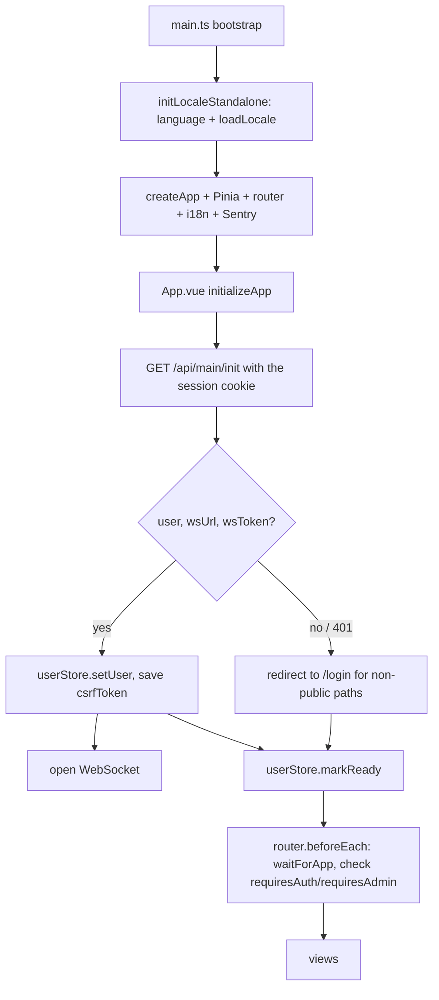

# Frontend

`packages/frontend` is a single-page application (SPA) on Vue 3 + Vite, which in production is served by the backend itself. This page is an overview. The details of individual subsystems are described on the backend pages, and here there are only links to them.

::: tip Need a different framework?
If you need a frontend on React, Svelte, Angular, a mobile client or another technology, you do not have to rewrite the template. It is enough to give the agent the task of creating next to it, in `packages/`, an analog of `packages/frontend` on the framework you need. This is realistic for two reasons:

- **The API contract is not tied to Vue.** The [`shared`](/en/shared/) package contains only arktype schemas, types and enums. A new frontend imports them just like the current one, and `pnpm typecheck` checks it against the same contract as the backend.
- **There is a ready sample.** The agent takes `packages/frontend` as the reference: an HTTP client with a cookie session and a CSRF token ([HTTP client, session and CSRF](#http-client-session-and-csrf)), WebSocket, push, PWA, i18n, router guards. It does not have to guess the backend protocol.

An example task for the agent:

```text
Create packages/frontend-react: an analog of packages/frontend on React + Vite.
Take API types and schemas only from the shared package. Repeat the HTTP client (session in a cookie,
CSRF token), WebSocket and the login and profile pages. Add the scripts typecheck, lint, test,
build so that pnpm -r typecheck and pnpm -r test pick them up.
```

The new package gets into the workspace automatically (`packages/*` in `pnpm-workspace.yaml`), and `pnpm typecheck`, `pnpm lint` and `pnpm test` check it together with the rest. Separately, you need to update the places where the name `frontend` is specified explicitly: `pnpm dev` in the root `package.json`, copying the build into `packages/backend/public` in the `Dockerfile` and `scripts/prod-local.sh`, and the e2e steps in CI.
:::

## Stack

The dependencies are taken from [`packages/frontend/package.json`](https://github.com/Blazheiko/vibe-template/blob/main/packages/frontend/package.json):

| Purpose            | Package                                                          |
| ------------------ | ---------------------------------------------------------------- |
| UI framework       | `vue` 3.5, `@vueuse/core`                                        |
| Build / dev        | `vite` 7, `@vitejs/plugin-vue`, `vite-plugin-vue-devtools`       |
| State              | `pinia`                                                          |
| Routing            | `vue-router` 5                                                   |
| i18n               | `vue-i18n` 11                                                    |
| Error monitoring   | `@sentry/vue`                                                    |
| PWA install prompt | `@khmyznikov/pwa-install`                                        |
| Other              | `mitt` (event bus), `dompurify`, `vue-advanced-cropper` (avatar) |
| Shared contracts   | `shared` (`workspace:*`)                                         |
| Tests              | `vitest`, `@vue/test-utils`, `jsdom`, `@playwright/test`         |
| Types              | `typescript` 6.0.3, `vue-tsc`                                    |

## Dev server and proxy

[`vite.config.ts`](https://github.com/Blazheiko/vibe-template/blob/main/packages/frontend/vite.config.ts): port `5173`, a single proxy key `/<prefix>` (the prefix from `VITE_API_PATH_PREFIX`, `api` by default) → `http://127.0.0.1:3000` with `ws: true`: it covers both HTTP and the WS endpoint `/<prefix>/websocket`. The alias `@` → `src/`. The `pwa-install` tag is declared as a custom element. Through `define`, `BUILD_TIMESTAMP` gets into the bundle, by which the versions of the app and the Service Worker are compared.

How to run together with the backend: [/en/guide/getting-started](/en/guide/getting-started), commands: [/en/reference/scripts](/en/reference/scripts).

## Environment variables

The `ImportMetaEnv` type in [`src/env.d.ts`](https://github.com/Blazheiko/vibe-template/blob/main/packages/frontend/src/env.d.ts) describes all the `VITE_*` variables that the app reads (the types are build strings). `ViteTypeOptions.strictImportMetaEnv` in the same file removes the index signature of `vite/client`, so accessing an undeclared variable is a type error. The variables:

| Variable                                                                                                                | Where it is used                                                                                                                                                                                                                     |
| ----------------------------------------------------------------------------------------------------------------------- | ------------------------------------------------------------------------------------------------------------------------------------------------------------------------------------------------------------------------------------ |
| `VITE_BASE_URL`                                                                                                         | the prefix for all HTTP requests in [`utils/base-api.ts`](https://github.com/Blazheiko/vibe-template/blob/main/packages/frontend/src/utils/base-api.ts)                                                                              |
| `VITE_API_PATH_PREFIX`                                                                                                  | the prefix of WS event names (`<prefix>/<route>`) in [`utils/ws-event.ts`](https://github.com/Blazheiko/vibe-template/blob/main/packages/frontend/src/utils/ws-event.ts); must match the backend `API_PATH_PREFIX`, `api` by default |
| `VITE_AUTH_PHONE_ENABLED`                                                                                               | `'true'` enables sign-in and registration by phone in [`AuthModals.vue`](https://github.com/Blazheiko/vibe-template/blob/main/packages/frontend/src/components/AuthModals.vue)                                                       |
| `VITE_SENTRY_ENABLED`, `VITE_SENTRY_DSN`, `VITE_SENTRY_ENVIRONMENT`, `VITE_SENTRY_RELEASE`, `VITE_SENTRY_*_SAMPLE_RATE` | Sentry configuration, see [/en/backend/observability](/en/backend/observability)                                                                                                                                                     |

Without `VITE_BASE_URL` (and with an empty value, as in `.env.example`) `base-api.ts` makes requests relative to the current origin: in dev through the Vite proxy, in production to the backend that serves the SPA. Set the variable only when the API lives on a different origin (the backend CORS must allow it).

## Structure of `src/`

| Directory / file                                                                                                    | Contents                                                                                                                                                                                                                                                                                                                                                                                                                                                             |
| ------------------------------------------------------------------------------------------------------------------- | -------------------------------------------------------------------------------------------------------------------------------------------------------------------------------------------------------------------------------------------------------------------------------------------------------------------------------------------------------------------------------------------------------------------------------------------------------------------- |
| [`main.ts`](https://github.com/Blazheiko/vibe-template/blob/main/packages/frontend/src/main.ts)                     | bootstrap: locale → `createApp` → Pinia, router, i18n → Sentry → `mount`; SW launch via `startServiceWorker`                                                                                                                                                                                                                                                                                                                                                         |
| [`App.vue`](https://github.com/Blazheiko/vibe-template/blob/main/packages/frontend/src/App.vue)                     | `initializeApp()`: calling `GET /api/main/init`, saving the user, opening the WebSocket                                                                                                                                                                                                                                                                                                                                                                              |
| `views/`                                                                                                            | pages: `Login`, `UserAccount`, `SupportView`, `VerifyEmailView`, `ResetPasswordView`, legal pages, `admin/`                                                                                                                                                                                                                                                                                                                                                          |
| `components/`                                                                                                       | `AppHeader`, `AuthModals` (the frame and step selection; the steps are in `auth/`: `LoginForm`, `ForgotPasswordFlow`, `RegisterEmailForm`, `RegisterPhoneFlow`, `AuthModalShell`; form styles are in `assets/auth-forms.css`), `MenuButton` (the menu; the "Install App" item is `PwaInstallButton`), `UpdateNotification`, `AvatarEditorModal`, `admin/` (`AdminUserDetailModal`, `AdminFilterBar` — a filter card shared by the user lists and the online history) |
| `composables/`                                                                                                      | `useWebSocketConnection`, `useBroadcastHandler`, `useSessionLifecycle`, `useLocale`, `useAdminUserDetailModal`, `useAuthRequest`, `useCompleteSignIn`, `useModalDialog` (the keyboard behaviour of a modal: initial focus, a Tab trap, Escape, focus return)                                                                                                                                                                                                         |
| `stores/`                                                                                                           | Pinia: `user`, `state` (theme, font, PWA mode, window sizes, storage config), `push` (push permission and subscription), `support`                                                                                                                                                                                                                                                                                                                                   |
| [`router/index.ts`](https://github.com/Blazheiko/vibe-template/blob/main/packages/frontend/src/router/index.ts)     | routes and guard                                                                                                                                                                                                                                                                                                                                                                                                                                                     |
| [`plugins/i18n.ts`](https://github.com/Blazheiko/vibe-template/blob/main/packages/frontend/src/plugins/i18n.ts)     | the `vue-i18n` instance                                                                                                                                                                                                                                                                                                                                                                                                                                              |
| `locales/`                                                                                                          | translation files                                                                                                                                                                                                                                                                                                                                                                                                                                                    |
| `utils/`                                                                                                            | HTTP client (`base-api.ts`, `api-client.ts`, `api.ts`), `csrf-token.ts`, WS contracts (`ws-client.ts`), WebSocket (`websocket-types.ts`, `ws-event.ts`, `websocket-close.ts`, `websocket-heartbeat.ts`), Sentry, `pwa-install.ts`, `event-bus.ts`                                                                                                                                                                                                                    |
| `types/`                                                                                                            | types, including `i18n.d.ts`                                                                                                                                                                                                                                                                                                                                                                                                                                         |
| [`service-worker.ts`](https://github.com/Blazheiko/vibe-template/blob/main/packages/frontend/src/service-worker.ts) | Service Worker, built separately                                                                                                                                                                                                                                                                                                                                                                                                                                     |

The overall structure of the monorepo: [/en/guide/project-structure](/en/guide/project-structure).

### Router and guard

Routes have `meta` (`requiresAuth`, `requiresAdmin`, `hideHeader`, `authModal` and so on, the types are extended in `env.d.ts`). For protected routes `router.beforeEach` waits for `waitForApp()` from the `user` store, i.e. for `initializeApp` to finish. Public pages (sign-in, email verification, password reset) do not wait for initialization. Without a user the guard redirects to `/login?redirect=<path>`. After sign-in `redirect` is used only if it is a path inside the app (`/…`, without `//`, backslashes and control characters, [`safe-redirect.ts`](https://github.com/Blazheiko/vibe-template/blob/main/packages/frontend/src/utils/safe-redirect.ts)); otherwise the user lands on `/account`. A `requiresAdmin` route redirects a non-admin to `/account`.

### i18n

The interface is translated into three languages: `en`, `uk`, `pl` (the list is `SHIPPED_LOCALE_CODES` of the [`shared`](/en/shared/) package, one file each in `src/locales/`; the `locales.spec.ts` test makes sure there are exactly that many files and that `uk` and `pl` have all the `en` keys with the same placeholders). `APP_LOCALE_CODES` (18 codes) is wider: it is used by language detection and by Support AI, which also answers in languages without an interface translation. Only `en` is in the main bundle. `loadLocale()` loads `uk` and `pl` with a dynamic `import()` and merges them with `en`, so missing keys are shown in English; if a file failed to load, `loadLocale()` returns `en` and writes a warning, so choosing a language does not leave the interface without text. The initial language is determined by `initLocaleStandalone()` in [`composables/useLocale.ts`](https://github.com/Blazheiko/vibe-template/blob/main/packages/frontend/src/composables/useLocale.ts) from `navigator.language`; if the language is not among the three, it takes `en` (a `ru-RU` or `de-DE` browser gets an English interface). The frontend asks Support AI to answer in the browser language (`supportLanguage()`), not in the interface language. A new language is added with a file in `src/locales/` and a code in `SHIPPED_LOCALE_CODES`.

## HTTP client, session and CSRF

[`utils/base-api.ts`](https://github.com/Blazheiko/vibe-template/blob/main/packages/frontend/src/utils/base-api.ts) wraps `fetch` (the transport). On top of it, [`utils/api-client.ts`](https://github.com/Blazheiko/vibe-template/blob/main/packages/frontend/src/utils/api-client.ts) provides `callApi(contract, input)`: a contract from `shared/contracts` names the method, the path and the types of the body, the query and the response (ADR 0005). [`utils/api.ts`](https://github.com/Blazheiko/vibe-template/blob/main/packages/frontend/src/utils/api.ts) is built on `callApi` and contains typed methods (`/api/auth/*`, `/api/main/*`, `/api/push-subscriptions*`). WS requests go through a contract too: `callWs(contract, payload)` from [`utils/ws-client.ts`](https://github.com/Blazheiko/vibe-template/blob/main/packages/frontend/src/utils/ws-client.ts) (ADR 0006); it resolves with the reply, a business error included (`data.status === 'error'`), and rejects only on a transport error or a timeout. ESLint ([`eslint.config.ts`](https://github.com/Blazheiko/vibe-template/blob/main/packages/frontend/eslint.config.ts)) forbids, outside these modules and tests, importing the transport (the default export of `base-api.ts`), `fetch`, and calls to `api.http`/`api.upload` and `websocketApi`, so `callApi` and `callWs` are the only allowed way.

- All requests go with `credentials: 'include'`, so the browser itself sends the session cookie. JS does not read it.
- The CSRF token is not embedded in HTML. It arrives in the `csrfToken` field of the response (including `init`) and is kept in the memory of the [`utils/csrf-token.ts`](https://github.com/Blazheiko/vibe-template/blob/main/packages/frontend/src/utils/csrf-token.ts) module. The token is checked with the regex `^[A-Za-z0-9_-]{32,128}$`. Only a **confirmed** token goes into `X-CSRF-Token` — one known to belong to a given session (`main/init`, a response with `user`, logout, a 2xx to a request signed with the confirmed token). A token in a 403/401 from the middleware chain stays unconfirmed and is never sent.
- For `POST`/`PUT`/`PATCH`/`DELETE` the client adds the `X-CSRF-Token` header.
- When the server returns `403 csrf_invalid` with `reason: token_mismatch`, the client silently (no events, no redirect) asks `main/init` and repeats the request **once** with the new token — only if the session still belongs to the same user. `origin_mismatch` and `fetch_site_*` are never repeated. If the session now belongs to another user, the page reloads (`clientCode: 'account_changed'`). Details: [`packages/frontend/README.md`](https://github.com/Blazheiko/vibe-template/blob/main/packages/frontend/README.md#csrf-and-the-session). The client turns an unauthorized response into an `unauthorized` event in the event bus.
- Errors are not thrown: the method returns `{ data, error }`, where `error` has normalized `code` and `transportCode`. The normalization lives in `utils/response-normalizer.ts`.

The server side of this mechanism is described in [Security → CSRF](/en/backend/security#csrf).

## WebSocket and push

- After a successful `init`, `App.vue` opens the WebSocket with `data.wsUrl` and `data.wsToken`. The client (`useWebSocketConnection`, `ws-event.ts`, heartbeat, the broadcast handler) is described in [/en/backend/websocket](/en/backend/websocket). The prefix is set by `VITE_API_PATH_PREFIX` (`api` by default), it must match the backend `API_PATH_PREFIX`. Both the WS events and all HTTP paths are built from it ([`utils/api-path.ts`](https://github.com/Blazheiko/vibe-template/blob/main/packages/frontend/src/utils/api-path.ts): `apiPath('auth/login')` → `/<prefix>/auth/login`), as well as OAuth links, screenshot and storage URLs, the API request filter in the service worker and the Vite proxy key (`/<prefix>` with `ws: true` covers the WS endpoint `/<prefix>/websocket` too).
- The Web Push subscription works through `/api/push-subscriptions*` (VAPID key, CRUD). How the SW handles push is described in [Web Push notifications](/en/backend/web-push-notification#frontend).

## PWA

- **Service Worker** is a separate build, [`vite.sw.config.ts`](https://github.com/Blazheiko/vibe-template/blob/main/packages/frontend/vite.sw.config.ts): lib mode, `iife` format, the result is `dist/service-worker.js`, `emptyOutDir: false` so as not to erase the app bundle. [`utils/sw-manager.ts`](https://github.com/Blazheiko/vibe-template/blob/main/packages/frontend/src/utils/sw-manager.ts) (`startServiceWorker`, called by `main.ts`) registers it only in production (`scope: '/'`, `updateViaCache: 'none'`) after the `load` event. In dev, already installed SWs are unregistered.
- **Updates.** `sw-manager.ts` compares the `BUILD_TIMESTAMP` of the app and of the SW (via `MessageChannel`, `GET_BUILD_TIMESTAMP`). When the difference is more than 10 minutes and it is not the first install, it calls `announceUpdate` (`main.ts` emits `update_available`) — at most once, no matter how many signals arrive, and `UpdateNotification` shows the message. SW errors (`SW_ERROR`) are forwarded to Sentry.
- **Installation.** The `@khmyznikov/pwa-install` web component is used in `MenuButton.vue` (the logic is the [`usePwaInstallButton`](https://github.com/Blazheiko/vibe-template/blob/main/packages/frontend/src/composables/usePwaInstallButton.ts) composable, the item itself is `PwaInstallButton.vue`), and the `beforeinstallprompt` state is kept by [`utils/pwa-install.ts`](https://github.com/Blazheiko/vibe-template/blob/main/packages/frontend/src/utils/pwa-install.ts) (`initializePwaInstallTracking()` is called at startup).
- **Offline and caching** in the SW: [/en/backend/caching-etag](/en/backend/caching-etag).

## Build and tests

`pnpm --filter frontend build` runs `vue-tsc --build` and `vite build` in parallel, and then `build-sw`. The result is in `packages/frontend/dist`. In the Docker image, the [`Dockerfile`](https://github.com/Blazheiko/vibe-template/blob/main/Dockerfile) copies `dist` into `packages/backend/public`, from where the backend serves it. Details: [/en/backend/deployment](/en/backend/deployment).

In the production build (the app and the Service Worker) the calls `console.log`, `console.info`, `console.debug` and `console.trace` are stripped by the minifier: [`vite.console.ts`](https://github.com/Blazheiko/vibe-template/blob/main/packages/frontend/vite.console.ts) passes them to `esbuild.pure`. This way tokens and user data, including those from third-party dependencies, do not end up in the browser console. `console.warn` and `console.error` stay. In dev mode (`pnpm dev`) the code is not minified, so all logs are in place. Do not rely on this stripping as protection: secrets should not be logged in dev either.

Unit tests (Vitest, `src/**/__tests__`) and e2e (Playwright, `e2e/`) are described in [/en/backend/testing](/en/backend/testing). The Playwright `webServer` runs `pnpm run dev` (`pnpm run preview` on CI).

## App startup


