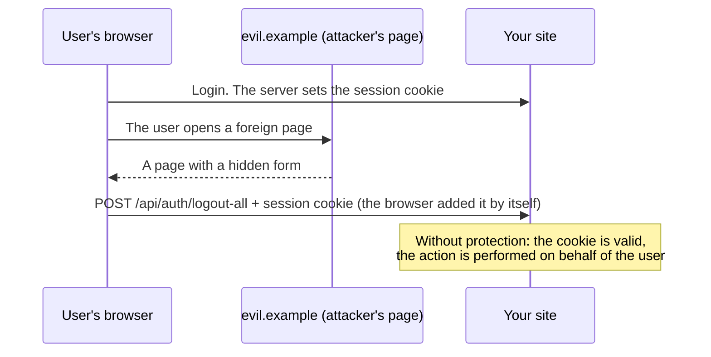
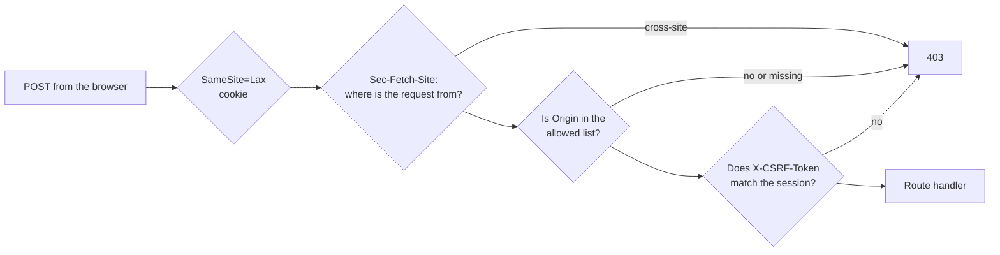
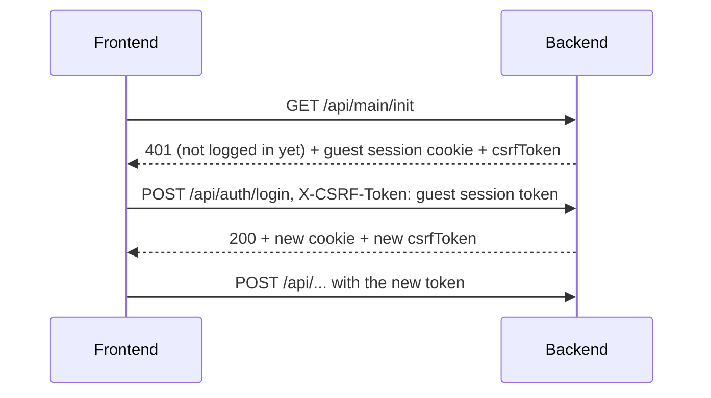

# CSRF in plain words

::: info Before you read
You don't need to know anything. It helps to have an idea of what a [cookie](/en/reference/glossary#cookie) and a [session](/en/reference/glossary#session) are; both terms are explained in the glossary. The technical reference with all variables and error codes is the [CSRF](/en/backend/security#csrf) section on the "Authentication and security" page.
:::

This page explains what a CSRF attack is, why you need to defend against it specifically in an app with cookie sessions, and how the protection is built in this template. Most of the protection works by itself: the frontend and backend already do everything. At the end: what you need to know when you add your own routes or test the API with curl.

## What is CSRF

**CSRF** (Cross-Site Request Forgery) is an attack where a foreign site makes the user's browser send a request to your site **on behalf of that user**.

An analogy. You are logged in to your bank, and the browser holds the bank's "pass", the session cookie. Then you open a completely different site, for example a page with cats. It has a hidden form that submits itself to the bank's address: "transfer 1000 to account X". The browser honestly adds the bank's cookie to this request, because that is how cookies work: they go to their own site, wherever the request started. The bank sees a valid cookie and thinks you made the request.



Important details:

- The attacker **cannot see** the response and cannot read the cookie. They don't need to: it is enough for the action to be performed.
- Only requests that **change** data are dangerous: `POST`, `PUT`, `PATCH`, `DELETE`. That is why the protection in the template checks only them; `GET` should only read.
- The attack works precisely because the session is held in a cookie. If the access token were added by JavaScript every time (like an `Authorization` header), a foreign site could not insert it. But `HttpOnly` cookies are safer against theft via XSS, so the template chooses cookies and closes CSRF separately.

## How the template protects itself: four layers

Each layer can only **reject** a request; none lets you skip the following ones. If an attacker bypasses one layer, another will stop them.



### 1. Cookie with `SameSite=Lax`

The session cookie has the `SameSite=Lax` attribute. It tells the browser: "do not send this cookie if the request came from another site", except for an ordinary link navigation. A modern browser simply will not add the cookie to the hidden form from `evil.example`. But you cannot rely on this alone: old browsers and special cases exist, so there are three more layers.

### 2. `Sec-Fetch-Site`: the browser itself says where the request is from

Modern browsers add the `Sec-Fetch-Site` header to every request, and JavaScript on the page cannot forge it. The value `same-origin` means "a request from the same site", `cross-site` means "from a foreign one". The template immediately rejects `cross-site` with `403` and the reason `fetch_site_cross_site`.

### 3. `Origin`: the address of the page that sent the request

The browser adds the `Origin` header to a `POST`: the scheme, domain and port of the page the request came from, for example `https://app.example.com`. The server compares it with the list of trusted addresses `CSRF_ALLOWED_ORIGINS`. A foreign origin, `Origin: null` (this happens with sandboxes and local files) or a request with neither `Origin` nor `Referer` gets `403` with the reason `origin_mismatch`.

### 4. CSRF token: a secret the attacker does not have

The main layer. For each session the server generates a random **CSRF token** and stores it next to the session in Redis. The frontend adds this token to every request that changes data, in the `X-CSRF-Token` header. The server compares: the token in the header must match the session token.

A foreign site cannot learn the token: it cannot read your server's response (the browser forbids this), so it cannot insert the token either. A mismatched token gets `403` with the reason `token_mismatch`.

## Where the frontend gets the token

The token comes in the `GET /api/main/init` response, the first request the app makes after loading. The frontend keeps it in memory only and updates it from responses that issue a new token (login, logout, password change).

::: tip Why the token is not embedded in the HTML
The template is a PWA: the Service Worker caches the HTML page so the app opens offline. If the token were in the HTML, a stale token could come from the cache, and requests would fail with `403`. So the HTML is the same for everyone and contains nothing secret, while the token always arrives fresh from the API. The Service Worker **never** caches API responses.
:::



### Even login needs a token

It may seem strange that a token is needed before login. But there is a separate kind of attack, **login CSRF**: a foreign site quietly logs you in to the **attacker's account**. You think you are working in your own account and save data there, while the attacker reads it. So even before login the server creates a guest session with its own token, and the login request must come with it.

## What the frontend does when something goes wrong

These cases are handled by `src/utils/base-api.ts`; you don't need to write your own code.

- **The token is stale.** For example, you changed the password in a neighboring tab and the session was renewed. The request gets `403 token_mismatch`. The frontend quietly re-requests `main/init` and, if it is the same user there, repeats the request **once** with the fresh token. The action is performed exactly once.
- **Someone logged in as a different account in another tab.** The cookie is shared by all tabs, so the session already belongs to another person. The frontend does not send the action meant for the previous user, but reloads the page to show the current account and not leave the previous one's data in memory.
- **Someone logged out in another tab.** There is no retry: the user is taken to the login page.
- **The server does not respond.** The action is not sent blindly: the call gets an error, and the next action will try to check the session again. The wait is limited to 10 seconds.
- **The reasons `origin_mismatch` and `fetch_site_*`** cannot be fixed by a retry, so the frontend returns the error right away.

## What a developer needs to know

### A new route that changes data

Add it to a route group that has `session_web` and `csrf_guard`; all groups in [`http-routes.ts`](https://github.com/Blazheiko/vibe-template/blob/main/packages/backend/src/app/routes/http-routes.ts) are built this way. Then the protection works automatically. The frontend inserts the token itself if you call the API via `baseApi.http` or `baseApi.upload`.

This is the rule for routes called by our frontend. A route of the public API for other servers and apps takes credentials from a header, not from a cookie, so CSRF is not a threat to it: it goes into a separate group without `session_web` and `csrf_guard`. See [Web routes and public API](/en/backend/web-and-api-routes).

If the new request is made by an **unauthenticated** user (like login or password reset), pass `{ csrfRecovery: 'public' }`: this way the frontend knows that a retry in a guest session is acceptable. Examples are in [`api.ts`](https://github.com/Blazheiko/vibe-template/blob/main/packages/frontend/src/utils/api.ts).

### Settings

| Variable               | Default | What it does                                                                                                                                                                                                                                 |
| ---------------------- | ------- | -------------------------------------------------------------------------------------------------------------------------------------------------------------------------------------------------------------------------------------------- |
| `CSRF_ENFORCE`         | `true`  | Reject violations with `403`. `false` only writes to the log (for diagnostics); the server warns about this at startup.                                                                                                                      |
| `CSRF_STRICT_ORIGIN`   | `true`  | Reject requests with neither `Origin` nor `Referer`. The server also accompanies `false` with a warning at startup.                                                                                                                          |
| `CSRF_ALLOWED_ORIGINS` | empty   | Trusted frontend addresses, comma-separated, for example `https://app.example.com`. **Required** in production: without it the server does not start. Locally, an empty value means "trust the addresses from `APP_URL` and `FRONTEND_URL`". |

The protection is on by default: if the variables are not set or are empty, `true` applies. You can turn the check off only explicitly, by writing `false` (or `0`, `no`, `off`), and this will not go unnoticed: at every startup, locally too, the log will have a `warn` with the name of the disabled variable.

The frontend and the API must be on the same site: on the same domain or on subdomains of one domain (`app.example.com` and `api.example.com`). On completely different domains the browser will not send the session cookie because of `SameSite=Lax`.

### Testing with curl or the API Playground

curl is not a browser and does not add the `Origin` header by itself. Pass it explicitly together with the token:

```bash
B=http://127.0.0.1:3000/api
O='origin: http://localhost:5173'
CSRF=$(curl -s -c cookies.txt -b cookies.txt $B/main/init | sed -E 's/.*"csrfToken":"([^"]+)".*/\1/')
curl -s -b cookies.txt -c cookies.txt -H "$O" -H 'content-type: application/json' \
  -H "x-csrf-token: $CSRF" -d '{"email":"user@example.com","password":"<user-password>","token":""}' \
  $B/auth/login
```

The full scenario is in the [Quick start](/en/guide/getting-started#the-same-with-curl). The [API Playground](/en/playground/) runs on port `5174`, so add its address to `CSRF_ALLOWED_ORIGINS`.

### What `403 csrf_invalid` means

| `reason`                | What happened                                                                             | What to do                                                                            |
| ----------------------- | ----------------------------------------------------------------------------------------- | ------------------------------------------------------------------------------------- |
| `token_mismatch`        | The `X-CSRF-Token` header is missing or the token is from another session                 | Get a fresh token from `GET /api/main/init`. The token changes after login or logout. |
| `origin_mismatch`       | `Origin` is not in the list, `Origin: null`, or neither `Origin` nor `Referer` is present | Check `CSRF_ALLOWED_ORIGINS`; in curl add `-H 'origin: ...'`.                         |
| `fetch_site_cross_site` | The browser reported that the request is from a foreign site                              | The frontend and API are on different sites: this setup is not supported.             |
| `fetch_site_invalid`    | Unknown `Sec-Fetch-Site` value                                                            | Check the proxy or client that sets this header.                                      |

## What next

- [Authentication and security → CSRF](/en/backend/security#csrf): the exact order of checks, session rotation, all the details.
- [How the backend works](/en/guide/how-backend-works): where `csrf_guard` stands among the other middleware.

::: tip Check it yourself
Run the project following the [Quick start](/en/guide/getting-started) and send `POST /api/auth/logout` with curl without the `origin` header. The server responds `403` with `reason: origin_mismatch`. Add `-H 'origin: http://localhost:5173'`: now the `403` will be with `token_mismatch`. Add `x-csrf-token` as well: the request goes through.
:::
