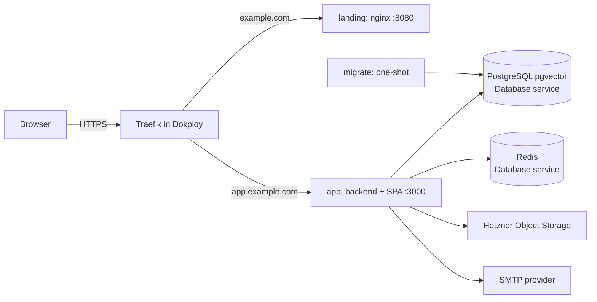

# Deploying to Hetzner with Dokploy

This page walks through deploying the application (the backend serving the SPA) and the landing to a Hetzner Cloud server with [Dokploy](https://docs.dokploy.com/). The application is described by [`docker-compose-prod.yml`](https://github.com/Blazheiko/vibe-template/blob/main/docker-compose-prod.yml) at the repository root, and the variables by the template [`.env.prod.example`](https://github.com/Blazheiko/vibe-template/blob/main/.env.prod.example).

::: warning Not verified
The guide has not been run on a real server yet. Only the production mode of the compose file is checked locally (`make prod-smoke`, see [Checks without a server](#checks-without-a-server)). How Traefik treats `X-Forwarded-For` and the work with the Dokploy databases have to be checked on the first deploy.
:::

## Topology



- **The compose file has three services:**
    - `migrate` is a one-shot run: `db:create:prod` (the database and the `vector` extension) and `db:migrate`;
    - `app` is the root `Dockerfile`, the backend serving the built SPA;
    - `landing` is the nginx image of the [landing](/en/landing/).
- **PostgreSQL and Redis are not in the file.** They are Database services you create by hand in the Dokploy panel: no External Port, backups on the Backups tab. `app` and `migrate` reach them on the external network `dokploy-network`.
- **S3 and mail are external:** Hetzner Object Storage and any SMTP provider.
- **Domains and TLS are set on the Domains tab of Dokploy.** Traefik adds its own labels. The file has no `ports`, only `expose`, so nothing is published on the host.

The URL contract in production:

| What              | Value                                                        |
| ----------------- | ------------------------------------------------------------ |
| Application       | `https://${APP_DOMAIN}` → service `app`, port `3000`         |
| Landing           | `https://${LANDING_DOMAIN}` → service `landing`, port `8080` |
| API and WebSocket | `https://${APP_DOMAIN}/${API_PATH_PREFIX}/…`                 |
| Landing buttons   | `https://${APP_DOMAIN}/login`, `/register`                   |
| RP ID of passkeys | `${APP_DOMAIN}`                                              |

The compose file derives `APP_URL`, `FRONTEND_URL`, `DOMAIN`, `LANDING_URL`, `CSRF_ALLOWED_ORIGINS` and `WEBAUTHN_RP_ID` from the two domains, so you do not set them separately.

## Prerequisites

- **A Hetzner Cloud server** with Ubuntu 24.04 and at least 4 GB RAM: the frontend is built on the server. On 2 GB the build can fail with OOM; add swap then (`fallocate -l 4G /swapfile && chmod 600 /swapfile && mkswap /swapfile && swapon /swapfile`, plus a line in `/etc/fstab`).
- **DNS:** A records `example.com`, `www.example.com` and `app.example.com` pointing at the server IP.
- **Dokploy** installed by [its guide](https://docs.dokploy.com/docs/core/installation) (`curl -sSL https://dokploy.com/install.sh | sh`).
- **Hetzner Cloud Firewall:** inbound 22, 80 and 443. Open the Dokploy panel (host port `3000`) to your own IP only, or publish it through a panel domain with HTTPS.
- **A Hetzner Object Storage bucket** and its access keys. Set the bucket CORS from [`corsS3.prod.example.xml`](https://github.com/Blazheiko/vibe-template/blob/main/corsS3.prod.example.xml) with your application domain.
- **An SMTP provider** with a sender address on your domain.

## Preparing the repository

- Change `PRODUCT.siteUrl` in [`packages/shared/src/product/index.ts`](https://github.com/Blazheiko/vibe-template/blob/main/packages/shared/src/product/index.ts) to `https://<APP_DOMAIN>/`: this address is set in the code, not in `.env`.
- Rewrite the landing texts for your product ([Landing page](/en/landing/)).
- Choose the deploy branch (usually `main`): every push to it starts a new deploy.

## Databases in Dokploy (by hand)

Create them before the application: the compose service refers to their addresses, and `depends_on` cannot point at services outside the file.

1. **PostgreSQL:** Project → Create Service → Database → PostgreSQL.
    - Docker Image: `pgvector/pgvector:pg16`. The stock image has no `vector`, and the migrations fail on it.
    - Set the Database Name (`vibe_template`), User and Password, and leave External Port empty.
    - Click Deploy.
2. **Redis:** Create Service → Database → Redis, with a password and no External Port. Click Deploy.
3. On the General tab of each service, open **Internal Credentials**. The Internal Host (the service's App Name), port, user, password and database name go to the application's `PGSQL_*` and `REDIS_*` variables.

## The application in Dokploy

1. Project → Create Service → **Compose**, type **Docker Compose** (not Stack: Stack cannot `build`).
2. Provider: your git repository, the deploy branch, Compose Path `./docker-compose-prod.yml`.
3. **Environment:** paste `.env.prod.example` and fill in the values.
    - `APP_DOMAIN` and `LANDING_DOMAIN` are hosts only, without `https://`.
    - `APP_KEY`: `openssl rand -base64 48`.
    - `MFA_ENCRYPTION_KEYS`: `pnpm --filter backend mfa:keys` on your machine, or `echo "k1:$(openssl rand -base64 32)"`. Losing the key makes every TOTP factor unusable.
    - `PGSQL_*` and `REDIS_*` come from Internal Credentials.
    - `TRUSTED_PROXY_CIDRS` is the subnet of `dokploy-network`. Look it up on the server: `docker network inspect dokploy-network` (the `IPAM.Config[0].Subnet` field).
    - `S3_*`, `CDN_URL` and `SMTP_*` come from Hetzner Object Storage and the mail provider.

    The compose file writes required variables as `${VAR:?…}`: without any of them the deploy stops at once, and the log names it.

4. **Domains:** add two domains.
    - `app.example.com` → service `app`, port `3000`, HTTPS (Let's Encrypt).
    - `example.com` → service `landing`, port `8080`, HTTPS.
    - Optionally `www.example.com` redirecting to `example.com` (a Traefik middleware in Dokploy).
5. **Deploy.** Then turn on AutoDeploy on the Deployments tab: add the Dokploy webhook to the repository settings.

Leave Isolated Deployments off: `app` and `migrate` have to stay on `dokploy-network`, or the databases are out of reach.

## The first deploy

1. **Build.** Dokploy clones the repository and builds the images on the server (`docker compose up --build`). The first build takes a few minutes.
2. **Migrations.** `migrate` creates the database and the `vector` extension and applies the migrations. If the database is not ready yet, `migrate` fails and `app` does not start; deploy again.
3. **`app` starts.** `app` starts after a successful `migrate`. Its healthcheck waits for `/<prefix>/ready`, that is, until PostgreSQL and Redis answer. A failed configuration check stops the container with the reason in the log (`Invalid … configuration`).
4. **Logs** are on the Logs tab of the service (pick `migrate`, `app` or `landing`).
5. **Seed** by hand, once: in the terminal of the `app` container (Terminal tab), run `pnpm db:seed:prod`. It adds the reference data (LLM prompts). No demo accounts are created in production. How to get the first administrator is described in [The first admin in production](/en/backend/database#the-first-admin-in-production).

## Checks

Run on your machine:

```bash
scripts/verify-landing-deploy.sh https://example.com https://app.example.com
curl -fsS https://app.example.com/api/ready
```

- Open the landing, follow its buttons to sign-in and sign-up, and register.
- Check that the confirmation mail arrives.
- Check a forged `X-Forwarded-For` as described in [Rate limit at the edge](/en/backend/deployment#rate-limit-at-the-edge). A few sign-ins with a wrong password and different `X-Forwarded-For: 203.0.113.N` must hit one per-IP limit. If they do not, Traefik passes the client's header through and needs `forwardedHeaders` set.

## Updates and rollback

- **Update:** push to the deploy branch, and AutoDeploy builds and rolls out the new commit. `migrate` runs before the new `app`.
- **Rollback:** redeploy the previous commit (Deployments tab). Migrations only go forward: if the rollback touches the schema, restore the database from a backup by hand.
- **Changing the application domain** needs a new landing build (the addresses are compiled into the HTML), and the passkeys of the old domain stop working.

## Backups and restore

- **PostgreSQL backups:** on the Backups tab of the PostgreSQL service, add a destination (a Hetzner Object Storage bucket) and a `pg_dump` schedule.
- **Manual backup:** `docker exec <postgres container> pg_dump -U postgres -Fc vibe_template > backup.dump`.
- **Restore:** `docker exec -i <postgres container> pg_restore -U postgres -d vibe_template --clean < backup.dump`, with `app` stopped.
- **Redis** is not backed up separately. With its volume go the anonymous and user sessions (everyone is signed out), the rate-limit counters, MFA tickets and one-time WS tokens. User data stays in PostgreSQL.

## Checks without a server

- `make verify-compose` (part of `make check` and CI) checks `docker-compose-prod.yml` with `.env.prod.example`:
    - every variable of the file is in the template;
    - without `APP_DOMAIN` the file does not resolve;
    - there are no `ports`, database services, volumes or Traefik labels;
    - there are healthchecks and `restart`;
    - `API_PATH_PREFIX` is the same at build and run time, and the landing is built for the application's addresses;
    - `app` and `migrate` are on the external `dokploy-network`.
- `make prod-smoke` brings up the same file with [`docker-compose-prod.smoke.yml`](https://github.com/Blazheiko/vibe-template/blob/main/docker-compose-prod.smoke.yml). There Caddy with an internal TLS certificate stands in for Traefik, local PostgreSQL and Redis for the Database services, and SeaweedFS and Mailpit for the external S3 and SMTP. The script checks:
    - the landing (`verify-landing-deploy.sh`);
    - `/api/ready`;
    - a `__Host-` cookie with `Secure`;
    - a registration, the email confirmed by the link of its mail (Mailpit) and a sign-in through the API.

    The application runs in production mode meanwhile. `SMOKE_KEEP=true make prod-smoke` leaves the stack running, so you can open `https://app.localhost:8443` in a browser.

## Checklist and troubleshooting

| Symptom                                                | Cause and fix                                                                                                                 |
| ------------------------------------------------------ | ----------------------------------------------------------------------------------------------------------------------------- |
| `migrate` cannot connect to the database               | the databases are not created, a wrong Internal Host, the service is not on `dokploy-network` (turn off Isolated Deployments) |
| `CREATE EXTENSION vector` fails                        | PostgreSQL runs the stock image: use `pgvector/pgvector:pg16`                                                                 |
| the deploy stops with `required variable … is missing` | the variable is not set in Environment                                                                                        |
| 502 from Traefik                                       | a wrong port in Domains: `app` is `3000`, `landing` is `8080`                                                                 |
| no cookie is set, the sign-in does not hold            | `APP_DOMAIN` is not the domain the site is opened from, or HTTPS is off                                                       |
| `403 csrf_invalid` with `origin_mismatch`              | the site is opened from a domain other than `APP_DOMAIN`                                                                      |
| the SPA calls the wrong API address                    | `API_PATH_PREFIX` changed without a new build: redeploy                                                                       |
| every request counts as one IP                         | `TRUSTED_PROXY_CIDRS` does not match the subnet of `dokploy-network`                                                          |
| the build fails with OOM                               | not enough memory: 4 GB or swap                                                                                               |
| the landing does not build                             | strict mode: `APP_DOMAIN` and `LANDING_DOMAIN` must be public, different and not placeholders (`example.com` does not pass)   |

The general production requirements (variables, Redis, S3, checklist) are on the [Deployment](/en/backend/deployment) page.
