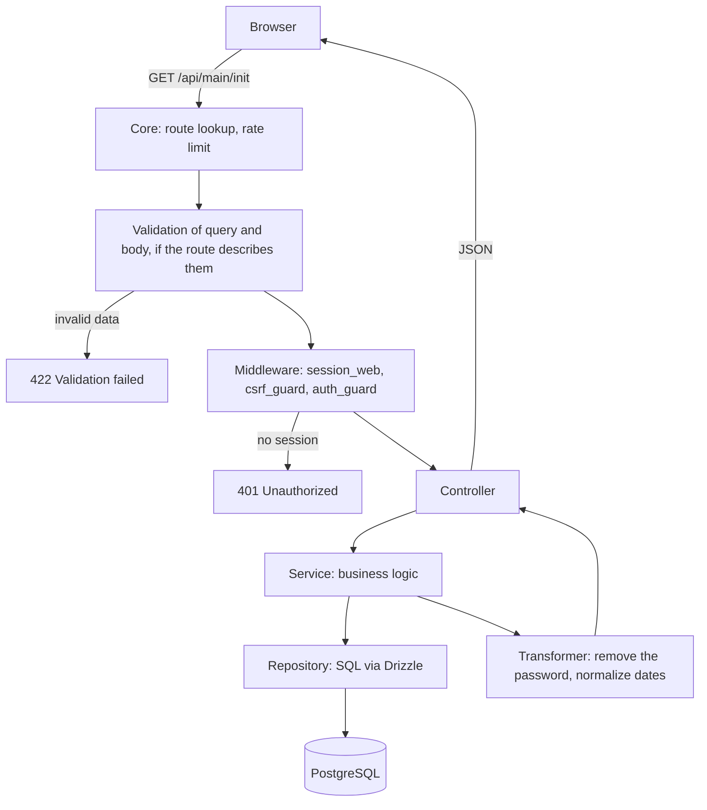
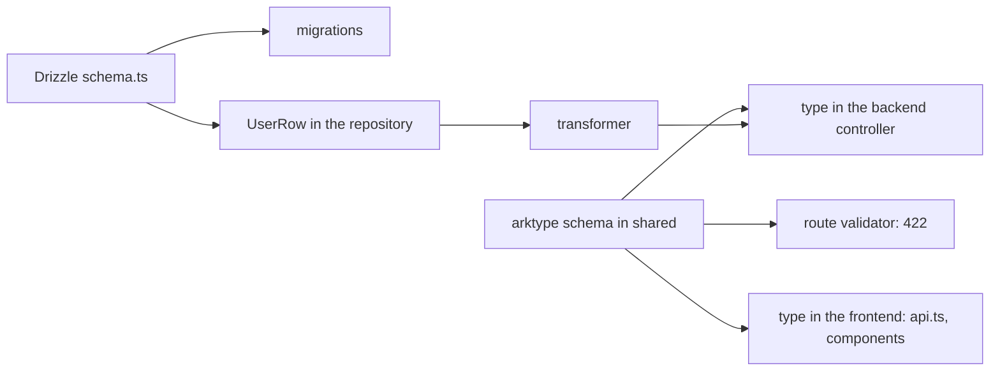

# How the backend works

::: info Before you read
You don't need to know anything. It will be easier if the project is already running via the [Quick start](/en/guide/getting-started): then you can check the examples right away.
:::

This page is for those who have opened the template for the first time. It explains, without unnecessary detail, what the backend consists of, what happens to a request, and why the code is laid out this way. The technical details of each topic are on separate pages of the [Backend](/en/backend/) section, with links along the way.

## In short

The backend is a single Node.js process that:

1. accepts [HTTP requests](/en/reference/glossary#http-method) (`/api/...`) and WebSocket connections;
2. checks who has come and whether they are allowed to do this;
3. runs business logic, reads and writes data in PostgreSQL, keeps sessions in Redis;
4. returns a [JSON response](/en/reference/glossary#json) or sends an event through the WebSocket.

It is written on [uWebSockets.js](https://github.com/uNetworking/uWebSockets.js), a very fast server written in C++. There is no Express, Fastify or NestJS here: instead, the `src/vendor/` directory holds a small custom "core" that handles routing, request body reading, sessions, limits and logging. You don't need to change it to add a feature: all your code lives in `src/app/`.

::: tip Why not Express?
uWebSockets.js is one of the fastest HTTP/WebSocket servers for Node.js according to [the author's public benchmarks](https://github.com/uNetworking/uWebSockets/tree/master/benchmarks). The repository has no measurements of its own for this template, so the real gain depends on your load: if most of the time goes to DB or AI requests, the server speed matters much less. The second advantage is that HTTP and WebSocket work in one process. The price is that it has no [middleware](/en/reference/glossary#middleware) ecosystem like Express. The template fills this gap: CORS, CSRF, sessions, rate limiting, validation and static files are already written and tested.
:::

## The path of a single request

Imagine the frontend calls `GET /api/main/init` to find out who is currently logged in.



1. **The core** finds the route and checks the request limit (rate limit). If the limit is exhausted, the request goes no further.
2. **Validation.** If the route describes a schema for query parameters, the core checks them. For `POST`, `PUT` and `PATCH` the core also reads the request body and validates it against the route schema. Our `GET` has no body, so this step is almost empty for it. Invalid data gets a `422` before the middleware and your code.
3. **Middleware** check the request one after another: `session_web` restores the [session](/en/reference/glossary#session) from the [cookie](/en/reference/glossary#cookie), `auth_guard` cuts off the unauthenticated with a `401`. `csrf_guard` is also in the chain, but checks nothing for `GET`: a CSRF token is only needed for requests that change data (`POST`, `PUT`, `PATCH`, `DELETE`).
4. **Controller** takes the request data and calls the needed service.
5. **Service** runs the logic: checks permissions, calculates, calls other services.
6. **Repository** queries the database.
7. **Transformer** turns a database row into a safe object for the client (without the password, tokens and so on).
8. The controller returns the result, and the core serializes it to JSON.

::: info Simplified
Some steps are omitted here: CORS headers, the `Content-Type` and body size check, error handling. The full order with links to the code is in [Request lifecycle](/en/backend/request-lifecycle).
:::

## Why so many layers

Beginners often think it is simpler to write everything in one handler. On a small project that works, but as it grows such code becomes hard to test and change. Layers separate responsibilities:

| Layer       | Responsible for                        | What must **not** be here            | Where it lives                               |
| ----------- | -------------------------------------- | ------------------------------------ | -------------------------------------------- |
| Route       | URL, method, schema, middleware, limit | Logic                                | `app/routes/http-routes.ts`, `ws-routes.ts`  |
| Middleware  | Checks before the handler              | Business rules of a specific feature | `app/middlewares/`, registry in `kernel.ts`  |
| Controller  | "Translate" HTTP into a service call   | SQL, complex calculations            | `app/controllers/http`, `app/controllers/ws` |
| Service     | Business logic, decisions, errors      | Direct access to tables              | `app/services/`                              |
| Repository  | Database queries                       | Logging, business decisions          | `app/repositories/`                          |
| Transformer | The shape of data for the client       | Database calls                       | `app/transformers/`                          |

What this gives in practice:

- **A service can be tested without HTTP and without a database**, by substituting the repository.
- **One service is used by both HTTP and WebSocket controllers**, so logic is not duplicated.
- **A DB schema change touches only the repository**, not all the code.
- **A password will not end up in a response by accident**, because data reaches the client only through a transformer.

The rules between layers are checked by the test [`layering.spec.ts`](https://github.com/Blazheiko/vibe-template/blob/main/packages/backend/src/app/layering.spec.ts): if a controller imports a repository directly, `pnpm test` fails. More in [Architecture](/en/backend/architecture).

## Errors without exceptions

Services do not `throw` on expected errors ("user not found", "wrong password"). They return a `Result` from the `better-result` library:

```ts
if (user === null) return Result.err(notFound('User', 'User not found'))
return Result.ok({ user })
```

The controller checks the result and turns the error into the right HTTP status via `mapControllerError`. This way errors are visible in the types: TypeScript will not let you forget that a call can fail. More in [Controllers → Error mapping](/en/backend/controllers#error-mapping).

## Where types come from: a single source of truth

The template almost never has types written by hand. They are **derived** from two descriptions, each of which is a [single source of truth](/en/reference/glossary#single-source-of-truth) for its contract:

| Contract                                 | Source                                                   | What comes out of it                                                           |
| ---------------------------------------- | -------------------------------------------------------- | ------------------------------------------------------------------------------ |
| API: what the client sends and gets      | arktype schema in `packages/shared`                      | request validator on the backend, type in the controller, type in the frontend |
| Database: which tables and columns exist | Drizzle schema `packages/backend/src/database/schema.ts` | SQL migrations, row types `UserRow` / `UserInsert` in repositories             |



### API: one schema is both validation and type

Here is part of the login schema from [`shared/src/schemas/auth/login.ts`](https://github.com/Blazheiko/vibe-template/blob/main/packages/shared/src/schemas/auth/login.ts):

```ts
const IdentifierLoginInputSchema = type({
    identifier: 'string >= 3 & string <= 255',
    password: 'string >= 8 & string <= 32',
    token: 'string <= 60',
    '+': 'reject', // unknown fields are rejected
})

export const LoginInputSchema = type.or(LegacyLoginInputSchema, IdentifierLoginInputSchema)
export type LoginInput = typeof LoginInputSchema.infer // the type is derived from the schema
```

This single file is used in three places:

- **the route** `POST /api/auth/login` validates the request body: `validator: LoginInputSchema` in [`http-routes.ts`](https://github.com/Blazheiko/vibe-template/blob/main/packages/backend/src/app/routes/http-routes.ts);
- **the controller** receives already typed data: `login(context: HttpContext<LoginInput>)`;
- **the frontend** sends a request of the same type: `login: async (body: LoginInput)` in [`api.ts`](https://github.com/Blazheiko/vibe-template/blob/main/packages/frontend/src/utils/api.ts).

What this gives: rename `identifier` to `login` in the schema, rebuild `shared` and run `pnpm typecheck`. Errors appear on both sides at once (output shortened):

```text
packages/frontend typecheck: src/components/AuthModals.vue(222,13): error TS2353:
  Object literal may only specify known properties, and 'identifier' does not exist in type ...
packages/backend typecheck: src/app/services/auth/auth-service.ts(88,67): error TS2339:
  Property 'email' does not exist on type ...
```

Without a shared schema, the frontend would keep sending `identifier`, the server would respond `422`, and the error would only be found manually.

### Database: row types from the Drizzle schema

The table is described once in TypeScript:

```ts
// packages/backend/src/database/schema.ts
export const users = pgTable('users', {
    id: bigserial('id', { mode: 'bigint' }).primaryKey(),
    name: varchar('name', { length: 100 }).notNull(),
    email: varchar('email', { length: 255 }),
    // ...
})
```

From it, `db:generate` generates the SQL migration, and the repository derives the row types ([`user-repository.ts`](https://github.com/Blazheiko/vibe-template/blob/main/packages/backend/src/app/repositories/user/user-repository.ts)):

```ts
export type UserRow = InferSelectModel<typeof users> // what SELECT returns
export type UserInsert = InferInsertModel<typeof users> // what can be passed to INSERT
```

Then the type goes down the chain: [`user-transformer.ts`](https://github.com/Blazheiko/vibe-template/blob/main/packages/backend/src/app/transformers/user-transformer.ts) describes the public shape as `Omit<UserRow, 'password' | 'sessionToken' | ...>`. Add a column in `schema.ts` and it shows up in `UserRow` and in the serialized user without a single hand-written type. And the password will not get there, because it is explicitly excluded.

### What this approach does not do

- **API and DB are different contracts, and this is deliberate.** The response type is not derived from the table automatically: between them stands a transformer that removes secrets and turns dates and `bigint` into strings.
- **The protection works where the type is actually imported.** If a component declares its own type instead of importing from `shared`, TypeScript will not notice a schema change in it. There is only one exception inside `shared` itself: in `CanonicalErrorResponse` the `details` field has a more precise TypeScript type than the schema can describe ([error-response.ts](https://github.com/Blazheiko/vibe-template/blob/main/packages/shared/src/responses/error-response.ts)).
- **Runtime response validation depends on the mode.** Besides TypeScript at compile time, the server can validate the controller response against `ResponseSchema`: by default `strict` outside production (a mismatch → `500`) and `off` in production. The object is checked before serialization, and the check does not catch extra fields. See [Response validation](/en/backend/response-validation).

More in [Validation](/en/backend/validation), [The shared package](/en/shared/), [Database](/en/backend/database).

## Where data is stored

| Storage        | What is there                                            | Page                                         |
| -------------- | -------------------------------------------------------- | -------------------------------------------- |
| PostgreSQL     | Users, push subscriptions, knowledge base, prompts, etc. | [Database](/en/backend/database)             |
| Redis          | Sessions, shared rate limits, temporary codes            | [Authentication](/en/backend/auth)           |
| S3 / MinIO     | Files: avatars, screenshots                              | [File storage](/en/backend/storage)          |
| Process memory | Active WebSocket connections, static file cache          | [Caching and ETag](/en/backend/caching-etag) |

The DB schema is described in code through Drizzle [ORM](/en/reference/glossary#orm) (`src/database/schema.ts`), and schema changes are applied by [migrations](/en/reference/glossary#migration).

## How sessions work

After login, the server creates a session in Redis and sets an HttpOnly cookie with a signed identifier in the browser. JavaScript on the page cannot read this cookie, so an XSS script will not steal it and will not use the session from another computer. But HttpOnly does not make XSS safe: a malicious script running on your page can still send requests on behalf of the user while they are on the site. So the template additionally restricts which scripts can run, through Content-Security-Policy ([CSP](/en/backend/security#content-security-policy)). On every request, the `session_web` middleware finds the session in Redis. Logout is simply deleting the session from Redis, so `logout-all` instantly signs out all devices. For requests that change data, the frontend additionally sends a CSRF token in the `x-csrf-token` header; it gets the token from `/api/main/init`. A request without the right token or from another site is rejected by the server with `403`; why this is needed and how it works is explained on the page [CSRF in plain words](/en/guide/csrf). More in [Authentication](/en/backend/auth) and [Security](/en/backend/security).

## WebSocket in plain words

HTTP is "ask and get an answer". WebSocket is a persistent connection through which the server can send a message by itself: "a new user is online", "here is the next chunk of the AI answer". The frontend gets a short-lived token from `/api/main/init`, opens the connection, and from then on both sides exchange JSON messages. WS routes are described the same way as HTTP: a URL-event, a handler, a schema. More in [WebSocket](/en/backend/websocket).

## Configuration

All settings are environment variables in the file `packages/backend/.env` (the sample is `.env.example`). At startup, `validateRuntimeConfig()` checks that the configuration is safe. For example, the server will not start if the secret for hashing OTP codes is shorter than 32 characters. The full reference is [Configuration](/en/backend/configuration).

## What to do next

1. If you have not run the project yet, go through the [Quick start](/en/guide/getting-started) together with the first scenario.
2. Open [`http-routes.ts`](https://github.com/Blazheiko/vibe-template/blob/main/packages/backend/src/app/routes/http-routes.ts) and walk through `GET /api/main/init` from the route to the repository: this is the best way to get a feel for the structure.
3. Keep the [Glossary](/en/reference/glossary) at hand in case you come across an unfamiliar term.

::: tip Next step
[From HTTP request to controller](/en/guide/http-request): what a request consists of and how each of its fields gets into the controller's `context`.
:::
