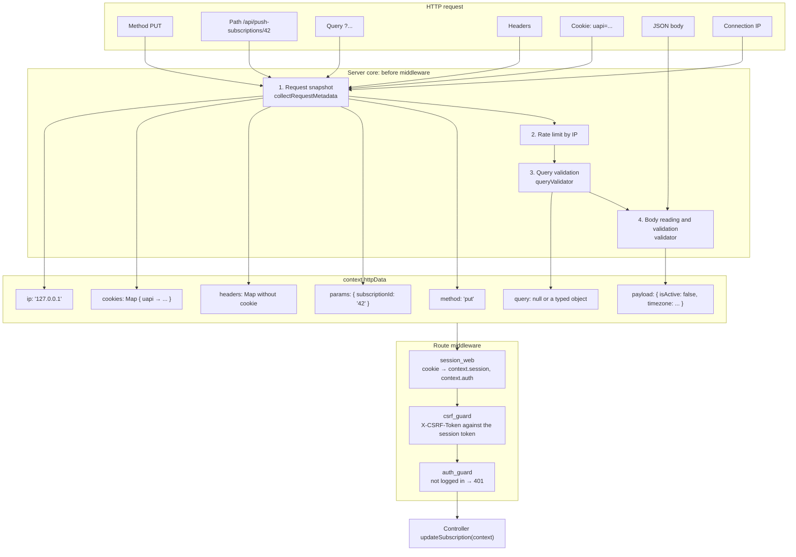

# From HTTP request to controller

::: info Before you read
It is worth reading [How the backend works](/en/guide/how-backend-works) first: it explains the route → controller → service → repository layers. This page looks at one step in more detail: how a raw HTTP request becomes the `context` object that the controller receives.
:::

A controller in the template never reads the "raw" request. It receives a single `context` argument in which everything is already split into fields, validated and typed. Below, a single real request shows where each field comes from.

## Request example

Let's take a route that has everything at once: a path parameter, a body, a session cookie and service headers. The user disables the push subscription with id `42`:

```http
PUT /api/push-subscriptions/42 HTTP/1.1
Host: localhost:3000
Origin: http://localhost:5173
Content-Type: application/json
Cookie: uapi=eyJzaWQiOi...
X-CSRF-Token: 7f3c9a...
Sec-Fetch-Site: same-site

{"isActive": false, "timezone": "Europe/Kyiv"}
```

The route consists of a contract in `shared`, an entry in the schema registry and a line in [http-routes.ts](https://github.com/Blazheiko/vibe-template/blob/main/packages/backend/src/app/routes/http-routes.ts) (more in [Routing](/en/backend/routing#http-routes-defineroute)):

```ts
// packages/shared/src/contracts/push-subscriptions.ts // the contract: method and path
update: contract<
    typeof UpdateSubscriptionInputSchema.inferIn,
    undefined,
    UpdateSubscriptionResponse
>()('put', '/push-subscriptions/:subscriptionId'),

// packages/backend/src/app/routes/contract-schemas/push-subscriptions.ts
update: {
    body: UpdateSubscriptionInputSchema, // body schema
    response: ResponseSchemas.UpdateSubscriptionResponseSchema, // response schema
},

// packages/backend/src/app/routes/http-routes.ts
{
    group: [
        defineRoute({
            contract: pushSubscriptionContracts.update,
            handler: PushSubscriptionController.updateSubscription.bind(
                PushSubscriptionController,
            ),
            middlewares: ['auth_guard'],
        }),
    ],
    middlewares: ['session_web', 'csrf_guard'], // for the whole group
    prefix: 'push-subscriptions',
}
```

`defineRoute` takes the method and the path from the contract, and the body and response schemas from the registry entry, and puts them into the route's `validator` and `ResponseSchema` fields; the rest of the page talks about these fields.

## What a request consists of

| Part of the request                    | In the example                | Purpose                                                                                                                    |
| -------------------------------------- | ----------------------------- | -------------------------------------------------------------------------------------------------------------------------- |
| **Method**                             | `PUT`                         | What to do: `GET` reads, `POST` creates, `PUT` changes, `DELETE` deletes                                                   |
| **Path**                               | `/api/push-subscriptions/42`  | Which resource. `api` is the API prefix, `push-subscriptions` is the group prefix, `42` is the `:subscriptionId` parameter |
| **Query** (after `?`)                  | none                          | Filters and settings, for example `?page=2`                                                                                |
| **`Content-Type` header**              | `application/json`            | The format of the body                                                                                                     |
| **`Cookie` header**                    | `uapi=...`                    | The session cookie: the server recognizes the user by it                                                                   |
| **`X-CSRF-Token` header**              | `7f3c9a...`                   | The CSRF protection token, the frontend adds it by itself                                                                  |
| **`Origin`, `Sec-Fetch-Site` headers** | frontend address, `same-site` | Where the request came from; also for CSRF protection                                                                      |
| **Body**                               | `{"isActive": false, ...}`    | The data to save                                                                                                           |
| **IP address**                         | not in the request text       | Taken from the TCP connection (or from `X-Forwarded-For` behind a trusted proxy)                                           |

::: tip Cookie name
Locally the session cookie is called `uapi`. In production it gets the `__Host-` prefix (`__Host-uapi`), which the browser allows only for HTTPS. See [Sessions](/en/backend/auth).
:::

## Diagram: how fields get into `context`



The order matters: cheap checks come first. The rate limit fires before the body is read, so the server does not spend memory on requests that will be rejected anyway. Query is validated before the body for the same reason.

## Step by step

### 1. Request snapshot

The uWebSockets.js request object lives only until the first `await`, so the core immediately and synchronously copies everything it needs from it (`collectRequestMetadata` in [server.ts](https://github.com/Blazheiko/vibe-template/blob/main/packages/backend/src/vendor/start/server.ts)):

- **headers** → a `Map`, keys in lowercase (`content-type`, `x-csrf-token`). A header with an invalid name or value is skipped and logged. The `Cookie` header does **not** get here, so that session secrets do not accidentally end up in logs;
- **cookies** → a separate `Map` called `cookies`;
- **path parameters** → a `params` object. Values are checked for length and character set; an invalid one gives `400`;
- **IP** → from the connection, or from `X-Forwarded-For` if the request came through a trusted proxy ([Trust proxy](/en/backend/security#trust-proxy-and-ip-detection)).

### 2. Rate limit

First the general per-IP limit, then the route limit if it is set. Exceeding it gives `429`, and the request goes no further.

### 3. Query

If the route has a `queryValidator`, the string after `?` is validated by the schema, and an already typed object is put into `httpData.query`. If there is no schema, `query` is `null`: you cannot read a parameter "on a hunch", TypeScript will not allow it. An example with query is in [First route](/en/guide/first-endpoint).

### 4. Body

The body is read only for `POST`, `PUT` and `PATCH`. The core checks the size and `Content-Type`, parses the JSON and runs the result through the route's `validator`, an arktype schema from the `shared` package:

```ts
// packages/shared/src/schemas/push-subscription/update-subscription.ts
export const UpdateSubscriptionInputSchema = type({
    'isActive?': 'boolean',
    'timezone?': 'string',
    // ...
    '+': 'reject', // an unknown field is an error
})
export type UpdateSubscriptionInput = typeof UpdateSubscriptionInputSchema.infer
```

If the body does not match the schema (for example, `"isActive": "no"` or an extra field `"userId": 1`), the server responds `422 validation_failed`, and the controller is **not called**. So in the controller, `payload` is already guaranteed to have the right shape.

### 5. Creating the context

From everything collected, the core builds `httpData` and wraps it into `context` ([http-context.ts](https://github.com/Blazheiko/vibe-template/blob/main/packages/backend/src/vendor/utils/context/http-context.ts)). For our request, `httpData` looks like this:

```ts
{
    method: 'put',
    ip: '127.0.0.1',
    params: { subscriptionId: '42' },
    query: null,                      // the route has no queryValidator
    payload: { isActive: false, timezone: 'Europe/Kyiv' },
    headers: Map {
        'host' => 'localhost:3000',
        'origin' => 'http://localhost:5173',
        'content-type' => 'application/json',
        'x-csrf-token' => '7f3c9a...',
        'sec-fetch-site' => 'same-site',
    },
    cookies: Map { 'uapi' => 'eyJzaWQiOi...' },
    contentType: 'application/json',
    isJson: true,
    files: null,                      // files exist only in multipart/form-data
}
```

The rest of the `context` fields:

| Field          | What it is                                                                         |
| -------------- | ---------------------------------------------------------------------------------- |
| `requestId`    | A unique request id, present in every log entry                                    |
| `logger`       | A logger that adds `requestId` by itself (and `userId` after login)                |
| `responseData` | Where middleware and the controller write the response status, headers and cookies |
| `session`      | An "empty" session for now; the `session_web` middleware will fill it              |
| `auth`         | "Nobody is logged in" for now; `session_web` will fill this too                    |
| `signal`       | An `AbortSignal` that fires if the client closed the connection                    |

### 6. Middleware

Middleware run one after another: first those set for the group, then those for the route. Each one can stop the request by not calling `next()`.

1. **`session_web`** takes the `uapi` cookie from `httpData.cookies`, finds the session in Redis and fills `context.session` and `context.auth`. After that, `context.auth.getUserId()` returns the user id.
2. **`csrf_guard`** for methods that change data compares `Sec-Fetch-Site`, `Origin` and the `X-CSRF-Token` header with the token stored in the session. More in [CSRF in plain words](/en/guide/csrf).
3. **`auth_guard`** checks `context.auth.check()`. If the user is not logged in, the response is `401` and the controller is not called.

### 7. Controller

Finally, the controller receives the ready `context` ([push-subscription-controller.ts](https://github.com/Blazheiko/vibe-template/blob/main/packages/backend/src/app/controllers/http/notifications/push-subscription-controller.ts)):

```ts
async updateSubscription(
    context: HttpContext<UpdateSubscriptionInput>, // body type from shared
): Promise<UpdateSubscriptionResponse> {
    const userId = requireUserId(context)              // from context.auth
    if (userId === null) return mapControllerError(context, unauthorized())

    const subscriptionId = resolveSubscriptionId(context) // from context.httpData.params
    if (subscriptionId === null) return mapControllerError(context, subscriptionNotFound())

    const payload = getTypedPayload(context)           // from context.httpData.payload

    const result = await pushSubscriptionService.updateSubscription(
        userId, subscriptionId, payload, context.auth.getPresentedUserToken(),
    )
    return respond(context, result, (value) => ({
        status: 'success',
        subscription: value.subscription,
    }))
}
```

What happens here:

- **`HttpContext<UpdateSubscriptionInput>`**: the first type parameter describes the body. So `getTypedPayload(context)` returns `{ isActive?: boolean; timezone?: string; ... }`, and accessing a nonexistent field is a compile error. The second parameter (if needed) describes the query.
- **`params` are always strings.** `subscriptionId` arrives as `'42'`. The controller itself turns it into a number (`BigInt`) and treats a non-numeric id as "not found".
- **The controller knows nothing about HTTP details.** It does not parse JSON, does not read cookies and does not check CSRF: all of that is already done. Its job is to take data from `context`, call a service and turn the result into a response.

The core validates the returned object against the route's `ResponseSchema` and sends it to the client as JSON. How this happens: [From controller to HTTP response](/en/guide/http-response).

## Where to find what in `context`

| I want to know                   | Where to get it                                                      |
| -------------------------------- | -------------------------------------------------------------------- |
| The id from the address (`/:id`) | `context.httpData.params['id']` (a string)                           |
| A parameter after `?`            | `context.httpData.query.name` (only if there is a `queryValidator`)  |
| Data from the body               | `getTypedPayload(context)` (only if there is a `validator`)          |
| Who is logged in                 | `requireUserId(context)` or `context.auth.getUserId()`               |
| A header                         | `context.httpData.headers.get('lowercase-name')`                     |
| An uploaded file                 | `context.httpData.files` (a `multipart/form-data` request)           |
| Set a status or cookie           | `context.responseData.status`, `context.responseData.setCookie(...)` |
| Write to the log                 | `context.logger.info(...)`                                           |

## What next

- [From controller to HTTP response](/en/guide/http-response): the way back, how the object returned by the controller becomes a response.
- [First route](/en/guide/first-endpoint): add your own route with a query parameter and go through this path yourself.
- [Request lifecycle](/en/backend/request-lifecycle): the same topic for the experienced: body limits, error handling, WebSocket.
- [Middleware](/en/backend/middlewares) and [Validation](/en/backend/validation): how to write your own middleware and schema.
