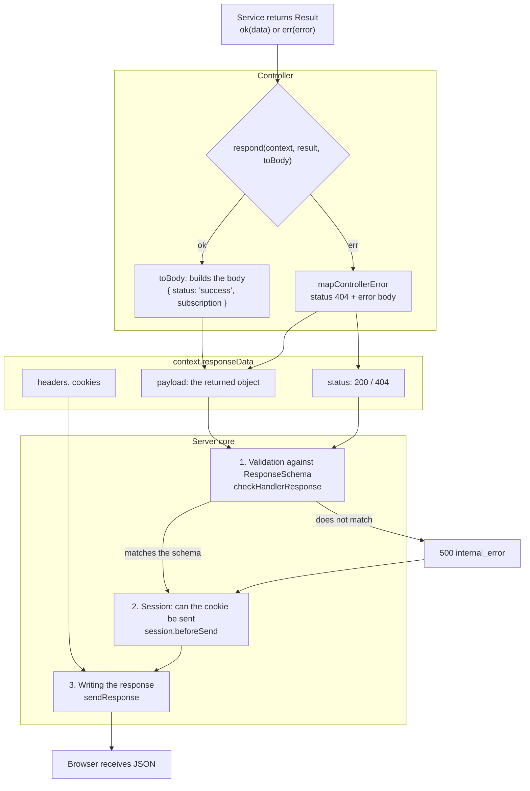

# From controller to HTTP response

::: info Before you read
This is a continuation of the page [From HTTP request to controller](/en/guide/http-request). There the request reached the controller. Here is the way back: how what the controller returned becomes the HTTP response that the browser receives.
:::

A controller in the template does not write to the response directly. It simply **returns an object**, the response body. The status, headers, cookies, schema validation and conversion to JSON are handled by the server core. Below is the same `PUT /api/push-subscriptions/42` request.

## Response example

A successful response to the request from the previous page:

```http
HTTP/1.1 200 OK
Content-Type: application/json
X-Content-Type-Options: nosniff
X-Frame-Options: DENY
Referrer-Policy: no-referrer
Strict-Transport-Security: max-age=31536000; includeSubDomains
Content-Security-Policy: default-src 'none'; frame-ancestors 'none'
Cache-Control: no-store
Access-Control-Allow-Origin: http://localhost:5173
Access-Control-Allow-Credentials: true

{
  "status": "success",
  "subscription": {
    "id": "42",
    "userId": "7",
    "isActive": false,
    "timezone": "Europe/Kyiv",
    "created_at": "2026-11-01T10:15:00.000Z",
    ...
  }
}
```

And this is what the response looks like if subscription `42` does not exist or belongs to another user:

```http
HTTP/1.1 404 Not Found
Content-Type: application/json
...the same service headers...

{ "status": "error", "code": "not_found", "message": "Subscription not found" }
```

## What a response consists of

| Part of the response          | In the example                                    | Who sets it                                                                                     |
| ----------------------------- | ------------------------------------------------- | ----------------------------------------------------------------------------------------------- |
| **Status**                    | `200`, `404`                                      | `200` by default. An error is set by `mapControllerError` according to the error type           |
| **`Content-Type`**            | `application/json`                                | The core, if the response has a body                                                            |
| **Security headers**          | `X-Frame-Options`, `Strict-Transport-Security`, … | The core, on every response ([Security headers](/en/backend/security#security-headers-and-csp)) |
| **`Content-Security-Policy`** | `default-src 'none'; …`                           | The core; the strictest policy for the API                                                      |
| **`Cache-Control`**           | `no-store`                                        | The core: API responses are not cached unless the controller sets otherwise                     |
| **CORS (`Access-Control-*`)** | the allowed frontend origin                       | The core, if CORS is enabled (`ENABLED_CORS`)                                                   |
| **`Set-Cookie`**              | none in this example                              | The session layer (login, logout, session extension) or the controller                          |
| **Body**                      | `{"status": "success", …}`                        | The controller: what it returned                                                                |

## Diagram: how a result becomes a response



## Step by step

### 1. The service returns a result, it does not throw an exception

The service knows nothing about HTTP. It returns a `Result`: either `ok` with data, or `err` with a description of the error ([Errors without exceptions](/en/guide/how-backend-works#errors-without-exceptions)). Before returning, the database row goes through a **transformer** that prepares it for JSON ([push-subscription-transformer.ts](https://github.com/Blazheiko/vibe-template/blob/main/packages/backend/src/app/transformers/push-subscription-transformer.ts)):

```ts
serialize(subscription: PushSubscriptionRow): SerializedPushSubscription {
    const { createdAt, updatedAt, lastUsedAt, id, userId, ...rest } = subscription
    return {
        ...rest,
        id: String(id),                     // bigint from the DB → string
        userId: String(userId),
        created_at: createdAt.toISOString(), // Date → ISO string
        updated_at: updatedAt.toISOString(),
        lastUsedAt: lastUsedAt !== null ? lastUsedAt.toISOString() : null,
    }
}
```

Why: JSON cannot handle `bigint` and `Date`. The transformer explicitly decides which fields go to the client and in what form.

### 2. The controller turns the result into a body

The end of almost every controller method is a call to `respond` ([controller-error.ts](https://github.com/Blazheiko/vibe-template/blob/main/packages/backend/src/app/controllers/shared/controller-error.ts)):

```ts
return respond(context, result, (value) => ({
    status: 'success',
    subscription: value.subscription,
}))
```

- **Success.** `respond` calls the `toBody` function and returns its result. The status stays `200`.
- **Error.** `respond` calls `mapControllerError`: it sets the status in `context.responseData.status`, writes `5xx` errors to the log (`4xx` are expected responses, they are not logged) and returns the error body `{ status: 'error', code, message }`.

The status depends on the type of error the service returned:

| Service error       | Status | `code`                                  |
| ------------------- | ------ | --------------------------------------- |
| `badRequest(...)`   | `400`  | `bad_request`                           |
| `unauthorized(...)` | `401`  | `unauthorized`                          |
| `forbidden(...)`    | `403`  | `forbidden`                             |
| `notFound(...)`     | `404`  | `not_found`                             |
| `conflict(...)`     | `409`  | `conflict`                              |
| `rateLimited(...)`  | `429`  | `rate_limited` (+ `Retry-After` header) |
| `internal(...)`     | `500`  | `internal_error`                        |

The full list is in [errors.ts](https://github.com/Blazheiko/vibe-template/blob/main/packages/backend/src/app/services/shared/errors.ts).

The type returned by a controller method is `Promise<UpdateSubscriptionResponse>`, derived from the response schema in `shared`. So TypeScript will not let you return a field that is not in the schema, or forget a required one.

::: tip Middleware can respond earlier
If `auth_guard` sees that the user is not logged in, it writes the `401` status and the error body into `responseData` itself and does not call `next()`. The controller then does not run at all, and the response goes further along the same path described below.
:::

### 3. Validation against `ResponseSchema`

The core puts the returned object into `responseData.payload` and, if the route declared a `ResponseSchema`, validates it against this schema, the same arktype schema from `shared`:

```ts
// packages/shared/src/responses/push-subscription-controller.ts
export const UpdateSubscriptionResponseSchema = type.or(
    {
        status: "'success'",
        'message?': 'string',
        'subscription?': SerializedPushSubscriptionSchema,
    },
    CanonicalErrorResponseSchema, // any standard error
)
export type UpdateSubscriptionResponse = typeof UpdateSubscriptionResponseSchema.infer
```

The schema works as a list of allowed fields. What happens if the response does not match it:

- **Wrong type or a missing field**: the client gets `500 internal_error`, and an error with the route name goes to the log.
- **An extra field** (for example, someone added a password hash in the transformer): in development `500`, in production the field is stripped and a warning goes to the log.

This way a mistake in a transformer will not lead to a data leak. Modes and settings: [Response validation](/en/backend/response-validation).

### 4. Session and cookie

Before sending, the core calls `session.beforeSend`. If this request was supposed to return a session cookie (for example, to extend its lifetime), but another request deleted that session in the meantime (the user logged out in a neighboring tab), the old cookie is **not** sent. The session cookie is always `HttpOnly` and `SameSite=Lax`. Outside local development (`APP_ENV` is not `local`) it is also `Secure`, and in production it gets the `__Host-` prefix. More in [Authentication](/en/backend/auth).

### 5. Writing the response

The last step is `sendResponse` in [server.ts](https://github.com/Blazheiko/vibe-template/blob/main/packages/backend/src/vendor/start/server.ts). It writes everything in this order:

1. **Status.** If the status is `200` and there is no body (the controller returned `null`), `204 No Content` is sent.
2. **`Content-Type: application/json`**, only when there is a body.
3. **Security headers and CSP.** If the controller set the same header itself, its value is used.
4. **`Cache-Control: no-store`**, unless the controller set its own.
5. **Controller headers** from `responseData.headers`.
6. **Cookies** from `responseData.cookies`.
7. **CORS headers**, if CORS is enabled and the request origin is allowed.
8. **Body**: `JSON.stringify` with `bigint` support (it becomes a string), so that a forgotten `bigint` does not break the response.

## And if the code threw an exception

Template code returns errors via `Result`, but an exception can still happen: a database failure, a bug in the code, an invalid request body before the controller. Then `handleError` in the core catches it and responds with the same body shape:

| What happened                              | Status | `code`                   |
| ------------------------------------------ | ------ | ------------------------ |
| Invalid path parameter                     | `400`  | `bad_request`            |
| The body could not be parsed (broken JSON) | `400`  | `bad_request`            |
| Body too large                             | `413`  | `payload_too_large`      |
| Unsupported `Content-Type`                 | `415`  | `unsupported_media_type` |
| Body or query does not match the schema    | `422`  | `validation_failed`      |
| Redis unavailable                          | `503`  | `service_unavailable`    |
| Any other exception                        | `500`  | `internal_error`         |

For `500` the client receives only `"Internal server error"`. The exception text is visible in the response only locally (`APP_ENV=local`), while the full error with the stack goes to the log and Sentry. This way internal details do not leak outside.

## Where to set what in a controller

| I want to                          | How                                                                        |
| ---------------------------------- | -------------------------------------------------------------------------- |
| Return data                        | `return respond(context, result, (value) => ({ status: 'success', ... }))` |
| Return an error                    | `return mapControllerError(context, notFound('X', 'X not found'))`         |
| A different success status (`201`) | `context.responseData.status = 201` before `return`                        |
| Add a header                       | `context.responseData.setHeader('ETag', '"v1"')`                           |
| Allow caching                      | `context.responseData.setHeader('Cache-Control', 'private, max-age=60')`   |
| Set a cookie                       | `context.responseData.setCookie('name', 'value', { httpOnly: true })`      |
| Respond without a body (`204`)     | Return `null` with status `200`                                            |

The `status: 'success' | 'error'` field in the body is a template convention: the frontend can check the result by the body, without looking at the HTTP status.

## What next

- [First route](/en/guide/first-endpoint): write your own route and look at its response with `curl`.
- [Response validation](/en/backend/response-validation): the `strict` and `log` modes, logs and Sentry.
- [Request lifecycle](/en/backend/request-lifecycle): the same for the experienced: responses without a body, error handling, WebSocket.
