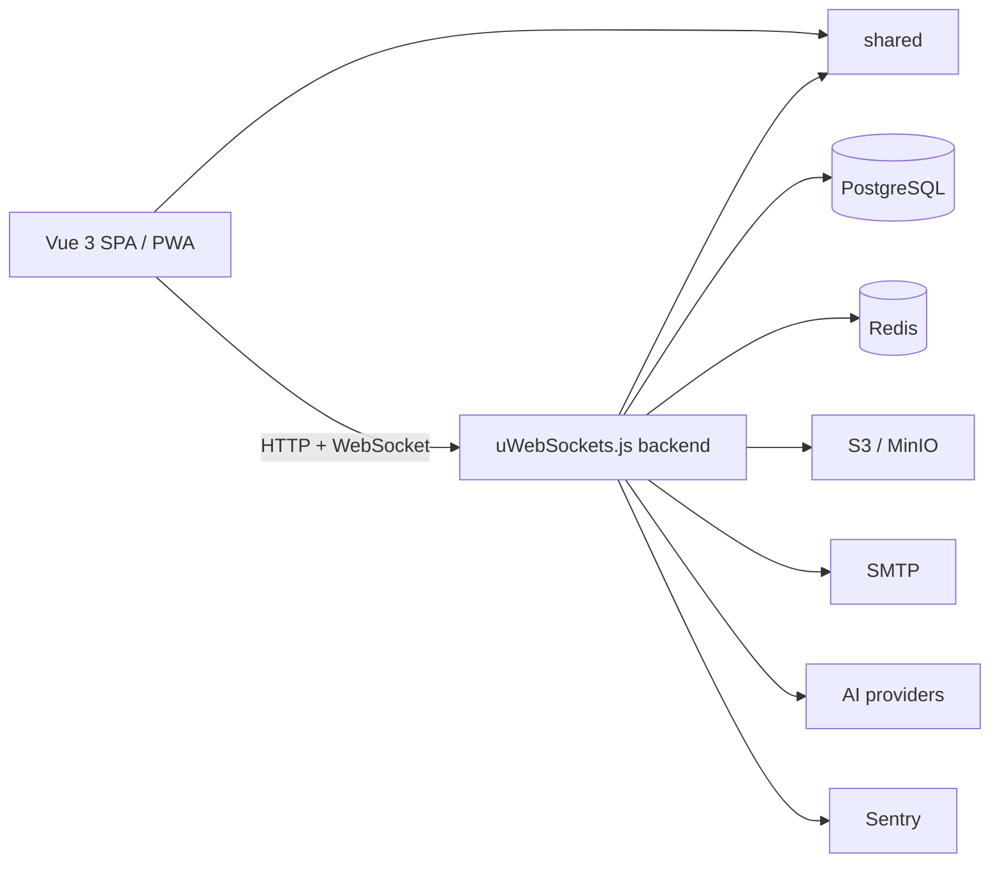

# Introduction

**vibe-template** is a full-stack TypeScript monorepo template: a Vue 3 frontend, a high-performance backend on uWebSockets.js, and a `shared` package with common contracts (schemas, enums, guards, responses) used on both sides. The repository is organized as a [pnpm](https://pnpm.io/) workspace ([README.md](https://github.com/Blazheiko/vibe-template/blob/main/README.md), [pnpm-workspace.yaml](https://github.com/Blazheiko/vibe-template/blob/main/pnpm-workspace.yaml)).

## What it is for

The template is meant for a quick start on production-ready SPA applications: instead of building the same foundation every time, you start from a working application that already has:

- **Authentication** — sign-in via email, phone (SMS) and social providers; sessions, CSRF protection and throttling.
- **Real-time** — a configured WebSocket layer on uWebSockets.js (live updates, presence, two-way messages).
- **Push notifications** — server-side web push delivery.
- **PWA** — the frontend is set up as a Progressive Web App.
- **More** — file storage (S3/MinIO), transactional email, i18n, AI provider integrations, error monitoring and a type-safe contracts layer.

Ready-made product flows: registration/email confirmation, login/logout (including logout-all), password change and reset, optional phone authentication, the OAuth foundation (`auth/oauth/:provider/redirect` and `/callback`), an account page with an avatar, push subscription management, an admin area (users, online, knowledge base), an AI support chat and an API playground ([README.md](https://github.com/Blazheiko/vibe-template/blob/main/README.md)).

### Who it is for

- SaaS dashboards and products with accounts, admin panels with real-time activity;
- PWAs with authentication, push and offline mode;
- applications that need shared frontend and backend contracts from day one;
- **backend-only / API services**: you can remove the `frontend` package, disable static file serving (`SERVE_STATIC=false`) and session/CSRF handling, and use `api-playground` for manual API testing.

Probably overkill for static landing pages, serverless/edge-first applications and projects without authentication, a database and real-time.

## Stack

| Area          | What is used                                                                  |
| ------------- | ----------------------------------------------------------------------------- |
| API           | uWebSockets.js, route validation (arktype), WebSocket                         |
| DB            | PostgreSQL, Drizzle ORM / drizzle-kit `1.0.0-rc.5` (migrations + seed)        |
| Auth/security | cookies, CSRF, CORS, throttling, CSP                                          |
| Frontend      | Vue 3, Pinia, vue-router, vue-i18n, PWA, Vitest, Playwright                   |
| Observability | Sentry (`@sentry/node`, `@sentry/vue`), Pino                                  |
| Integrations  | S3/MinIO (`@aws-sdk/client-s3`), nodemailer, web-push, OpenAI / Mistral / xAI |

Sources: [package.json](https://github.com/Blazheiko/vibe-template/blob/main/package.json), [packages/backend/package.json](https://github.com/Blazheiko/vibe-template/blob/main/packages/backend/package.json), [packages/frontend/package.json](https://github.com/Blazheiko/vibe-template/blob/main/packages/frontend/package.json), [packages/shared/package.json](https://github.com/Blazheiko/vibe-template/blob/main/packages/shared/package.json).

Requirements: Node.js `^24.22.2` and pnpm `>=9` (pinned to `pnpm@9.15.0` via `packageManager`), TypeScript `6.0.3`.

::: tip Next step
This is the first page of the **"First day"** path (left menu): six pages from launching to your own project. Next up is the [Quick start](/en/guide/getting-started): running locally and your first sign-in.
:::

## Other sections

- [Getting started](/en/guide/getting-started)
- [Project structure](/en/guide/project-structure)
- [Backend overview](/en/backend/)
- [Scripts](/en/reference/scripts)
