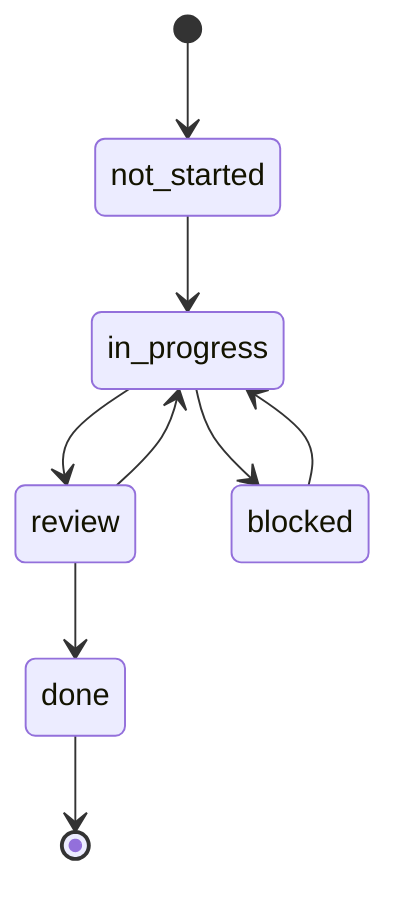

# Workflow

This section describes how work by humans and agents is organized in the repository: how to pick a feature, where its state is stored, when it counts as complete and what to update in the documentation. The rules are taken from [`AGENTS.md`](https://github.com/Blazheiko/vibe-template/blob/main/AGENTS.md).

::: info Looking for how to turn the template into your own product?
This page describes the workflow in the template repository. How to rename the template, change the interface and choose integrations for your own project is described in the [Your project on the template](/en/guide/your-project) section.
:::

## Session start

1. Open [`feature_list.json`](https://github.com/Blazheiko/vibe-template/blob/main/feature_list.json) and find the feature whose `owner` matches you and whose `status` is `in_progress`. This is your active feature.
2. Switch to the branch from the `branch` field. The feature's `progress.md` and `session-handoff.md` files live **on its branch**, not in `main`: the "Mark feat-XXX done" PR, which flips the feature to `done`, deletes them from `main`, and the evidence stays in the `evidence` field of `feature_list.json`.
3. Read `progress.md`: last session's state, blockers, "Notes for Next Session". If the session is resuming, also read `session-handoff.md`.
4. Run [`./init.sh`](https://github.com/Blazheiko/vibe-template/blob/main/init.sh). It is a wrapper around `make init`: `pnpm install`, building `shared`, `make check` (`format:check`, `typecheck`, `lint`, `test`, the same steps as in CI) and `pnpm build`. It stops at the first error. If it fails, do not continue. The remaining commands: [make commands](/en/reference/make).
5. Each owner works on one feature at a time. New work is recorded as a new entry in `feature_list.json` via a PR to `main`, not by expanding the current feature.

## `feature_list.json`

The file lives only on `main` and is the single source of truth about who is working on what. Its `schema` block defines the fields and allowed statuses:

| Field          | Meaning                                                      |
| -------------- | ------------------------------------------------------------ |
| `id`           | Identifier of the form `feat-XXX`                            |
| `name`         | Feature name                                                 |
| `description`  | Description, often with a link to the plan in `docs/plan/`   |
| `owner`        | The human or agent responsible for the feature (exactly one) |
| `branch`       | The branch where `progress.md` and `session-handoff.md` live |
| `dependencies` | List of `id`s that must be `done` before starting            |
| `status`       | `not-started`, `in_progress`, `blocked`, `review`, `done`    |
| `evidence`     | Link to a PR/commit or output that confirms completion       |

A feature's row is edited only by its owner. Everyone else proposes changes via a PR. Two people cannot share one `in_progress` row. Helping with someone else's feature means a PR to its branch, not edits to its `progress.md`.

## Statuses

Each status transition is made by a separate PR that changes `feature_list.json` on `main`. The `blocked` status is allowed, but the reason must be recorded in `progress.md` on the feature branch.

In the diagram, `not_started` means `not-started` (Mermaid does not allow a hyphen in a state identifier). `AGENTS.md` explicitly names only the chain `not-started → in_progress → review → done` and allows `blocked`. Returning from `review` and leaving `blocked` are shown as obvious scenarios; there are no separate rules for them.

Dependencies are mandatory: a feature cannot be started until its `dependencies` have the `done` status. If you need to start earlier, split the dependency into a separate, smaller `feat-XXX` and close it first.

## Definition of Done

A feature becomes `done` only when the following is recorded in `progress.md` under **Evidence of Completion**:

- `pnpm typecheck` clean;
- `pnpm lint` clean;
- `pnpm test` passes, and for UI changes also `pnpm --filter frontend test:e2e`;
- manual verification of the golden path is described;
- the row in `feature_list.json` is flipped to `done` with a link to the commit or output in `evidence`.

The reviewer checks this evidence block in the branch's `progress.md` before approving the merge. Commands are described in the [Scripts](/en/reference/scripts) section, tests in the [Testing](/en/backend/testing) section.

## End of session

Before ending the session, commit and push the feature branch with an updated `progress.md` (current state, modified files, next step). If the work is unfinished, fill in `session-handoff.md` so the next session starts without losses.

## Branches, commits, PRs

- The feature branch is given in `branch`. The current history uses prefixes such as `feat/…` and `docs/…` (for example `feat/vitepress-docs`). There is no separate naming rule in `AGENTS.md`.
- Commits are written concisely, intent first. Useful trailers: `Tested: pnpm test` or `Not-tested: requires production credentials`.
- A PR describes the change, the verification performed and related issues, and for visible frontend changes adds screenshots or a screen recording.

::: warning
The Commit & Pull Request Guidelines section of `AGENTS.md` still says that "checkout does not include .git history". For the current repository this is no longer true: the history exists, and PRs are merged on GitHub.
:::

## Documentation

The site in `documentation/` is published to GitHub Pages from `main` via [`.github/workflows/docs.yml`](https://github.com/Blazheiko/vibe-template/blob/main/.github/workflows/docs.yml).

- If public backend behaviour changes (a route, an environment variable, a middleware, a migration or the DB schema), the matching page in `documentation/backend/` is updated in the same PR. For example: [Routing](/en/backend/routing), [Configuration](/en/backend/configuration), [Database](/en/backend/database).
- Pages are written from the code, with links to sources on GitHub. Things that are not implemented yet are marked with `::: warning Plan`. Use placeholders for secrets.
- A new page is added to the sidebar in [`documentation/.vitepress/config.ts`](https://github.com/Blazheiko/vibe-template/blob/main/documentation/.vitepress/config.ts) and to `KEY_PAGES` in [`documentation/scripts/verify-dist.mjs`](https://github.com/Blazheiko/vibe-template/blob/main/documentation/scripts/verify-dist.mjs).
- If a page uses `<!--@include-->`, the source path must be in `paths` in `docs.yml`.
- Before merging, run `pnpm docs:build && pnpm docs:verify`.

## Backlog of upcoming features

Code issues found while writing the documentation are collected in [`docs/plan/code-issues-found-during-docs.md`](https://github.com/Blazheiko/vibe-template/blob/main/docs/plan/code-issues-found-during-docs.md). This is the source for future `feat-XXX` entries: each item that is decided to be fixed is recorded as a new row in `feature_list.json` via a PR to `main`.
