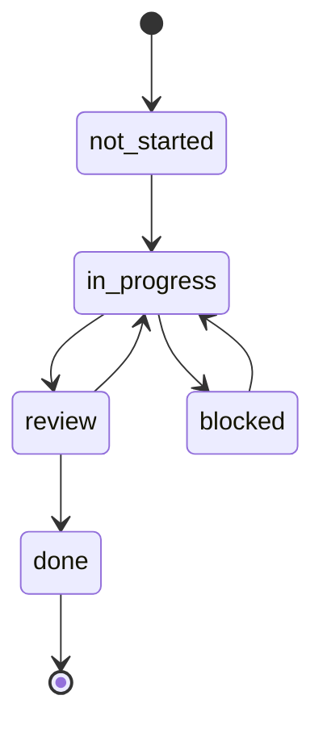

# Workflow

This section describes how work by humans and agents is organized in the repository: how to pick a feature, where its state is stored, when it counts as complete and what to update in the documentation. The rules are taken from [`AGENTS.md`](https://github.com/Blazheiko/vibe-template/blob/main/AGENTS.md).

::: info Looking for how to turn the template into your own product?
This page describes the workflow in the template repository. How to rename the template, change the interface and choose integrations for your own project is described in the [Your project on the template](/en/guide/your-project) section.
:::

## Session start

This applies to **implementation** sessions. Analysis, code review and questions only read: they pick no feature, change no status and make no commits. A `not-started` feature is never started on your own initiative.

1. Check the working tree: `git branch --show-current` and `git status`. Do not discard, stash or overwrite changes that are not yours; if the tree is dirty with someone else's work, or you must switch branches, use a separate `git worktree`.
2. Read [`feature_list.json`](https://github.com/Blazheiko/vibe-template/blob/main/feature_list.json) from `origin/main` (`git fetch`, then `git show origin/main:feature_list.json`): a copy on a feature branch may be stale. Find the feature that matches the request and whose `owner` is you:
    - `in_progress`: your active feature, continue it;
    - `review`: add no scope, only address review comments on its branch;
    - `blocked`: read the blocker in `progress.md` on the branch and report it, resume once it is resolved;
    - `not-started`: start it only when the request asks for it and its `dependencies` are `done`; flip it to `in_progress` via a PR to `main`, then create the branch and `progress.md`;
    - no matching feature: do not expand scope, propose a new `feat-XXX` entry via a PR to `main`.
3. Switch to the branch from the `branch` field. The feature's state files live **on its branch** under `feature-state/<feat-id>/` (`progress.md`, `session-handoff.md`). After the implementation merge they may briefly sit in `main`; the "Mark feat-XXX done" PR deletes only that feature's `feature-state/<feat-id>/` directory, and the evidence stays in the `evidence` field of `feature_list.json`.
4. Read `progress.md`: last session's state, blockers, "Notes for Next Session". If the session is resuming, also read `session-handoff.md`.
5. Run [`./init.sh`](https://github.com/Blazheiko/vibe-template/blob/main/init.sh). It is a wrapper around `make init`: `pnpm install`, building `shared`, `make check` (`verify-makefile`, `verify-compose`, `format:check`, `typecheck`, `lint`, `check-bundle-graph`, `test`, the same steps as in CI) and `pnpm build`. It stops at the first error. If it fails, record the failure (command and output) in `progress.md`; then either fix it, when fixing the baseline is the request, or stop and report. Do not build features on a red baseline. Reading and review sessions skip `init.sh`. The remaining commands: [make commands](/en/reference/make).
6. Each owner works on one feature at a time. New work is recorded as a new entry in `feature_list.json` via a PR to `main`, not by expanding the current feature.

## `feature_list.json`

The file is canonical on `main` and is the single source of truth about who is working on what. Its `schema` block defines the fields and allowed statuses:

| Field          | Meaning                                                      |
| -------------- | ------------------------------------------------------------ |
| `id`           | Identifier of the form `feat-XXX`                            |
| `name`         | Feature name                                                 |
| `description`  | Description, often with a link to the plan in `docs/plan/`   |
| `owner`        | The human or agent responsible for the feature (exactly one) |
| `branch`       | The branch where `feature-state/<feat-id>/` lives            |
| `dependencies` | List of `id`s that must be `done` before starting            |
| `status`       | `not-started`, `in_progress`, `blocked`, `review`, `done`    |
| `evidence`     | Link to a PR/commit or output that confirms completion       |

A feature's row is edited only by its owner. Everyone else proposes changes via a PR. Two people cannot share one `in_progress` row. Helping with someone else's feature means a PR to its branch, not edits to its `feature-state/<feat-id>/progress.md`.

## Statuses

Each status transition is made by a separate PR from a short-lived coordination branch (not the feature branch) that changes `feature_list.json` on `main`; the feature branch never edits the file. The `blocked` status is allowed, but the reason must be recorded in `progress.md` on the feature branch.

In the diagram, `not_started` means `not-started` (Mermaid does not allow a hyphen in a state identifier). `AGENTS.md` explicitly names only the chain `not-started → in_progress → review → done` and allows `blocked`. Returning from `review` and leaving `blocked` are shown as obvious scenarios; there are no separate rules for them.

Dependencies are mandatory: a feature cannot be started until its `dependencies` have the `done` status. If you need to start earlier, split the dependency into a separate, smaller `feat-XXX` and close it first.

## Definition of Done

Lifecycle: checks and evidence → status `review` → review → merge of the implementation PR → a separate "Mark feat-XXX done" PR. A feature is ready for `review` when `feature-state/<feat-id>/progress.md` records, under **Evidence of Completion**:

- `make check` is clean (build of `shared`, Makefile and compose checks, `format:check`, `typecheck`, `lint`, bundle graph, `test`);
- the checks by scope of the change: `pnpm --filter frontend test:e2e` for UI, `make test-e2e-landing` for the landing, `make test-pg` / `make test-redis` for backend DB or Redis code, `pnpm docs:build && pnpm docs:verify` for documentation;
- for PG and Redis, the test output with the executed and skipped counts, or a link to a successful CI job (`test-pg` in `pg-tests.yml`, `test-redis` in `redis-tests.yml`): the suites skip without `PG_TEST_URL` / `REDIS_TEST_URL`, so a running service or a green `pnpm test` proves nothing;
- the manual verification of the golden path is described.

**Closing the feature.** After review and the merge of the implementation PR, a separate "Mark feat-XXX done" PR flips the row in `feature_list.json` to `done`, puts the permanent evidence (a CI run or commit link, test output) in `evidence` and deletes `feature-state/<feat-id>/`.

The reviewer checks the evidence block in the branch's `progress.md` before approving the merge. Commands are described in the [Scripts](/en/reference/scripts) section, tests in the [Testing](/en/backend/testing) section.

## End of session

This applies only to implementation sessions and only to your own changes within the active feature. Commit and push the feature branch with an updated `progress.md` (current state, modified files, next step). If the work is unfinished, fill in `session-handoff.md` so the next session starts without losses. Analysis and review sessions make no commits. If push is unavailable, keep the commit locally and report why.

## Branches, commits, PRs

- The feature branch is given in `branch`. The current history uses prefixes such as `feat/…` and `docs/…` (for example `feat/vitepress-docs`). There is no separate naming rule in `AGENTS.md`.
- Commits are written concisely, intent first. Useful trailers: `Tested: pnpm test` or `Not-tested: requires production credentials`.
- A PR describes the change, the verification performed and related issues, and for visible frontend changes adds screenshots or a screen recording.

## Documentation

The site in `documentation/` is published to GitHub Pages from `main` via [`.github/workflows/docs.yml`](https://github.com/Blazheiko/vibe-template/blob/main/.github/workflows/docs.yml).

- If public backend behaviour changes (a route, an environment variable, a middleware, a migration or the DB schema), the matching page in `documentation/backend/` is updated in the same PR. For example: [Routing](/en/backend/routing), [Configuration](/en/backend/configuration), [Database](/en/backend/database).
- Pages are written from the code, with links to sources on GitHub. Things that are not implemented yet are marked with `::: warning Plan`. Use placeholders for secrets.
- The site is bilingual: the Ukrainian page `documentation/<path>.md` and the English `documentation/en/<path>.md` change in one PR. A new page is added to the sidebars of both locales in [`documentation/.vitepress/config.ts`](https://github.com/Blazheiko/vibe-template/blob/main/documentation/.vitepress/config.ts) and to `KEY_PAGES` and `EN_KEY_PAGES` in [`documentation/scripts/verify-dist.mjs`](https://github.com/Blazheiko/vibe-template/blob/main/documentation/scripts/verify-dist.mjs).
- If a page uses `<!--@include-->`, the source path must be in `paths` in `docs.yml`.
- Before merging, run `pnpm docs:build && pnpm docs:verify`.

## Backlog of upcoming features

Code issues found while writing the documentation are collected in [`docs/plan/code-issues-found-during-docs.md`](https://github.com/Blazheiko/vibe-template/blob/main/docs/plan/code-issues-found-during-docs.md). This is the source for future `feat-XXX` entries: each item that is decided to be fixed is recorded as a new row in `feature_list.json` via a PR to `main`.
