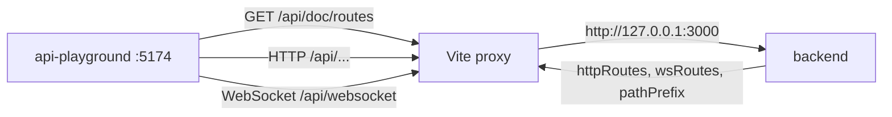

# API Playground

`packages/api-playground` is a Vue application for developers: it loads the route description from the backend and lets you call HTTP and WebSocket routes manually. This is a tool for local development only. In production it is not needed and is not intended for it.

How the backend serves the route description and when the `/doc/routes` endpoint is available at all is described in [Routing](/en/backend/routing) and [Middleware](/en/backend/middlewares). Here the client side itself is covered.

## Stack

According to [`package.json`](https://github.com/Blazheiko/vibe-template/blob/main/packages/api-playground/package.json):

- Vue 3, `vue-router`, Pinia, `@vueuse/core`;
- Vite 7 with `@vitejs/plugin-vue` and `vite-plugin-vue-devtools`;
- Tailwind CSS 3 (PostCSS, autoprefixer);
- TypeScript `6.0.3`, type checking via `vue-tsc`;
- the workspace dependency `shared`.

Scripts: `dev`, `build` (`type-check` together with `vite build`), `preview`, `typecheck`, `lint`, `lint:check`, `format`, `test` (`vitest run`).

## Running

1. In `packages/backend/.env` set `APP_ENV=manual-test`, `DOC_PAGE=true`, `SERVE_STATIC=true`. Explanations of these variables are in [Routing](/en/backend/routing) and [Configuration](/en/backend/configuration).
2. From the repository root run `pnpm dev:manual_test`. The command builds `shared` and then runs the backend and the playground in parallel ([root `package.json`](https://github.com/Blazheiko/vibe-template/blob/main/package.json)). Other scripts are described in the [scripts reference](/en/reference/scripts).
3. Open `http://localhost:5174`.

### Vite proxy

In [`vite.config.ts`](https://github.com/Blazheiko/vibe-template/blob/main/packages/api-playground/vite.config.ts) the dev server listens on port **5174** and proxies requests:

| Prefix                                   | Target                                                                    | Note                                                                              |
| ---------------------------------------- | ------------------------------------------------------------------------- | --------------------------------------------------------------------------------- |
| `/<API_PATH_PREFIX>` (`/api` by default) | the backend's `http://<HOST>:<PORT>` (`http://127.0.0.1:3000` by default) | `changeOrigin: true`, `ws: true` — HTTP and the WS endpoint `/<prefix>/websocket` |

The prefix, `HOST` and `PORT` come from the backend variables in the shell or `packages/backend/.env`, as for the frontend ([one source](/en/backend/configuration#one-source-for-the-api-address-and-prefix)); the playground has no prefix or port of its own. A WS response is recognized by the `id` of the pending request ([protocol](/en/backend/websocket#message-protocol)), so it works with any prefix, and several requests of one event can be in flight at once. The base URL for HTTP calls is empty by default. So requests go relative to the dev server origin and pass through the proxy. It can be overridden with the `VITE_API_BASE_URL` variable or in the UI settings ([`stores/api-settings.ts`](https://github.com/Blazheiko/vibe-template/blob/main/packages/api-playground/src/stores/api-settings.ts)).

## Loading the route description

The `fetchRoutes()` function in [`stores/api-doc.ts`](https://github.com/Blazheiko/vibe-template/blob/main/packages/api-playground/src/stores/api-doc.ts) does `fetch(apiUrl(baseUrl, 'doc/routes'))` ([`utils/api-path.ts`](https://github.com/Blazheiko/vibe-template/blob/main/packages/api-playground/src/utils/api-path.ts)): `<baseUrl>/<API_PATH_PREFIX>/doc/routes`, with an empty `baseUrl` through the proxy. The response has the form `{ httpRoutes, wsRoutes, pathPrefix }`. The store merges groups with the same prefix, assigns numeric `id`s to routes and builds flat lists for navigation with `fullUrl` (prefix + group paths + `url`). The received `pathPrefix` is saved in the settings.

The serialization on the backend is done by [`serialize-routes.ts`](https://github.com/Blazheiko/vibe-template/blob/main/packages/backend/src/vendor/utils/routing/serialize-routes.ts). It copies the route fields, replaces `handler` with `null` and removes `validator`, `queryValidator` and `ResponseSchema`. In their place the following are added:

- `inputSchema` — from `validator` (the request body);
- `querySchema` — from `queryValidator`;
- `outputSchema` — from `ResponseSchema`;
- `bodyLimits` — only for `post`/`put`/`patch`: a list of `{ kind, maxBytes }` for each type from `allowedContentTypes` (`["json"]` by default), because the limit depends on the request `Content-Type`. `[]` means `allowedContentTypes: []`, and the card writes "No allowed body types". It is computed via `resolveMaxBodySize` in [serialize-routes.ts](https://github.com/Blazheiko/vibe-template/blob/main/packages/backend/src/vendor/utils/routing/serialize-routes.ts).

Each schema has the form `{ expression, fields[], jsonSchema? }` (the `ArkSchema` type in the store). The other fields that the UI uses: `url`, `method`, `description`, `middlewares`, `rateLimit` / `groupRateLimit` (`{ windowMs, maxRequests }`), and for groups also `prefix` and `group`. For more about schemas see [Validation](/en/backend/validation).

The route card ([`ApiRoute.vue`](https://github.com/Blazheiko/vibe-template/blob/main/packages/api-playground/src/components/api/ApiRoute.vue)) shows the method, URL, middleware, schemas and rate limit. If a route has no limit of its own, the group limit is shown with a `route`/`group` label. There is also a separate route page `/route/:routeId` ([`router/index.ts`](https://github.com/Blazheiko/vibe-template/blob/main/packages/api-playground/src/router/index.ts)).

## Interface layout

The main page ([`ApiHomeView.vue`](https://github.com/Blazheiko/vibe-template/blob/main/packages/api-playground/src/views/ApiHomeView.vue)) has three columns under the `ApiHeader` header:

| Column                 | Component                                                                                                                                         | What it shows                                                             |
| ---------------------- | ------------------------------------------------------------------------------------------------------------------------------------------------- | ------------------------------------------------------------------------- |
| left (from width `xl`) | [`SiteNavigation.vue`](https://github.com/Blazheiko/vibe-template/blob/main/packages/api-playground/src/components/navigation/SiteNavigation.vue) | a tree of groups and routes (`TreeGroup.vue`), an HTTP / WebSocket switch |
| center                 | `ApiGroup.vue` → `ApiRoute.vue`                                                                                                                   | groups and route cards                                                    |
| right (from `xl`)      | [`OnThisPage.vue`](https://github.com/Blazheiko/vibe-template/blob/main/packages/api-playground/src/components/navigation/OnThisPage.vue)         | the page table of contents with the active section highlighted            |

On narrower screens navigation is provided by `MobileNavigation.vue` (with `MobileGroupItem.vue`). `RouteGroupsMenu.vue` is the groups menu. A separate route opens at `/route/:routeId` (`RouteDetailView.vue`).

## What is implemented

### HTTP requests

The [`TestForm.vue`](https://github.com/Blazheiko/vibe-template/blob/main/packages/api-playground/src/components/api/TestForm.vue) form contains:

- fields for path parameters: every `:name` in `fullUrl` is replaced with the entered value;
- headers in JSON format (`Content-Type: application/json` by default) with JSON validation;
- a body in JSON format, filled with a template from `inputSchema`. For `GET` and `DELETE` the body is not sent ([`utils/base-api.ts`](https://github.com/Blazheiko/vibe-template/blob/main/packages/api-playground/src/utils/base-api.ts));
- the body of the response for any status: an error (`400`, `401`, `403`, `409`, `429`, `5xx`) is shown with its JSON — `code`, `message`, the `reason` of a CSRF refusal — not only the status number. A response without a body (`204`) or one that is not JSON is a success with empty data, not a "network error";
- generation of an equivalent `curl` command;
- repeated runs: the number of requests and the number of "threads", with response time statistics (average — the mean of the request durations, minimum, maximum) and the number of successful requests. The bounds — 1000 requests per thread and 100 threads — are enforced in code, not only by the field's attributes: a larger typed value is cut, an empty or zero one becomes 1. The **Stop** button ends the run after the requests already on their way and shows the statistics of what was sent. The run is performed by the [`useLoadTest`](https://github.com/Blazheiko/vibe-template/blob/main/packages/api-playground/src/composables/useLoadTest.ts) composable (types and calculations are in [`utils/load-test.ts`](https://github.com/Blazheiko/vibe-template/blob/main/packages/api-playground/src/utils/load-test.ts)); scrolling to the response and body formatting are shared by `TestForm.vue` with `TestFormWs.vue` via [`utils/test-form-helpers.ts`](https://github.com/Blazheiko/vibe-template/blob/main/packages/api-playground/src/utils/test-form-helpers.ts);
- viewing the response: status, headers, time, body.

There is no separate query string editor. `querySchema` is only displayed in the route card, so you will have to append query parameters to the URL by hand.

### Global settings

[`ApiSettingsModal.vue`](https://github.com/Blazheiko/vibe-template/blob/main/packages/api-playground/src/components/api/ApiSettingsModal.vue) and `stores/api-settings.ts` manage these settings:

- `baseUrl`, which is kept in `localStorage`, and a temporary override for the current session (it does not get into `localStorage`);
- global headers with the `enableGlobalHeaders` switch, which are added to every HTTP request. **Header values** (`Authorization`, `Cookie`, API keys are credentials that the developer enters to test the API) are kept only in `sessionStorage` (they live for one tab), not in `localStorage`, where they would outlive the tab and be available to every script of the origin. The base address, the prefix and the switch stay in `localStorage`. Values saved in `localStorage` by an old version are ignored and erased. In the console the request log shows `[redacted]` instead of the values of sensitive headers (`authorization`, `cookie`, `*token*`, `*api-key*`, `*secret*`); `console.log` is stripped from the production build, as in the frontend;
- reset to defaults.

There are no separate "environments" with variables. The theme (light/dark) is also kept in `localStorage` ([`useTheme.ts`](https://github.com/Blazheiko/vibe-template/blob/main/packages/api-playground/src/composables/useTheme.ts)).

### Authorization and session

There is no special logic for authentication or CSRF: the CSRF token is not obtained or substituted automatically. `fetch` is called without an explicit `credentials`. Through the Vite proxy the requests are same-origin, so the browser sends cookies under the usual rules. The needed headers (for example, a token) can be added by hand in the request headers or in the global headers. For `POST`/`PUT`/`PATCH`/`DELETE` two things are needed: the `x-csrf-token` header (the `csrfToken` value from the `GET /api/main/init` response) and an allowed origin. The browser sends `Origin: http://localhost:5174`, and in dev the backend by default trusts only the origins from `APP_URL` and `FRONTEND_URL`. So add the playground in `packages/backend/.env`: `CSRF_ALLOWED_ORIGINS=http://localhost:5173,http://localhost:5174`, and restart the backend ([CSRF in simple words](/en/guide/csrf)). For the protection mechanisms on the backend see [Security](/en/backend/security).

### WebSocket

[`useWebSocketConnection.ts`](https://github.com/Blazheiko/vibe-template/blob/main/packages/api-playground/src/composables/useWebSocketConnection.ts) together with [`TestFormWs.vue`](https://github.com/Blazheiko/vibe-template/blob/main/packages/api-playground/src/components/api/TestFormWs.vue) and [`WebSocketModal.vue`](https://github.com/Blazheiko/vibe-template/blob/main/packages/api-playground/src/components/api/WebSocketModal.vue) support:

- connecting by URL and token. The token is passed as a subprotocol (`Sec-WebSocket-Protocol`);
- autofill: if an HTTP response contains `wsUrl` and `wsToken`, they are substituted into the connection form;
- sending messages in the format `{ event, id, timestamp, payload }`, where `event` is the full path of the WS route and `id` is a new UUID of each request. The response is matched to the request by `id`, and a timeout applies. Several requests with the same `event` can be in flight at once;
- request errors: a server reply with `status: "error"` is shown at once as an error with `error.code`, `error.message` and `details`; no reply at all is a timeout after 10 s. Neither is shown as a successful response;
- handling connection close: the code `4001` is treated as unauthorized access, and for the codes `4000–4099` no reconnection is performed.

The protocol is described in the [WebSocket](/en/backend/websocket) section.

### What is missing

There is no request history and no saved requests: the form state is not stored anywhere.

## Common problems

| Symptom                                                           | What to check                                                                                                                                                                                                                                                                                                                |
| ----------------------------------------------------------------- | ---------------------------------------------------------------------------------------------------------------------------------------------------------------------------------------------------------------------------------------------------------------------------------------------------------------------------- |
| routes do not load, `Failed to fetch` or 404 on `/api/doc/routes` | the backend is running on `:3000`; `packages/backend/.env` has `APP_ENV=manual-test`, `DOC_PAGE=true`, `SERVE_STATIC=true` (without all three the endpoint is not registered); Vite was restarted after a change of the backend `PORT` or `API_PATH_PREFIX`: the proxy reads them at startup (see [Vite proxy](#vite-proxy)) |
| HTTP requests go to the wrong place                               | `VITE_API_BASE_URL` and `baseUrl` / override in the settings: an empty value means "through the Vite proxy"; `VITE_API_BASE_URL` of the current build wins over a saved `baseUrl`                                                                                                                                            |
| WebSocket does not connect                                        | the URL and token in the connection form; the token is taken from a response that contains `wsUrl` and `wsToken`; closing with code `4001` means the token is invalid                                                                                                                                                        |
| CORS errors in the console                                        | requests bypass the proxy (`baseUrl` set to another origin); then the playground origin must be in the backend CORS whitelist ([Security](/en/backend/security#cors))                                                                                                                                                        |
| `POST` returns `403` with `code: csrf_invalid`                    | `reason: origin_mismatch` — the playground origin (`http://localhost:5174`) is not in `CSRF_ALLOWED_ORIGINS`; `reason: token_mismatch` — `x-csrf-token` is missing or stale (take a new one from `GET /api/main/init`)                                                                                                       |

The **Test Connection** button in the settings does `GET <baseUrl>/<prefix>/ping` — the backend liveness route (earlier it hit the non-existent `/health`); with an empty `baseUrl` the check goes through the Vite proxy. The request body is not written to the console (it can carry passwords and tokens); the Network tab shows it. An empty WS token is not sent as a subprotocol. The WS address by default is derived from `baseUrl`: `http://` → `ws://`, `https://` → `wss://`. Messages are not queued: without an open connection `sendMessage` sends nothing, writes an error to the console and returns `false`.

## Limitations

- Tests are Vitest (`pnpm --filter api-playground test`): URL building under the prefix, `http`/`https` → `ws`/`wss`, `sendMessage` without a connection.
- The `build` script exists (`vite build`), but production deployment of the playground is not set up in the repository. The app is designed for a dev server with a proxy.
- Two internal notes remain in `packages/api-playground/docs/` — `ROADMAP.md` and `UI-UX-ANALYSIS.md`. These are ideas and analysis, not a description of the actual behavior.

::: danger Security
Never enable `APP_ENV=manual-test` and `DOC_PAGE=true` in production. `/doc/routes` exposes the full API map: URLs, middleware, validation schemas and rate limits. See [Security](/en/backend/security) and [Routing](/en/backend/routing).
:::
