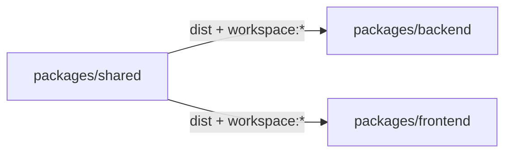

# The shared package

`packages/shared` contains the contracts shared by the backend and the frontend: ArkType input schemas, response schemas and interfaces, error codes, branded types, language enums and utilities. Thanks to this, the server and the client import the same schema or type instead of keeping two copies.



## package.json and the build

Data from [packages/shared/package.json](https://github.com/Blazheiko/vibe-template/blob/main/packages/shared/package.json):

- `name: "shared"`, `private: true`, `type: "module"`;
- `exports` has the root entry `.` and the subpaths `./brands`, `./schemas`, `./responses`, `./errors`, `./enums`, `./utils`, `./guards`, `./limits`, `./patterns`, `./ws-client`, `./contracts`. Each points to `dist/<section>/index.js` and `.d.ts`;
- `build`: `tsc --build`, `dev`: `tsc --build --watch`. [tsconfig.json](https://github.com/Blazheiko/vibe-template/blob/main/packages/shared/tsconfig.json) builds `src` into `dist` (`composite: true`);
- runtime dependencies: `@arktype/type`, `@ark/util`, `libphonenumber-js`.

The backend and the frontend connect the package as `"shared": "workspace:*"` ([backend/package.json](https://github.com/Blazheiko/vibe-template/blob/main/packages/backend/package.json), [frontend/package.json](https://github.com/Blazheiko/vibe-template/blob/main/packages/frontend/package.json)).

Because `exports` point only to `dist`, consumers will not find the package without building it. That is why the root `pnpm dev` first runs `build:shared` (`pnpm --filter shared build`), then builds the backend and only then starts the dev servers in parallel ([package.json](https://github.com/Blazheiko/vibe-template/blob/main/package.json)). See also ["Scripts"](/en/reference/scripts).

## Structure of `src/`

| Section                                                                                                  | Contents                                                                                                                                                                                                                                                                                                                                                                                                                                                                                                                                                                                                |
| -------------------------------------------------------------------------------------------------------- | ------------------------------------------------------------------------------------------------------------------------------------------------------------------------------------------------------------------------------------------------------------------------------------------------------------------------------------------------------------------------------------------------------------------------------------------------------------------------------------------------------------------------------------------------------------------------------------------------------- |
| [brands](https://github.com/Blazheiko/vibe-template/tree/main/packages/shared/src/brands)                | branded primitives: in [primitives.ts](https://github.com/Blazheiko/vibe-template/blob/main/packages/shared/src/brands/primitives.ts), e.g., `EmailSchema = type("string.email").brand("Email")` and `PositiveIntSchema`, and [ids.ts](https://github.com/Blazheiko/vibe-template/blob/main/packages/shared/src/brands/ids.ts) holds `EntityIdSchema`                                                                                                                                                                                                                                                   |
| [contracts](https://github.com/Blazheiko/vibe-template/tree/main/packages/shared/src/contracts)          | HTTP route contracts by group (`authContracts`, `pushSubscriptionContracts`…): `contract<Body, Query, Response>()(method, path)`, `multipartContract`, `navigationContract` and `buildPath`/`buildQuery`/`buildUrl` from [core.ts](https://github.com/Blazheiko/vibe-template/blob/main/packages/shared/src/contracts/core.ts). At run time a contract is only `{ method, path }` (and `kind`); schemas are imported as types, so the frontend takes it without ArkType ([Routing](/en/backend/routing#http-routes-defineroute))                                                                        |
| [enums](https://github.com/Blazheiko/vibe-template/blob/main/packages/shared/src/enums/languages.ts)     | `APP_LOCALE_CODES` (`as const`), `SHIPPED_LOCALE_CODES` (languages with an interface translation), language name maps and the functions `resolveLanguageName`, `resolveLanguageCode`, `isAppLocaleCode` and others                                                                                                                                                                                                                                                                                                                                                                                      |
| [errors](https://github.com/Blazheiko/vibe-template/blob/main/packages/shared/src/errors/error-codes.ts) | the `ErrorCode` object (`BadRequest: "bad_request"`, `ValidationFailed: "validation_failed"`, `CsrfInvalid: "csrf_invalid"`…) and the `ErrorCodeValues` list, with no runtime dependency on ArkType (the frontend imports this module). `ErrorCodeSchema` lives in `responses`                                                                                                                                                                                                                                                                                                                          |
| [guards](https://github.com/Blazheiko/vibe-template/blob/main/packages/shared/src/guards/index.ts)       | [ws-channels.ts](https://github.com/Blazheiko/vibe-template/blob/main/packages/shared/src/guards/ws-channels.ts): the whitelist of WS channels `WS_CHANNELS` (`admin`), the `WsChannel` type and the dependency-free guard `isWsChannel(value: unknown)`; it is used by `broadcastToChannel`, and the frontend can import it from `shared/guards`                                                                                                                                                                                                                                                       |
| [responses](https://github.com/Blazheiko/vibe-template/tree/main/packages/shared/src/responses)          | response schemas and interfaces per controller (`auth-controller.ts`, `main-controller.ts`, `admin-user-controller.ts`…). The canonical error lives in [error-response.ts](https://github.com/Blazheiko/vibe-template/blob/main/packages/shared/src/responses/error-response.ts): `CanonicalErrorResponseSchema` with `status: "'error'"`, `code`, `message` and the optional `reason`/`details`/`csrfToken`                                                                                                                                                                                            |
| [schemas](https://github.com/Blazheiko/vibe-template/tree/main/packages/shared/src/schemas)              | ArkType input schemas by domain (`auth`, `main`, `support`, `push-subscription`, `query`, `ws`, `activity`, `common`). Each schema is exported together with its type, e.g. `LoginInputSchema` / `LoginInput` in [auth/login.ts](https://github.com/Blazheiko/vibe-template/blob/main/packages/shared/src/schemas/auth/login.ts). `ws` holds the registry of push event payloads `BroadcastEventSchemas` with the types `BroadcastEventName` and `BroadcastPayload<E>` ([broadcast-events.ts](https://github.com/Blazheiko/vibe-template/blob/main/packages/shared/src/schemas/ws/broadcast-events.ts)) |
| [utils](https://github.com/Blazheiko/vibe-template/blob/main/packages/shared/src/utils/phone.ts)         | `normalizePhoneNumber(input, defaultCountry?)` (built on `libphonenumber-js`, returns E.164 or throws `PhoneNormalizationError`) and `looksLikePhoneNumber`                                                                                                                                                                                                                                                                                                                                                                                                                                             |

For the rules of writing schemas (`'+': 'reject'`, query morphs) see ["Validation"](/en/backend/validation). Why transformer DTOs are not taken from `shared/responses` is explained in the ["Transformers"](/en/backend/transformers) section.

- Two subpaths with no libraries at all that are safe to pull into the browser: [`limits`](https://github.com/Blazheiko/vibe-template/blob/main/packages/shared/src/limits/index.ts) (numeric limits: chat message length, history page size, `PASSWORD_MIN_LENGTH`/`PASSWORD_MAX_LENGTH`) and [`patterns`](https://github.com/Blazheiko/vibe-template/blob/main/packages/shared/src/patterns/index.ts) (`ENTITY_ID_PATTERN`, `looksLikePhoneNumber`; `shared/utils` pulls in `libphonenumber-js`, so the browser takes the phone number shape from here). The schemas and the client have one source, and a test in `contracts.test.js` keeps them together. The third such subpath, [`ws-client`](https://github.com/Blazheiko/vibe-template/blob/main/packages/shared/src/ws-client/index.ts), is what both WebSocket clients (the app and the playground) agree on: `classifyWsMessage` (where to route an incoming message), `normalizeApiPrefix` and the [message envelope](https://github.com/Blazheiko/vibe-template/blob/main/packages/shared/src/ws-client/envelope.ts): `WsRequestEnvelope`, `WsReplyEnvelope`, `WsBroadcastEnvelope`, `isWsBroadcast`, shared with the server as well (feat-184). The connections themselves are deliberately not shared: the app has heartbeat, token refresh and handshake back-off, the playground has simple reconnection.
- [src/index.ts](https://github.com/Blazheiko/vibe-template/blob/main/packages/shared/src/index.ts) re-exports all sections, including `guards`; the subpaths from `exports` (`shared/guards` and so on) work the same way.
- `EntityIdSchema` is a real branded type: `type(/^[1-9]\d*$/).brand('EntityId')`. A string becomes `EntityId` only after the schema check; assigning a plain string is a typecheck error (checked by [`shared-brands.spec.ts`](https://github.com/Blazheiko/vibe-template/blob/main/packages/backend/src/app/shared-brands.spec.ts) in the backend).

## Usage in the backend

A route names a contract from `shared/contracts`, and its schemas are written in the [`app/routes/contract-schemas/`](https://github.com/Blazheiko/vibe-template/blob/main/packages/backend/src/app/routes/contract-schemas/index.ts) registry: input schemas from `shared/schemas`, response schemas from `shared/responses` as a namespace. The route table is [http-routes.ts](https://github.com/Blazheiko/vibe-template/blob/main/packages/backend/src/app/routes/http-routes.ts):

```ts
// packages/backend/src/app/routes/contract-schemas/auth.ts
import { LoginInputSchema /* … */ } from 'shared/schemas'
import * as ResponseSchemas from 'shared/responses'
import { authContracts } from 'shared/contracts'

export const authSchemas = contractSchemas(authContracts, {
    login: {
        body: LoginInputSchema,
        response: ResponseSchemas.LoginResponseSchema,
    },
    // …
})

// packages/backend/src/app/routes/http-routes.ts
defineRoute({
    contract: authContracts.login,
    handler: AuthController.login.bind(AuthController),
    description: 'Login a user by email or phone identifier',
}),
```

The `response` schema ends up in the doc serialization of routes and checks every response at runtime (see ["Response validation"](/en/backend/response-validation)). Controllers import only types, e.g. `import type { SupportChatInput } from 'shared/schemas'` in [ws/support-controller.ts](https://github.com/Blazheiko/vibe-template/blob/main/packages/backend/src/app/controllers/ws/support-controller.ts). Services use utilities, such as `resolveLanguageName` from `shared/enums` in [support-llm-service.ts](https://github.com/Blazheiko/vibe-template/blob/main/packages/backend/src/app/services/support/support-llm-service.ts).

## Usage in the frontend

- The API client [utils/api.ts](https://github.com/Blazheiko/vibe-template/blob/main/packages/frontend/src/utils/api.ts) calls routes through `callApi(contract, { params, query, body })` from [api-client.ts](https://github.com/Blazheiko/vibe-template/blob/main/packages/frontend/src/utils/api-client.ts) and the contracts from `shared/contracts`, and takes its types from `shared/responses`, `shared/schemas` (`import type` only) and `import type { ErrorCode } from 'shared/errors'`;
- [response-normalizer.ts](https://github.com/Blazheiko/vibe-template/blob/main/packages/frontend/src/utils/response-normalizer.ts) and components (for example, [AuthModals.vue](https://github.com/Blazheiko/vibe-template/blob/main/packages/frontend/src/components/AuthModals.vue)) compare error codes with `ErrorCode` values;
- [useBroadcastHandler.ts](https://github.com/Blazheiko/vibe-template/blob/main/packages/frontend/src/composables/useBroadcastHandler.ts) checks broadcast event payloads with guards from [ws-payload-guards.ts](https://github.com/Blazheiko/vibe-template/blob/main/packages/frontend/src/utils/ws-payload-guards.ts), not with schemas: ArkType at runtime would increase the bundle and break CSP (JIT via `new Function`). The guard types are `BroadcastContracts[E]` from `shared/contracts`, and the `broadcastGuards` registry must have a guard for every event; a parity test runs every guard and the `BroadcastEventSchemas` registry schema on the same fixtures (only the test imports ArkType);
- [plugins/i18n.ts](https://github.com/Blazheiko/vibe-template/blob/main/packages/frontend/src/plugins/i18n.ts) and [useLocale.ts](https://github.com/Blazheiko/vibe-template/blob/main/packages/frontend/src/composables/useLocale.ts) take `SHIPPED_LOCALE_CODES` (languages with an interface translation: `en`, `uk`, `pl`) and `resolveLanguageCode` from `shared/enums`;
- admin views import the types `AdminUserListItem`, `AdminOnlineUserDetail` and others from `shared/responses`.

## Tests

The `test` script runs `pnpm build && node --test test/*.test.js`, i.e. Node's built-in runner runs the JS files from `test/` against the built `dist`. The root `pnpm test` (`pnpm -r test`) runs it together with the other packages.

What is covered:

| File                                                                                                                 | What it checks                                                                                                                                                                                                                           |
| -------------------------------------------------------------------------------------------------------------------- | ---------------------------------------------------------------------------------------------------------------------------------------------------------------------------------------------------------------------------------------- |
| [languages.test.js](https://github.com/Blazheiko/vibe-template/blob/main/packages/shared/test/languages.test.js)     | `resolveLanguageCode` (browser locale → app code or `en`), `isAppLocaleCode`, `SHIPPED_LOCALE_CODES` / `isShippedLocale`, language names for every `APP_LOCALE_CODES`                                                                    |
| [phone.test.js](https://github.com/Blazheiko/vibe-template/blob/main/packages/shared/test/phone.test.js)             | `normalizePhoneNumber` → E.164 and rejection of empty/invalid input, `looksLikePhoneNumber`                                                                                                                                              |
| [ws-channels.test.js](https://github.com/Blazheiko/vibe-template/blob/main/packages/shared/test/ws-channels.test.js) | `isWsChannel`                                                                                                                                                                                                                            |
| [contracts.test.js](https://github.com/Blazheiko/vibe-template/blob/main/packages/shared/test/contracts.test.js)     | `ErrorCodeSchema` accepts exactly the `ErrorCode` values, `EntityIdSchema` and `ENTITY_ID_PATTERN`, `looksLikePhoneNumber`, password and message limits and `'+': 'reject'` of selected input schemas, re-export of guards from the root |

## How to add a contract

1. Put an input schema in `src/schemas/<domain>/<name>.ts`, and a response schema or interface in `src/responses/<controller>.ts`. Export the type next to the schema (`typeof X.infer`).
2. Add an export to the `index.ts` of the matching section (e.g. [schemas/index.ts](https://github.com/Blazheiko/vibe-template/blob/main/packages/shared/src/schemas/index.ts)). A new section must be added both to `src/index.ts` and to `exports` in `package.json`.
3. Rebuild the package: `pnpm build:shared` (or `pnpm --filter shared dev` in watch mode). Otherwise the backend and the frontend will see the old version of `dist`.
4. Connect the schema in the route (`validator`, `ResponseSchema`) and then follow the steps from ["Adding a feature"](/en/backend/adding-a-feature).
