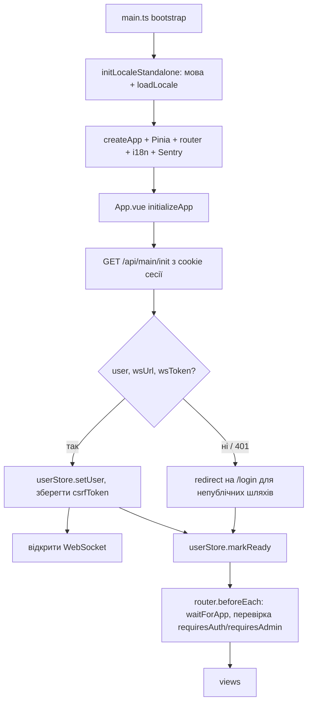

# Фронтенд

`packages/frontend` — односторінковий застосунок (SPA) на Vue 3 + Vite, який у production віддає сам бекенд. Ця сторінка — огляд. Деталі окремих підсистем описані на сторінках бекенду, і тут на них лише посилання.

::: tip Потрібен інший фреймворк?
Якщо вам потрібен фронтенд на React, Svelte, Angular, мобільний клієнт чи інша технологія, переписувати шаблон не треба. Достатньо дати агенту завдання створити поряд, у `packages/`, аналог `packages/frontend` на потрібному фреймворку. Це реально з двох причин:

- **Контракт API не прив'язаний до Vue.** Пакет [`shared`](/shared/) містить лише arktype-схеми, типи й enum-и. Новий фронтенд імпортує їх так само, як і поточний, і `pnpm typecheck` перевіряє його проти того самого контракту, що й бекенд.
- **Є готовий зразок.** Агент бере `packages/frontend` як еталон: HTTP-клієнт з cookie-сесією і CSRF-токеном ([HTTP-клієнт, сесія і CSRF](#http-клієнт-сесія-і-csrf)), WebSocket, push, PWA, i18n, guard-и роутера. Йому не треба вгадувати протокол бекенду.

Приклад завдання для агента:

```text
Створи packages/frontend-react: аналог packages/frontend на React + Vite.
Типи й схеми API бери тільки з пакета shared. Повтори HTTP-клієнт (сесія в cookie,
CSRF-токен), WebSocket і сторінки входу та профілю. Додай scripts typecheck, lint, test,
build, щоб їх підхопили pnpm -r typecheck і pnpm -r test.
```

Новий пакет потрапляє у workspace автоматично (`packages/*` у `pnpm-workspace.yaml`), а `pnpm typecheck`, `pnpm lint` і `pnpm test` перевіряють його разом з рештою. Окремо треба оновити місця, де назву `frontend` вказано явно: `pnpm dev` у кореневому `package.json`, копіювання збірки в `packages/backend/public` у `Dockerfile` і `scripts/prod-local.sh`, а також e2e-кроки в CI.
:::

## Стек

Залежності взято з [`packages/frontend/package.json`](https://github.com/Blazheiko/vibe-template/blob/main/packages/frontend/package.json):

| Призначення        | Пакет                                                            |
| ------------------ | ---------------------------------------------------------------- |
| UI-фреймворк       | `vue` 3.5, `@vueuse/core`                                        |
| Збірка / dev       | `vite` 7, `@vitejs/plugin-vue`, `vite-plugin-vue-devtools`       |
| Стан               | `pinia`                                                          |
| Роутинг            | `vue-router` 5                                                   |
| i18n               | `vue-i18n` 11                                                    |
| Моніторинг помилок | `@sentry/vue`                                                    |
| PWA install prompt | `@khmyznikov/pwa-install`                                        |
| Інше               | `mitt` (event bus), `dompurify`, `vue-advanced-cropper` (аватар) |
| Спільні контракти  | `shared` (`workspace:*`)                                         |
| Тести              | `vitest`, `@vue/test-utils`, `jsdom`, `@playwright/test`         |
| Типи               | `typescript` 6.0.3, `vue-tsc`                                    |

## Dev-сервер і проксі

[`vite.config.ts`](https://github.com/Blazheiko/vibe-template/blob/main/packages/frontend/vite.config.ts): порт `5173`, проксі `/api` → `http://127.0.0.1:3000` і `/ws` → `ws://127.0.0.1:3000` (`ws: true`). Аліас `@` → `src/`. Тег `pwa-install` оголошено як custom element. Через `define` у бандл потрапляє `BUILD_TIMESTAMP`, за яким порівнюються версії застосунку і Service Worker.

Як запускати разом із бекендом: [/guide/getting-started](/guide/getting-started), команди: [/reference/scripts](/reference/scripts).

## Змінні оточення

Тип `ImportMetaEnv` в [`src/env.d.ts`](https://github.com/Blazheiko/vibe-template/blob/main/packages/frontend/src/env.d.ts) описує всі `VITE_*`, які читає застосунок (типи — рядки збірки). Від звертання до неоголошеної змінної це не захищає: `vite/client` оголошує в `ImportMetaEnv` індексну сигнатуру. Змінні:

| Змінна                                                                                                                  | Де використовується                                                                                                                                                                                                                    |
| ----------------------------------------------------------------------------------------------------------------------- | -------------------------------------------------------------------------------------------------------------------------------------------------------------------------------------------------------------------------------------- |
| `VITE_BASE_URL`                                                                                                         | префікс для всіх HTTP-запитів у [`utils/base-api.ts`](https://github.com/Blazheiko/vibe-template/blob/main/packages/frontend/src/utils/base-api.ts)                                                                                    |
| `VITE_API_PATH_PREFIX`                                                                                                  | префікс назв WS-подій (`<prefix>/<route>`) у [`utils/ws-event.ts`](https://github.com/Blazheiko/vibe-template/blob/main/packages/frontend/src/utils/ws-event.ts); має збігатися з бекендовим `API_PATH_PREFIX`, за замовчуванням `api` |
| `VITE_AUTH_PHONE_ENABLED`                                                                                               | `'true'` вмикає вхід і реєстрацію за телефоном у [`AuthModals.vue`](https://github.com/Blazheiko/vibe-template/blob/main/packages/frontend/src/components/AuthModals.vue)                                                              |
| `VITE_SENTRY_ENABLED`, `VITE_SENTRY_DSN`, `VITE_SENTRY_ENVIRONMENT`, `VITE_SENTRY_RELEASE`, `VITE_SENTRY_*_SAMPLE_RATE` | конфігурація Sentry, див. [/backend/observability](/backend/observability)                                                                                                                                                             |

Без `VITE_BASE_URL` (і з порожнім значенням, як у `.env.example`) `base-api.ts` робить запити відносно поточного origin: у dev — через Vite-проксі, у production — до бекенду, що віддає SPA. Задавайте змінну, лише коли API живе на іншому origin (його має дозволяти CORS бекенду).

## Структура `src/`

| Каталог / файл                                                                                                      | Вміст                                                                                                                                                                                                                                                                                                                                                                                                                                          |
| ------------------------------------------------------------------------------------------------------------------- | ---------------------------------------------------------------------------------------------------------------------------------------------------------------------------------------------------------------------------------------------------------------------------------------------------------------------------------------------------------------------------------------------------------------------------------------------- |
| [`main.ts`](https://github.com/Blazheiko/vibe-template/blob/main/packages/frontend/src/main.ts)                     | bootstrap: локаль → `createApp` → Pinia, router, i18n → Sentry → `mount`; запуск SW через `startServiceWorker`                                                                                                                                                                                                                                                                                                                                 |
| [`App.vue`](https://github.com/Blazheiko/vibe-template/blob/main/packages/frontend/src/App.vue)                     | `initializeApp()`: виклик `GET /api/main/init`, збереження користувача, відкриття WebSocket                                                                                                                                                                                                                                                                                                                                                    |
| `views/`                                                                                                            | сторінки: `Login`, `UserAccount`, `SupportView`, `VerifyEmailView`, `ResetPasswordView`, юридичні сторінки, `admin/`                                                                                                                                                                                                                                                                                                                           |
| `components/`                                                                                                       | `AppHeader`, `AuthModals` (рамка й вибір кроку; кроки — у `auth/`: `LoginForm`, `ForgotPasswordFlow`, `RegisterEmailForm`, `RegisterPhoneFlow`, `AuthModalShell`; стилі форм — `assets/auth-forms.css`), `MenuButton` (меню; пункт «Install App» — `PwaInstallButton`), `UpdateNotification`, `AvatarEditorModal`, `admin/` (`AdminUserDetailModal`, `AdminFilterBar` — карточка фільтрів, спільна для списків користувачів і історії онлайну) |
| `composables/`                                                                                                      | `useWebSocketConnection`, `useBroadcastHandler`, `useSessionLifecycle`, `useLocale`, `useAdminUserDetailModal`, `useAuthRequest`, `useCompleteSignIn`, `useModalDialog` (клавіатурна поведінка модального вікна: початковий фокус, утримання Tab, Escape, повернення фокуса)                                                                                                                                                                   |
| `stores/`                                                                                                           | Pinia: `user`, `state` (тема, шрифт, режим PWA, розміри вікна, конфіг сховища), `push` (дозвіл і підписка на push), `support`                                                                                                                                                                                                                                                                                                                  |
| [`router/index.ts`](https://github.com/Blazheiko/vibe-template/blob/main/packages/frontend/src/router/index.ts)     | маршрути та guard                                                                                                                                                                                                                                                                                                                                                                                                                              |
| [`plugins/i18n.ts`](https://github.com/Blazheiko/vibe-template/blob/main/packages/frontend/src/plugins/i18n.ts)     | інстанс `vue-i18n`                                                                                                                                                                                                                                                                                                                                                                                                                             |
| `locales/`                                                                                                          | файли перекладів                                                                                                                                                                                                                                                                                                                                                                                                                               |
| `utils/`                                                                                                            | HTTP-клієнт (`base-api.ts`, `api.ts`), `csrf-token.ts`, WebSocket (`websocket-types.ts`, `ws-event.ts`, `websocket-close.ts`, `websocket-heartbeat.ts`), Sentry, `pwa-install.ts`, `event-bus.ts`                                                                                                                                                                                                                                              |
| `types/`                                                                                                            | типи, зокрема `i18n.d.ts`                                                                                                                                                                                                                                                                                                                                                                                                                      |
| [`service-worker.ts`](https://github.com/Blazheiko/vibe-template/blob/main/packages/frontend/src/service-worker.ts) | Service Worker, збирається окремо                                                                                                                                                                                                                                                                                                                                                                                                              |

Загальна структура монорепозиторію: [/guide/project-structure](/guide/project-structure).

### Роутер і guard

У маршрутах є `meta` (`requiresAuth`, `requiresAdmin`, `hideHeader`, `authModal` тощо, типи розширено в `env.d.ts`). `router.beforeEach` для захищених маршрутів чекає `waitForApp()` зі стору `user`, тобто завершення `initializeApp`. Публічні сторінки (вхід, верифікація email, скидання пароля) не чекають ініціалізації. Без користувача guard перенаправляє на `/login?redirect=<шлях>`. Після входу `redirect` береться лише якщо це шлях усередині застосунку (`/…`, без `//`, зворотних слешів і керувальних символів, [`safe-redirect.ts`](https://github.com/Blazheiko/vibe-template/blob/main/packages/frontend/src/utils/safe-redirect.ts)); інакше користувач потрапляє на `/account`. Маршрут `requiresAdmin` для не-адміна перенаправляє на `/account`.

### i18n

Інтерфейс перекладено трьома мовами: `en`, `uk`, `pl` (список — `SHIPPED_LOCALE_CODES` пакета [`shared`](/shared/), по файлу в `src/locales/`; тест `locales.spec.ts` стежить, щоб файлів було рівно стільки і щоб `uk` та `pl` мали всі ключі `en` з тими самими плейсхолдерами). `APP_LOCALE_CODES` (18 кодів) ширший: ним користується розпізнавання мови й Support AI, який відповідає і мовами без перекладу інтерфейсу. В основний бандл входить тільки `en`. `uk` і `pl` `loadLocale()` підвантажує динамічним `import()` і зливає з `en`, тож відсутні ключі показуються англійською; якщо файл не завантажився, `loadLocale()` повертає `en` і пише попередження, тож вибір мови не залишає інтерфейс без тексту. Початкову мову `initLocaleStandalone()` у [`composables/useLocale.ts`](https://github.com/Blazheiko/vibe-template/blob/main/packages/frontend/src/composables/useLocale.ts) визначає за `navigator.language`; якщо мови немає серед трьох, бере `en` (браузер `ru-RU` чи `de-DE` отримує англійський інтерфейс). Support AI фронтенд просить відповідати мовою браузера (`supportLanguage()`), а не мовою інтерфейсу. Нову мову додають файлом у `src/locales/` і кодом у `SHIPPED_LOCALE_CODES`.

## HTTP-клієнт, сесія і CSRF

[`utils/base-api.ts`](https://github.com/Blazheiko/vibe-template/blob/main/packages/frontend/src/utils/base-api.ts) обгортає `fetch`, а [`utils/api.ts`](https://github.com/Blazheiko/vibe-template/blob/main/packages/frontend/src/utils/api.ts) містить типізовані методи (`/api/auth/*`, `/api/main/*`, `/api/push-subscriptions*`).

- Усі запити йдуть з `credentials: 'include'`, тож браузер сам надсилає сесійну cookie. JS її не читає.
- CSRF-токен не вбудовується в HTML. Він приходить у полі `csrfToken` відповіді (зокрема `init`) і зберігається в пам'яті модуля [`utils/csrf-token.ts`](https://github.com/Blazheiko/vibe-template/blob/main/packages/frontend/src/utils/csrf-token.ts). Токен перевіряється regex `^[A-Za-z0-9_-]{32,128}$` і оновлюється з кожної відповіді, у якій є нове значення.
- Для `POST`/`PUT`/`PATCH`/`DELETE` клієнт додає заголовок `X-CSRF-Token`.
- Коли сервер повертає `csrf_invalid`, клієнт один раз емітить `init_app`, щоб повторно ініціалізуватися й отримати новий токен. Неавторизовану відповідь клієнт перетворює на подію `unauthorized` в event bus.
- Помилки не кидаються: метод повертає `{ data, error }`, де `error` має нормалізовані `code` і `transportCode`. Нормалізація живе в `utils/response-normalizer.ts`.

Серверна сторона цього механізму описана в [Безпека → CSRF](/backend/security#csrf).

## WebSocket і push

- Після успішного `init` `App.vue` відкриває WebSocket з `data.wsUrl` і `data.wsToken`. Клієнт (`useWebSocketConnection`, `ws-event.ts`, heartbeat, broadcast-обробник) описано в [/backend/websocket](/backend/websocket). Префікс задає `VITE_API_PATH_PREFIX` (за замовчуванням `api`), він має збігатися з бекендовим `API_PATH_PREFIX`. З нього будуються і WS-події, і всі HTTP-шляхи ([`utils/api-path.ts`](https://github.com/Blazheiko/vibe-template/blob/main/packages/frontend/src/utils/api-path.ts): `apiPath('auth/login')` → `/<prefix>/auth/login`), OAuth-посилання, URL скриншотів і сховища, фільтр API-запитів у service worker і ключ Vite proxy (`/<prefix>` з `ws: true` покриває і WS-ендпоінт `/<prefix>/websocket`).
- Підписка на Web Push працює через `/api/push-subscriptions*` (VAPID-ключ, CRUD). Як SW обробляє push, описано в [Web Push сповіщення](/backend/web-push-notification#фронтенд).

## PWA

- **Service Worker** — окрема збірка [`vite.sw.config.ts`](https://github.com/Blazheiko/vibe-template/blob/main/packages/frontend/vite.sw.config.ts): lib-режим, формат `iife`, результат `dist/service-worker.js`, `emptyOutDir: false`, щоб не стерти бандл застосунку. [`utils/sw-manager.ts`](https://github.com/Blazheiko/vibe-template/blob/main/packages/frontend/src/utils/sw-manager.ts) (`startServiceWorker`, його викликає `main.ts`) реєструє його тільки в production (`scope: '/'`, `updateViaCache: 'none'`) після події `load`. У dev уже встановлені SW знімаються з реєстрації.
- **Оновлення.** `sw-manager.ts` порівнює `BUILD_TIMESTAMP` застосунку і SW (через `MessageChannel`, `GET_BUILD_TIMESTAMP`). Коли різниця більша за 10 хвилин і це не перше встановлення, він викликає `announceUpdate` (`main.ts` емітить `update_available`) — не більше одного разу, хоч би скільки сигналів прийшло, і `UpdateNotification` показує повідомлення. Помилки SW (`SW_ERROR`) пересилаються в Sentry.
- **Встановлення.** Веб-компонент `@khmyznikov/pwa-install` використовується в `MenuButton.vue` (логіка — composable [`usePwaInstallButton`](https://github.com/Blazheiko/vibe-template/blob/main/packages/frontend/src/composables/usePwaInstallButton.ts), сам пункт — `PwaInstallButton.vue`), а стан `beforeinstallprompt` зберігає [`utils/pwa-install.ts`](https://github.com/Blazheiko/vibe-template/blob/main/packages/frontend/src/utils/pwa-install.ts) (`initializePwaInstallTracking()` викликається на старті).
- **Офлайн і кешування** в SW: [/backend/caching-etag](/backend/caching-etag).

## Збірка і тести

`pnpm --filter frontend build` запускає паралельно `vue-tsc --build` і `vite build`, а потім `build-sw`. Результат лежить у `packages/frontend/dist`. У Docker-образі [`Dockerfile`](https://github.com/Blazheiko/vibe-template/blob/main/Dockerfile) копіює `dist` у `packages/backend/public`, звідки його віддає бекенд. Подробиці: [/backend/deployment](/backend/deployment).

У production-збірці (застосунок і Service Worker) виклики `console.log`, `console.info`, `console.debug` і `console.trace` вирізаються мінифікатором: [`vite.console.ts`](https://github.com/Blazheiko/vibe-template/blob/main/packages/frontend/vite.console.ts) передає їх у `esbuild.pure`. Так у консоль браузера не потрапляють токени й дані користувача, зокрема зі сторонніх залежностей. `console.warn` і `console.error` лишаються. У dev-режимі (`pnpm dev`) код не мінифікується, тож усі логи на місці. Не покладайтеся на це вирізання як на захист: секрети не варто логувати й у dev.

Unit-тести (Vitest, `src/**/__tests__`) і e2e (Playwright, `e2e/`) описані в [/backend/testing](/backend/testing). Відома проблема №38: Playwright `webServer` запускається через `npm`.

## Старт застосунку


