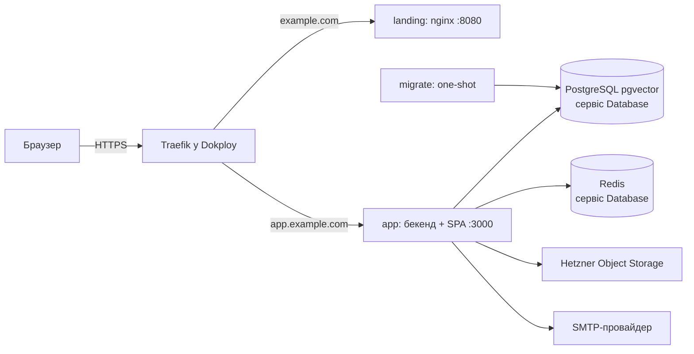

# Деплой на Hetzner через Dokploy

Ця сторінка покроково описує, як розгорнути застосунок (бекенд із SPA) і лендінг на сервері Hetzner Cloud за допомогою [Dokploy](https://docs.dokploy.com/). Застосунок описано файлом [`docker-compose-prod.yml`](https://github.com/Blazheiko/vibe-template/blob/main/docker-compose-prod.yml) у корені репозиторію, а зразок змінних — файлом [`.env.prod.example`](https://github.com/Blazheiko/vibe-template/blob/main/.env.prod.example).

::: warning Не перевірено
Інструкцію ще не пройдено на справжньому сервері. Локально перевірено лише production-режим compose-файлу (`make prod-smoke`, див. [Перевірка без сервера](#перевірка-без-сервера)). Поведінку Traefik щодо `X-Forwarded-For` і роботу з базами Dokploy треба перевірити під час першого деплою.
:::

## Топологія



- **У compose-файлі три сервіси:**
    - `migrate` — разовий запуск: `db:create:prod` (база і розширення `vector`) і `db:migrate`;
    - `app` — кореневий `Dockerfile`, бекенд віддає зібраний SPA;
    - `landing` — образ [лендінгу](/landing/) на nginx.
- **PostgreSQL і Redis до файлу не входять.** Це сервіси Database, які ви створюєте вручну в панелі Dokploy: без External Port, з бекапами на вкладці Backups. `app` і `migrate` бачать їх через зовнішню мережу `dokploy-network`.
- **S3 і пошта зовнішні:** Hetzner Object Storage і будь-який SMTP-провайдер.
- **Домени й TLS налаштовуються на вкладці Domains Dokploy.** Traefik сам додає свої labels. У файлі немає `ports`, лише `expose`, тож на хості нічого не публікується.

Контракт URL у production:

| Що                   | Значення                                                    |
| -------------------- | ----------------------------------------------------------- |
| Застосунок           | `https://${APP_DOMAIN}` → сервіс `app`, порт `3000`         |
| Лендінг              | `https://${LANDING_DOMAIN}` → сервіс `landing`, порт `8080` |
| API і WebSocket      | `https://${APP_DOMAIN}/${API_PATH_PREFIX}/…`                |
| Кнопки лендінгу      | `https://${APP_DOMAIN}/login`, `/register`                  |
| RP ID ключів доступу | `${APP_DOMAIN}`                                             |

`APP_URL`, `FRONTEND_URL`, `DOMAIN`, `LANDING_URL`, `CSRF_ALLOWED_ORIGINS` і `WEBAUTHN_RP_ID` compose-файл виводить із двох доменів, тож задавати їх окремо не треба.

## Передумови

- **Сервер Hetzner Cloud** з Ubuntu 24.04 і щонайменше 4 GB RAM: фронтенд збирається на сервері. На 2 GB збірка може впасти з OOM, тоді додайте swap (`fallocate -l 4G /swapfile && chmod 600 /swapfile && mkswap /swapfile && swapon /swapfile`, рядок у `/etc/fstab`).
- **DNS:** A-записи `example.com`, `www.example.com` і `app.example.com` на IP сервера.
- **Dokploy** встановлено за [його інструкцією](https://docs.dokploy.com/docs/core/installation) (`curl -sSL https://dokploy.com/install.sh | sh`).
- **Hetzner Cloud Firewall:** вхідні 22, 80 і 443. Панель Dokploy (порт `3000` хоста) відкривайте лише для свого IP або публікуйте через домен панелі з HTTPS.
- **Бакет Hetzner Object Storage** і ключі доступу до нього. CORS бакета налаштуйте за [`corsS3.prod.example.xml`](https://github.com/Blazheiko/vibe-template/blob/main/corsS3.prod.example.xml), вказавши свій домен застосунку.
- **SMTP-провайдер** з адресою відправника на вашому домені.

## Підготовка репозиторію

- Змініть `PRODUCT.siteUrl` у [`packages/shared/src/product/index.ts`](https://github.com/Blazheiko/vibe-template/blob/main/packages/shared/src/product/index.ts) на `https://<APP_DOMAIN>/`: ця адреса задається в коді, а не в `.env`.
- Перепишіть тексти лендінгу під свій продукт ([Лендінг](/landing/)).
- Виберіть гілку для деплою (зазвичай `main`): кожен push у неї запускає новий деплой.

## Бази в Dokploy (вручну)

Створіть їх до застосунку: compose-сервіс посилається на їхні адреси, а `depends_on` на сервіси поза файлом неможливий.

1. **PostgreSQL:** Project → Create Service → Database → PostgreSQL.
    - Docker Image: `pgvector/pgvector:pg16`. У стандартного образу немає `vector`, і міграції на ньому впадуть.
    - Задайте Database Name (`vibe_template`), User і Password, а External Port залиште порожнім.
    - Натисніть Deploy.
2. **Redis:** Create Service → Database → Redis, з паролем і без External Port. Натисніть Deploy.
3. На вкладці General кожного сервісу відкрийте **Internal Credentials**. Internal Host (це App Name сервісу), порт, користувач, пароль і назва бази підуть у змінні `PGSQL_*` і `REDIS_*` застосунку.

## Застосунок у Dokploy

1. Project → Create Service → **Compose**, тип **Docker Compose** (не Stack: Stack не вміє `build`).
2. Provider: ваш git-репозиторій, гілка для деплою, Compose Path — `./docker-compose-prod.yml`.
3. **Environment:** вставте вміст `.env.prod.example` і заповніть значення.
    - `APP_DOMAIN` і `LANDING_DOMAIN` — лише хости, без `https://`.
    - `APP_KEY`: `openssl rand -base64 48`.
    - `MFA_ENCRYPTION_KEYS`: `pnpm --filter backend mfa:keys` на своїй машині або `echo "k1:$(openssl rand -base64 32)"`. Втрата ключа робить непридатними всі TOTP-фактори.
    - `PGSQL_*` і `REDIS_*` — з Internal Credentials.
    - `TRUSTED_PROXY_CIDRS` — підмережа `dokploy-network`. Подивіться її на сервері: `docker network inspect dokploy-network` (поле `IPAM.Config[0].Subnet`).
    - `S3_*`, `CDN_URL` і `SMTP_*` — від Hetzner Object Storage і поштового провайдера.

    Обов'язкові змінні compose-файл записує як `${VAR:?…}`: без будь-якої з них деплой зупиняється одразу, і в лозі видно її назву.

4. **Domains:** додайте два домени.
    - `app.example.com` → сервіс `app`, порт `3000`, HTTPS (Let's Encrypt).
    - `example.com` → сервіс `landing`, порт `8080`, HTTPS.
    - За бажанням `www.example.com` з редиректом на `example.com` (middleware Traefik у Dokploy).
5. **Deploy.** Потім на вкладці Deployments увімкніть AutoDeploy: додайте webhook Dokploy у налаштування репозиторію.

Ізольовані деплої Dokploy (Isolated Deployments) не вмикайте: `app` і `migrate` мають лишатися в `dokploy-network`, інакше бази недоступні.

## Перший деплой

1. **Збірка.** Dokploy клонує репозиторій і збирає образи на сервері (`docker compose up --build`). Перша збірка триває кілька хвилин.
2. **Міграції.** `migrate` створює базу й розширення `vector` і застосовує міграції. Якщо база ще не готова, `migrate` падає, а `app` не стартує; задеплойте ще раз.
3. **Старт `app`.** `app` стартує після успішного `migrate`. Healthcheck чекає `/<prefix>/ready`, тобто поки відповідатимуть PostgreSQL і Redis. Невдала перевірка конфігурації зупиняє контейнер з поясненням у лозі (`Invalid … configuration`).
4. **Логи** — на вкладці Logs сервісу (виберіть `migrate`, `app` чи `landing`).
5. **Seed** вручну, один раз: у терміналі контейнера `app` (вкладка Terminal) виконайте `pnpm db:seed:prod`. Він додає довідкові дані (LLM-промпти). Demo-акаунти в production не створюються. Як отримати першого адміністратора, описано в розділі [«Перший адмін у production»](/backend/database#першии-адмін-у-production).

## Перевірка

Виконайте на своїй машині:

```bash
scripts/verify-landing-deploy.sh https://example.com https://app.example.com
curl -fsS https://app.example.com/api/ready
```

- Відкрийте лендінг, перейдіть кнопками до входу й реєстрації і зареєструйтесь.
- Перевірте, що лист підтвердження приходить.
- Перевірте підроблений `X-Forwarded-For`, як описано в розділі [«Rate limit на edge»](/backend/deployment#rate-limit-на-edge). Кілька входів з невірним паролем і різними `X-Forwarded-For: 203.0.113.N` мають упертися в один ліміт за IP. Якщо цього не відбувається, Traefik пропускає заголовок клієнта, і йому треба налаштувати `forwardedHeaders`.

## Оновлення і відкат

- **Оновлення:** push у гілку деплою, і AutoDeploy збирає й розгортає новий коміт. `migrate` відпрацьовує перед новим `app`.
- **Відкат:** redeploy попереднього коміту (вкладка Deployments). Міграції йдуть лише вперед: якщо відкат зачіпає схему, відновіть базу з бекапу вручну.
- **Зміна домену застосунку** потребує нової збірки лендінгу (адреси вшиті в HTML), а ключі доступу (passkeys) старого домену перестануть працювати.

## Бекапи і відновлення

- **Бекапи PostgreSQL:** на вкладці Backups сервісу PostgreSQL додайте destination (бакет Hetzner Object Storage) і розклад `pg_dump`.
- **Ручний бекап:** `docker exec <контейнер postgres> pg_dump -U postgres -Fc vibe_template > backup.dump`.
- **Відновлення:** `docker exec -i <контейнер postgres> pg_restore -U postgres -d vibe_template --clean < backup.dump`, коли `app` зупинено.
- **Redis** окремо не бекапиться. Разом із його volume зникають анонімні сесії й сесії користувачів (усі виходять із системи), лічильники лімітів, тікети MFA й одноразові WS-токени. Дані користувачів лишаються в PostgreSQL.

## Перевірка без сервера

- `make verify-compose` (частина `make check` і CI) перевіряє `docker-compose-prod.yml` з `.env.prod.example`:
    - кожна змінна файлу є в зразку;
    - без `APP_DOMAIN` файл не резолвиться;
    - немає `ports`, сервісів баз, volume і labels Traefik;
    - є healthcheck і `restart`;
    - `API_PATH_PREFIX` у збірці й під час виконання однаковий, а лендінг зібрано на адреси застосунку;
    - `app` і `migrate` у зовнішній `dokploy-network`.
- `make prod-smoke` піднімає той самий файл із [`docker-compose-prod.smoke.yml`](https://github.com/Blazheiko/vibe-template/blob/main/docker-compose-prod.smoke.yml). Там Caddy з внутрішнім TLS замінює Traefik, локальні PostgreSQL і Redis замінюють сервіси Database, а SeaweedFS і Mailpit — зовнішні S3 і SMTP. Скрипт перевіряє:
    - лендінг (`verify-landing-deploy.sh`);
    - `/api/ready`;
    - cookie `__Host-` з `Secure`;
    - реєстрацію, підтвердження email за посиланням із листа (Mailpit) і вхід через API.

    Застосунок при цьому працює в production-режимі. `SMOKE_KEEP=true make prod-smoke` лишає стек запущеним, щоб відкрити `https://app.localhost:8443` у браузері.

## Чекліст і усунення проблем

| Симптом                                               | Причина і що робити                                                                                                            |
| ----------------------------------------------------- | ------------------------------------------------------------------------------------------------------------------------------ |
| `migrate` не підключається до бази                    | бази не створено, не той Internal Host, сервіс не в `dokploy-network` (вимкніть Isolated Deployments)                          |
| `CREATE EXTENSION vector` падає                       | у PostgreSQL стандартний образ: потрібен `pgvector/pgvector:pg16`                                                              |
| деплой зупиняється з `required variable … is missing` | змінну не задано в Environment                                                                                                 |
| 502 від Traefik                                       | не той порт у Domains: `app` — `3000`, `landing` — `8080`                                                                      |
| cookie не встановлюється, вхід не тримається          | `APP_DOMAIN` не той, з якого відкрито сайт, або HTTPS не ввімкнено                                                             |
| `403 csrf_invalid` з `origin_mismatch`                | сайт відкрито з іншого домену, ніж `APP_DOMAIN`                                                                                |
| SPA ходить не за тією адресою API                     | `API_PATH_PREFIX` змінено без нової збірки: зробіть redeploy                                                                   |
| усі запити рахуються з одного IP                      | `TRUSTED_PROXY_CIDRS` не відповідає підмережі `dokploy-network`                                                                |
| збірка падає з OOM                                    | мало пам'яті: 4 GB або swap                                                                                                    |
| лендінг не збирається                                 | строгий режим: `APP_DOMAIN` і `LANDING_DOMAIN` мають бути публічними, різними й без плейсхолдерів (`example.com` не підходить) |

Загальні вимоги до production (змінні, Redis, S3, чекліст) описано на сторінці [Деплой](/backend/deployment).
