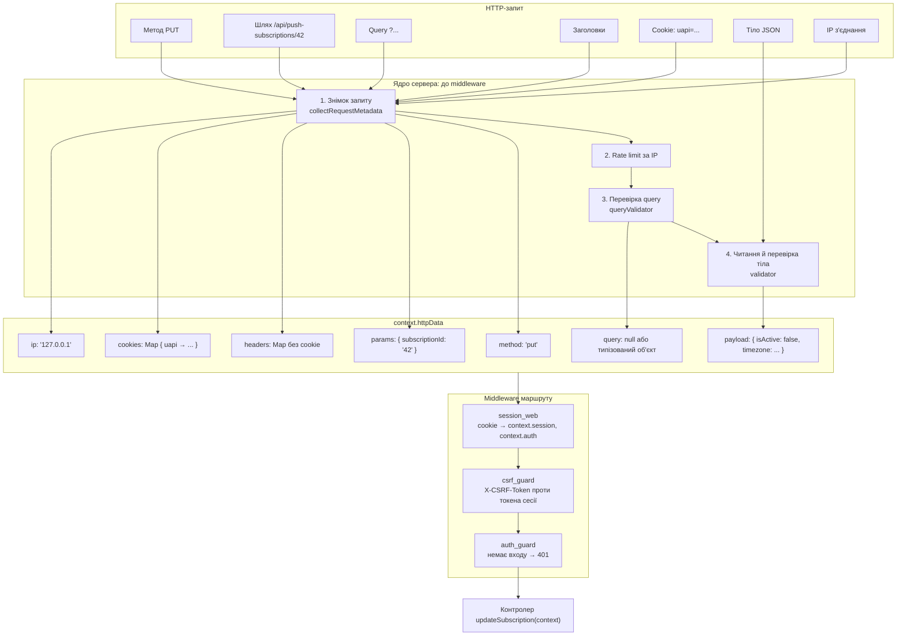

# Від HTTP-запиту до контролера

::: info Перед читанням
Варто прочитати [Як влаштований бекенд](/guide/how-backend-works): там пояснено шари route → controller → service → repository. Ця сторінка розбирає один крок детальніше: як сирий HTTP-запит перетворюється на об'єкт `context`, який отримує контролер.
:::

Контролер у шаблоні ніколи не читає «сирий» запит. Він отримує один аргумент `context`, у якому вже все розкладено по полях, перевірено й типізовано. Нижче на одному реальному запиті показано, звідки береться кожне поле.

## Приклад запиту

Візьмемо маршрут, у якому є все одразу: параметр у шляху, тіло, cookie сесії і службові заголовки. Користувач вимикає push-підписку з id `42`:

```http
PUT /api/push-subscriptions/42 HTTP/1.1
Host: localhost:3000
Origin: http://localhost:5173
Content-Type: application/json
Cookie: uapi=eyJzaWQiOi...
X-CSRF-Token: 7f3c9a...
Sec-Fetch-Site: same-site

{"isActive": false, "timezone": "Europe/Kyiv"}
```

Маршрут оголошено в [http-routes.ts](https://github.com/Blazheiko/vibe-template/blob/main/packages/backend/src/app/routes/http-routes.ts):

```ts
{
    group: [
        defineRoute({
            url: '/:subscriptionId',
            method: 'put',
            handler: PushSubscriptionController.updateSubscription.bind(PushSubscriptionController),
            validator: UpdateSubscriptionInputSchema, // схема тіла
            ResponseSchema: ResponseSchemas.UpdateSubscriptionResponseSchema,
            middlewares: ['auth_guard'],
        }),
    ],
    middlewares: ['session_web', 'csrf_guard'], // для всієї групи
    prefix: 'push-subscriptions',
}
```

## З чого складається запит

| Частина запиту                           | У прикладі                    | Для чого                                                                                                  |
| ---------------------------------------- | ----------------------------- | --------------------------------------------------------------------------------------------------------- |
| **Метод**                                | `PUT`                         | Що зробити: `GET` — прочитати, `POST` — створити, `PUT` — змінити, `DELETE` — видалити                    |
| **Шлях**                                 | `/api/push-subscriptions/42`  | Який ресурс. `api` — префікс API, `push-subscriptions` — префікс групи, `42` — параметр `:subscriptionId` |
| **Query** (після `?`)                    | немає                         | Фільтри й налаштування, наприклад `?page=2`                                                               |
| **Заголовок `Content-Type`**             | `application/json`            | У якому форматі тіло                                                                                      |
| **Заголовок `Cookie`**                   | `uapi=...`                    | Cookie сесії: за нею сервер упізнає користувача                                                           |
| **Заголовок `X-CSRF-Token`**             | `7f3c9a...`                   | Токен захисту від CSRF, фронтенд додає його сам                                                           |
| **Заголовки `Origin`, `Sec-Fetch-Site`** | адреса фронтенду, `same-site` | Звідки прийшов запит; теж для захисту від CSRF                                                            |
| **Тіло**                                 | `{"isActive": false, ...}`    | Дані, які треба зберегти                                                                                  |
| **IP-адреса**                            | не в тексті запиту            | Береться з TCP-з'єднання (або з `X-Forwarded-For` за довіреним проксі)                                    |

::: tip Назва cookie
Локально cookie сесії називається `uapi`. У production до неї додається префікс `__Host-` (`__Host-uapi`), який браузер дозволяє лише для HTTPS. Див. [Сесії](/backend/auth).
:::

## Схема: як поля потрапляють у `context`



Порядок важливий: дешеві перевірки йдуть першими. Rate limit спрацьовує до читання тіла, щоб сервер не витрачав пам'ять на запити, які все одно буде відхилено. Query перевіряється до тіла з тієї ж причини.

## Крок за кроком

### 1. Знімок запиту

Об'єкт запиту uWebSockets.js живе лише до першого `await`, тому ядро одразу синхронно копіює з нього все потрібне (`collectRequestMetadata` у [server.ts](https://github.com/Blazheiko/vibe-template/blob/main/packages/backend/src/vendor/start/server.ts)):

- **заголовки** → `Map`, ключі в нижньому регістрі (`content-type`, `x-csrf-token`). Заголовок з некоректною назвою чи значенням пропускається із записом у лог. Заголовок `Cookie` сюди **не** потрапляє, щоб секрети сесії випадково не опинилися в логах;
- **cookie** → окрема `Map` `cookies`;
- **параметри шляху** → об'єкт `params`. Значення перевіряються за довжиною й набором символів; некоректне дає `400`;
- **IP** → з з'єднання, або з `X-Forwarded-For`, якщо запит прийшов через довірений проксі ([Trust proxy](/backend/security#trust-proxy-і-визначення-ip)).

### 2. Rate limit

Спершу загальний ліміт на IP, потім ліміт маршруту, якщо він заданий. Перевищення — `429`, далі запит не йде.

### 3. Query

Якщо в маршруті є `queryValidator`, рядок після `?` перевіряється схемою, а в `httpData.query` кладеться вже типізований об'єкт. Якщо схеми немає, `query` дорівнює `null`: прочитати параметр «на вдачу» не вийде, TypeScript не дасть. Приклад з query — у [Першому маршруті](/guide/first-endpoint).

### 4. Тіло

Тіло читається лише для `POST`, `PUT` і `PATCH`. Ядро перевіряє розмір і `Content-Type`, розбирає JSON і проганяє результат через `validator` маршруту — arktype-схему з пакета `shared`:

```ts
// packages/shared/src/schemas/push-subscription/update-subscription.ts
export const UpdateSubscriptionInputSchema = type({
    'isActive?': 'boolean',
    'timezone?': 'string',
    // ...
    '+': 'reject', // невідоме поле — помилка
})
export type UpdateSubscriptionInput = typeof UpdateSubscriptionInputSchema.infer
```

Якщо тіло не відповідає схемі (наприклад, `"isActive": "no"` або зайве поле `"userId": 1`), сервер відповідає `422 validation_failed`, і контролер **не викликається**. Тому в контролері `payload` уже гарантовано правильної форми.

### 5. Створення контексту

З усього зібраного ядро будує `httpData` і загортає його в `context` ([http-context.ts](https://github.com/Blazheiko/vibe-template/blob/main/packages/backend/src/vendor/utils/context/http-context.ts)). Для нашого запиту `httpData` виглядає так:

```ts
{
    method: 'put',
    ip: '127.0.0.1',
    params: { subscriptionId: '42' },
    query: null,                      // у маршруту немає queryValidator
    payload: { isActive: false, timezone: 'Europe/Kyiv' },
    headers: Map {
        'host' => 'localhost:3000',
        'origin' => 'http://localhost:5173',
        'content-type' => 'application/json',
        'x-csrf-token' => '7f3c9a...',
        'sec-fetch-site' => 'same-site',
    },
    cookies: Map { 'uapi' => 'eyJzaWQiOi...' },
    contentType: 'application/json',
    isJson: true,
    files: null,                      // файли бувають лише в multipart/form-data
}
```

Решта полів `context`:

| Поле           | Що це                                                                   |
| -------------- | ----------------------------------------------------------------------- |
| `requestId`    | Унікальний id запиту, є в кожному записі логу                           |
| `logger`       | Логер, який сам додає `requestId` (а після входу — `userId`)            |
| `responseData` | Куди middleware й контролер пишуть статус, заголовки й cookie відповіді |
| `session`      | Поки що «порожня» сесія; заповнить middleware `session_web`             |
| `auth`         | Поки що «ніхто не увійшов»; теж заповнить `session_web`                 |
| `signal`       | `AbortSignal`, який спрацьовує, якщо клієнт закрив з'єднання            |

### 6. Middleware

Middleware виконуються по черзі: спершу ті, що задані для групи, потім ті, що для маршруту. Кожен може зупинити запит, не викликавши `next()`.

1. **`session_web`** бере з `httpData.cookies` cookie `uapi`, знаходить сесію в Redis і заповнює `context.session` та `context.auth`. Після цього `context.auth.getUserId()` повертає id користувача.
2. **`csrf_guard`** для методів, що змінюють дані, звіряє `Sec-Fetch-Site`, `Origin` і заголовок `X-CSRF-Token` з токеном, збереженим у сесії. Детальніше — [CSRF простими словами](/guide/csrf).
3. **`auth_guard`** перевіряє `context.auth.check()`. Якщо користувач не увійшов, відповідь `401`, і контролер не викликається.

### 7. Контролер

Нарешті контролер отримує готовий `context` ([push-subscription-controller.ts](https://github.com/Blazheiko/vibe-template/blob/main/packages/backend/src/app/controllers/http/notifications/push-subscription-controller.ts)):

```ts
async updateSubscription(
    context: HttpContext<UpdateSubscriptionInput>, // тип тіла з shared
): Promise<UpdateSubscriptionResponse> {
    const userId = requireUserId(context)              // з context.auth
    if (userId === null) return mapControllerError(context, unauthorized())

    const subscriptionId = resolveSubscriptionId(context) // з context.httpData.params
    if (subscriptionId === null) return mapControllerError(context, subscriptionNotFound())

    const payload = getTypedPayload(context)           // з context.httpData.payload

    const result = await pushSubscriptionService.updateSubscription(
        userId, subscriptionId, payload, context.auth.getPresentedUserToken(),
    )
    return respond(context, result, (value) => ({
        status: 'success',
        subscription: value.subscription,
    }))
}
```

Що тут відбувається:

- **`HttpContext<UpdateSubscriptionInput>`** — перший параметр типу описує тіло. Тому `getTypedPayload(context)` повертає `{ isActive?: boolean; timezone?: string; ... }`, і звернення до неіснуючого поля — помилка компіляції. Другий параметр (за потреби) описує query.
- **`params` завжди рядки.** `subscriptionId` приходить як `'42'`. Контролер сам перетворює його на число (`BigInt`) і вважає нечисловий id «не знайденим».
- **Контролер не знає про HTTP-деталі.** Він не парсить JSON, не читає cookie й не перевіряє CSRF: усе це вже зроблено. Його робота — дістати дані з `context`, викликати сервіс і перетворити результат на відповідь.

Повернений об'єкт ядро перевіряє за `ResponseSchema` маршруту і відправляє клієнту як JSON. Як це відбувається — [Від контролера до HTTP-відповіді](/guide/http-response).

## Де що шукати в `context`

| Хочу дізнатися              | Звідки взяти                                                         |
| --------------------------- | -------------------------------------------------------------------- |
| Id з адреси (`/:id`)        | `context.httpData.params['id']` (рядок)                              |
| Параметр після `?`          | `context.httpData.query.name` (лише якщо є `queryValidator`)         |
| Дані з тіла                 | `getTypedPayload(context)` (лише якщо є `validator`)                 |
| Хто увійшов                 | `requireUserId(context)` або `context.auth.getUserId()`              |
| Заголовок                   | `context.httpData.headers.get('назва-в-нижньому-регістрі')`          |
| Завантажений файл           | `context.httpData.files` (запит `multipart/form-data`)               |
| Встановити статус чи cookie | `context.responseData.status`, `context.responseData.setCookie(...)` |
| Записати в лог              | `context.logger.info(...)`                                           |

## Що далі

- [Від контролера до HTTP-відповіді](/guide/http-response) — зворотний шлях: як повернений контролером об'єкт стає відповіддю.
- [Перший маршрут](/guide/first-endpoint) — додайте власний маршрут з query-параметром і пройдіть цей шлях самі.
- [Життєвий цикл запиту](/backend/request-lifecycle) — та сама тема для досвідчених: ліміти тіла, обробка помилок, WebSocket.
- [Middleware](/backend/middlewares) і [Валідація](/backend/validation) — як написати свій middleware і схему.
