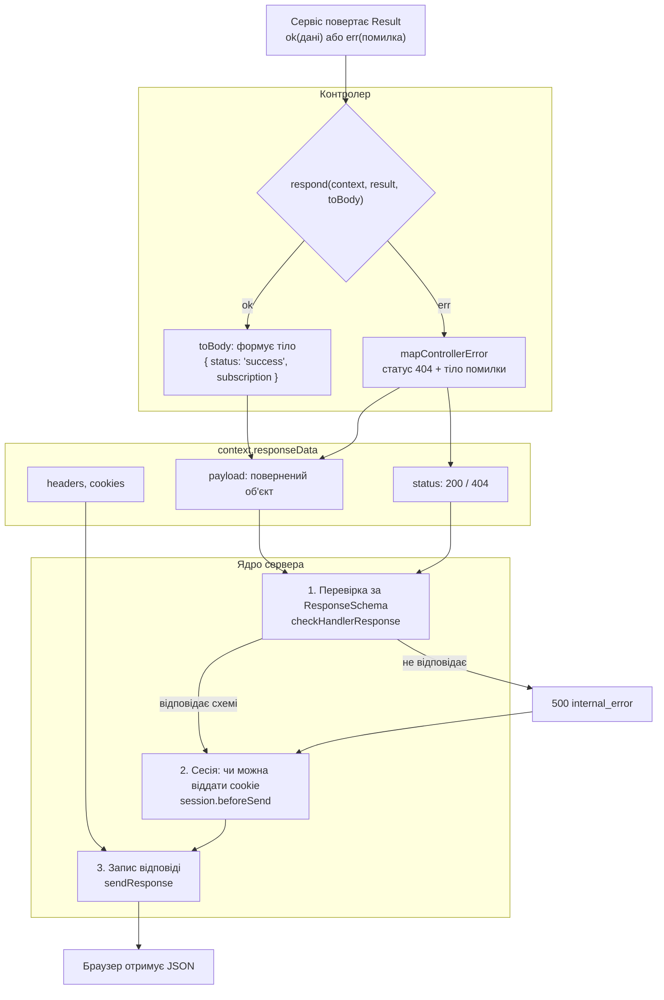

# Від контролера до HTTP-відповіді

::: info Перед читанням
Це продовження сторінки [Від HTTP-запиту до контролера](/guide/http-request). Там запит дійшов до контролера. Тут — зворотний шлях: як те, що повернув контролер, стає HTTP-відповіддю, яку отримує браузер.
:::

Контролер у шаблоні не пише у відповідь напряму. Він просто **повертає об'єкт** — тіло відповіді. Статус, заголовки, cookie, перевірку за схемою і перетворення на JSON бере на себе ядро сервера. Нижче розібрано той самий запит `PUT /api/push-subscriptions/42`.

## Приклад відповіді

Успішна відповідь на запит з попередньої сторінки:

```http
HTTP/1.1 200 OK
Content-Type: application/json
X-Content-Type-Options: nosniff
X-Frame-Options: DENY
Referrer-Policy: no-referrer
Strict-Transport-Security: max-age=31536000; includeSubDomains
Content-Security-Policy: default-src 'none'; frame-ancestors 'none'
Cache-Control: no-store
Access-Control-Allow-Origin: http://localhost:5173
Access-Control-Allow-Credentials: true

{
  "status": "success",
  "subscription": {
    "id": "42",
    "userId": "7",
    "isActive": false,
    "timezone": "Europe/Kyiv",
    "created_at": "2026-11-01T10:15:00.000Z",
    ...
  }
}
```

А так виглядає відповідь, якщо підписки `42` немає або вона належить іншому користувачу:

```http
HTTP/1.1 404 Not Found
Content-Type: application/json
...ті самі службові заголовки...

{ "status": "error", "code": "not_found", "message": "Subscription not found" }
```

## З чого складається відповідь

| Частина відповіді             | У прикладі                                        | Хто задає                                                                                  |
| ----------------------------- | ------------------------------------------------- | ------------------------------------------------------------------------------------------ |
| **Статус**                    | `200`, `404`                                      | За замовчуванням `200`. Помилку задає `mapControllerError` за типом помилки                |
| **`Content-Type`**            | `application/json`                                | Ядро, якщо в відповіді є тіло                                                              |
| **Заголовки безпеки**         | `X-Frame-Options`, `Strict-Transport-Security`, … | Ядро, на кожну відповідь ([Заголовки безпеки](/backend/security#заголовки-безпеки-та-csp)) |
| **`Content-Security-Policy`** | `default-src 'none'; …`                           | Ядро; для API — найсуворіша політика                                                       |
| **`Cache-Control`**           | `no-store`                                        | Ядро: відповіді API не кешуються, якщо контролер не задав інше                             |
| **CORS (`Access-Control-*`)** | дозволений origin фронтенду                       | Ядро, якщо CORS увімкнено (`ENABLED_CORS`)                                                 |
| **`Set-Cookie`**              | у цьому прикладі немає                            | Сесійний шар (вхід, вихід, продовження сесії) або контролер                                |
| **Тіло**                      | `{"status": "success", …}`                        | Контролер: те, що він повернув                                                             |

## Схема: як результат стає відповіддю



## Крок за кроком

### 1. Сервіс повертає результат, а не кидає виняток

Сервіс не знає про HTTP. Він повертає `Result`: або `ok` з даними, або `err` з описом помилки ([Помилки без винятків](/guide/how-backend-works#помилки-без-винятків)). Перед поверненням рядок з бази проходить через **transformer**, який готує його для JSON ([push-subscription-transformer.ts](https://github.com/Blazheiko/vibe-template/blob/main/packages/backend/src/app/transformers/push-subscription-transformer.ts)):

```ts
serialize(subscription: PushSubscriptionRow): SerializedPushSubscription {
    const { createdAt, updatedAt, lastUsedAt, id, userId, ...rest } = subscription
    return {
        ...rest,
        id: String(id),                     // bigint з БД → рядок
        userId: String(userId),
        created_at: createdAt.toISOString(), // Date → рядок ISO
        updated_at: updatedAt.toISOString(),
        lastUsedAt: lastUsedAt !== null ? lastUsedAt.toISOString() : null,
    }
}
```

Навіщо: JSON не вміє `bigint` і `Date`. Transformer явно вирішує, які поля й у якому вигляді піде клієнту.

### 2. Контролер перетворює результат на тіло

Кінець майже кожного методу контролера — виклик `respond` ([controller-error.ts](https://github.com/Blazheiko/vibe-template/blob/main/packages/backend/src/app/controllers/shared/controller-error.ts)):

```ts
return respond(context, result, (value) => ({
    status: 'success',
    subscription: value.subscription,
}))
```

- **Успіх.** `respond` викликає функцію `toBody` і повертає її результат. Статус лишається `200`.
- **Помилка.** `respond` викликає `mapControllerError`: той ставить статус у `context.responseData.status`, пише в лог помилки `5xx` (`4xx` — очікувані відповіді, їх не логують) і повертає тіло помилки `{ status: 'error', code, message }`.

Статус залежить від типу помилки, яку повернув сервіс:

| Помилка сервісу     | Статус | `code`                                     |
| ------------------- | ------ | ------------------------------------------ |
| `badRequest(...)`   | `400`  | `bad_request`                              |
| `unauthorized(...)` | `401`  | `unauthorized`                             |
| `forbidden(...)`    | `403`  | `forbidden`                                |
| `notFound(...)`     | `404`  | `not_found`                                |
| `conflict(...)`     | `409`  | `conflict`                                 |
| `rateLimited(...)`  | `429`  | `rate_limited` (+ заголовок `Retry-After`) |
| `internal(...)`     | `500`  | `internal_error`                           |

Повний список — в [errors.ts](https://github.com/Blazheiko/vibe-template/blob/main/packages/backend/src/app/services/shared/errors.ts).

Тип, який повертає метод контролера, — `Promise<UpdateSubscriptionResponse>`, виведений зі схеми відповіді в `shared`. Тому TypeScript не дасть повернути поле, якого в схемі немає, або забути обов'язкове.

::: tip Middleware можуть відповісти раніше
Якщо `auth_guard` бачить, що користувач не увійшов, він сам пише в `responseData` статус `401` і тіло помилки й не викликає `next()`. Контролер тоді взагалі не запускається, а далі відповідь іде тим самим шляхом, що описано нижче.
:::

### 3. Перевірка за `ResponseSchema`

Повернений об'єкт ядро кладе в `responseData.payload` і, якщо маршрут оголосив `ResponseSchema`, перевіряє його за цією схемою — тією самою arktype-схемою з `shared`:

```ts
// packages/shared/src/responses/push-subscription-controller.ts
export const UpdateSubscriptionResponseSchema = type.or(
    {
        status: "'success'",
        'message?': 'string',
        'subscription?': SerializedPushSubscriptionSchema,
    },
    CanonicalErrorResponseSchema, // будь-яка стандартна помилка
)
export type UpdateSubscriptionResponse = typeof UpdateSubscriptionResponseSchema.infer
```

Схема працює як список дозволених полів. Що буває, якщо відповідь з нею не збігається:

- **Не той тип або бракує поля** — клієнт отримує `500 internal_error`, а в лог іде помилка з назвою маршруту.
- **Зайве поле** (наприклад, хтось додав у transformer хеш пароля) — у розробці `500`, у production поле вирізається, а в лог іде попередження.

Так помилка в transformer'і не призведе до витоку даних. Режими й налаштування — [Перевірка відповідей](/backend/response-validation).

### 4. Сесія і cookie

Перед відправкою ядро викликає `session.beforeSend`. Якщо цей запит мав повернути cookie сесії (наприклад, продовжити її термін), а інший запит тим часом цю сесію видалив (користувач вийшов у сусідній вкладці), стара cookie **не** відправляється. Cookie сесії завжди `HttpOnly` і `SameSite=Lax`. Поза локальною розробкою (`APP_ENV` не `local`) вона ще й `Secure`, а в production отримує префікс `__Host-`. Детальніше — [Автентифікація](/backend/auth).

### 5. Запис відповіді

Останній крок — `sendResponse` у [server.ts](https://github.com/Blazheiko/vibe-template/blob/main/packages/backend/src/vendor/start/server.ts). Він записує все в такому порядку:

1. **Статус.** Якщо статус `200`, а тіла немає (контролер повернув `null`), відправляється `204 No Content`.
2. **`Content-Type: application/json`** — лише коли є тіло.
3. **Заголовки безпеки і CSP.** Якщо контролер задав такий самий заголовок сам, використовується його значення.
4. **`Cache-Control: no-store`**, якщо контролер не задав власний.
5. **Заголовки контролера** з `responseData.headers`.
6. **Cookie** з `responseData.cookies`.
7. **CORS-заголовки**, якщо CORS увімкнено і origin запиту дозволений.
8. **Тіло** — `JSON.stringify` з підтримкою `bigint` (він стає рядком), щоб забутий `bigint` не зламав відповідь.

## А якщо код кинув виняток

Код шаблону повертає помилки через `Result`, але виняток все одно може статися: збій бази, помилка в коді, некоректне тіло запиту ще до контролера. Тоді його ловить `handleError` у ядрі і відповідає тією самою формою тіла:

| Що сталося                                | Статус | `code`                   |
| ----------------------------------------- | ------ | ------------------------ |
| Некоректний параметр шляху                | `400`  | `bad_request`            |
| Тіло не вдалося розібрати (зламаний JSON) | `400`  | `bad_request`            |
| Тіло завелике                             | `413`  | `payload_too_large`      |
| Непідтримуваний `Content-Type`            | `415`  | `unsupported_media_type` |
| Тіло чи query не відповідає схемі         | `422`  | `validation_failed`      |
| Redis недоступний                         | `503`  | `service_unavailable`    |
| Будь-який інший виняток                   | `500`  | `internal_error`         |

Для `500` клієнт отримує лише `"Internal server error"`. Текст винятку видно в відповіді тільки локально (`APP_ENV=local`), а повна помилка зі стеком іде в лог і Sentry. Так внутрішні деталі не витікають назовні.

## Де що задати в контролері

| Хочу                          | Як                                                                         |
| ----------------------------- | -------------------------------------------------------------------------- |
| Повернути дані                | `return respond(context, result, (value) => ({ status: 'success', ... }))` |
| Повернути помилку             | `return mapControllerError(context, notFound('X', 'X not found'))`         |
| Інший успішний статус (`201`) | `context.responseData.status = 201` перед `return`                         |
| Додати заголовок              | `context.responseData.setHeader('ETag', '"v1"')`                           |
| Дозволити кешування           | `context.responseData.setHeader('Cache-Control', 'private, max-age=60')`   |
| Поставити cookie              | `context.responseData.setCookie('name', 'value', { httpOnly: true })`      |
| Відповісти без тіла (`204`)   | Повернути `null` зі статусом `200`                                         |

Поле `status: 'success' | 'error'` у тілі — домовленість шаблону: фронтенд може перевіряти результат за тілом, не дивлячись на HTTP-статус.

## Що далі

- [Перший маршрут](/guide/first-endpoint) — напишіть свій маршрут і подивіться на його відповідь через `curl`.
- [Перевірка відповідей](/backend/response-validation) — режими `strict` і `log`, логи й Sentry.
- [Життєвий цикл запиту](/backend/request-lifecycle) — те саме для досвідчених: відповіді без тіла, обробка помилок, WebSocket.
