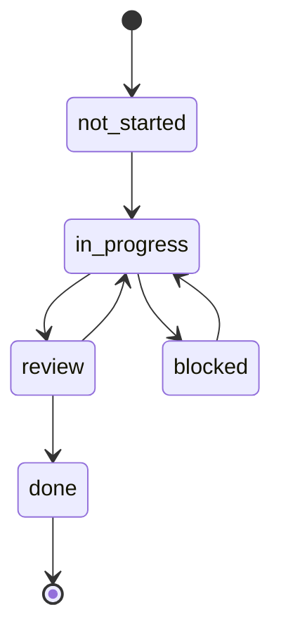

# Процес роботи

Цей розділ описує, як у репозиторії організовано роботу людей і агентів: як обрати фічу, де зберігається її стан, коли вона вважається завершеною і що оновити в документації. Правила взято з [`AGENTS.md`](https://github.com/Blazheiko/vibe-template/blob/main/AGENTS.md).

::: info Шукаєте, як зробити з шаблону свій продукт?
Ця сторінка описує процес роботи в репозиторії шаблону. Як перейменувати шаблон, змінити інтерфейс і обрати інтеграції для власного проєкту, описано в розділі [Свій проєкт на шаблоні](/guide/your-project).
:::

## Старт сесії

Це стосується **реалізаційних** сесій. Аналіз, код-рев'ю і запитання лише читають: вони не обирають фічу, не змінюють статус і не роблять коммітів. Фічу зі статусом `not-started` ніколи не стартують за власною ініціативою.

1. Перевірити робоче дерево: `git branch --show-current` і `git status`. Не скидати, не stash-ити й не перезаписувати чужі зміни; якщо дерево брудне чужою роботою або треба перемикати гілку, використати окремий `git worktree`.
2. Прочитати [`feature_list.json`](https://github.com/Blazheiko/vibe-template/blob/main/feature_list.json) з `origin/main` (`git fetch`, потім `git show origin/main:feature_list.json`): копія на feature-гілці може бути застарілою. Знайти фічу, що відповідає запиту й у якої `owner` збігається з вами:
    - `in_progress`: ваша активна фіча, продовжувати її;
    - `review`: не додавати обсяг, лише відповідати на коментарі рев'ю на її гілці;
    - `blocked`: прочитати блокер у `progress.md` на гілці й повідомити про нього, продовжувати після розв'язання;
    - `not-started`: стартувати лише якщо запит цього вимагає і `dependencies` мають `done`; перевести в `in_progress` через PR у `main`, потім створити гілку й `progress.md`;
    - немає відповідної фічі: не розширювати обсяг, запропонувати новий запис `feat-XXX` через PR у `main`.
3. Перейти на гілку з поля `branch`. Файли стану цієї фічі лежать **на її гілці** в `feature-state/<feat-id>/` (`progress.md`, `session-handoff.md`). Після merge реалізації вони можуть недовго лежати в `main`; PR «Mark feat-XXX done» видаляє лише каталог `feature-state/<feat-id>/` цієї фічі, а докази лишаються в полі `evidence` у `feature_list.json`.
4. Прочитати `progress.md`: стан минулої сесії, блокери, «Notes for Next Session». Якщо сесія продовжується, прочитати також `session-handoff.md`.
5. Запустити [`./init.sh`](https://github.com/Blazheiko/vibe-template/blob/main/init.sh). Це обгортка над `make init`: `pnpm install`, збірка `shared`, `make check` (`verify-makefile`, `verify-compose`, `format:check`, `typecheck`, `lint`, `check-bundle-graph`, `test`, ті самі кроки, що в CI) і `pnpm build`. Зупиняється на першій помилці. Якщо він падає, записати збій (команда і вивід) у `progress.md`; далі або виправити його, якщо виправлення baseline і є запитом, або зупинитися й повідомити. Не будувати фічі на червоному baseline. Сесії читання й рев'ю `init.sh` не запускають. Решта команд: [Команди make](/reference/make).
6. Кожен owner веде одну фічу за раз. Нова робота оформлюється новим записом у `feature_list.json` через PR у `main`, а не розширенням поточної фічі.

## `feature_list.json`

Файл канонічний на `main` і є єдиним джерелом правди про те, хто над чим працює. Його блок `schema` задає поля і допустимі статуси:

| Поле           | Зміст                                                      |
| -------------- | ---------------------------------------------------------- |
| `id`           | Ідентифікатор виду `feat-XXX`                              |
| `name`         | Назва фічі                                                 |
| `description`  | Опис, часто з посиланням на план у `docs/plan/`            |
| `owner`        | Людина або агент, відповідальні за фічу (рівно один)       |
| `branch`       | Гілка, де живе `feature-state/<feat-id>/`                  |
| `dependencies` | Список `id`, які мають бути `done` перед стартом           |
| `status`       | `not-started`, `in_progress`, `blocked`, `review`, `done`  |
| `evidence`     | Посилання на PR/коміт або вивід, що підтверджує завершення |

Рядок фічі редагує тільки її owner. Усі інші пропонують зміни через PR. Двоє людей не можуть ділити один рядок `in_progress`. Допомога з чужою фічею означає PR у її гілку, а не правки в її `feature-state/<feat-id>/progress.md`.

## Статуси

Кожен перехід статусу робиться окремим PR із короткоживучої coordination-гілки (не feature-гілки), що змінює `feature_list.json` на `main`; feature-гілка цей файл не редагує. Статус `blocked` дозволений, але причину треба записати в `progress.md` на гілці фічі.

У діаграмі `not_started` означає `not-started` (Mermaid не дозволяє дефіс в ідентифікаторі стану). `AGENTS.md` прямо називає лише ланцюжок `not-started → in_progress → review → done` і дозволяє `blocked`. Повернення з `review` і вихід із `blocked` показано як очевидні сценарії, окремих правил для них немає.

Залежності обов'язкові: фічу не можна починати, поки її `dependencies` не мають статусу `done`. Якщо почати треба раніше, залежність виділяють в окрему меншу `feat-XXX` і закривають першою.

## Definition of Done

Життєвий цикл: перевірки й evidence → статус `review` → рев'ю → merge реалізаційного PR → окремий PR «Mark feat-XXX done». Фіча готова до `review`, коли в `feature-state/<feat-id>/progress.md` у розділі **Evidence of Completion** записано:

- `make check` без помилок (збірка `shared`, перевірки Makefile і compose, `format:check`, `typecheck`, `lint`, bundle graph, `test`);
- перевірки за областю змін: `pnpm --filter frontend test:e2e` для UI, `make test-e2e-landing` для лендінгу, `make test-pg` / `make test-redis` для коду БД чи Redis у backend, `pnpm docs:build && pnpm docs:verify` для документації;
- для PG і Redis: вивід тестів із кількістю виконаних і пропущених перевірок або посилання на успішний CI job (`test-pg` у `pg-tests.yml`, `test-redis` у `redis-tests.yml`): набори пропускаються без `PG_TEST_URL` / `REDIS_TEST_URL`, тож запущені сервіси чи зелений `pnpm test` нічого не доводять;
- описано ручну перевірку golden path.

**Закриття фічі.** Після рев'ю та merge реалізаційного PR окремий PR «Mark feat-XXX done» переводить рядок у `feature_list.json` у `done`, записує постійні докази (посилання на CI run чи коміт, вивід тестів) у `evidence` і видаляє `feature-state/<feat-id>/`.

Рев'юер перевіряє блок evidence у `progress.md` гілки перед тим, як схвалити merge. Команди описано в розділі [Скрипти](/reference/scripts), тести в розділі [Тестування](/backend/testing).

## Кінець сесії

Це стосується лише реалізаційних сесій і лише ваших власних змін у межах активної фічі. Закомітити і запушити гілку фічі з оновленим `progress.md` (поточний стан, змінені файли, наступний крок). Якщо робота не закінчена, заповнити `session-handoff.md`, щоб наступна сесія стартувала без втрат. Сесії аналізу й рев'ю не роблять коммітів. Якщо push недоступний, залишити коміт локально й повідомити причину.

## Гілки, коміти, PR

- Гілка фічі вказана в `branch`. У поточній історії використовуються префікси на кшталт `feat/…` та `docs/…` (наприклад `feat/vitepress-docs`). Окремого правила іменування в `AGENTS.md` немає.
- Коміти пишуться коротко, із наміром на першому місці. Корисні трейлери: `Tested: pnpm test` або `Not-tested: requires production credentials`.
- PR описує зміну, виконану перевірку, пов'язані issue, а для видимих змін фронтенду додає скриншоти або запис екрана.

## Документація

Сайт у `documentation/` публікується на GitHub Pages з `main` через [`.github/workflows/docs.yml`](https://github.com/Blazheiko/vibe-template/blob/main/.github/workflows/docs.yml).

- Якщо змінюється публічна поведінка бекенду (маршрут, змінна оточення, middleware, міграція або схема БД), відповідну сторінку в `documentation/backend/` оновлюють у тому ж PR. Наприклад: [Маршрутизація](/backend/routing), [Конфігурація](/backend/configuration), [База даних](/backend/database).
- Сторінки пишуться з коду, з посиланнями на джерела на GitHub. Те, що ще не реалізовано, позначають `::: warning План`. Для секретів використовують плейсхолдери.
- Сайт двомовний: українська сторінка `documentation/<path>.md` і англійська `documentation/en/<path>.md` змінюються в одному PR. Нову сторінку додають у sidebar обох локалей у [`documentation/.vitepress/config.ts`](https://github.com/Blazheiko/vibe-template/blob/main/documentation/.vitepress/config.ts) і в `KEY_PAGES` та `EN_KEY_PAGES` у [`documentation/scripts/verify-dist.mjs`](https://github.com/Blazheiko/vibe-template/blob/main/documentation/scripts/verify-dist.mjs).
- Якщо сторінка використовує `<!--@include-->`, шлях до джерела має бути в `paths` у `docs.yml`.
- Перед merge запускають `pnpm docs:build && pnpm docs:verify`.

## Беклог наступних фіч

Проблеми в коді, знайдені під час написання документації, зібрано в [`docs/plan/code-issues-found-during-docs.md`](https://github.com/Blazheiko/vibe-template/blob/main/docs/plan/code-issues-found-during-docs.md). Це джерело для майбутніх записів `feat-XXX`: кожен пункт, який вирішили виправляти, оформлюють новим рядком у `feature_list.json` через PR у `main`.
